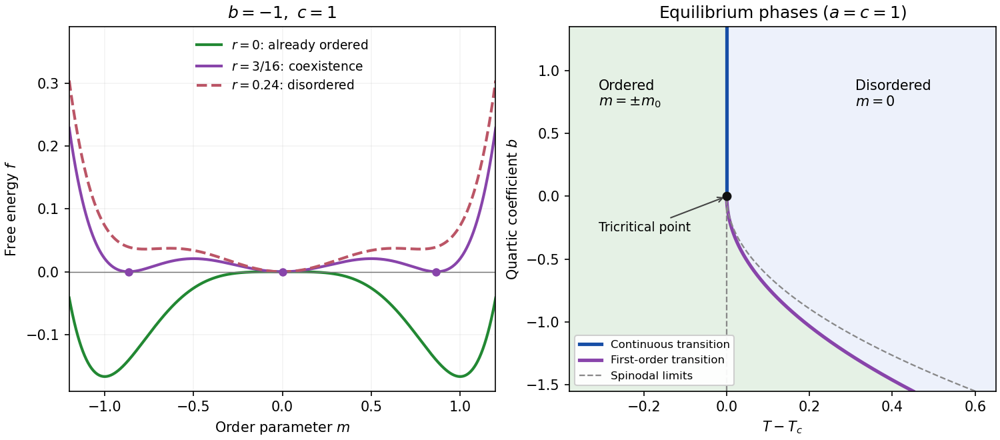

<h1 id="4/c/solution">Solution</h1>

↑ **Parent:** [C](../c.md)

For $b<0$ at $T=T_c$, the quartic term lowers the [free energy](../../../../thermodynamic-free-energy.md) near $m=0$, while the positive sextic term stabilizes it at larger $|m|$. The nonzero stationary points have

$$
\boxed{m^2=-\frac bc,\qquad f(m)=\frac{b^3}{6c^2}<0.}
$$

They are [global minima](../../../../global-minimum.md). The stationary point $m=0$ has zero quadratic curvature but is a flat local maximum because its leading nonzero term is negative. Thus the system is already ordered at $T_c$, with a finite [magnetization](../../../../magnetization.md).

More explicitly, a continuous onset from $m=0$ could occur only where $f''(0)=2r$ vanishes, namely at $r=0$. But the global minima there are the finite values above. For sufficiently large positive $r$, only $m=0$ is stable. Therefore the equilibrium minimum must change at some positive $r$ by crossing between a zero and a finite nonzero [order parameter](../../../../order-parameter.md). This is a [first-order phase transition](../../../../first-order-phase-transition.md). Its actual temperature lies above $T_c$ and is calculated next; $T_c$ itself is the disordered [spinodal point](../../../../spinodal-point.md), not the coexistence temperature.

**[Figure 2](#4/c/image-free-energy-coexistence-and-the-continuous-and-first-order-landau-transition-lines). Free-energy coexistence and the continuous and first-order Landau transition lines**. Original plots. The left panel uses $b=-1,c=1$ at $r=0$, at coexistence $r=3/16$, and above coexistence $r=0.24$. The right panel uses $a=c=1$ and shows the equilibrium phase boundaries in the $(T-T_c,b)$ plane. Dashed gray curves are spinodal limits, not additional equilibrium transitions.

## ↑ Ancestors (14)

1. [C](../c.md)
2. [4](../../4.md)
3. [2019](../../../2019-split.md)
4. [Past exam of the theoretical physics I course of the University of Cambridge](../../../split.md)
5. [Theoretical Physics I course of the University of Cambridge](../../../../theoretical-physics-i-course-of-the-university-of-cambridge.md)
6. [Theoretical Physics course of the University of Cambridge](../../../../theoretical-physics-course-of-the-university-of-cambridge.md)
7. [Physics course of the year 3 of the natural sciences course of the University of Cambridge](../../../../physics-course-of-the-year-3-of-the-natural-sciences-course-of-the-university-of-cambridge.md)
8. [Year 3 of the natural sciences course of the University of Cambridge](../../../../year-3-of-the-natural-sciences-course-of-the-university-of-cambridge.md)
9. [Year of the natural sciences course of the University of Cambridge](../../../../year-of-the-natural-sciences-course-of-the-university-of-cambridge.md)
10. [Natural sciences course of the University of Cambridge](../../../../natural-sciences-course-of-the-university-of-cambridge.md)
11. [Course of the University of Cambridge](../../../../course-of-the-university-of-cambridge.md)
12. [University of Cambridge](../../../../university-of-cambridge-split.md)
13. [List of universities](../../../../list-of-universities.md)
14. [Codex Wiki](../../../../split.md)
