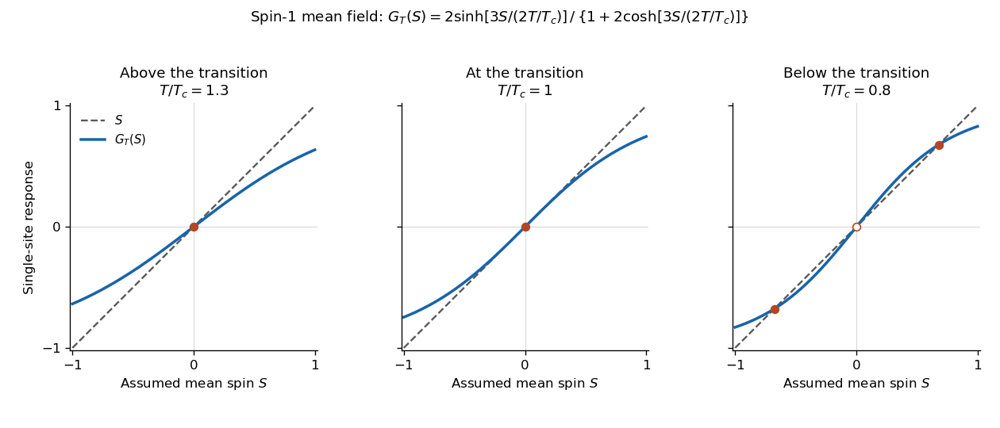

<h1 id="3/d/solution">Solution</h1>

↑ **Parent:** [D](../d.md)

At zero field, write the right-hand side of the [self-consistency equation](../../../../self-consistency-equation.md) as $G_T(S)=g(4\beta JS)$, with $g(x)=2\sinh x/[1+2\cosh x]$. The origin is always a solution, and the slope there is

$$
G_T'(0)=4\beta J\,g'(0)=\frac{8\beta J}{3}.
$$

The critical crossing occurs when this equals one, giving

$$
\boxed{k_BT_c=\frac{8J}{3},\qquad T_c=\frac{8J}{3k_B}.}
$$

This is a [continuous phase transition](../../../../continuous-phase-transition.md) in the [mean-field approximation](../../../../mean-field-approximation.md). For $x>0$,

$$
g''(x)=-\frac{2(7+2\cosh x)\sinh x}{(1+2\cosh x)^3}<0,
$$

so the positive branch is a [strictly concave](../../../../strictly-concave-function.md) function, while $g$ is odd and bounded by one. For $T\geq T_c$, the slope at zero is at most one and [strict concavity](../../../../strict-concavity.md) puts $G_T(S)$ below $S$ for every $S>0$, leaving only the unmagnetized solution. For $T<T_c$, it initially lies above $S$ but has $G_T(1)<1$; hence there is one positive intersection and, by [spin inversion symmetry](../../../../spin-inversion-symmetry.md), one negative intersection.

The curvature of the [Helmholtz free energy](../../../../helmholtz-free-energy.md) in the [mean-field approximation](../../../../mean-field-approximation.md) is $4J[1-G_T'(S)]$ per site. It is negative at $S=0$ below $T_c$ and positive at the nonzero intersections, identifying the ordered minima and the unstable zero solution.

**[Figure 1](#3/d/image-the-self-consistency-equation-develops-two-nonzero-order-parameter-branches-below-the-mean-field-critical-temperature). The self-consistency equation develops two nonzero order parameter branches below the mean-field critical temperature**.

The [critical temperature](../../../../critical-temperature.md) and branches here belong to the [mean-field approximation](../../../../mean-field-approximation.md). In the exact finite system, [spin inversion symmetry](../../../../spin-inversion-symmetry.md) forces zero average [magnetization](../../../../magnetization.md) at zero field; selecting a broken-symmetry phase requires the [thermodynamic limit](../../../../thermodynamic-limit.md) with a vanishing field of specified sign.

## ↑ Ancestors (14)

1. [D](../d.md)
2. [3](../../3.md)
3. [2022](../../../2022-split.md)
4. [Past exam of the theoretical physics I course of the University of Cambridge](../../../split.md)
5. [Theoretical Physics I course of the University of Cambridge](../../../../theoretical-physics-i-course-of-the-university-of-cambridge.md)
6. [Theoretical Physics course of the University of Cambridge](../../../../theoretical-physics-course-of-the-university-of-cambridge.md)
7. [Physics course of the year 3 of the natural sciences course of the University of Cambridge](../../../../physics-course-of-the-year-3-of-the-natural-sciences-course-of-the-university-of-cambridge.md)
8. [Year 3 of the natural sciences course of the University of Cambridge](../../../../year-3-of-the-natural-sciences-course-of-the-university-of-cambridge.md)
9. [Year of the natural sciences course of the University of Cambridge](../../../../year-of-the-natural-sciences-course-of-the-university-of-cambridge.md)
10. [Natural sciences course of the University of Cambridge](../../../../natural-sciences-course-of-the-university-of-cambridge.md)
11. [Course of the University of Cambridge](../../../../course-of-the-university-of-cambridge.md)
12. [University of Cambridge](../../../../university-of-cambridge-split.md)
13. [List of universities](../../../../list-of-universities.md)
14. [Codex Wiki](../../../../split.md)
