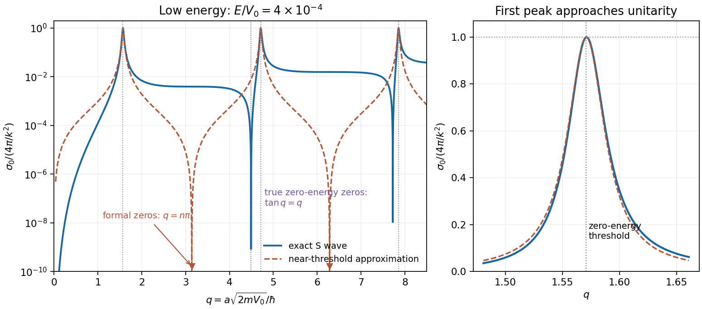

# Paper 1

↑ **Parent:** [2012](../2012.md)

Original source: [physical PDF pages 237–241; paper pages 1–5](https://www.whatdotheyknow.com/request/natural_science_tripos_physics_e_2/response/2340776/attach/2/FOI%202023%20399%20Zahid%20materials.pdf?cookie_passthrough=1). All six optional questions are answered.

**Table of contents**

- [1](#1)
  - [a](#1/a)
    - [Solution](#1/a/solution)
  - [b](#1/b)
    - [Solution](#1/b/solution)
  - [c](#1/c)
    - [Solution](#1/c/solution)
  - [d](#1/d)
    - [Solution](#1/d/solution)
  - [e](#1/e)
    - [Solution](#1/e/solution)
- [2](#2)
  - [a](#2/a)
    - [Solution](#2/a/solution)
  - [b](#2/b)
    - [Solution](#2/b/solution)
  - [c](#2/c)
    - [Solution](#2/c/solution)
  - [d](#2/d)
    - [Solution](#2/d/solution)
  - [e](#2/e)
    - [Solution](#2/e/solution)
- [3](#3)
  - [a](#3/a)
    - [Solution](#3/a/solution)
  - [b](#3/b)
    - [Solution](#3/b/solution)
  - [c](#3/c)
    - [Solution](#3/c/solution)
  - [d](#3/d)
    - [Solution](#3/d/solution)
- [4](#4)
  - [a](#4/a)
    - [Solution](#4/a/solution)
  - [b](#4/b)
    - [Solution](#4/b/solution)
  - [c](#4/c)
    - [Solution](#4/c/solution)
- [5](#5)
  - [a](#5/a)
    - [Solution](#5/a/solution)
  - [b](#5/b)
    - [Solution](#5/b/solution)
  - [c](#5/c)
    - [Solution](#5/c/solution)
  - [d](#5/d)
    - [Solution](#5/d/solution)
- [6](#6)
  - [a](#6/a)
    - [Solution](#6/a/solution)
  - [b](#6/b)
    - [Solution](#6/b/solution)
  - [c](#6/c)
    - [Solution](#6/c/solution)
  - [d](#6/d)
    - [Solution](#6/d/solution)
  - [e](#6/e)
    - [Solution](#6/e/solution)

## 1

↑ **Parent:** [Paper 1](paper-1.md)

<h3 id="1/a">a</h3>

↑ **Parent:** [1](#1)

<h4 id="1/a/solution">Solution</h4>

↑ **Parent:** [A](#1/a)

For a differentiable family of invertible [linear operators](../../vector-space.md#linear-operator), differentiate the identity without changing the factor order:

$$
\frac{dA^{-1}}{d\lambda}A+A^{-1}\frac{dA}{d\lambda}=0.
$$

Multiplication on the right by $A^{-1}$ gives the [derivative of matrix inversion](../../multivariable-calculus.md#derivative-of-matrix-inversion),

$$
\boxed{\frac{dA^{-1}}{d\lambda}=-A^{-1}\frac{dA}{d\lambda}A^{-1}.}
$$

Commuting $A^{-1}$ past the [derivative](../../calculus.md#derivative) would generally be invalid.

<h3 id="1/b">b</h3>

↑ **Parent:** [1](#1)

<h4 id="1/b/solution">Solution</h4>

↑ **Parent:** [B](#1/b)

Take an [orthonormal basis](../../inner-product.md#orthonormal-basis) $\{|j\rangle\}$ and insert its [completeness relation](../../inner-product.md#resolution-of-the-identity):

$$
\operatorname{Tr}(|u\rangle\langle v|)
=\sum_j\langle j|u\rangle\langle v|j\rangle
=\langle v|\left(\sum_j|j\rangle\langle j|\right)|u\rangle
=\boxed{\langle v|u\rangle}.
$$

No normalization or [orthogonality](../../inner-product.md#orthogonal-vectors) of $u,v$ is required. This is the [trace](../../linear-algebra.md#matrix-trace) of a [rank-one operator](../../compact-operator.md#rank-one-operator); in a [Hilbert space](../../hilbert-space.md) the sum converges by the [Cauchy-Schwarz inequality](../../probability-and-statistics.md#cauchy-schwarz-inequality).

<h3 id="1/c">c</h3>

↑ **Parent:** [1](#1)

<h4 id="1/c/solution">Solution</h4>

↑ **Parent:** [C](#1/c)

In a finite-dimensional [basis](../../vector-space.md#basis), interchange the two finite sums:

$$
\operatorname{Tr}(AB)=\sum_{j,k}A_{jk}B_{kj}
=\sum_{k,j}B_{kj}A_{jk}
=\boxed{\operatorname{Tr}(BA)}.
$$

This [cyclic property of the trace](../../linear-algebra.md#cyclic-property-of-the-trace) does not assert $AB=BA$ or permit arbitrary reordering of three factors. For infinite-dimensional [linear operators](../../vector-space.md#linear-operator), the [traces](../../linear-algebra.md#matrix-trace) and rearrangements need hypotheses, for example one [trace-class operator](../../compact-operator.md#trace-class-operator) and one [bounded operator](../../topological-vector-space.md#continuous-linear-operator); an arbitrary pair of unbounded [linear operators](../../vector-space.md#linear-operator) is not covered.

<h3 id="1/d">d</h3>

↑ **Parent:** [1](#1)

<h4 id="1/d/solution">Solution</h4>

↑ **Parent:** [D](#1/d)

For real $\epsilon$, [unitarity](../../vector-space.md#unitary-operator) to first order gives

$$
I=U^\dagger U=(I-i\epsilon F^\dagger)(I+i\epsilon F)
=I+i\epsilon(F-F^\dagger)+O(\epsilon^2).
$$

Hence the generator of an [infinitesimal unitary transformation](../../vector-space.md#infinitesimal-unitary-transformation) obeys **$F=F^\dagger$**: it is [Hermitian](../../hilbert-space.md#hermitian-operator). More precisely, $U(\epsilon)=I+i\epsilon F+O(\epsilon^2)$ is a differentiable unitary family at the identity. The omitted second-order terms matter if $\epsilon$ is finite.

<h3 id="1/e">e</h3>

↑ **Parent:** [1](#1)

<h4 id="1/e/solution">Solution</h4>

↑ **Parent:** [E](#1/e)

Set $C(\beta)=[A,e^{-\beta B}]$. The [product rule](../../calculus.md#product-rule) gives

$$
C'+BC=[B,A]e^{-\beta B},\qquad C(0)=0.
$$

Multiplying by the [integrating factor](../../linear-ordinary-differential-equation.md#integrating-factor) $e^{\beta B}$ and integrating yields the [commutator of an operator with an exponential](../../linear-operator-theory.md#commutator-of-an-operator-with-an-exponential):

$$
\boxed{[A,e^{-\beta B}]
=e^{-\beta B}\int_0^\beta
e^{\lambda B}[B,A]e^{-\lambda B}\,d\lambda.}
$$

Equivalently, differentiate $e^{\beta B}Ae^{-\beta B}-A$ directly; its [derivative](../../calculus.md#derivative) is the integrand and it vanishes at zero. The argument is exact for finite [matrices](../../vector-space.md#matrix), and for [bounded operators](../../topological-vector-space.md#continuous-linear-operator) with their norm-convergent exponentials; unbounded [linear operators](../../vector-space.md#linear-operator) require an appropriate common domain.

## 2

↑ **Parent:** [Paper 1](paper-1.md)

<h3 id="2/a">a</h3>

↑ **Parent:** [2](#2)

<h4 id="2/a/solution">Solution</h4>

↑ **Parent:** [A](#2/a)

An ensemble of normalized [quantum states](../../quantum-system.md#quantum-state) with [probabilities](../../probability-theory.md#probability) $p_j$ is represented by the [density operator](../../density-matrix.md)

$$
\boxed{\rho=\sum_jp_j|\psi_j\rangle\langle\psi_j|,
\qquad p_j\ge0,\quad\sum_jp_j=1.}
$$

It determines every [observable](../../quantum-system.md#observable) [expectation value](../../quantum-system.md#expectation-value) through $\langle A\rangle=\operatorname{Tr}(\rho A)$. The ensemble decomposition need not be unique; the operator specifies the measurement statistics.

<h3 id="2/b">b</h3>

↑ **Parent:** [2](#2)

<h4 id="2/b/solution">Solution</h4>

↑ **Parent:** [B](#2/b)

Each term is a [Hermitian](../../hilbert-space.md#hermitian-operator) rank-one [projection](../../vector-space.md#projection-linear-algebra) and $p_j$ is real, so $\rho^\dagger=\rho$. Using the rank-one [trace](../../linear-algebra.md#matrix-trace),

$$
\operatorname{Tr}\rho=\sum_jp_j\langle\psi_j|\psi_j\rangle
=\sum_jp_j=\boxed{1}.
$$

The remaining admissibility condition follows from $\langle v|\rho|v\rangle=\sum_jp_j|\langle\psi_j|v\rangle|^2\ge0$: **$\rho$ is [positive semidefinite](../../quadratic-form.md#positive-semidefinite-matrix)**.

<h3 id="2/c">c</h3>

↑ **Parent:** [2](#2)

<h4 id="2/c/solution">Solution</h4>

↑ **Parent:** [C](#2/c)

A normalized [pure state](../../quantum-theory.md#pure-state) has $\rho=|\psi\rangle\langle\psi|$, and therefore

$$
\boxed{\rho^2=\rho,\qquad\operatorname{Tr}\rho^2=1.}
$$

Conversely, diagonalize a permissible [density operator](../../density-matrix.md). Its [eigenvalues](../../linear-operator-theory.md#eigenvalue) obey $0\le\lambda_j\le1$ and $\sum_j\lambda_j=1$, so

$$
1-\operatorname{Tr}\rho^2
=\sum_j\lambda_j(1-\lambda_j)\ge0.
$$

Equality requires every [eigenvalue](../../linear-operator-theory.md#eigenvalue) to be zero or one; exactly one is one. Thus the [idempotent matrix](../../function.md#idempotent-matrix) condition and [purity](../../density-matrix.md#purity-of-a-density-operator) one both characterize a [pure state](../../quantum-theory.md#pure-state). A [mixed state](../../density-matrix.md#mixed-state) has at least two positive [eigenvalues](../../linear-operator-theory.md#eigenvalue), **$\rho^2\ne\rho$ and $\operatorname{Tr}\rho^2<1$**. In [dimension](../../vector-space.md#dimension-vector-space) $d$ its [purity](../../density-matrix.md#purity-of-a-density-operator) is at least $1/d$.

<h3 id="2/d">d</h3>

↑ **Parent:** [2](#2)

<h4 id="2/d/solution">Solution</h4>

↑ **Parent:** [D](#2/d)

The given real symmetric [matrix](../../vector-space.md#matrix) is [Hermitian](../../hilbert-space.md#hermitian-operator) and has [trace](../../linear-algebra.md#matrix-trace) one. A [spectral decomposition](../../linear-operator-theory.md#spectral-decomposition) supplies its positivity without relying on diagonal entries alone:

$$
\rho=\frac34|v_1\rangle\langle v_1|
+\frac14|v_2\rangle\langle v_2|,\qquad
v_1=\frac{(2,1,1)^{\mathsf T}}{\sqrt6},\quad
v_2=\frac{(0,1,-1)^{\mathsf T}}{\sqrt2}.
$$

The remaining normalized [eigenvector](../../linear-operator-theory.md#eigenvector) is $(-1,1,1)^{\mathsf T}/\sqrt3$ with [eigenvalue](../../linear-operator-theory.md#eigenvalue) zero. Consequently the spectrum is **$\{3/4,1/4,0\}$**, every [eigenvalue](../../linear-operator-theory.md#eigenvalue) is nonnegative, and the [matrix](../../vector-space.md#matrix) is permissible. Its [purity](../../density-matrix.md#purity-of-a-density-operator) is $(3/4)^2+(1/4)^2=\boxed{5/8}$, so it is **mixed**.

<h3 id="2/e">e</h3>

↑ **Parent:** [2](#2)

<h4 id="2/e/solution">Solution</h4>

↑ **Parent:** [E](#2/e)

The original [Von Neumann entropy](../../von-neumann-entropy.md) depends on its [eigenvalues](../../linear-operator-theory.md#eigenvalue), with $0\log0$ defined by continuity:

$$
\boxed{\frac{S_{\rm before}}{k_B}
=-\frac34\log\frac34-\frac14\log\frac14
=2\log2-\frac34\log3
\simeq0.562335.}
$$

After [rank-one dephasing](../../quantum-measurement.md#rank-one-dephasing), the [eigenvalues](../../linear-operator-theory.md#eigenvalue) are the retained diagonal populations $1/2,1/4,1/4$, giving

$$
\boxed{\frac{S_{\rm after}}{k_B}=\frac32\log2\simeq1.039721,\qquad
\frac{\Delta S}{k_B}=\frac34\log3-\frac12\log2\simeq0.477386>0.}
$$

[dephasing](../../quantum-information-theory.md#dephasing-channel) removes coherences in the specified [basis](../../vector-space.md#basis), increasing the system's mixedness while preserving those measurement [probabilities](../../probability-theory.md#probability). It cannot be a closed-system [unitary transformation](../../vector-space.md#unitary-operator), since the [eigenvalues](../../linear-operator-theory.md#eigenvalue) change. The subsystem [entropy](../../entropy.md) increase does not by itself assert an increase in the [entropy](../../entropy.md) of a closed system plus its environment.

## 3

↑ **Parent:** [Paper 1](paper-1.md)

<h3 id="3/a">a</h3>

↑ **Parent:** [3](#3)

<h4 id="3/a/solution">Solution</h4>

↑ **Parent:** [A](#3/a)

The [canonical commutation relation](../../quantum-mechanics.md#canonical-commutation-relation) $[x',p']=i\hbar I$ and [hamiltonian](../../hamiltonian-mechanics.md#hamiltonian) $H'=p'^2/(2m)+m\omega^2x'^2/2$ give

$$
[H',x']=-\frac{i\hbar}{m}p',\qquad
[H',p']=i\hbar m\omega^2x'.
$$

Substitution in the [Heisenberg equation of motion](../../quantum-system.md#heisenberg-equation-of-motion) yields $\dot x'=p'/m$ and $\dot p'=-m\omega^2x'$. Differentiating once more gives the harmonic-oscillator equation for each operator. Its initial-value solution is

$$
\boxed{\begin{aligned}
x'(t)&=x'(0)\cos\omega t+\frac{p'(0)}{m\omega}\sin\omega t,\\
p'(t)&=p'(0)\cos\omega t-m\omega x'(0)\sin\omega t.
\end{aligned}}
$$

Differentiating these expressions at zero verifies both prescribed initial [derivatives](../../calculus.md#derivative). They also preserve $[x'(t),p'(t)]=i\hbar I$.

<h3 id="3/b">b</h3>

↑ **Parent:** [3](#3)

<h4 id="3/b/solution">Solution</h4>

↑ **Parent:** [B](#3/b)

The normalized initial [Gaussian wave packet](../../wave-function.md#gaussian-wave-packet) is real and even, so the integrands for $\langle x'\rangle_0$ and $\langle p'\rangle_0$ are odd. Its second [position](../../classical-mechanics.md#position) moment is the elementary [Gaussian integral](../../integral.md#gaussian-integral) $\langle x'^2\rangle_0=1/(2\alpha)$. Since $\partial_x\Psi=-\alpha x\Psi$ and $\partial_x^2\Psi=(\alpha^2x^2-\alpha)\Psi$,

$$
\langle p'^2\rangle_0
=\hbar^2\left(\alpha-\alpha^2\langle x'^2\rangle_0\right)
=\frac{\hbar^2\alpha}{2}.
$$

Moreover $\langle x'p'\rangle_0=i\hbar\alpha\langle x'^2\rangle_0=i\hbar/2$ and $\langle p'x'\rangle_0=-i\hbar/2$. Thus

$$
\boxed{\langle x'\rangle_0=\langle p'\rangle_0
=\langle x'p'+p'x'\rangle_0=0,\qquad
\langle x'^2\rangle_0=\frac1{2\alpha},\quad
\langle p'^2\rangle_0=\frac{\hbar^2\alpha}{2}.}
$$

<h3 id="3/c">c</h3>

↑ **Parent:** [3](#3)

<h4 id="3/c/solution">Solution</h4>

↑ **Parent:** [C](#3/c)

Square the operator solutions, retaining the symmetrized cross term rather than treating $x'(0)$ and $p'(0)$ as commuting variables. The initial symmetrized expectation vanishes, so

$$
\boxed{\begin{aligned}
\langle x'^2\rangle_t
&=\frac{\cos^2\omega t}{2\alpha}
+\frac{\hbar^2\alpha}{2m^2\omega^2}\sin^2\omega t,\\
\langle p'^2\rangle_t
&=\frac{\hbar^2\alpha}{2}\cos^2\omega t
+\frac{m^2\omega^2}{2\alpha}\sin^2\omega t.
\end{aligned}}
$$

The means remain zero. These are also the [variances](../../variance.md). Unless $\alpha=m\omega/\hbar$, the [Gaussian](../../probability-distribution.md#normal-distribution) state breathes: its [position](../../classical-mechanics.md#position) and [momentum](../../momentum.md) widths exchange periodically while the mean [energy](../../energy.md) remains constant.

<h3 id="3/d">d</h3>

↑ **Parent:** [3](#3)

<h4 id="3/d/solution">Solution</h4>

↑ **Parent:** [D](#3/d)

Introduce the [dimensionless](../../physics.md#dimensionless-quantity) width $s=\hbar\alpha/(m\omega)>0$. Multiplying the [variances](../../variance.md) gives

$$
\boxed{(\Delta x')_t^2(\Delta p')_t^2
=\frac{\hbar^2}{4}\left[
1+\frac14(s-s^{-1})^2\sin^2(2\omega t)\right]
\ge\frac{\hbar^2}{4}.}
$$

The minimum holds **at all times precisely when $\alpha=m\omega/\hbar$**, the oscillator ground-state width. For any other $\alpha$, it is still attained at the isolated quarter-period times $t=n\pi/(2\omega)$, including zero. At a fixed generic time, minimizing over $\alpha$ again selects $s=1$.

The excess product has a [covariance](../../variance.md#covariance) interpretation:

$$
C_{xp}(t)=\frac12\langle x'p'+p'x'\rangle_t
=\frac{\hbar}{4}(s-s^{-1})\sin2\omega t,\qquad
(\Delta x')^2(\Delta p')^2-C_{xp}^2=\frac{\hbar^2}{4}.
$$

Thus the [breathing Gaussian state in a harmonic oscillator](../../quantum-harmonic-oscillator.md#breathing-gaussian-state-in-a-harmonic-oscillator) saturates the [Robertson-Schrödinger uncertainty relation](../../quantum-theory.md#robertson-schrodinger-uncertainty-relation) throughout, even when its position-momentum product exceeds the lower bound in the [Heisenberg uncertainty principle](../../quantum-theory.md#heisenberg-uncertainty-relation).

## 4

↑ **Parent:** [Paper 1](paper-1.md)

<h3 id="4/a">a</h3>

↑ **Parent:** [4](#4)

<h4 id="4/a/solution">Solution</h4>

↑ **Parent:** [A](#4/a)

The [half-line square-root potential well](../../energy.md#half-line-square-root-potential-well) is confining for $a>0$, which is assumed here. The hard wall imposes $\psi(0)=0$ and the smooth [turning point](../../energy.md#turning-point) is $x_{\rm t}=(E/a)^2$. With $u=a\sqrt x/E$, the WKB [action](../../lagrangian-mechanics.md#action) becomes

$$
\int_0^{x_{\rm t}}k(x)\,dx
=\frac{2\sqrt{2m}E^{5/2}}{\hbar a^2}
\int_0^1u(1-u)^{1/2}\,du
=\frac{8\sqrt{2m}E^{5/2}}{15\hbar a^2}.
$$

The [hard-wall and soft-turning-point WKB quantization](../../analysis.md#hard-wall-and-soft-turning-point-wkb-quantization) condition therefore gives

$$
\boxed{E_n^{\rm WKB}
=\left[\frac{15\pi\hbar a^2}{8\sqrt{2m}}
\left(n+\frac34\right)\right]^{2/5},\qquad n=0,1,\ldots.}
$$

The coefficient $a$ here denotes the potential strength, not the [integration](../../integral.md) limit in the generic quantization formula.

The [WKB approximation](../../analysis.md#wkb-approximation) is reliable in the interior where $|k'|/k^2\ll1$, but fails near the soft [turning point](../../energy.md#turning-point) where $k\to0$; a connection formula supplies its phase. The hard wall also requires its [boundary condition](../../differential-equation.md#boundary-condition), and $V'=a/(2\sqrt x)$ makes the local slow-variation condition fail sufficiently close to zero. Higher-energy states have a larger [action](../../lagrangian-mechanics.md#action) relative to $\hbar$, with smaller relative endpoint regions, so the leading WKB spectrum is generally more reliable at large $n$ than for the [ground state](../../quantum-mechanics.md#ground-state).

<h3 id="4/b">b</h3>

↑ **Parent:** [4](#4)

<h4 id="4/b/solution">Solution</h4>

↑ **Parent:** [B](#4/b)

For $b>0$, the [exponential variational trial for a square-root half-line well](../../quantum-theory.md#exponential-variational-trial-for-a-square-root-half-line-well) satisfies the wall [boundary condition](../../differential-equation.md#boundary-condition) and has norm $\int_0^\infty x^2e^{-2bx}dx=1/(4b^3)$. [integration by parts](../../calculus.md#integration-by-parts) has no boundary term and gives

$$
\langle T\rangle
=\frac{\hbar^2}{2m}
\frac{\int_0^\infty(1-bx)^2e^{-2bx}dx}{1/(4b^3)}
=\frac{\hbar^2b^2}{2m}.
$$

The supplied [gamma integral](../../complex-analysis.md#gamma-integral) gives

$$
\langle V\rangle=\frac{15a}{16}\sqrt{\frac\pi2}\,b^{-1/2},\qquad
E(b)=\frac{\hbar^2b^2}{2m}
+\frac{15a}{16}\sqrt{\frac\pi2}\,b^{-1/2}.
$$

Setting $E'(b)=0$ yields the unique minimum,

$$
\boxed{b_*=\left(\frac{ma}{\hbar^2}\frac{15}{32}
\sqrt{\frac\pi2}\right)^{2/5}.}
$$

At the minimum $\langle V\rangle=4\langle T\rangle$, so the variational ground-state estimate is

$$
\boxed{E_{\rm var}=\frac{5\hbar^2b_*^2}{2m}
=1.876493\left(\frac{\hbar^2a^4}{2m}\right)^{1/5}.}
$$

The [energy](../../energy.md) diverges as $b\to0$ or $b\to\infty$, confirming that the stationary point minimizes the trial [energy](../../energy.md).

<h3 id="4/c">c</h3>

↑ **Parent:** [4](#4)

<h4 id="4/c/solution">Solution</h4>

↑ **Parent:** [C](#4/c)

Write $E_*=(\hbar^2a^4/(2m))^{1/5}$. Then **$E_0^{\rm WKB}=1.811694E_*$ and $E_{\rm var}=1.876493E_*$**. The [variational method](../../quantum-theory.md#variational-method) guarantees $E_0\le E_{\rm var}$, since the trial satisfies the wall condition and has finite [energy](../../energy.md). WKB gives no comparable upper-bound guarantee and is least controlled for the lowest state. The two estimates differ by about $3.6\%$ of the WKB value; their closeness is encouraging but does not prove that the exact [energy](../../energy.md) lies between them.

## 5

↑ **Parent:** [Paper 1](paper-1.md)

<h3 id="5/a">a</h3>

↑ **Parent:** [5](#5)

<h4 id="5/a/solution">Solution</h4>

↑ **Parent:** [A](#5/a)

Split the [time-evolution operator](../../quantum-system.md#time-evolution-operator) into $N$ factors with $\epsilon=T/N$, and insert $N-1$ [position](../../classical-mechanics.md#position) [completeness relations](../../inner-product.md#resolution-of-the-identity) between them. Each factor is evaluated by inserting [momentum](../../momentum.md) states normalized by $\langle x|p\rangle=(2\pi\hbar)^{-1/2}e^{ipx/\hbar}$:

$$
\begin{aligned}
\langle x_{j+1}|e^{-i\epsilon p^2/(2m\hbar)}|x_j\rangle
&=\int_{\mathbb R}\frac{dp}{2\pi\hbar}
\exp\left[\frac{ip(x_{j+1}-x_j)}{\hbar}
-\frac{i\epsilon p^2}{2m\hbar}\right]\\
&=\sqrt{\frac{m}{2\pi i\hbar\epsilon}}\,
\exp\left[\frac{im(x_{j+1}-x_j)^2}{2\hbar\epsilon}\right].
\end{aligned}
$$

Multiplying the $N$ kernels and integrating the intermediate [positions](../../classical-mechanics.md#position) produces the stated time-sliced [path integral](../../quantum-field-theory.md#path-integral), including its $N/2$ normalization power. For a [free particle](../../quantum-mechanics.md#free-particle) this [Gaussian](../../probability-distribution.md#normal-distribution) short-time kernel is exact, so the convolution identity already holds at finite $N$. Oscillatory [integrals](../../integral.md) are defined with a vanishing convergence regulator, consistently fixing the square-root phase.

<h3 id="5/b">b</h3>

↑ **Parent:** [5](#5)

<h4 id="5/b/solution">Solution</h4>

↑ **Parent:** [B](#5/b)

The exponent is $iS_N/\hbar$, where

$$
S_N=\sum_{j=0}^{N-1}\epsilon\,\frac m2
\left(\frac{x_{j+1}-x_j}{\epsilon}\right)^2
$$

is the classical [action](../../lagrangian-mechanics.md#action) of the piecewise-linear interpolating path. For smooth paths its limit is $S=\int_0^T m\dot x^2\,dt/2$. The discretization defines the quantum [integral](../../integral.md); it does not assert that typical quantum paths are differentiable. Weighting histories by their [action](../../lagrangian-mechanics.md#action) phase is the central formulation of the original path-integral paper.[1948, abstract: amplitudes from histories weighted by the exponential of classical action in units of reduced Planck's constant](../../physics-bibliography.md#space-time-approach-to-non-relativistic-quantum-mechanics-by-richard-feynman)

When [action](../../lagrangian-mechanics.md#action) differences on the experimental scales are large compared with $\hbar$, nearby nonstationary phases cancel. [stationary phase](../../analysis.md#stationary-phase-method) selects $\delta S=0$ at fixed endpoints, hence $m\ddot x=0$. The surviving free classical trajectory is $x_{\rm cl}(t)=x_0+(x_T-x_0)t/T$, with [action](../../lagrangian-mechanics.md#action) $m(x_T-x_0)^2/(2T)$. This is the semiclassical mechanism; it does not mean each individual path becomes a classical path.

<h3 id="5/c">c</h3>

↑ **Parent:** [5](#5)

<h4 id="5/c/solution">Solution</h4>

↑ **Parent:** [C](#5/c)

The [Fresnel convolution of free-particle time slices](../../quantum-system.md#fresnel-convolution-of-free-particle-time-slices) follows by completing the square:

$$
\frac{(x_k-x_0)^2}{k}+(x_{k+1}-x_k)^2
=\frac{k+1}{k}\left(x_k-\frac{x_0+kx_{k+1}}{k+1}\right)^2
+\frac{(x_{k+1}-x_0)^2}{k+1}.
$$

The second term is independent of $x_k$. The shifted [Fresnel integral](../../fourier-transform.md#fresnel-integral) in the first term gives

$$
\boxed{\sqrt{\frac{2\pi i\hbar\epsilon}{m}\frac{k}{k+1}}\,
\exp\left[\frac{im(x_{k+1}-x_0)^2}
{2\hbar\epsilon(k+1)}\right].}
$$

Here $k$ is the positive slice index, not a [wave number](../../wave-equation.md#wavenumber). The phase is fixed by the same convergence prescription as the short-time kernel.

<h3 id="5/d">d</h3>

↑ **Parent:** [5](#5)

<h4 id="5/d/solution">Solution</h4>

↑ **Parent:** [D](#5/d)

After integrating $x_1,\ldots,x_{N-1}$, the remaining exponent contains $(x_T-x_0)^2/N$. The square-root factors telescope:

$$
\begin{aligned}
&\left(\frac{m}{2\pi i\hbar\epsilon}\right)^{N/2}
\prod_{k=1}^{N-1}
\left(\frac{2\pi i\hbar\epsilon}{m}\frac{k}{k+1}\right)^{1/2}\\
&\hspace{2em}
=\sqrt{\frac{m}{2\pi i\hbar\epsilon}}\,
\sqrt{\frac1N}
=\sqrt{\frac{m}{2\pi i\hbar T}}.
\end{aligned}
$$

Since $N\epsilon=T$, the [free-particle propagator](../../quantum-system.md#free-particle-propagator) is

$$
\boxed{K(x_T,x_0;T)=
\sqrt{\frac{m}{2\pi i\hbar T}}\,
\exp\left[\frac{im(x_T-x_0)^2}{2\hbar T}\right].}
$$

For $T>0$, the square root has phase $e^{-i\pi/4}$. Its short-time limit is the [position](../../classical-mechanics.md#position) delta function in the distributional sense, consistent with unitary evolution.

## 6

↑ **Parent:** [Paper 1](paper-1.md)

<h3 id="6/a">a</h3>

↑ **Parent:** [6](#6)

<h4 id="6/a/solution">Solution</h4>

↑ **Parent:** [A](#6/a)

A [scattering phase shift](../../quantum-scattering.md#scattering-phase-shift) measures the change of a [partial wave](../../quantum-scattering.md#partial-wave)'s outgoing phase relative to the free radial solution. For a real [central potential](../../energy.md#central-potential) and [elastic scattering](../../quantum-scattering.md#elastic-scattering), [probability](../../probability-theory.md#probability) conservation gives a unit-modulus [Partial-wave S-matrix](../../quantum-scattering.md#partial-wave-s-matrix) $S_l=e^{2i\delta_l}$. Indeed

$$
e^{i\delta_l}\sin(z+\delta_l)
=\frac{e^{2i\delta_l}e^{iz}-e^{-iz}}{2i},
\qquad z=kr-l\pi/2,
$$

so the incoming amplitude is unchanged and the outgoing one acquires $S_l$.

Expanding an incident [plane wave](../../wave-function.md#plane-wave) in [Legendre polynomials](../../linear-ordinary-differential-equation.md#legendre-polynomial) and comparing the outgoing [spherical wave](../../wave.md#spherical-wave) gives

$$
f(\theta)=\frac1k\sum_{l=0}^\infty
(2l+1)e^{i\delta_l}\sin\delta_l\,P_l(\cos\theta).
$$

Use $d\sigma/d\Omega=|f|^2$ and $\int d\Omega\,P_lP_{l'}=4\pi\delta_{ll'}/(2l+1)$ to remove cross terms:

$$
\boxed{\sigma=\frac{4\pi}{k^2}
\sum_{l=0}^\infty(2l+1)\sin^2\delta_l.}
$$

This is the elastic total [scattering cross-section](../../quantum-scattering.md#scattering-cross-section) for the one-particle central-potential problem, with no identical-particle symmetrization factor.

<h3 id="6/b">b</h3>

↑ **Parent:** [6](#6)

<h4 id="6/b/solution">Solution</h4>

↑ **Parent:** [B](#6/b)

For $l=0$, put $u(r)=rR_0(r)$. The radial [Schrödinger equation](../../mathematical-physics.md#schrodinger-equation) reduces to $u''+k'^2u=0$ inside and $u''+k^2u=0$ outside, where $k'^2=2m(E+V_0)/\hbar^2$ and $k^2=2mE/\hbar^2$. Regularity at the origin requires $u(0)=0$, excluding the inner cosine. A real outer sine-cosine combination can be written with an amplitude and a [phase shift](../../wave.md#phase-shift):

$$
\boxed{R_0(r)=
\begin{cases}
A\,\sin(k'r)/r,&0r\le a,\\
B\,\sin(kr+\delta_0)/r,&ra.
\end{cases}}
$$

The inner expression has the finite limiting value $Ak'$ at the origin. An overall complex normalization can carry the asymptotic phase convention of part a.

<h3 id="6/c">c</h3>

↑ **Parent:** [6](#6)

<h4 id="6/c/solution">Solution</h4>

↑ **Parent:** [C](#6/c)

At a finite potential step, both $u$ and $u'$ are continuous:

$$
A\sin(k'a)=B\sin(ka+\delta_0),\qquad
Ak'\cos(k'a)=Bk\cos(ka+\delta_0).
$$

Taking the [logarithmic derivative](../../analytic-number-theory.md#logarithmic-derivative) eliminates the amplitudes:

$$
\boxed{k'a\cot(k'a)=ka\cot(ka+\delta_0).}
$$

At a zero of a denominator, the original two matching equations provide the continuous limiting condition.

<h3 id="6/d">d</h3>

↑ **Parent:** [6](#6)

<h4 id="6/d/solution">Solution</h4>

↑ **Parent:** [D](#6/d)

Write $\kappa=\sqrt{2mV_0}/\hbar$ and $q=\kappa a$. At low [energy](../../energy.md), the $S$ wave normally dominates. Under the additional stated near-resonance assumption $ka\ll|\delta_0|$, neglect $ka$ inside the cotangent of the matching condition and set $k'\simeq\kappa$:

$$
k\cot\delta_0\simeq\kappa\cot q,\qquad
\sin^2\delta_0\simeq
\frac{k^2}{k^2+\kappa^2\cot^2q}.
$$

Substitution in $\sigma_0=4\pi\sin^2\delta_0/k^2$ gives

$$
\boxed{\sigma_{\rm res}\simeq
\frac{2\pi\hbar^2}{m}\,
\frac1{E+V_0\cot^2(\sqrt{2mV_0}\,a/\hbar)}.}
$$

This is a [near-resonance square-well approximation](../../quantum-mechanics.md#near-resonance-square-well-approximation), not a uniform formula for every well radius. A [phase shift](../../wave.md#phase-shift) is defined modulo $\pi$; its representative must be chosen consistently when applying the comparison with $ka$.

<h3 id="6/e">e</h3>

↑ **Parent:** [6](#6)

<h4 id="6/e/solution">Solution</h4>

↑ **Parent:** [E](#6/e)

For small fixed positive $E$, the stated approximate curve has maxima at

$$
\boxed{\kappa a=\left(n+\frac12\right)\pi,\qquad
\sigma_{\rm res,max}=\frac{2\pi\hbar^2}{mE}=\frac{4\pi}{k^2},
\quad n=0,1,\ldots.}
$$

Its formal minima are zero at $\kappa a=n\pi$. The peak height is the $S$-wave [unitarity](../../vector-space.md#unitary-operator) limit, and the peaks narrow as $E/V_0$ decreases.

**[Figure 1](#6/e/image-square-well-resonance-limits). Square-well resonance limits**.

To identify the bound-state threshold, let the bound-state [energy](../../energy.md) be $-\varepsilon$ with $\varepsilon>0$. The reduced radial wave is proportional to $\sin(Kr)$ inside and $e^{-\chi r}$ outside, with $K=\sqrt{2m(V_0-\varepsilon)}/\hbar$ and $\chi=\sqrt{2m\varepsilon}/\hbar$. Matching gives $K\cot(Ka)=-\chi$. As a new [bound state](../../quantum-system.md#bound-state) emerges at $\varepsilon\downarrow0$,

$$
\boxed{\kappa\cot(\kappa a)=0
\ \Longrightarrow\
\kappa a=\left(n+\frac12\right)\pi.}
$$

Thus the limiting peak locations coincide with the appearance of successive **$S$-wave [bound states](../../quantum-system.md#bound-state)**. At the exact threshold the zero-energy radial solution is not [square-integrable](../../measure-theory.md#square-integrable-function); a [normalizable](../../wave-function.md#normalizable-wavefunction) [bound state](../../quantum-system.md#bound-state) appears just beyond it. Finite-energy maxima shift slightly from the zero-energy [positions](../../classical-mechanics.md#position).

The formal minima require care because the assumption used in part d fails there. Retaining $ka$ in the exact matching condition gives the [spherical square-well scattering length](../../quantum-mechanics.md#spherical-square-well-scattering-length)

$$
a_s=a-\frac{\tan(\kappa a)}{\kappa},\qquad
\sigma_0\longrightarrow4\pi a_s^2
$$

away from a threshold. At $\kappa a=n\pi$, $a_s=a$, so the true low-energy [S-wave scattering](../../quantum-scattering.md#s-wave-quantum-scattering) contribution is $4\pi a^2$, not zero. Genuine leading-order zeros of that contribution instead satisfy $\tan q=q$, for example $q\simeq4.493409$ and $7.725252$. The original sketch compares the exact finite-energy $S$ wave with the requested approximation, making this nonuniformity visible. Dominance by the $S$ wave must be checked separately near a higher-partial-wave threshold. The scattering-length divergence and its bound-state interpretation are also derived in institutional lecture notes.[2017, §6.2.6, printed pp. 219–222: square-well matching, scattering length and threshold bound states](../../physics-bibliography.md#topics-in-quantum-mechanics-by-david-tong)

## ↑ Ancestors (12)

1. [2012](../2012.md)
2. [Past exam of the theoretical physics II course of the University of Cambridge](../../past-exam-of-the-theoretical-physics-ii-course-of-the-university-of-cambridge.md)
3. [Theoretical Physics II course of the University of Cambridge](../../university-of-cambridge.md#theoretical-physics-ii-course-of-the-university-of-cambridge)
4. [Theoretical Physics course of the University of Cambridge](../../university-of-cambridge.md#theoretical-physics-course-of-the-university-of-cambridge)
5. [Physics course of the year 3 of the natural sciences course of the University of Cambridge](../../university-of-cambridge.md#physics-course-of-the-year-3-of-the-natural-sciences-course-of-the-university-of-cambridge)
6. [Year 3 of the natural sciences course of the University of Cambridge](../../university-of-cambridge.md#year-3-of-the-natural-sciences-course-of-the-university-of-cambridge)
7. [Year of the natural sciences course of the University of Cambridge](../../university-of-cambridge.md#year-of-the-natural-sciences-course-of-the-university-of-cambridge)
8. [Natural sciences course of the University of Cambridge](../../university-of-cambridge.md#natural-sciences-course-of-the-university-of-cambridge)
9. [Course of the University of Cambridge](../../university-of-cambridge.md#course-of-the-university-of-cambridge)
10. [University of Cambridge](../../university-of-cambridge.md)
11. [List of universities](../../README.md#list-of-universities)
12. [Codex Wiki](../../README.md)
