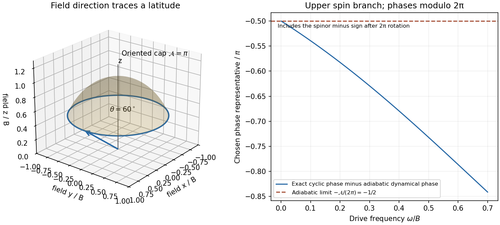

<h1 id="1/c/solution">Solution</h1>

↑ **Parent:** [C](../c.md)

Take $\omega>0$ and $T=2\pi/\omega$. A full [spin one-half](../../../../../spin-one-half.md) rotation gives $R(T)=-I$, an essential sign. The [cyclic phase of a spin in a rotating field](../../../../../cyclic-phase-of-a-spin-in-a-rotating-field.md) has factors and total [quantum phases](../../../../../quantum-phase.md)

$$
\boxed{e^{i\Phi_\pm}=-e^{\mp i\pi\Omega/\omega},\qquad
\Phi_\pm=\pi\mp\frac{\pi\Omega}{\omega}\pmod{2\pi}}.
$$

To separate the adiabatic [dynamical phase](../../../../../dynamical-phase.md), set $B=\sqrt{\Omega_0^2+\Omega_R^2}>0$ and $\cos\theta=\Omega_0/B$. Then $\Omega=B-\omega\cos\theta+O(\omega^2/B)$. The instantaneous laboratory energies are $\pm\hbar B/2$, so the adiabatic [dynamical phases](../../../../../dynamical-phase.md) are $\mp BT/2$. Subtracting them from $\Phi_\pm$ gives

$$
\boxed{\gamma_\pm=\mp\pi(1-\cos\theta)=\mp\frac{\mathcal A}{2}\pmod{2\pi},\qquad
\mathcal A=2\pi(1-\cos\theta)}.
$$

The oriented [solid angle](../../../../../solid-angle.md) $\mathcal A$ is swept out by the field direction. These are the [Berry phases](../../../../../berry-phase.md) for the [eigenstates](../../../../../eigenstate.md) parallel and antiparallel to that direction. Retaining the [spinor](../../../../../spinor.md) sign makes the [quantum phase](../../../../../quantum-phase.md) vanish modulo $2\pi$ when the field does not trace a nontrivial loop. The assumption $\omega\ll B$ suffices for adiabatic following; near degeneracy it must not be silently dropped.[Section 4, spinning particles in slowly changing magnetic fields](../../../../../quantal-phase-factors-accompanying-adiabatic-changes-by-michael-victor-berry.md)

**[Figure 1](#1/c/image-original-rotating-field-cone-and-convergence-of-the-exact-cyclic-phase-to-the-spin-one-half-geometric-phase). Original rotating-field cone and convergence of the exact cyclic phase to the spin-one-half geometric phase**.

## ↑ Ancestors (15)

1. [C](../c.md)
2. [1](../../1.md)
3. [Paper 1](../../../paper-1-split.md)
4. [2013](../../../split.md)
5. [Past exam of the theoretical physics II course of the University of Cambridge](../../../../split.md)
6. [Theoretical Physics II course of the University of Cambridge](../../../../../theoretical-physics-ii-course-of-the-university-of-cambridge.md)
7. [Theoretical Physics course of the University of Cambridge](../../../../../theoretical-physics-course-of-the-university-of-cambridge.md)
8. [Physics course of the year 3 of the natural sciences course of the University of Cambridge](../../../../../physics-course-of-the-year-3-of-the-natural-sciences-course-of-the-university-of-cambridge.md)
9. [Year 3 of the natural sciences course of the University of Cambridge](../../../../../year-3-of-the-natural-sciences-course-of-the-university-of-cambridge.md)
10. [Year of the natural sciences course of the University of Cambridge](../../../../../year-of-the-natural-sciences-course-of-the-university-of-cambridge.md)
11. [Natural sciences course of the University of Cambridge](../../../../../natural-sciences-course-of-the-university-of-cambridge.md)
12. [Course of the University of Cambridge](../../../../../course-of-the-university-of-cambridge.md)
13. [University of Cambridge](../../../../../university-of-cambridge-split.md)
14. [List of universities](../../../../../list-of-universities.md)
15. [Codex Wiki](../../../../../split.md)
