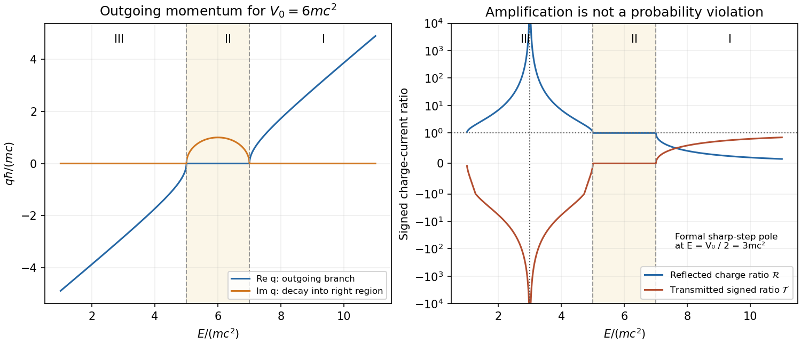

<h1 id="6/c/solution">Solution</h1>

↑ **Parent:** [C](../c.md)

Let $z=E-V_0+i0$. The [outgoing analytic branch of Klein-Gordon step momentum](../../../../../outgoing-analytic-branch-of-klein-gordon-step-momentum.md) is

$$
\boxed{q(z)=\frac{\sqrt{z-M}\sqrt{z+M}}{\hbar c}},
$$

where each [square root](../../../../../square-root.md) is continued from the [upper half-plane](../../../../../upper-half-plane-complex-analysis.md). It behaves as $z/(\hbar c)$ at large positive or negative real $z$. The [branch points](../../../../../branch-point.md) are $E=V_0\pm M$; replacing this product by a principal [square root](../../../../../square-root.md) of $z^2-M^2$ can choose the wrong sign below the lower threshold.

**I.** For $E-V_0>M$, $q>0$ and both transmitted [kinetic energy](../../../../../kinetic-energy.md) and [group velocity](../../../../../group-velocity.md) are positive. Thus $0\leq\mathcal R<1$ and $\mathcal T=4kq/(k+q)^2>0$; the transmission decreases to zero on approaching the upper threshold from above.

**II.** For $|E-V_0|<M$, write $q=i\kappa$ with $\kappa=\sqrt{M^2-(E-V_0)^2}/(\hbar c)>0$. The right wave decays, $r=(k-i\kappa)/(k+i\kappa)$ has modulus one, and $\mathcal T=0$. There is an evanescent tail but no [flux](../../../../../flux.md) transmitted to infinity. Its reflection [quantum phase](../../../../../quantum-phase.md) changes continuously between the two thresholds.

**III.** For $E-V_0<-M$, the [analytic continuation](../../../../../analytic-continuation.md) gives $q=-Q$, where $Q=\sqrt{(E-V_0)^2-M^2}/(\hbar c)>0$. The [group velocity](../../../../../group-velocity.md) $c^2\hbar q/(E-V_0)$ is again rightward, while the charge density and transmitted charge current are negative. Therefore

$$
\boxed{\mathcal R=\frac{(k+Q)^2}{(k-Q)^2}>1,\qquad
\mathcal T=-\frac{4kQ}{(k-Q)^2}<0,\qquad
\mathcal R+\mathcal T=1}.
$$

Choosing $q=+Q$ would describe a wavepacket arriving from the right, inconsistent with the chosen incoming channel. As the lower threshold is approached, $q\to0^-$ and $\mathcal R\to1$ from above. This [Klein-Gordon step amplification](../../../../../klein-gordon-step-amplification.md) has a real denominator zero at $E=V_0/2$ when $V_0>2M$: there $Q=k$, and no finite stationary solution with unit incoming amplitude satisfies both matching equations. The resulting formal pole must not be described as an infinite single-particle [probability](../../../../../probability.md). Finite switching, wavepackets and the treatment of the external source require a multiparticle analysis.[Equations 4.142–4.155: outgoing negative-momentum branch, boundary matching and charge currents](../../../../../klein-paradox-for-spin-0-particles-by-douglas-m-gingrich.md)

**[Figure 2](#6/c/image-original-outgoing-klein-gordon-momentum-branches-and-charge-current-reflection-for-a-supercritical-sharp-step). Original outgoing Klein-Gordon momentum branches and charge-current reflection for a supercritical sharp step**.

## ↑ Ancestors (15)

1. [C](../c.md)
2. [6](../../6.md)
3. [Paper 1](../../../paper-1-split.md)
4. [2013](../../../split.md)
5. [Past exam of the theoretical physics II course of the University of Cambridge](../../../../split.md)
6. [Theoretical Physics II course of the University of Cambridge](../../../../../theoretical-physics-ii-course-of-the-university-of-cambridge.md)
7. [Theoretical Physics course of the University of Cambridge](../../../../../theoretical-physics-course-of-the-university-of-cambridge.md)
8. [Physics course of the year 3 of the natural sciences course of the University of Cambridge](../../../../../physics-course-of-the-year-3-of-the-natural-sciences-course-of-the-university-of-cambridge.md)
9. [Year 3 of the natural sciences course of the University of Cambridge](../../../../../year-3-of-the-natural-sciences-course-of-the-university-of-cambridge.md)
10. [Year of the natural sciences course of the University of Cambridge](../../../../../year-of-the-natural-sciences-course-of-the-university-of-cambridge.md)
11. [Natural sciences course of the University of Cambridge](../../../../../natural-sciences-course-of-the-university-of-cambridge.md)
12. [Course of the University of Cambridge](../../../../../course-of-the-university-of-cambridge.md)
13. [University of Cambridge](../../../../../university-of-cambridge-split.md)
14. [List of universities](../../../../../list-of-universities.md)
15. [Codex Wiki](../../../../../split.md)
