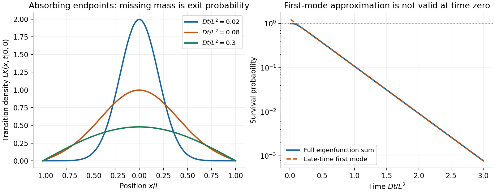

<h1 id="2/e/solution">Solution</h1>

↑ **Parent:** [E](../e.md)

The [survival probability from an absorbing transition density](../../../../../survival-probability-from-an-absorbing-transition-density.md) follows by integrating over final [position](../../../../../position.md). Since

$$
\int_{-L}^{L}\cos\frac{(2j+1)\pi x}{2L}\,dx
=\frac{4L(-1)^j}{(2j+1)\pi},
$$

the exact [survival probability](../../../../../survival-probability.md) for $t>0$ is

$$
S(t)=\frac4\pi\sum_{j=0}^{\infty}\frac{(-1)^j}{2j+1}
e^{-(2j+1)^2u},\qquad u=\frac{\pi^2Dt}{4L^2}.
$$

The slowest Dirichlet mode dominates at large [time](../../../../../time-in-physics.md):

$$
\boxed{S(t)\sim\frac4\pi\exp\!\left(-\frac{\pi^2Dt}{4L^2}\right).}
$$

The first relative correction is $-\tfrac13e^{-8u}$. The approximation is a late-time result; extrapolating its prefactor to $t=0$ would incorrectly give a [probability](../../../../../probability.md) larger than one. The full alternating series tends to one there.

**[Figure 1](#2/e/image-original-absorbing-interval-transition-densities-and-the-approach-of-the-survival-probability-to-its-slowest-mode-asymptote). Original absorbing-interval transition densities and the approach of the survival probability to its slowest-mode asymptote**.

## ↑ Ancestors (15)

1. [E](../e.md)
2. [2](../../2.md)
3. [Paper 1](../../../paper-1-split.md)
4. [2015](../../../split.md)
5. [Past exam of the theoretical physics II course of the University of Cambridge](../../../../split.md)
6. [Theoretical Physics II course of the University of Cambridge](../../../../../theoretical-physics-ii-course-of-the-university-of-cambridge.md)
7. [Theoretical Physics course of the University of Cambridge](../../../../../theoretical-physics-course-of-the-university-of-cambridge.md)
8. [Physics course of the year 3 of the natural sciences course of the University of Cambridge](../../../../../physics-course-of-the-year-3-of-the-natural-sciences-course-of-the-university-of-cambridge.md)
9. [Year 3 of the natural sciences course of the University of Cambridge](../../../../../year-3-of-the-natural-sciences-course-of-the-university-of-cambridge.md)
10. [Year of the natural sciences course of the University of Cambridge](../../../../../year-of-the-natural-sciences-course-of-the-university-of-cambridge.md)
11. [Natural sciences course of the University of Cambridge](../../../../../natural-sciences-course-of-the-university-of-cambridge.md)
12. [Course of the University of Cambridge](../../../../../course-of-the-university-of-cambridge.md)
13. [University of Cambridge](../../../../../university-of-cambridge-split.md)
14. [List of universities](../../../../../list-of-universities.md)
15. [Codex Wiki](../../../../../split.md)
