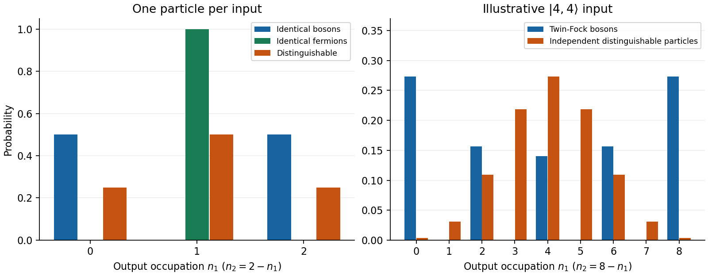

<h1 id="5/d/solution">Solution</h1>

↑ **Parent:** [D](../d.md)

The input squared norm is $(N!)^2$, so divide its stated expression by $N!$. Commutativity and the inverse channel transformation give the normalized output

$$
|\psi_{\rm out}\rangle=
\frac1{2^NN!}\left[(b_1^\dagger)^2-(b_2^\dagger)^2\right]^N|0\rangle.
$$

After the binomial expansion, the coefficient of $|2j,2N-2j\rangle$ is

$$
c_j=\frac{(-1)^{N-j}}{2^NN!}\binom Nj
\sqrt{(2j)!(2N-2j)!},\qquad 0\le j\le N.
$$

Hence every possible occupancy has even particle number in each port:

$$
\boxed{P(2j,2N-2j)=\frac1{4^N}\binom{2j}{j}
\binom{2N-2j}{N-j},\quad j=0,\ldots,N.}
$$

All other occupancies have zero [probability](../../../../../probability.md). The normalization identity

$$
\sum_{j=0}^N\binom{2j}{j}\binom{2N-2j}{N-j}=4^N
$$

follows by taking the coefficient of $z^N$ in $(1-4z)^{-1/2}(1-4z)^{-1/2}=(1-4z)^{-1}$. For $N=1$ it reduces to (c), and [symmetry](../../../../../symmetry-physics.md) under $j\leftrightarrow N-j$ gives equal mean occupancies in both outputs.

**[Figure 2](#5/d/image-original-balanced-splitter-occupations-for-two-particle-statistics-and-twin-fock-bosons-with-independent-distinguishable-particle-comparisons). Original balanced-splitter occupations for two-particle statistics and twin-Fock bosons, with independent distinguishable-particle comparisons**.

## ↑ Ancestors (15)

1. [D](../d.md)
2. [5](../../5.md)
3. [Paper 1](../../../paper-1-split.md)
4. [2015](../../../split.md)
5. [Past exam of the theoretical physics II course of the University of Cambridge](../../../../split.md)
6. [Theoretical Physics II course of the University of Cambridge](../../../../../theoretical-physics-ii-course-of-the-university-of-cambridge.md)
7. [Theoretical Physics course of the University of Cambridge](../../../../../theoretical-physics-course-of-the-university-of-cambridge.md)
8. [Physics course of the year 3 of the natural sciences course of the University of Cambridge](../../../../../physics-course-of-the-year-3-of-the-natural-sciences-course-of-the-university-of-cambridge.md)
9. [Year 3 of the natural sciences course of the University of Cambridge](../../../../../year-3-of-the-natural-sciences-course-of-the-university-of-cambridge.md)
10. [Year of the natural sciences course of the University of Cambridge](../../../../../year-of-the-natural-sciences-course-of-the-university-of-cambridge.md)
11. [Natural sciences course of the University of Cambridge](../../../../../natural-sciences-course-of-the-university-of-cambridge.md)
12. [Course of the University of Cambridge](../../../../../course-of-the-university-of-cambridge.md)
13. [University of Cambridge](../../../../../university-of-cambridge-split.md)
14. [List of universities](../../../../../list-of-universities.md)
15. [Codex Wiki](../../../../../split.md)
