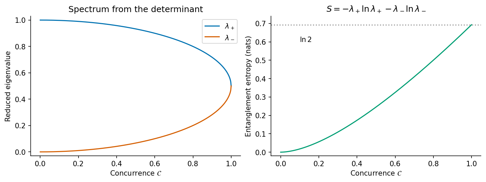
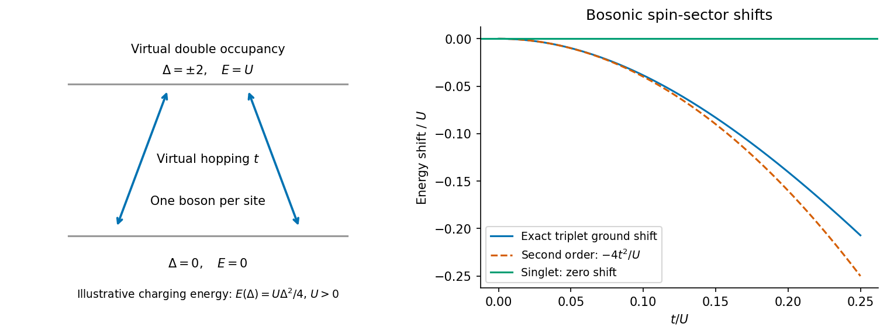
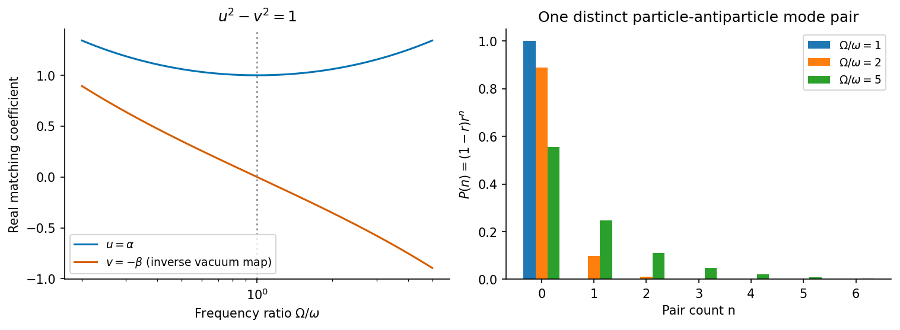

# Paper 1

↑ **Parent:** [2016](../2016.md)

Original paper: [Public original PDF, physical pages 421–426; question pages 422–426](https://www.whatdotheyknow.com/request/natural_science_tripos_physics_e_2/response/2340776/attach/2/FOI%202023%20399%20Zahid%20materials.pdf?cookie_passthrough=1#page=421).

**Table of contents**

- [1](#1)
  - [a](#1/a)
    - [Solution](#1/a/solution)
  - [b](#1/b)
    - [Solution](#1/b/solution)
  - [c](#1/c)
    - [Solution](#1/c/solution)
  - [d](#1/d)
    - [Solution](#1/d/solution)
  - [e](#1/e)
    - [Solution](#1/e/solution)
- [2](#2)
  - [a](#2/a)
    - [Solution](#2/a/solution)
  - [b](#2/b)
    - [Solution](#2/b/solution)
  - [c](#2/c)
    - [Solution](#2/c/solution)
  - [d](#2/d)
    - [Solution](#2/d/solution)
  - [e](#2/e)
    - [Solution](#2/e/solution)
- [3](#3)
  - [a](#3/a)
    - [Solution](#3/a/solution)
  - [b](#3/b)
    - [Solution](#3/b/solution)
  - [c](#3/c)
    - [Solution](#3/c/solution)
  - [d](#3/d)
    - [Solution](#3/d/solution)
  - [e](#3/e)
    - [Solution](#3/e/solution)
- [4](#4)
  - [a](#4/a)
    - [Solution](#4/a/solution)
  - [b](#4/b)
    - [Solution](#4/b/solution)
  - [c](#4/c)
    - [Solution](#4/c/solution)
  - [d](#4/d)
    - [Solution](#4/d/solution)
  - [e](#4/e)
    - [Solution](#4/e/solution)

## 1

↑ **Parent:** [Paper 1](paper-1.md)

<h3 id="1/a">a</h3>

↑ **Parent:** [1](#1)

<h4 id="1/a/solution">Solution</h4>

↑ **Parent:** [A](#1/a)

Take periodic orbital [wavefunctions](../../wave-function.md) on the ring, and write $H_0=-(\hbar^2/2I)\partial_\theta^2$. Between kicks the evolution over one period is

$$
U_T=e^{-iH_0T/\hbar}
=\exp\!\left(\frac{i\hbar T}{2I}\partial_\theta^2\right).
$$

Integrating through an infinitesimal kick gives

$$
U_\eta=\exp\!\left[-\frac i\hbar(-\hbar\eta\cos\theta)\right]
=e^{i\eta\cos\theta}.
$$

The free-motion contribution during the vanishing kick duration disappears in the ideal impulsive limit. The sign of the [phase](../../wave.md#phase-waves) follows from the negative kick potential.

Starting just after a kick, the [particle](../../physics.md#particle-physics) evolves freely first and is kicked at the end of the interval. Operators act right to left, so **one step is $U_\eta U_T$**, and

$$
\boxed{U(0^+\to NT^+)=(U_\eta U_T)^N.}
$$

The one-period product is the [Floquet operator](../../quantum-system.md#floquet-operator) of this [quantum kicked rotor](../../quantum-mechanics.md#quantum-kicked-rotor). There is no additional kick at the initial endpoint $0^+$. Changing the stroboscopic convention to just before each kick would change the displayed order; it is not appropriate for these endpoints.

<h3 id="1/b">b</h3>

↑ **Parent:** [1](#1)

<h4 id="1/b/solution">Solution</h4>

↑ **Parent:** [B](#1/b)

Put $x=r\cos\theta$. The function $e^{ikx}$ solves the two-dimensional [Helmholtz equation](../../partial-differential-equation.md#helmholtz-equation), $(\nabla^2+k^2)e^{ikx}=0$. Expand its angular dependence as a [Fourier series](../../fourier-series.md),

$$
e^{ikr\cos\theta}=\sum_{m\in\mathbb Z}F_m(r)e^{im\theta}.
$$

Substitution into the polar-coordinate [Laplacian](../../multivariable-calculus.md#laplacian),

$$
\nabla^2=\partial_r^2+\frac1r\partial_r+\frac1{r^2}\partial_\theta^2,
$$

gives

$$
r^2F_m''+rF_m'+(k^2r^2-m^2)F_m=0.
$$

With $\rho=kr$, this is the [Bessel differential equation](../../bessel-function.md#bessel-differential-equation). Regularity of the original [plane wave](../../wave-function.md#plane-wave) at the origin excludes the singular second-kind solution. Thus $F_m(r)$ is a constant multiple of the regular first-kind function, and

$$
\boxed{e^{ikr\cos\theta}=\sum_{m\in\mathbb Z}a_mJ_m(kr)e^{im\theta}.}
$$

For integer negative orders, $J_{-m}=(-1)^mJ_m$, so this indexing still supplies the regular radial solution. The radial equation fixes the form of each term; the small-radius plane-wave expansion fixes its coefficient.

<h3 id="1/c">c</h3>

↑ **Parent:** [1](#1)

<h4 id="1/c/solution">Solution</h4>

↑ **Parent:** [C](#1/c)

For a nonnegative integer $m$, expand the [plane wave](../../wave-function.md#plane-wave) in powers of $\rho$:

$$
e^{i\rho\cos\theta}=\sum_{n=0}^{\infty}\frac{(i\rho)^n}{n!}
\left(\frac{e^{i\theta}+e^{-i\theta}}2\right)^n.
$$

The first contribution to the positive angular harmonic $e^{im\theta}$ occurs at $n=m$. Its coefficient is $(i\rho)^m/(2^m m!)$. Comparing this with $a_mJ_m(\rho)\sim a_m\rho^m/(2^m m!)$ gives $a_m=i^m$ for $m\geq0$.

The [plane wave](../../wave-function.md#plane-wave) is even in $\theta$, so its $m$ and $-m$ [Fourier coefficients](../../fourier-series.md#fourier-coefficient) agree. Therefore $a_{-m}J_{-m}=a_mJ_m$, implying $a_{-m}=(-1)^mi^m=i^{-m}$. Hence

$$
\boxed{a_m=i^m\quad(m\in\mathbb Z),\qquad
e^{i\rho\cos\theta}=\sum_{m=-\infty}^{\infty}i^mJ_m(\rho)e^{im\theta}.}
$$

This is the cosine form of the [Jacobi-Anger expansion](../../bessel-function.md#jacobi-anger-expansion). The factorial asymptotic stated in the source is used for nonnegative order; applying it literally to negative integers would introduce an undefined factorial. The [Integer-order Bessel reflection identity](../../bessel-function.md#integer-order-bessel-reflection-identity) is the required extension, not a separate set of divergent radial solutions.

<h3 id="1/d">d</h3>

↑ **Parent:** [1](#1)

<h4 id="1/d/solution">Solution</h4>

↑ **Parent:** [D](#1/d)

Define $\alpha=\hbar T/(2I)$. The free [propagator](../../quantum-field-theory.md#propagator) acts diagonally on each angular harmonic:

$$
U_Te^{im\theta}=e^{-i\alpha m^2}e^{im\theta}.
$$

The kick multiplies by the Jacobi-Anger series

$$
e^{i\eta\cos\theta}=\sum_{\ell\in\mathbb Z}i^\ell J_\ell(\eta)e^{i\ell\theta}.
$$

Multiply the two series and collect the output harmonic $n=m+\ell$. The one-step coefficient update is

$$
\boxed{c_n(t+T)=\sum_{m\in\mathbb Z}
i^{\,n-m}J_{n-m}(\eta)e^{-i\alpha m^2}c_m(t),}
$$

where both sampling times are just after their respective kicks. Free evolution supplies the input-index [phase](../../wave.md#phase-waves) before the kick mixes angular momenta.

The source uses the unnormalized basis functions $e^{im\theta}$. Thus a unit-norm [wavefunction](../../wave-function.md) satisfies $2\pi\sum_m|c_m|^2=1$. If the basis is instead $e^{im\theta}/\sqrt{2\pi}$, its amplitudes have sum of squared moduli one and obey the same [matrix](../../vector-space.md#matrix) update. Mixing these normalization conventions would change an energy expectation incorrectly.

<h3 id="1/e">e</h3>

↑ **Parent:** [1](#1)

<h4 id="1/e/solution">Solution</h4>

↑ **Parent:** [E](#1/e)

On periodic ring states the angular-momentum index $m$ is an integer. At the stated [resonance](../../dynamical-systems.md#resonance),

$$
e^{-i\alpha m^2}=e^{-2\pi im^2}=1,
$$

so **$U_T$ is the identity on every orbital state**. After $N$ steps from the normalized ground state,

$$
\psi_N(\theta)=\frac1{\sqrt{2\pi}}e^{iN\eta\cos\theta}.
$$

Its [phase](../../wave.md#phase-waves) varies in space but its position [probability density](../../wave-function.md#probability-density) remains uniform. Periodicity permits [integration by parts](../../calculus.md#integration-by-parts), giving

$$
\langle K\rangle_N=\frac{\hbar^2}{2I}\int_0^{2\pi}
|\partial_\theta\psi_N|^2\,\mathrm d\theta
=\frac{\hbar^2N^2\eta^2}{2I}\frac1{2\pi}
\int_0^{2\pi}\sin^2\theta\,\mathrm d\theta.
$$

Consequently

$$
\boxed{\langle K\rangle_N=\frac{\hbar^2\eta^2}{4I}N^2.}
$$

Equivalently, the angular-momentum [probabilities](../../probability-theory.md#probability) are $P_m=J_m(N\eta)^2$, with $\sum_m m^2J_m(z)^2=z^2/2$. The mean [angular momentum](../../momentum.md#angular-momentum) remains zero while its [variance](../../variance.md) grows as $N^2$. This [quantum resonance of the kicked rotor](../../quantum-mechanics.md#quantum-resonance-of-the-kicked-rotor) gives coherent ballistic energy growth. The [Bessel second-moment identity](../../bessel-function.md#bessel-second-moment-identity) connects the momentum spreading to that quadratic energy law; an incoherent [random walk](../../random-walk.md) would instead give linear energy growth.

**[Figure 1](#1/e/image-original-resonant-kicked-rotor-calculation-angular-momentum-probabilities-and-the-quadratic-kinetic-energy-law). Original resonant kicked-rotor calculation: angular-momentum probabilities and the quadratic kinetic-energy law**.

## 2

↑ **Parent:** [Paper 1](paper-1.md)

<h3 id="2/a">a</h3>

↑ **Parent:** [2](#2)

<h4 id="2/a/solution">Solution</h4>

↑ **Parent:** [A](#2/a)

Assume the composite [pure state](../../quantum-theory.md#pure-state) has unit norm. Put its amplitudes into the [matrix](../../vector-space.md#matrix)

$$
C=\begin{pmatrix}a_1&a_2\\a_3&a_4\end{pmatrix},
\qquad |\chi\rangle=\sum_{s,t}C_{st}|s\rangle_A|t\rangle_B.
$$

The [partial trace](../../quantum-theory.md#partial-trace) contracts the same $B$ index between ket and bra:

$$
(\rho_A)_{ss'}=\sum_t C_{st}C^*_{s't}.
$$

Thus

$$
\boxed{\rho_A=CC^\dagger=
\begin{pmatrix}
|a_1|^2+|a_2|^2&a_1a_3^*+a_2a_4^*\\
a_1^*a_3+a_2^*a_4&|a_3|^2+|a_4|^2
\end{pmatrix}.}
$$

It is [Hermitian](../../hilbert-space.md#hermitian-operator), [positive semidefinite](../../quadratic-form.md#positive-semidefinite-matrix) and has [trace](../../linear-algebra.md#matrix-trace) one. Its [determinant](../../multilinear-algebra.md#determinant) is particularly useful:

$$
\boxed{\det\rho_A=|\det C|^2=|a_1a_4-a_2a_3|^2.}
$$

This follows from multiplicativity of the [determinant](../../multilinear-algebra.md#determinant), or by expanding the two-by-two expression. If the supplied amplitudes were not normalized, the physical reduced state would be $CC^\dagger/\operatorname{tr}(CC^\dagger)$ instead.

<h3 id="2/b">b</h3>

↑ **Parent:** [2](#2)

<h4 id="2/b/solution">Solution</h4>

↑ **Parent:** [B](#2/b)

The specified Bell-state [phases](../../wave.md#phase-waves) give

$$
a_1=\frac{b_2+ib_3}{\sqrt2},\quad
a_4=\frac{b_2-ib_3}{\sqrt2},\quad
a_2=\frac{ib_1+b_4}{\sqrt2},\quad
a_3=\frac{ib_1-b_4}{\sqrt2}.
$$

Therefore

$$
a_1a_4-a_2a_3
=\frac12(b_2^2+b_3^2+b_1^2+b_4^2),
\qquad
\boxed{\det\rho_A=\frac14\left|\sum_{j=1}^4b_j^2\right|^2.}
$$

The sum contains complex squares, not squared moduli. Define $q=\sum_jb_j^2$ and $\mathcal C=|q|$. Normalization gives $\sum_j|b_j|^2=1$, so the [triangle inequality](../../topological-analysis.md#triangle-inequality) ensures $0\leq\mathcal C\leq1$.

The [characteristic polynomial](../../linear-operator-theory.md#characteristic-polynomial) is $\lambda^2-\lambda+\mathcal C^2/4$. Hence

$$
\boxed{\lambda_\pm=\frac12\left(1\pm\sqrt{1-\mathcal C^2}\right),\qquad
S_A=-\lambda_+\ln\lambda_+-\lambda_-\ln\lambda_-.}
$$

Here logarithms are natural and $0\ln0$ means its limiting value zero. Using logarithms to base two gives entropy in bits instead. [Product states](../../bell-state.md#product-state) have $\mathcal C=0$, [spectrum](../../linear-operator-theory.md#spectrum-functional-analysis) $(1,0)$ and entropy zero; [maximally entangled states](../../quantum-theory.md#maximally-entangled-state) have $\mathcal C=1$, [spectrum](../../linear-operator-theory.md#spectrum-functional-analysis) $(1/2,1/2)$ and entropy $\ln2$.

This phased [Bell basis](../../quantum-theory.md#bell-basis) is a [magic basis](../../bell-state.md#magic-basis), and $\mathcal C$ is the pure-state [concurrence](../../bell-state.md#concurrence). The paper's ordering is a permutation of the usual magic-basis ordering, which leaves $|\sum_jb_j^2|$ unchanged.[Eqs.(3)–(6), magic basis, concurrence and binary entropy](../../physics-bibliography.md#entanglement-of-a-pair-of-quantum-bits-by-scott-hill-and-william-k-wootters)

**[Figure 2](#2/b/image-original-two-qubit-calculation-of-the-reduced-eigenvalues-and-entropy-as-functions-of-concurrence). Original two-qubit calculation of the reduced eigenvalues and entropy as functions of concurrence**.

<h3 id="2/c">c</h3>

↑ **Parent:** [2](#2)

<h4 id="2/c/solution">Solution</h4>

↑ **Parent:** [C](#2/c)

A [matrix](../../vector-space.md#matrix) $R$ belongs to the [special orthogonal group](../../linear-algebra.md#special-orthogonal-group) in four dimensions precisely when

$$
\boxed{R\in M_4(\mathbb R),\qquad R^{\mathsf T}R=I,\qquad\det R=1.}
$$

Differentiating the [orthogonality](../../inner-product.md#orthogonal-vectors) relation along a path $R(\epsilon)=I+\epsilon X+O(\epsilon^2)$ gives $X^{\mathsf T}+X=0$. Thus its [Lie algebra](../../lie-algebra.md) consists of real antisymmetric four-by-four [matrices](../../vector-space.md#matrix). Such a [matrix](../../vector-space.md#matrix) has one free entry for each unordered coordinate pair, giving dimension $\binom42=6$.

Each displayed generator has a single two-coordinate antisymmetric block. The $K$ [matrices](../../vector-space.md#matrix) cover planes $(1,2),(1,3),(1,4)$; the $L$ [matrices](../../vector-space.md#matrix) cover $(3,4),(2,4),(2,3)$, with their printed orientations. These are all six distinct planes. Therefore the generators are linearly independent and span the full antisymmetric space: **they form a basis of $\mathfrak{so}(4)$**.

Conversely, exponentiating any real antisymmetric $X$ gives $(e^X)^{\mathsf T}e^X=I$ and $\det(e^X)=e^{\operatorname{tr}X}=1$. This verifies that the infinitesimal [matrices](../../vector-space.md#matrix) generate proper rotations rather than reflections.

<h3 id="2/d">d</h3>

↑ **Parent:** [2](#2)

<h4 id="2/d/solution">Solution</h4>

↑ **Parent:** [D](#2/d)

Use $\epsilon_{xyz}=+1$ and the supplied [commutators](../../lie-algebra.md#commutator). Antisymmetry also gives $[K_a,L_b]=\epsilon_{abc}K_c$. Expanding the combinations,

$$
[L_a^\pm,L_b^\pm]
=\frac14\left([L_a,L_b]+[K_a,K_b]
\pm[L_a,K_b]\pm[K_a,L_b]\right)
=\epsilon_{abc}L_c^\pm.
$$

The mixed [commutator](../../lie-algebra.md#commutator) cancels:

$$
[L_a^+,L_b^-]
=\frac14\left([L_a,L_b]-[L_a,K_b]+[K_a,L_b]-[K_a,K_b]\right)=0.
$$

Thus

$$
\boxed{[L_a^+,L_b^+]=\epsilon_{abc}L_c^+,\qquad
[L_a^-,L_b^-]=\epsilon_{abc}L_c^-,\qquad
[L_a^+,L_b^-]=0.}
$$

There are two mutually commuting three-generator rotation algebras. As real compact [Lie algebras](../../lie-algebra.md),

$$
\boxed{\mathfrak{so}(4)\cong\mathfrak{su}(2)\oplus\mathfrak{su}(2).}
$$

For example, the [anti-Hermitian](../../linear-operator-theory.md#skew-hermitian-matrix) basis $-i\sigma_a/2$ obeys the same commutation convention in each $\mathfrak{su}(2)$ factor. This is an algebra statement. Globally, the simply connected group is $\operatorname{Spin}(4)\cong SU(2)\times SU(2)$, and

$$
SO(4)\cong\frac{SU(2)\times SU(2)}{\{(I,I),(-I,-I)\}}.
$$

Dropping that central quotient would incorrectly identify the global groups.

<h3 id="2/e">e</h3>

↑ **Parent:** [2](#2)

<h4 id="2/e/solution">Solution</h4>

↑ **Parent:** [E](#2/e)

In the printed phased [Bell basis](../../quantum-theory.md#bell-basis), the actions on its four kets are

$$
\begin{array}{c|ccc}
 &\sigma_A^x&\sigma_A^y&\sigma_A^z\\\hline
|1\rangle&i|2\rangle&-i|3\rangle&i|4\rangle\\
|2\rangle&-i|1\rangle&-i|4\rangle&-i|3\rangle\\
|3\rangle&-i|4\rangle&i|1\rangle&i|2\rangle\\
|4\rangle&i|3\rangle&i|2\rangle&-i|1\rangle
\end{array}
$$

Each [matrix](../../vector-space.md#matrix) is purely imaginary and antisymmetric. Let $T$ have these four basis kets as columns in the computational basis. The [infinitesimal generators](../../stochastic-process.md#infinitesimal-generator-stochastic-processes) of the standard rotation $U_A=\exp[-i\theta\,\mathbf n\cdot\boldsymbol\sigma_A/2]$ are

$$
G_a=-\frac i2T^\dagger(\sigma_a\otimes I)T.
$$

Using the displayed actions gives the phase-convention-specific identities

$$
\boxed{G_x=-L_x^-,\qquad G_y=L_y^-,\qquad G_z=-L_z^-.}
$$

They are real [antisymmetric matrices](../../linear-algebra.md#skew-symmetric-matrix). A finite $SU(2)$ rotation on $A$ therefore acts on the magic-basis coefficient vector as $b\mapsto Ob$, with $O\in SO(4)$. Consequently

$$
q'=(Ob)^{\mathsf T}(Ob)=b^{\mathsf T}O^{\mathsf T}Ob=b^{\mathsf T}b=q.
$$

It preserves [concurrence](../../bell-state.md#concurrence) and hence **preserves the reduced [eigenvalues](../../linear-operator-theory.md#eigenvalue) and [entanglement entropy](../../von-neumann-entropy.md#entanglement-entropy)**. A general $U(2)$ operation adds a common [phase](../../wave.md#phase-waves) to $b$; that changes $q$ by a [phase](../../wave.md#phase-waves) of twice the angle but leaves $|q|$ unchanged. The real-rotation description of local transformations is a characteristic property of the [magic basis](../../bell-state.md#magic-basis).[After Eq.(6), real magic-basis matrices and independent local transformations](../../physics-bibliography.md#entanglement-of-a-pair-of-quantum-bits-by-scott-hill-and-william-k-wootters)

As an independent direct check, a local unitary sends $\rho_A$ to $U_A\rho_AU_A^\dagger$, which is a unitary similarity transformation and cannot change its [spectrum](../../linear-operator-theory.md#spectrum-functional-analysis). This [local-unitary invariance of entanglement entropy](../../bell-state.md#local-unitary-invariance-of-entanglement-entropy) also explains why merely rotating one subsystem cannot create [entanglement](../../bell-state.md#entangled-state).

## 3

↑ **Parent:** [Paper 1](paper-1.md)

<h3 id="3/a">a</h3>

↑ **Parent:** [3](#3)

<h4 id="3/a/solution">Solution</h4>

↑ **Parent:** [A](#3/a)

For one [spin](../../angular-momentum-operator.md#spin) channel, let $X_s=a_s^\dagger b_s$ and $Y_s=X_s^\dagger$. The number-operator [commutators](../../lie-algebra.md#commutator) give

$$
[\Delta,X_s]=2X_s,\qquad[\Delta,Y_s]=-2Y_s.
$$

Moving a [boson](../../tensor-product-of-quantum-systems.md#boson) from $B$ to $A$ raises the number difference by two. On a number-difference [eigenstate](../../energy-eigenvalue.md#eigenstate) $|d\rangle$, $X_s\mathcal E(\Delta)|d\rangle=\mathcal E(d)X_s|d\rangle$, while $\mathcal E(\Delta-2)X_s|d\rangle=\mathcal E(d)X_s|d\rangle$. Thus

$$
X_s\mathcal E(\Delta)=\mathcal E(\Delta-2)X_s,\qquad
Y_s\mathcal E(\Delta)=\mathcal E(\Delta+2)Y_s.
$$

Subtracting the reversed products yields

$$
\boxed{[X_s,\mathcal E(\Delta)]
=[\mathcal E(\Delta-2)-\mathcal E(\Delta)]X_s,}
$$

$$
\boxed{[Y_s,\mathcal E(\Delta)]
=[\mathcal E(\Delta+2)-\mathcal E(\Delta)]Y_s.}
$$

This [number-difference shift identity](../../quantum-harmonic-oscillator.md#number-difference-shift-identity) fixes the ordering. The placement of the coefficient to the left matters: it acts on the state after the hop. This spectral argument applies to any function defined on the accessible number-difference [eigenvalues](../../linear-operator-theory.md#eigenvalue), without requiring a power-series expansion.

<h3 id="3/b">b</h3>

↑ **Parent:** [3](#3)

<h4 id="3/b/solution">Solution</h4>

↑ **Parent:** [B](#3/b)

For a [unitary transformation](../../vector-space.md#unitary-operator) $e^S$, take $S^\dagger=-S$ and $S=O(t)$. [Operator conjugation by an exponential](../../linear-operator-theory.md#operator-conjugation-by-an-exponential) gives

$$
H'=H+[S,H]+\frac12[S,[S,H]]+\cdots.
$$

Separate the unperturbed energy $\mathcal E(\Delta)$ from $H_t=O(t)$. To first order,

$$
H'=\mathcal E(\Delta)+H_t+[S,\mathcal E(\Delta)]+O(t^2).
$$

Therefore **eliminating the first-order hopping requires**

$$
\boxed{[S,\mathcal E(\Delta)]=-H_t.}
$$

This is a [Schrieffer-Wolff transformation](../../quantum-mechanics.md#schrieffer-wolff-transformation): virtual transitions are removed from the leading [Hamiltonian](../../hamiltonian-mechanics.md#hamiltonian) and reappear as higher-order effects within a retained occupation sector. The same canonical-elimination strategy relates localized-moment and effective-exchange descriptions in the original construction.[Abstract, canonical transformation in the small-mixing limit](../../physics-bibliography.md#relation-between-the-anderson-and-kondo-hamiltonians-by-john-robert-schrieffer-and-p-a-wolff)

Such a choice requires the hopping to connect separated unperturbed energies. If it connects exactly degenerate states, those states must remain in the retained degenerate block; a singular perturbative generator is not an acceptable replacement.

<h3 id="3/c">c</h3>

↑ **Parent:** [3](#3)

<h4 id="3/c/solution">Solution</h4>

↑ **Parent:** [C](#3/c)

Put $X=\sum_s a_s^\dagger b_s$ and $Y=X^\dagger$, and take real hopping amplitude $t$ and real $\mathcal E$. Write the [anti-Hermitian](../../linear-operator-theory.md#skew-hermitian-matrix) ansatz with its ordering visible:

$$
S=f(\Delta)X-Yf(\Delta).
$$

Using $Yf(\Delta)=f(\Delta+2)Y$, its [commutator](../../lie-algebra.md#commutator) with $\mathcal E$ is

$$
[S,\mathcal E]
=f(\Delta)[\mathcal E(\Delta-2)-\mathcal E(\Delta)]X
-f(\Delta+2)[\mathcal E(\Delta+2)-\mathcal E(\Delta)]Y.
$$

Both terms equal their required hopping coefficients $-t$ if

$$
\boxed{f(\Delta)=\frac{t}{\mathcal E(\Delta)-\mathcal E(\Delta-2)}.}
$$

The shifted expression is then $f(\Delta+2)=t/[\mathcal E(\Delta+2)-\mathcal E(\Delta)]$. For a transition from difference $d$ to $d+2$, the left-ordered factor evaluates as $f(d+2)=t/[\mathcal E(d+2)-\mathcal E(d)]$, the final-minus-initial energy denominator.

The formula describes [occupation-dependent virtual hopping](../../quantum-mechanics.md#occupation-dependent-virtual-hopping) on actual transitions with nonzero energy gaps. [Perturbation theory](../../asymptotic-expansion.md#perturbation-theory) also requires the hopping [matrix](../../vector-space.md#matrix) element, including its bosonic occupation factors, to be small compared with that gap. The [resonance obstruction to perturbative elimination](../../quantum-mechanics.md#resonance-obstruction-to-perturbative-elimination) at a zero denominator on a nonzero hop requires [degenerate perturbation theory](../../quantum-mechanics.md#degenerate-perturbation-theory). Values on unreachable states whose hopping amplitude vanishes need not determine the generator.

<h3 id="3/d">d</h3>

↑ **Parent:** [3](#3)

<h4 id="3/d/solution">Solution</h4>

↑ **Parent:** [D](#3/d)

The second-order terms are

$$
[S,H_t]+\frac12[S,[S,\mathcal E]]
=[S,H_t]-\frac12[S,H_t],
$$

so

$$
\boxed{H'=\mathcal E(\Delta)+H^{(2)}+O(t^3),\qquad
H^{(2)}=\frac12[S,H_t].}
$$

Here $S$ is the first-order generator. The full second-order [commutator](../../lie-algebra.md#commutator) includes terms changing the number difference by four. To retain only fixed site occupancies, keep the products $XY$ and $YX$.

With $f=f(\Delta)$ and $f_+=f(\Delta+2)$, the mixed [commutators](../../lie-algebra.md#commutator) give

$$
[fX,Y]=fXY-f_+YX,\qquad
[-f_+Y,X]=fXY-f_+YX.
$$

Thus [occupancy-preserving second-order bosonic hopping](../../quantum-mechanics.md#occupancy-preserving-second-order-bosonic-hopping) gives

$$
\boxed{H^{(2)}_{\rm occ}
=t\left[f(\Delta)XY-f(\Delta+2)YX\right].}
$$

For [bosons](../../tensor-product-of-quantum-systems.md#boson), [normal ordering](../../perturbative-quantum-field-theory.md#normal-ordering) gives

$$
XY=N_a+P,\qquad YX=N_b+P,
\qquad P=\sum_{s,s'}a_s^\dagger a_{s'}b_{s'}^\dagger b_s.
$$

Consequently an explicit form in terms of the supplied function is

$$
\boxed{H^{(2)}_{\rm occ}
=t\left[f(\Delta)N_a-f(\Delta+2)N_b
+\{f(\Delta)-f(\Delta+2)\}P\right].}
$$

The operator $P$ exchanges [spin](../../angular-momentum-operator.md#spin) labels between sites while preserving their total occupancies. Defining dimensionless Schwinger-boson [spins](../../angular-momentum-operator.md#spin) $\mathbf s_a=\tfrac12a_s^\dagger\boldsymbol\sigma_{ss'}a_{s'}$ and similarly for $B$,

$$
P=\frac12N_aN_b+2\mathbf s_a\cdot\mathbf s_b.
$$

No factor of $\hbar^2$ is needed for these dimensionless [spins](../../angular-momentum-operator.md#spin); for physical [spin](../../angular-momentum-operator.md#spin) operators $\mathbf S_a=\hbar\mathbf s_a$ it becomes $2\mathbf S_a\cdot\mathbf S_b/\hbar^2$. The [spin](../../angular-momentum-operator.md#spin) exchange belongs in the occupancy-preserving part, whereas two hops in the same direction do not.

<h3 id="3/e">e</h3>

↑ **Parent:** [3](#3)

<h4 id="3/e/solution">Solution</h4>

↑ **Parent:** [E](#3/e)

**A linear number-difference energy gives only a one-body level renormalization.** Let $\mathcal E(\Delta)=E_c+\gamma\Delta$, with $\gamma\ne0$. Then $f=t/(2\gamma)$ is constant, so the exchange coefficient cancels. Since $[X,Y]=\Delta$,

$$
\boxed{H^{(2)}_{\rm occ}=\frac{t^2}{2\gamma}\Delta.}
$$

The same-direction [commutators](../../lie-algebra.md#commutator) vanish as well, so this is the whole second-order term. This agrees with expanding the two-site single-particle splitting $\sqrt{\gamma^2+t^2}$ with the appropriate assignment of levels. A collection of noninteracting [bosons](../../tensor-product-of-quantum-systems.md#boson) remains noninteracting after a change of single-particle basis. The case $\gamma=0$ is resonant and cannot be treated by this elimination.

**A nonlinear energy generally makes the virtual denominators occupancy-dependent.** Then $f(\Delta)$ and $f(\Delta+2)$ need not agree, and the occupancy-preserving effective [Hamiltonian](../../hamiltonian-mechanics.md#hamiltonian) contains density-dependent shifts and a spin-exchange coefficient

$$
J(\Delta)=2t\,[f(\Delta)-f(\Delta+2)]
$$

multiplying $\mathbf s_a\cdot\mathbf s_b$. Its sign depends on the function and sector; nonlinearity alone does not fix a universal exchange sign. The full second-order result can additionally contain pair hopping between different occupation sectors.

For a concrete repulsive example, take $\mathcal E=U\Delta^2/4$, $U>0$, and restrict to two [bosons](../../tensor-product-of-quantum-systems.md#boson) with one on each site. Here $f(0)=-t/U$, $f(2)=t/U$, $N_a=N_b=1$, giving

$$
\boxed{H^{(2)}_{\rm occ}
=-\frac{t^2}{U}\left(3+4\mathbf s_a\cdot\mathbf s_b\right).}
$$

The triplet energy shift is $-4t^2/U$ and the singlet shift is zero. This is ferromagnetic [bosonic superexchange](../../quantum-mechanics.md#bosonic-superexchange) in this example: the symmetric [spin](../../angular-momentum-operator.md#spin) sector can lower its energy through virtual double occupancy. The sign must not be imported from the fermionic Hubbard problem. The example specifies an additional energy function solely to illustrate the general expression; it is not an asserted numerical input.

**[Figure 3](#3/e/image-original-virtual-hopping-construction-and-exact-versus-perturbative-spin-sector-energies-for-the-illustrative-repulsive-two-boson-model). Original virtual-hopping construction and exact versus perturbative spin-sector energies for the illustrative repulsive two-boson model**.

## 4

↑ **Parent:** [Paper 1](paper-1.md)

<h3 id="4/a">a</h3>

↑ **Parent:** [4](#4)

<h4 id="4/a/solution">Solution</h4>

↑ **Parent:** [A](#4/a)

A Klein-Gordon solution is second order in time: both $\Psi$ and $\partial_t\Psi$ are needed as [initial data](../../general-relativity.md#initial-data-in-general-relativity). Its free modes have both signs of [frequency](../../wave.md#frequency),

$$
E=\pm\sqrt{c^2p^2+m^2c^4}.
$$

This differs from the first-order Schrödinger evolution of a fixed one-particle [wavefunction](../../wave-function.md).

Moreover, $|\Psi|^2$ does not generally obey the required [probability](../../probability-theory.md#probability) [continuity equation](../../mathematical-physics.md#continuity-equation). The conserved Klein-Gordon density is proportional to

$$
\rho_{\rm KG}=i\left(\Psi^*\partial_t\Psi-(\partial_t\Psi^*)\Psi\right),
$$

up to a positive conventional constant. A pure positive-frequency mode gives $+2\omega|\Psi|^2$ and a negative-frequency mode gives $-2\omega|\Psi|^2$. **This density is not positive definite and cannot be a universal position [probability density](../../wave-function.md#probability-density).**

For a free field, one can choose a positive-frequency subspace with a positive integrated inner product. Time-dependent backgrounds generally mix it with the negative-frequency subspace, so simply deleting the latter is not dynamically consistent. In [quantum field theory](../../quantum-field-theory.md) the complex [Klein-Gordon field](../../quantum-field-theory.md#klein-gordon-field) instead has [particle](../../physics.md#particle-physics) and [antiparticle](../../relativistic-quantum-field.md#antiparticle) sectors; its [conserved current](../../classical-field-theory.md#conserved-current) is interpreted as charge current, and creation or annihilation of pairs need not fit a fixed-particle-number [wavefunction](../../wave-function.md). These are limitations of the naive single-particle interpretation, not a failure of the relativistic field equation.

<h3 id="4/b">b</h3>

↑ **Parent:** [4](#4)

<h4 id="4/b/solution">Solution</h4>

↑ **Parent:** [B](#4/b)

Work in [temporal gauge](../../relativistic-quantum-field.md#temporal-gauge), with zero scalar potential, and use the charge sign exactly as in the given covariant spatial derivative. A spatially uniform [vector potential](../../multivariable-calculus.md#vector-potential) acts on a Fourier mode as

$$
\left(\nabla-\frac{ie\mathbf A(t)}\hbar\right)
\{\psi_{\mathbf k}(t)e^{i\mathbf k\cdot\mathbf r}\}
=i\left(\mathbf k-\frac{e\mathbf A(t)}\hbar\right)
\psi_{\mathbf k}(t)e^{i\mathbf k\cdot\mathbf r}.
$$

There are no spatial derivatives of $\mathbf A$. Substitution into the field equation and multiplication by $c^2$ therefore gives

$$
\boxed{\ddot\psi_{\mathbf k}
+\omega_{\mathbf k-e\mathbf A(t)/\hbar}^2\psi_{\mathbf k}=0,
\qquad
\omega_{\mathbf q}=\sqrt{c^2|\mathbf q|^2+\frac{m^2c^4}{\hbar^2}}.}
$$

The canonical [wavevector](../../elasticity-physics.md#wavevector) $\mathbf k$ is conserved by spatial translation symmetry; the [kinetic momentum](../../quantum-theory.md#kinetic-momentum) is $\hbar\mathbf k-e\mathbf A(t)$. The absence of a term involving $\dot{\mathbf A}$ in this mode equation follows from [temporal gauge](../../relativistic-quantum-field.md#temporal-gauge) and the spatial minimal-coupling operator. The [electric field](../../electric-field.md) still affects evolution through the changing oscillator [frequency](../../wave.md#frequency).

<h3 id="4/c">c</h3>

↑ **Parent:** [4](#4)

<h4 id="4/c/solution">Solution</h4>

↑ **Parent:** [C](#4/c)

For this mode, abbreviate

$$
\omega=\omega_{\mathbf k}>0,\qquad
\Omega=\omega_{\mathbf k-e\mathbf A_0/\hbar}>0.
$$

The electric pulse is $\mathbf E(t)=-\mathbf A_0\delta(t)$. In [temporal gauge](../../relativistic-quantum-field.md#temporal-gauge) the mode equation has a finite step in its [frequency](../../wave.md#frequency) squared, with no delta multiplying the mode. Thus **both $\psi_{\mathbf k}$ and its first time derivative are continuous at zero**.

Writing the positive-frequency incident amplitude as $a_{\mathbf k}^{\rm in}$, the matched solution is

$$
\boxed{\psi_{\mathbf k}(t>0)
=\frac{a_{\mathbf k}^{\rm in}}{\sqrt{2\omega}}
\left(\cos\Omega t-i\frac{\omega}{\Omega}\sin\Omega t\right).}
$$

Its initial value is $a_{\mathbf k}^{\rm in}/\sqrt{2\omega}$ and its initial derivative is $-i\omega a_{\mathbf k}^{\rm in}/\sqrt{2\omega}$, as required. In the normalized outgoing-frequency basis it is

$$
\psi_{\mathbf k}(t>0)
=\frac{a_{\mathbf k}^{\rm in}}{\sqrt{2\Omega}}
\left(\alpha_{\mathbf k}e^{-i\Omega t}
+\beta_{\mathbf k}e^{i\Omega t}\right),
$$

$$
\boxed{\alpha_{\mathbf k}=\frac{\Omega+\omega}{2\sqrt{\Omega\omega}},
\qquad
\beta_{\mathbf k}=\frac{\Omega-\omega}{2\sqrt{\Omega\omega}},
\qquad \alpha_{\mathbf k}^2-\beta_{\mathbf k}^2=1.}
$$

The negative-frequency contribution appears even though only [positive frequency](../../quantum-field-theory.md#positive-frequency-solution) was incident. These are temporal-mode matching coefficients, so their conserved difference is hyperbolic rather than the sum-one rule of ordinary spatial reflection and transmission [probabilities](../../probability-theory.md#probability).

<h3 id="4/d">d</h3>

↑ **Parent:** [4](#4)

<h4 id="4/d/solution">Solution</h4>

↑ **Parent:** [D](#4/d)

Distinguish in-operators and out-operators before identifying the symbols in the final [vacuum](../../physics.md#vacuum) condition. The full charged-field Fourier component before the pulse contains

$$
\frac1{\sqrt{2\omega}}
\left(a_{\mathbf k}^{\rm in}e^{-i\omega t}
+b_{-\mathbf k}^{{\rm in}\dagger}e^{i\omega t}\right).
$$

The conjugate incoming mode has the conjugate matched solution. Collecting the coefficients of $e^{-i\Omega t}$ and $e^{i\Omega t}$ after the pulse gives the real Bogoliubov map

$$
a_{\mathbf k}^{\rm out}=\alpha_{\mathbf k}a_{\mathbf k}^{\rm in}
+\beta_{\mathbf k}b_{-\mathbf k}^{{\rm in}\dagger},\qquad
b_{-\mathbf k}^{{\rm out}\dagger}
=\beta_{\mathbf k}a_{\mathbf k}^{\rm in}
+\alpha_{\mathbf k}b_{-\mathbf k}^{{\rm in}\dagger}.
$$

Since $\alpha^2-\beta^2=1$, the inverse map is

$$
a_{\mathbf k}^{\rm in}
=\alpha_{\mathbf k}a_{\mathbf k}^{\rm out}
-\beta_{\mathbf k}b_{-\mathbf k}^{{\rm out}\dagger}.
$$

The [Inverse Bogoliubov vacuum condition](../../quantum-field-theory.md#inverse-bogoliubov-vacuum-condition) therefore yields

$$
\boxed{u_{\mathbf k}=\alpha_{\mathbf k}
=\frac{\Omega+\omega}{2\sqrt{\Omega\omega}},
\qquad
v_{\mathbf k}=-\beta_{\mathbf k}
=\frac{\omega-\Omega}{2\sqrt{\Omega\omega}}.}
$$

Here the $a,b$ inside $(u_{\mathbf k}a_{\mathbf k}+v_{\mathbf k}b_{-\mathbf k}^\dagger)$ mean out-operators. Using the forward-map coefficient $\beta$ with the same plus sign would be inconsistent with this convention. Mode rephasings can change a displayed coefficient sign, but the map and squeezed-state exponent must change together.

The complete [in-vacuum](../../quantum-field-theory.md#in-vacuum) also obeys the [antiparticle](../../relativistic-quantum-field.md#antiparticle) annihilation condition. In out-operators this is $(u_{\mathbf k}b_{-\mathbf k}^{\rm out}+v_{\mathbf k}a_{\mathbf k}^{{\rm out}\dagger})|0_{\rm in}\rangle=0$. The two conditions jointly select the [vacuum](../../physics.md#vacuum) sector used below; the [particle](../../physics.md#particle-physics) condition alone would not exclude arbitrary incoming [antiparticle](../../relativistic-quantum-field.md#antiparticle) excitations.

<h3 id="4/e">e</h3>

↑ **Parent:** [4](#4)

<h4 id="4/e/solution">Solution</h4>

↑ **Parent:** [E](#4/e)

Suppress the mode label temporarily and let $a,b$ be out-operators. With $q=v/u$, the commuting-mode identity

$$
a\,e^{-qa^\dagger b^\dagger}
=e^{-qa^\dagger b^\dagger}(a-qb^\dagger)
$$

shows that $(a+qb^\dagger)e^{-qa^\dagger b^\dagger}|0_{\rm out}\rangle=0$. The analogous relation for $b$ gives the [antiparticle](../../relativistic-quantum-field.md#antiparticle) condition. Thus in a finite regulated collection of modes,

$$
\boxed{|0_{\rm in}\rangle
=\mathcal N\prod_{\mathbf k}
\exp\!\left[-\frac{v_{\mathbf k}}{u_{\mathbf k}}
a_{\mathbf k}^{{\rm out}\dagger}
b_{-\mathbf k}^{{\rm out}\dagger}\right]
|0_{\rm out}\rangle.}
$$

For one particle-antiparticle mode pair, $(a^\dagger b^\dagger)^n|0,0\rangle=n!|n,n\rangle$. The exponential's factorial therefore cancels:

$$
|0_{\rm in}\rangle_{\mathbf k}
=\sqrt{1-|q_{\mathbf k}|^2}
\sum_{n=0}^{\infty}(-q_{\mathbf k})^n|n,n\rangle_{\rm out}.
$$

The resulting [particle-antiparticle two-mode squeezed vacuum](../../quantum-harmonic-oscillator.md#particle-antiparticle-two-mode-squeezed-vacuum) has the [geometric pair-number distribution](../../quantum-harmonic-oscillator.md#geometric-pair-number-distribution)

$$
\boxed{P_{\mathbf k}(n)
=(1-r_{\mathbf k})r_{\mathbf k}^{\,n},
\quad n=0,1,\ldots,\qquad
r_{\mathbf k}=\left|\frac{v_{\mathbf k}}{u_{\mathbf k}}\right|^2
=\left(\frac{\omega-\Omega}{\omega+\Omega}\right)^2.}
$$

Here one pair means one [particle](../../physics.md#particle-physics) in canonical mode $\mathbf k$ and one [antiparticle](../../relativistic-quantum-field.md#antiparticle) in mode $-\mathbf k$. They are distinct species, and the state has equal [particle](../../physics.md#particle-physics) and [antiparticle](../../relativistic-quantum-field.md#antiparticle) occupation. In particular,

$$
\langle n_{\mathbf k}\rangle
=\frac{r_{\mathbf k}}{1-r_{\mathbf k}}=|v_{\mathbf k}|^2,\qquad
\operatorname{var}n_{\mathbf k}
=|v_{\mathbf k}|^2(1+|v_{\mathbf k}|^2).
$$

For a finite set, $|\mathcal N|=\prod_{\mathbf k}\sqrt{1-r_{\mathbf k}}=\prod_{\mathbf k}|u_{\mathbf k}|^{-1}$. An overall [phase](../../wave.md#phase-waves) is arbitrary. With no pulse, $\Omega=\omega$, so $v=0$ and only the zero-pair state remains.

**[Figure 4](#4/e/image-original-sudden-pulse-calculation-normalized-frequency-matching-coefficients-and-the-resulting-geometric-pair-number-distributions). Original sudden-pulse calculation: normalized frequency-matching coefficients and the resulting geometric pair-number distributions**.

The [ultraviolet divergence of an instantaneous vector-potential quench](../../quantum-field-theory.md#ultraviolet-divergence-of-an-instantaneous-vector-potential-quench) qualifies this formal product. For an exactly instantaneous vector-potential step in three spatial dimensions, at large $k$ the mixing behaves as $v_{\mathbf k}\sim e\mathbf A_0\cdot\widehat{\mathbf k}/(2\hbar k)$. Thus $\int\mathrm d^3k\,|v_{\mathbf k}|^2$ diverges in the ultraviolet. In a finite quantization box, a finite momentum cutoff makes the product a normalized Fock-space vector; a sufficiently smooth finite-duration pulse removes this particular instantaneous-quench pathology. The per-mode distribution remains the result above, while the unregulated infinite product should not be asserted to have a finite nonzero global normalization.

## ↑ Ancestors (12)

1. [2016](../2016.md)
2. [Past exam of the theoretical physics II course of the University of Cambridge](../../past-exam-of-the-theoretical-physics-ii-course-of-the-university-of-cambridge.md)
3. [Theoretical Physics II course of the University of Cambridge](../../university-of-cambridge.md#theoretical-physics-ii-course-of-the-university-of-cambridge)
4. [Theoretical Physics course of the University of Cambridge](../../university-of-cambridge.md#theoretical-physics-course-of-the-university-of-cambridge)
5. [Physics course of the year 3 of the natural sciences course of the University of Cambridge](../../university-of-cambridge.md#physics-course-of-the-year-3-of-the-natural-sciences-course-of-the-university-of-cambridge)
6. [Year 3 of the natural sciences course of the University of Cambridge](../../university-of-cambridge.md#year-3-of-the-natural-sciences-course-of-the-university-of-cambridge)
7. [Year of the natural sciences course of the University of Cambridge](../../university-of-cambridge.md#year-of-the-natural-sciences-course-of-the-university-of-cambridge)
8. [Natural sciences course of the University of Cambridge](../../university-of-cambridge.md#natural-sciences-course-of-the-university-of-cambridge)
9. [Course of the University of Cambridge](../../university-of-cambridge.md#course-of-the-university-of-cambridge)
10. [University of Cambridge](../../university-of-cambridge.md)
11. [List of universities](../../README.md#list-of-universities)
12. [Codex Wiki](../../README.md)
