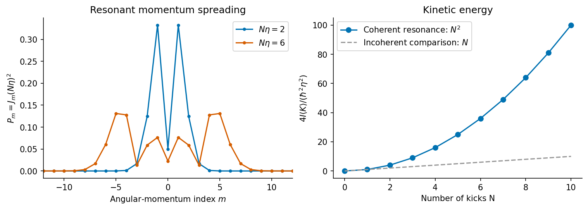

<h1 id="1/e/solution">Solution</h1>

↑ **Parent:** [E](../e.md)

On periodic ring states the angular-momentum index $m$ is an integer. At the stated [resonance](../../../../../resonance.md),

$$
e^{-i\alpha m^2}=e^{-2\pi im^2}=1,
$$

so **$U_T$ is the identity on every orbital state**. After $N$ steps from the normalized ground state,

$$
\psi_N(\theta)=\frac1{\sqrt{2\pi}}e^{iN\eta\cos\theta}.
$$

Its [phase](../../../../../phase-waves.md) varies in space but its position [probability density](../../../../../probability-density.md) remains uniform. Periodicity permits [integration by parts](../../../../../integration-by-parts.md), giving

$$
\langle K\rangle_N=\frac{\hbar^2}{2I}\int_0^{2\pi}
|\partial_\theta\psi_N|^2\,\mathrm d\theta
=\frac{\hbar^2N^2\eta^2}{2I}\frac1{2\pi}
\int_0^{2\pi}\sin^2\theta\,\mathrm d\theta.
$$

Consequently

$$
\boxed{\langle K\rangle_N=\frac{\hbar^2\eta^2}{4I}N^2.}
$$

Equivalently, the angular-momentum [probabilities](../../../../../probability.md) are $P_m=J_m(N\eta)^2$, with $\sum_m m^2J_m(z)^2=z^2/2$. The mean [angular momentum](../../../../../angular-momentum.md) remains zero while its [variance](../../../../../variance-split.md) grows as $N^2$. This [quantum resonance of the kicked rotor](../../../../../quantum-resonance-of-the-kicked-rotor.md) gives coherent ballistic energy growth. The [Bessel second-moment identity](../../../../../bessel-second-moment-identity.md) connects the momentum spreading to that quadratic energy law; an incoherent [random walk](../../../../../random-walk-split.md) would instead give linear energy growth.

**[Figure 1](#1/e/image-original-resonant-kicked-rotor-calculation-angular-momentum-probabilities-and-the-quadratic-kinetic-energy-law). Original resonant kicked-rotor calculation: angular-momentum probabilities and the quadratic kinetic-energy law**.

## ↑ Ancestors (15)

1. [E](../e.md)
2. [1](../../1.md)
3. [Paper 1](../../../paper-1-split.md)
4. [2016](../../../split.md)
5. [Past exam of the theoretical physics II course of the University of Cambridge](../../../../split.md)
6. [Theoretical Physics II course of the University of Cambridge](../../../../../theoretical-physics-ii-course-of-the-university-of-cambridge.md)
7. [Theoretical Physics course of the University of Cambridge](../../../../../theoretical-physics-course-of-the-university-of-cambridge.md)
8. [Physics course of the year 3 of the natural sciences course of the University of Cambridge](../../../../../physics-course-of-the-year-3-of-the-natural-sciences-course-of-the-university-of-cambridge.md)
9. [Year 3 of the natural sciences course of the University of Cambridge](../../../../../year-3-of-the-natural-sciences-course-of-the-university-of-cambridge.md)
10. [Year of the natural sciences course of the University of Cambridge](../../../../../year-of-the-natural-sciences-course-of-the-university-of-cambridge.md)
11. [Natural sciences course of the University of Cambridge](../../../../../natural-sciences-course-of-the-university-of-cambridge.md)
12. [Course of the University of Cambridge](../../../../../course-of-the-university-of-cambridge.md)
13. [University of Cambridge](../../../../../university-of-cambridge-split.md)
14. [List of universities](../../../../../list-of-universities.md)
15. [Codex Wiki](../../../../../split.md)
