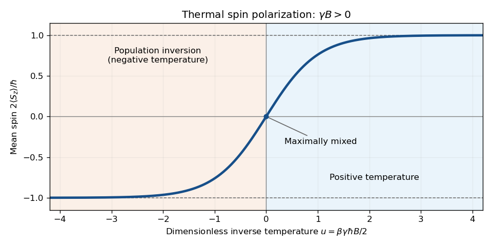

<h1 id="2/e/solution">Solution</h1>

↑ **Parent:** [E](../e.md)

For $\mathbf B=B\mathbf e_z$, the [quantum Gibbs state](../../../../quantum-gibbs-state.md) is diagonal in the $S_z$ basis. Its two [probabilities](../../../../probability.md) are proportional to $e^{\pm\beta\gamma\hbar B/2}$. Thus

$$
\boxed{\langle S_z\rangle=\frac\hbar2\tanh\left(\frac{\gamma\hbar B}{2k_BT}\right).}
$$

At small [inverse temperature](../../../../inverse-temperature.md), $\langle S_z\rangle\simeq\beta\gamma\hbar^2B/4$. As a function of $u=\beta\gamma\hbar B/2$, the normalized [spin](../../../../spin.md) component is the smooth odd curve $\tanh u$: it crosses zero at $u=0$ and saturates at $\pm1$. As a function of $\beta$ its direction is reversed if $\gamma B<0$. For $\gamma B>0$, positive [temperature](../../../../temperature-split.md) favors $S_z=+\hbar/2$, while negative [temperature](../../../../temperature-split.md) gives the inverted population.

**[Figure 1](#2/e/image-thermal-spin-one-half-polarization-versus-dimensionless-inverse-temperature). Thermal spin one-half polarization versus dimensionless inverse temperature**. Original plot of $2\langle S_z\rangle/\hbar=\tanh u$, with $u=\beta\gamma\hbar B/2$. For $\gamma B>0$, the negative-$u$ half corresponds to [negative temperature](../../../../negative-temperature.md). Dashed lines mark the fully polarized limits.

## ↑ Ancestors (14)

1. [E](../e.md)
2. [2](../../2.md)
3. [2017](../../../2017-split.md)
4. [Past exam of the theoretical physics II course of the University of Cambridge](../../../split.md)
5. [Theoretical Physics II course of the University of Cambridge](../../../../theoretical-physics-ii-course-of-the-university-of-cambridge.md)
6. [Theoretical Physics course of the University of Cambridge](../../../../theoretical-physics-course-of-the-university-of-cambridge.md)
7. [Physics course of the year 3 of the natural sciences course of the University of Cambridge](../../../../physics-course-of-the-year-3-of-the-natural-sciences-course-of-the-university-of-cambridge.md)
8. [Year 3 of the natural sciences course of the University of Cambridge](../../../../year-3-of-the-natural-sciences-course-of-the-university-of-cambridge.md)
9. [Year of the natural sciences course of the University of Cambridge](../../../../year-of-the-natural-sciences-course-of-the-university-of-cambridge.md)
10. [Natural sciences course of the University of Cambridge](../../../../natural-sciences-course-of-the-university-of-cambridge.md)
11. [Course of the University of Cambridge](../../../../course-of-the-university-of-cambridge.md)
12. [University of Cambridge](../../../../university-of-cambridge-split.md)
13. [List of universities](../../../../list-of-universities.md)
14. [Codex Wiki](../../../../split.md)
