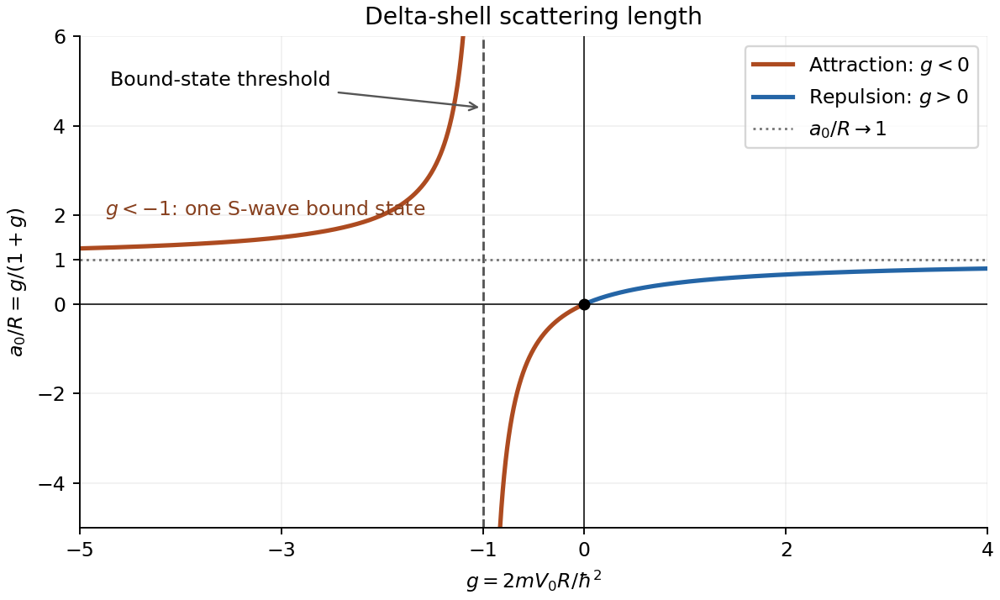

# 2018

↑ **Parent:** [Past exam of the theoretical physics II course of the University of Cambridge](../past-exam-of-the-theoretical-physics-ii-course-of-the-university-of-cambridge.md)

[Original paper, released PDF pages 344–348](https://www.whatdotheyknow.com/request/natural_science_tripos_physics_e/response/2127325/attach/3/FOI%202022%20639%20Sullivan%20materials.pdf?cookie_passthrough=1#page=344)

**Table of contents**

- [1](#1)
  - [a](#1/a)
    - [Solution](#1/a/solution)
  - [b](#1/b)
    - [Solution](#1/b/solution)
  - [c](#1/c)
    - [Solution](#1/c/solution)
  - [d](#1/d)
    - [Solution](#1/d/solution)
  - [e](#1/e)
    - [Solution](#1/e/solution)
- [2](#2)
  - [a](#2/a)
    - [Solution](#2/a/solution)
  - [b](#2/b)
    - [Solution](#2/b/solution)
  - [c](#2/c)
    - [Solution](#2/c/solution)
  - [d](#2/d)
    - [Solution](#2/d/solution)
  - [e](#2/e)
    - [Solution](#2/e/solution)
- [3](#3)
  - [a](#3/a)
    - [Solution](#3/a/solution)
  - [b](#3/b)
    - [Solution](#3/b/solution)
  - [c](#3/c)
    - [Solution](#3/c/solution)
- [4](#4)
  - [a](#4/a)
    - [Solution](#4/a/solution)
  - [b](#4/b)
    - [Solution](#4/b/solution)
  - [c](#4/c)
    - [Solution](#4/c/solution)
  - [d](#4/d)
    - [Solution](#4/d/solution)

## 1

↑ **Parent:** [2018](2018.md)

<h3 id="1/a">a</h3>

↑ **Parent:** [1](#1)

<h4 id="1/a/solution">Solution</h4>

↑ **Parent:** [A](#1/a)

For independent bosonic modes, the [canonical commutation relation](../quantum-mechanics.md#canonical-commutation-relation) is

$$
[b_i,b_j^\dagger]=\delta_{ij},\qquad [b_i,b_j]=[b_i^\dagger,b_j^\dagger]=0.
$$

For independent fermionic modes, the [canonical anticommutation relations](../supersymmetric-quantum-mechanics.md#canonical-anticommutation-relations) are

$$
\{c_i,c_j^\dagger\}=\delta_{ij},\qquad \{c_i,c_j\}=\{c_i^\dagger,c_j^\dagger\}=0,
$$

where $[A,B]=AB-BA$ and $\{A,B\}=AB+BA$. The [creation operator](../quantum-harmonic-oscillator.md#creation-operator) is the adjoint of the [annihilation operator](../quantum-harmonic-oscillator.md#annihilation-operator). In either case the mode's [number operator](../quantum-harmonic-oscillator.md#number-operator) is

$$
\boxed{n_i=a_i^\dagger a_i},
$$

with $a_i=b_i$ or $c_i$ as appropriate. It measures the mode's [occupation number](../quantum-field-theory.md#occupation-number). Its possible [eigenvalues](../linear-operator-theory.md#eigenvalue) are

$$
\boxed{n_i=0,1,2,\ldots\ \text{for bosons};\qquad n_i=0,1\ \text{for fermions}}.
$$

For [fermions](../tensor-product-of-quantum-systems.md#fermion), $c_i^2=0$ implies $n_i^2=c_i^\dagger(1-c_i^\dagger c_i)c_i=n_i$, so the [number operator](../quantum-harmonic-oscillator.md#number-operator) is a projection. This expresses the exclusion of double occupation of one fermionic mode. The total particle number is $N=\sum_i n_i$.

<h3 id="1/b">b</h3>

↑ **Parent:** [1](#1)

<h4 id="1/b/solution">Solution</h4>

↑ **Parent:** [B](#1/b)

Expand the [anticommutators](../vector-space.md#anticommutator) using the relations in part (a). The terms with two creation or two [annihilation operators](../quantum-harmonic-oscillator.md#annihilation-operator) vanish, leaving

$$
\boxed{\{\gamma_i^A,\gamma_j^A\}=2\delta_{ij},\qquad
\{\gamma_i^B,\gamma_j^B\}=2\delta_{ij},\qquad
\{\gamma_i^A,\gamma_j^B\}=0}.
$$

Each [Majorana fermion operator](../topological-quantum-matter.md#majorana-fermion-operator) is [Hermitian](../hilbert-space.md#hermitian-operator) and squares to the identity. In particular, $(\gamma_i^A)^\dagger\gamma_i^A=1$, so this expression cannot distinguish an empty mode from an occupied one. A single Majorana operator is its own adjoint and does not supply distinct creation and [annihilation operators](../quantum-harmonic-oscillator.md#annihilation-operator) for such an occupation.

An occupation can instead be assigned after [pairing Majorana operators into a fermionic mode](../topological-quantum-matter.md#pairing-majorana-operators-into-a-fermionic-mode). For two distinct Majorana operators $\gamma_a,\gamma_b$,

$$
f=\frac{\gamma_a+i\gamma_b}{2},\qquad
\boxed{n_f=f^\dagger f=\frac{1+i\gamma_a\gamma_b}{2}}.
$$

This is a nontrivial [projection operator](../vector-space.md#projection-linear-algebra) with [eigenvalues](../linear-operator-theory.md#eigenvalue) zero and one. Thus **occupation belongs to a chosen pair of Majorana operators, not to an individual Majorana operator**.

<h3 id="1/c">c</h3>

↑ **Parent:** [1](#1)

<h4 id="1/c/solution">Solution</h4>

↑ **Parent:** [C](#1/c)

Use $c_j=(\gamma_j^A+i\gamma_j^B)/2$ and $c_j^\dagger=(\gamma_j^A-i\gamma_j^B)/2$. Moving operators from different modes past one another introduces a minus sign. Direct expansion gives

$$
\begin{aligned}
c_1^\dagger c_2+c_2^\dagger c_1
&=\frac i2(\gamma_1^A\gamma_2^B-\gamma_1^B\gamma_2^A),\\
c_1^\dagger c_2^\dagger+c_2c_1
&=-\frac i2(\gamma_1^A\gamma_2^B+\gamma_1^B\gamma_2^A).
\end{aligned}
$$

Thus, for real hopping and pairing parameters,

$$
H=\frac i2\left[(\Delta-t)\gamma_1^A\gamma_2^B+(t+\Delta)\gamma_1^B\gamma_2^A\right].
$$

At $\Delta=t\ne0$ this becomes

$$
\boxed{H=it\gamma_1^B\gamma_2^A}.
$$

Use $\tau$ for time to distinguish it from the hopping amplitude $t$. Each unused Majorana operator anticommutes with both factors in $H$, so commuting it through their product gives two minus signs. Hence $[H,\gamma_1^A]=[H,\gamma_2^B]=0$. The [Heisenberg picture](../quantum-system.md#heisenberg-picture) equation $dO/d\tau=(i/\hbar)[H,O]$ therefore gives

$$
\boxed{\gamma_1^A(\tau)=\gamma_1^A(0),\qquad \gamma_2^B(\tau)=\gamma_2^B(0)}.
$$

These are the two uncoupled [Majorana zero modes](../topological-quantum-matter.md#majorana-zero-mode).

<h3 id="1/d">d</h3>

↑ **Parent:** [1](#1)

<h4 id="1/d/solution">Solution</h4>

↑ **Parent:** [D](#1/d)

For any two distinct normalized [Majorana fermion operators](../topological-quantum-matter.md#majorana-fermion-operator) $\eta,\chi$, let $f=(\eta+i\chi)/2$. Then

$$
\{f,f^\dagger\}=\frac14\big(\{\eta,\eta\}+\{\chi,\chi\}\big)=1,
$$

and

$$
\{f,f\}=\frac14\big(\{\eta,\eta\}-\{\chi,\chi\}+2i\{\eta,\chi\}\big)=0.
$$

The same applies to $f^\dagger$. Both specified pairs have this form. Moreover, the Majorana operators entering $f_1$ are all distinct from those entering $f_2$, so every cross [anticommutator](../vector-space.md#anticommutator) is zero. Therefore

$$
\boxed{\{f_i,f_j^\dagger\}=\delta_{ij},\qquad
\{f_i,f_j\}=\{f_i^\dagger,f_j^\dagger\}=0}.
$$

Thus $f_1,f_2$ are ordinary [fermionic annihilation operators](../relativistic-quantum-field.md#fermionic-annihilation-operator), constructed by a different pairing of the four Majorana operators.

<h3 id="1/e">e</h3>

↑ **Parent:** [1](#1)

<h4 id="1/e/solution">Solution</h4>

↑ **Parent:** [E](#1/e)

The occupation formula from part (b) gives

$$
n_2=f_2^\dagger f_2=\frac{1+i\gamma_1^B\gamma_2^A}{2}.
$$

Consequently

$$
\boxed{H=t(2f_2^\dagger f_2-1)=t(2n_2-1)}.
$$

The independent [occupation numbers](../quantum-field-theory.md#occupation-number) $n_1,n_2$ are each zero or one. The [Hamiltonian](../hamiltonian-mechanics.md#hamiltonian) is independent of $n_1$, so its four states have

$$
\boxed{\begin{array}{c|c|c}
n_2&E&\text{degeneracy}\\\hline
0&-t&2\\
1&+t&2
\end{array}}.
$$

Each energy admits $n_1=0$ or $n_1=1$; these states differ by occupancy of the zero-energy mode. The ground energy is $-|t|$ for either sign of $t$. These degeneracies refer to the full two-mode [fermionic Fock space](../supersymmetric-quantum-mechanics.md#fermionic-fock-space). If one separately restricts to a fixed global [fermion parity](../topological-quantum-matter.md#fermion-parity), only one state at each energy remains in that parity sector.

## 2

↑ **Parent:** [2018](2018.md)

<h3 id="2/a">a</h3>

↑ **Parent:** [2](#2)

<h4 id="2/a/solution">Solution</h4>

↑ **Parent:** [A](#2/a)

For a short-range potential, an incident [plane wave](../wave-function.md#plane-wave) of unit amplitude and wave vector $k\mathbf e_z$ has the large-distance [scattering wavefunction](../quantum-scattering.md#scattering-wavefunction)

$$
\boxed{\psi(\mathbf r)=e^{ikz}+f(\theta,\phi)\frac{e^{ikr}}r+O(r^{-2})\qquad(r\to\infty)}.
$$

The coefficient $f$ is the [scattering amplitude](../quantum-scattering.md#scattering-amplitude). For a central potential it depends only on the scattering angle $\theta$. The incident [probability current](../wave-function.md#probability-current) is $\hbar k/m$, while the scattered radial current is $(\hbar k/m)|f|^2/r^2$ to leading order. Their ratio gives

$$
\boxed{\frac{d\sigma}{d\Omega}=|f(\theta,\phi)|^2,\qquad
\sigma_{\mathrm{tot}}=\int |f(\theta,\phi)|^2\,d\Omega}.
$$

These are the [differential scattering cross-section](../quantum-scattering.md#differential-scattering-cross-section) and total [cross section](../physics.md#cross-section-physics) for elastic scattering with the same incident and outgoing wave number.

The expression is _asymptotic_: it specifies the outgoing wave's leading $1/r$ term, not its finite-distance radial corrections or its form inside the interaction region. In particular, for angle-dependent $f$, the spherical term by itself has an angular-Laplacian contribution of order $r^{-3}$ to the free wave equation, which is cancelled by subleading terms in the exact solution.

<h3 id="2/b">b</h3>

↑ **Parent:** [2](#2)

<h4 id="2/b/solution">Solution</h4>

↑ **Parent:** [B](#2/b)

In the [first Born approximation](../quantum-theory.md#born-approximation), with incident and outgoing wave vectors $\mathbf k,\mathbf k'$, put $\mathbf q=\mathbf k'-\mathbf k$. For elastic scattering,

$$
q=2k\sin\frac\theta2,
\qquad f_B=-\frac{m}{2\pi\hbar^2}\int e^{-i\mathbf q\cdot\mathbf r}V(r)\,d^3r.
$$

Choose the polar axis along $\mathbf q$. The angular integral is

$$
\int e^{-iqr\cos\vartheta}\,d\Omega
=2\pi\int_{-1}^1e^{-iqru}\,du=4\pi\frac{\sin(qr)}{qr}.
$$

The radial [Dirac delta distribution](../distribution-theory.md#dirac-delta-function) then gives

$$
f_B=-\frac{2mV_0}{\hbar^2}\int_0^\infty r^2\delta(r-R)\frac{\sin(qr)}{qr}\,dr.
$$

Thus, introducing the [dimensionless](../physics.md#dimensionless-quantity) shell strength $g=2mV_0R/\hbar^2$,

$$
\boxed{f_B(\theta)=-\frac{2mV_0R}{\hbar^2q}\sin(qR)
=-gR\frac{\sin(qR)}{qR}}.
$$

The forward value is the continuous limit $f_B(0)=-gR$. This is the [delta-shell Born amplitude](../quantum-theory.md#delta-shell-born-amplitude), with its angular dependence expressed through the [momentum transfer](../quantum-scattering.md#momentum-transfer).

<h3 id="2/c">c</h3>

↑ **Parent:** [2](#2)

<h4 id="2/c/solution">Solution</h4>

↑ **Parent:** [C](#2/c)

Away from the shell, the reduced radial equation is free. Regularity at the origin and the definition of the S-wave [phase shift](../wave.md#phase-shift) give

$$
u_0(r)=\begin{cases}A\sin kr,&r<R,\\B\sin(kr+\delta_0),&r>R.\end{cases}
$$

The reduced radial [wave function](../wave-function.md) is continuous at $R$; otherwise its second derivative would contain a delta derivative not present in the equation. Integrating the equation across the shell gives the jump

$$
u_0'(R^+)-u_0'(R^-)=\frac{2mV_0}{\hbar^2}u_0(R).
$$

Divide by the common shell value and substitute the two free solutions. This yields

$$
\boxed{k\cot(kR+\delta_0)-k\cot(kR)=\frac{2mV_0}{\hbar^2}}.
$$

If the shell value vanishes, use the undivided matching equations or a continuous limit rather than this logarithmic-derivative division. For an explicit [phase shift of a delta-shell potential](../quantum-scattering.md#phase-shift-of-a-delta-shell-potential), write $x=kR$ and $g=2mV_0R/\hbar^2$. The cotangent addition formula gives

$$
\boxed{\tan\delta_0(k)=-\frac{g\sin^2x}{x+g\sin x\cos x}}.
$$

The phase is defined modulo $\pi$; choose its branch continuously as energy or coupling varies. At zero coupling the physical [phase shift](../wave.md#phase-shift) is zero.

<h3 id="2/d">d</h3>

↑ **Parent:** [2](#2)

<h4 id="2/d/solution">Solution</h4>

↑ **Parent:** [D](#2/d)

The [scattering length](../quantum-scattering.md#scattering-length-from-a-partial-wave-s-matrix) is $a_0=-\lim_{k\to0}\tan\delta_0/k$. Since $\sin(kR)\sim kR$ and $\cos(kR)\sim1$, the exact [phase shift](../wave.md#phase-shift) gives, away from the pole,

$$
\boxed{a_0=R\frac{g}{1+g},\qquad g=\frac{2mV_0R}{\hbar^2}}.
$$

Thus plot $a_0/R$ against $g$, so that both axes are [dimensionless](../physics.md#dimensionless-quantity).

**[Figure 1](#2/d/image-delta-shell-scattering-length-versus-dimensionless-coupling-with-the-bound-state-threshold-at-g-minus-1). Delta-shell scattering length versus dimensionless coupling, with the bound-state threshold at g = −1**.

For repulsion, $g>0$, the curve rises from zero to the horizontal asymptote $a_0/R=1$, staying between zero and one. For weak attraction, $-1<g<0$, the [scattering length](../quantum-scattering.md#scattering-length-from-a-partial-wave-s-matrix) is negative and tends to $-\infty$ as $g\to-1^+$. For stronger attraction, $g<-1$, it is positive and greater than $R$, tending to $+\infty$ as $g\to-1^-$ and to $R$ as $g\to-\infty$. Its only zero is $g=0$.

The pole at $g=-1$ is the zero-energy threshold of an S-wave [bound state](../quantum-system.md#bound-state). To see this directly, use $u\propto\sinh(\kappa r)$ inside and $u\propto e^{-\kappa r}$ outside for energy $-\hbar^2\kappa^2/(2m)$. The same derivative jump gives

$$
g=-\kappa R[1+\coth(\kappa R)]
=-\frac{2\kappa R}{1-e^{-2\kappa R}}.
$$

This approaches $-1$ as $\kappa\downarrow0$ and admits a positive $\kappa$ for $g<-1$. At the threshold the [scattering length](../quantum-scattering.md#scattering-length-from-a-partial-wave-s-matrix) diverges; this is a [zero-energy scattering resonance](../quantum-scattering.md#zero-energy-scattering-resonance), not a divergence of the finite-energy cross-section beyond its [partial-wave unitarity](../quantum-scattering.md#partial-wave-unitarity) bound. These are the main features of the [scattering length of a delta-shell potential](../quantum-scattering.md#scattering-length-of-a-delta-shell-potential).

<h3 id="2/e">e</h3>

↑ **Parent:** [2](#2)

<h4 id="2/e/solution">Solution</h4>

↑ **Parent:** [E](#2/e)

The [delta-shell Born amplitude](../quantum-theory.md#delta-shell-born-amplitude) is first order in the potential strength:

$$
f_B=-gR\frac{\sin(qR)}{qR}.
$$

It retains finite-energy angular dependence and includes the leading weak-coupling contributions of all [partial waves](../quantum-scattering.md#partial-wave). By contrast, the supplied $-gR/(1+g)=-a_0$ is the _zero-energy limit_ of the exact [S-wave scattering](../quantum-scattering.md#s-wave-quantum-scattering) amplitude. It is isotropic, depends nonlinearly on $g$, and captures the scattering-length pole missed by first-order perturbation theory.

At finite energy the exact S-wave amplitude is instead

$$
f_0(k)=\frac{e^{2i\delta_0}-1}{2ik}
=\frac1{k\cot\delta_0-ik},
$$

which is generally complex and obeys elastic unitarity. Its zero-energy limit is $-a_0$ for finite [scattering length](../quantum-scattering.md#scattering-length-from-a-partial-wave-s-matrix). Thus the two expressions printed in the question represent different approximations; the energy-independent S-wave expression is not the full finite-$k$ result of part (c).

Their common regime requires **both weak coupling and low energy**:

$$
\boxed{|g|\ll1,\qquad kR\ll1}.
$$

Then $qR\leq2kR\ll1$, so

$$
f_B=-gR\left[1-\frac{(qR)^2}{6}+O((qR)^4)\right],\qquad
-a_0=-\frac{gR}{1+g}=-gR+g^2R+O(g^3R).
$$

Consequently

$$
\boxed{f_B\sim f_0\sim-gR=-\frac{2mV_0R^2}{\hbar^2}}
$$

in that joint regime. Low energy alone does not remove the nonperturbative denominator $1+g$, while weak coupling alone does not remove higher-partial-wave angular dependence.

## 3

↑ **Parent:** [2018](2018.md)

<h3 id="3/a">a</h3>

↑ **Parent:** [3](#3)

<h4 id="3/a/solution">Solution</h4>

↑ **Parent:** [A](#3/a)

An ensemble with normalized quantum states $|\psi_a\rangle$ and probabilities $p_a\geq0$, $\sum_ap_a=1$, has [density matrix](../density-matrix.md)

$$
\boxed{\rho=\sum_a p_a|\psi_a\rangle\langle\psi_a|}.
$$

Each rank-one projector is [Hermitian](../hilbert-space.md#hermitian-operator), so $\rho^\dagger=\rho$. Taking the [trace](../linear-algebra.md#matrix-trace) in any [orthonormal basis](../inner-product.md#orthonormal-basis) gives

$$
\operatorname{Tr}\rho=\sum_a p_a\langle\psi_a|\psi_a\rangle=1.
$$

It is also positive: $\langle v|\rho|v\rangle=\sum_ap_a|\langle\psi_a|v\rangle|^2\geq0$. Its [eigenvalues](../linear-operator-theory.md#eigenvalue) $\lambda_a$ are therefore nonnegative and sum to one. Hence

$$
\operatorname{Tr}\rho^2=\sum_a\lambda_a^2\leq\left(\sum_a\lambda_a\right)^2=1,
$$

with equality exactly when one [eigenvalue](../linear-operator-theory.md#eigenvalue) is one and the others are zero. Thus the [purity of a density operator](../density-matrix.md#purity-of-a-density-operator) distinguishes

$$
\boxed{\text{pure state: }\operatorname{Tr}\rho^2=1,\qquad
\text{mixed state: }\operatorname{Tr}\rho^2<1}.
$$

Equivalently, a [pure state](../quantum-theory.md#pure-state) has $\rho^2=\rho$ and rank one. In a $d$-dimensional [Hilbert space](../hilbert-space.md), purity is at least $1/d$, attained by the [maximally mixed state](../density-matrix.md#maximally-mixed-state) $I/d$.

<h3 id="3/b">b</h3>

↑ **Parent:** [3](#3)

<h4 id="3/b/solution">Solution</h4>

↑ **Parent:** [B](#3/b)

The fixed-particle-number sector is spanned by $|1\rangle=c_1^\dagger|0\rangle$ and $|2\rangle=c_2^\dagger|0\rangle$. In this basis,

$$
H=-t\begin{pmatrix}0&1\\1&0\end{pmatrix}=-t\sigma_x.
$$

The relevant [quantum Gibbs state](../canonical-ensemble.md#quantum-gibbs-state) is normalized within this two-dimensional sector, not over all particle numbers. With $\beta=(k_BT)^{-1}$ and $x=\beta t$, the [exponential of a Pauli vector](../algebra.md#exponential-of-a-pauli-vector) gives

$$
e^{-\beta H}=e^{x\sigma_x}=I\cosh x+\sigma_x\sinh x,\qquad
Z=2\cosh x.
$$

Therefore

$$
\boxed{\rho_\beta=\frac12(I+\tanh x\,\sigma_x)
=\frac12\begin{pmatrix}1&\tanh x\\\tanh x&1\end{pmatrix}}.
$$

Its [eigenstates](../energy-eigenvalue.md#eigenstate) are $|\pm\rangle=(|1\rangle\pm|2\rangle)/\sqrt2$, with energies $\mp t$ and probabilities $p_\pm=e^{\pm x}/(2\cosh x)$. These are nonnegative and sum to one, so the [matrix](../vector-space.md#matrix) is [Hermitian](../hilbert-space.md#hermitian-operator) and has [trace](../linear-algebra.md#matrix-trace) one. Its [purity of a density operator](../density-matrix.md#purity-of-a-density-operator) is

$$
\boxed{\operatorname{Tr}\rho_\beta^2=\frac12(1+\tanh^2x)}.
$$

For $t\ne0$, the zero-temperature limit is the pure ground-state projector,

$$
\rho_{T\to0}=\frac12[I+\operatorname{sgn}(t)\sigma_x],
$$

with purity one. As $T\to\infty$, $x\to0$ and $\rho\to I/2$, with purity $1/2$. At every strictly positive finite [temperature](../temperature.md) and finite $t$, both [eigenvalues](../linear-operator-theory.md#eigenvalue) are nonzero, so the state is mixed. If $t=0$, the two levels are degenerate and the Gibbs state is $I/2$ at all temperatures, including its zero-temperature limit.

Using [dimensionless](../physics.md#dimensionless-quantity) [Von Neumann entropy](../von-neumann-entropy.md), $S=-\operatorname{Tr}(\rho\ln\rho)$, gives

$$
\boxed{S(T)=-p_+\ln p_+-p_-\ln p_-
=\ln(2\cosh x)-x\tanh x}.
$$

For nonzero $t$, $S\to0$ as $T\to0$, while $S\to\ln2$ as $T\to\infty$. More precisely, the high-temperature expansion is $S=\ln2-x^2/2+O(x^4)$, and the low-temperature form is $S\sim(1+2|x|)e^{-2|x|}$. The thermodynamic entropy includes an overall factor $k_B$.

<h3 id="3/c">c</h3>

↑ **Parent:** [3](#3)

<h4 id="3/c/solution">Solution</h4>

↑ **Parent:** [C](#3/c)

Fix the mode ordering with the $b^\dagger$ operator before the $c^\dagger$ operator, as in the given state. In the sector with one [fermion](../tensor-product-of-quantum-systems.md#fermion) in each subsystem, use the ordered basis

$$
(|B_1C_1\rangle,|B_1C_2\rangle,|B_2C_1\rangle,|B_2C_2\rangle).
$$

The [state vector](../dynamical-systems.md#state-vector) is $v=(1/2,1/\sqrt2,0,1/2)^T$, whose squared norm is one. Thus the global [density matrix](../density-matrix.md) is the rank-one projector

$$
\boxed{\rho_{BC}=vv^\dagger=
\begin{pmatrix}
\frac14&\frac1{2\sqrt2}&0&\frac14\\
\frac1{2\sqrt2}&\frac12&0&\frac1{2\sqrt2}\\
0&0&0&0\\
\frac14&\frac1{2\sqrt2}&0&\frac14
\end{pmatrix}}.
$$

It has [trace](../linear-algebra.md#matrix-trace) one and satisfies $\rho_{BC}^2=\rho_{BC}$, so the global state is pure.

Take the [partial trace](../quantum-theory.md#partial-trace) over $B$. The conditional vectors in $C$ are $v_1=(1/2,1/\sqrt2)^T$ for $B_1$ and $v_2=(0,1/2)^T$ for $B_2$. Therefore the [reduced density matrix](../bell-state.md#reduced-density-matrix) is

$$
\boxed{\rho_C=v_1v_1^\dagger+v_2v_2^\dagger
=\begin{pmatrix}\frac14&\frac1{2\sqrt2}\\\frac1{2\sqrt2}&\frac34\end{pmatrix}}.
$$

Its determinant is $1/16$, giving [eigenvalues](../linear-operator-theory.md#eigenvalue)

$$
\lambda_\pm=\frac{2\pm\sqrt3}{4}.
$$

Both are positive; in particular, $\operatorname{Tr}\rho_C^2=7/8<1$, so the reduced state is mixed despite global purity. The [entanglement entropy](../von-neumann-entropy.md#entanglement-entropy) is obtained by diagonalizing this reduced [matrix](../vector-space.md#matrix) and evaluating

$$
\boxed{S_{\mathrm{ent}}=-\lambda_+\ln\lambda_+-\lambda_-\ln\lambda_-}.
$$

For a globally pure bipartite state this equals the entropy of either reduced subsystem. No numerical evaluation is needed.

## 4

↑ **Parent:** [2018](2018.md)

<h3 id="4/a">a</h3>

↑ **Parent:** [4](#4)

<h4 id="4/a/solution">Solution</h4>

↑ **Parent:** [A](#4/a)

Using $[x,p]=i\hbar$, the [Heisenberg picture](../quantum-system.md#heisenberg-picture) equations for the [quantum harmonic oscillator](../quantum-harmonic-oscillator.md) are

$$
\boxed{\dot x=\frac{i}{\hbar}[H_0,x]=\frac pm,\qquad
\dot p=\frac{i}{\hbar}[H_0,p]=-m\omega^2x}.
$$

Solving these coupled linear equations gives

$$
\boxed{\begin{aligned}
x(t)&=x(0)\cos\omega t+\frac{p(0)}{m\omega}\sin\omega t,\\
p(t)&=p(0)\cos\omega t-m\omega x(0)\sin\omega t.
\end{aligned}}
$$

The oscillator [annihilation operator](../quantum-harmonic-oscillator.md#annihilation-operator) and [creation operator](../quantum-harmonic-oscillator.md#creation-operator) are

$$
a=\sqrt{\frac{m\omega}{2\hbar}}x+\frac{i}{\sqrt{2m\hbar\omega}}p,\qquad
a^\dagger=\sqrt{\frac{m\omega}{2\hbar}}x-\frac{i}{\sqrt{2m\hbar\omega}}p.
$$

They obey $[a,a^\dagger]=1$ and $H_0=\hbar\omega(a^\dagger a+1/2)$. Substitution of the position and momentum solutions, or the corresponding [commutators](../lie-algebra.md#commutator) with $H_0$, yields

$$
\boxed{a(t)=a(0)e^{-i\omega t},\qquad a^\dagger(t)=a^\dagger(0)e^{i\omega t}}.
$$

<h3 id="4/b">b</h3>

↑ **Parent:** [4](#4)

<h4 id="4/b/solution">Solution</h4>

↑ **Parent:** [B](#4/b)

Complete the square, keeping the equilibrium displacement signed:

$$
x_0=-\frac\gamma{m\omega^2},\qquad
U_{\min}=-\frac{\gamma^2}{2m\omega^2},\qquad
H=\frac{p^2}{2m}+\frac12m\omega^2(x-x_0)^2+U_{\min}.
$$

Write $X=x-x_0$ for position relative to the new minimum. By the [sudden approximation](../quantum-mechanics.md#sudden-approximation), the state immediately after the [quantum quench](../quantum-mechanics.md#quantum-quench) is still the old vacuum. Its initial means are

$$
\boxed{\langle X(0^+)\rangle=-x_0=\frac\gamma{m\omega^2},\qquad
\langle p(0^+)\rangle=0}.
$$

The old [ground state](../quantum-mechanics.md#ground-state) has $\langle H_0\rangle=\hbar\omega/2$ and $\langle x\rangle=0$. Thus $\langle H\rangle=\hbar\omega/2$, but the energy measured above the _new potential minimum_ is

$$
\boxed{\langle H-U_{\min}\rangle=\frac{\hbar\omega}{2}+\frac{\gamma^2}{2m\omega^2}
=\frac{\hbar\omega}{2}+\frac12m\omega^2x_0^2}.
$$

The extra term is the excitation energy above the new [ground state](../quantum-mechanics.md#ground-state); the zero-point term remains part of the energy above the potential minimum.

The variables $X,p$ obey the oscillator equations in part (a). Using the above initial means gives

$$
\boxed{\langle X(t)\rangle=-x_0\cos\omega t,\qquad
\langle x(t)\rangle=x_0(1-\cos\omega t),\qquad
\langle p(t)\rangle=m\omega x_0\sin\omega t}.
$$

The wavepacket's centre therefore oscillates about the new equilibrium, beginning at the old origin with zero mean momentum.

<h3 id="4/c">c</h3>

↑ **Parent:** [4](#4)

<h4 id="4/c/solution">Solution</h4>

↑ **Parent:** [C](#4/c)

Define the signed [dimensionless](../physics.md#dimensionless-quantity) displacement

$$
\lambda=\sqrt{\frac{m\omega}{2\hbar}}x_0.
$$

The [spatial translation operator](../quantum-mechanics.md#spatial-translation-operator) is $T(x_0)=e^{-ipx_0/\hbar}$, and the phases of the new [energy eigenstates](../energy-eigenvalue.md#energy-eigenstate) are fixed by $|n'\rangle=T(x_0)|n\rangle$. Their expansion coefficients are therefore

$$
\langle n'|0\rangle=\langle n|T(-x_0)|0\rangle.
$$

Since $p=i\sqrt{m\hbar\omega/2}(a^\dagger-a)$,

$$
T(-x_0)=e^{-\lambda(a^\dagger-a)}.
$$

Set $A=-\lambda a^\dagger$ and $B=\lambda a$. Their [commutator](../lie-algebra.md#commutator) is $[A,B]=\lambda^2I$, which commutes with both operators. Thus the stated special case of the [Baker--Campbell--Hausdorff formula](../linear-operator-theory.md#baker-campbell-hausdorff-formula) is applicable and gives

$$
e^{A+B}=e^{-\lambda^2/2}e^Ae^B.
$$

Because $a|0\rangle=0$,

$$
T(-x_0)|0\rangle=e^{-\lambda^2/2}e^{-\lambda a^\dagger}|0\rangle
=e^{-\lambda^2/2}\sum_{n=0}^\infty\frac{(-\lambda)^n}{\sqrt{n!}}|n\rangle.
$$

Taking the overlaps with $\langle n|$ therefore proves

$$
\boxed{|0\rangle=e^{-\lambda^2/2}\sum_{n=0}^\infty\frac{(-\lambda)^n}{\sqrt{n!}}|n'\rangle}.
$$

This is the [coherent state after shifting an oscillator equilibrium](../quantum-theory.md#coherent-state-after-shifting-an-oscillator-equilibrium). Its normalization follows from $e^{-\lambda^2}\sum_n\lambda^{2n}/n!=1$.

There is a sign qualification in the printed expansion: $(m\omega x_0^2/(2\hbar))^{n/2}=|\lambda|^n$ agrees with $(-\lambda)^n$ when $x_0\leq0$, equivalently $\gamma\geq0$. For a general signed displacement $x_0>0$, the odd coefficients have the opposite sign in the specified translated basis. The squared displacement alone fixes the occupation probabilities, not these coherent relative phases. The two-exponential identity also requires the central-commutator condition used above; it is not valid in that simple form for arbitrary operators.

<h3 id="4/d">d</h3>

↑ **Parent:** [4](#4)

<h4 id="4/d/solution">Solution</h4>

↑ **Parent:** [D](#4/d)

The [annihilation operator](../quantum-harmonic-oscillator.md#annihilation-operator) associated with the new coordinate $X=x-x_0$ is

$$
a'=\sqrt{\frac{m\omega}{2\hbar}}(x-x_0)+\frac{i}{\sqrt{2m\hbar\omega}}p=a-\lambda.
$$

As the initial state is the old vacuum,

$$
\boxed{a'|\Psi(0)\rangle=-\lambda|\Psi(0)\rangle,\qquad
\alpha_0=-\lambda=-\sqrt{\frac{m\omega}{2\hbar}}x_0}.
$$

Equivalently, applying $a'$ to the number-state expansion in part (c) and shifting its summation index returns $-\lambda$ times the same state. It is therefore a [coherent state](../quantum-theory.md#coherent-state) of the displaced oscillator.

The new [Hamiltonian](../hamiltonian-mechanics.md#hamiltonian) is $H=U_{\min}+\hbar\omega(a'^\dagger a'+1/2)$. In the [Schrödinger picture](../quantum-system.md#schrodinger-picture) its evolution gives

$$
|\Psi(t)\rangle=e^{-i(U_{\min}/\hbar+\omega/2)t}
 e^{-|\alpha_0|^2/2}\sum_{n=0}^\infty\frac{(\alpha_0e^{-i\omega t})^n}{\sqrt{n!}}|n'\rangle.
$$

Consequently

$$
\boxed{a'|\Psi(t)\rangle=\alpha(t)|\Psi(t)\rangle,\qquad
\alpha(t)=\alpha_0e^{-i\omega t}}.
$$

The displayed prefactor is only a global phase. Equivalently, in the [Heisenberg picture](../quantum-system.md#heisenberg-picture) $a'(t)=a'(0)e^{-i\omega t}$. The mean occupation $|\alpha(t)|^2=\lambda^2$ is constant, and $\hbar\omega(\lambda^2+1/2)$ reproduces the energy above the new minimum found in part (b). Its mean position and momentum likewise reproduce that part's oscillating wavepacket centre.

## ↑ Ancestors (11)

1. [Past exam of the theoretical physics II course of the University of Cambridge](../past-exam-of-the-theoretical-physics-ii-course-of-the-university-of-cambridge.md)
2. [Theoretical Physics II course of the University of Cambridge](../university-of-cambridge.md#theoretical-physics-ii-course-of-the-university-of-cambridge)
3. [Theoretical Physics course of the University of Cambridge](../university-of-cambridge.md#theoretical-physics-course-of-the-university-of-cambridge)
4. [Physics course of the year 3 of the natural sciences course of the University of Cambridge](../university-of-cambridge.md#physics-course-of-the-year-3-of-the-natural-sciences-course-of-the-university-of-cambridge)
5. [Year 3 of the natural sciences course of the University of Cambridge](../university-of-cambridge.md#year-3-of-the-natural-sciences-course-of-the-university-of-cambridge)
6. [Year of the natural sciences course of the University of Cambridge](../university-of-cambridge.md#year-of-the-natural-sciences-course-of-the-university-of-cambridge)
7. [Natural sciences course of the University of Cambridge](../university-of-cambridge.md#natural-sciences-course-of-the-university-of-cambridge)
8. [Course of the University of Cambridge](../university-of-cambridge.md#course-of-the-university-of-cambridge)
9. [University of Cambridge](../university-of-cambridge.md)
10. [List of universities](../README.md#list-of-universities)
11. [Codex Wiki](../README.md)
