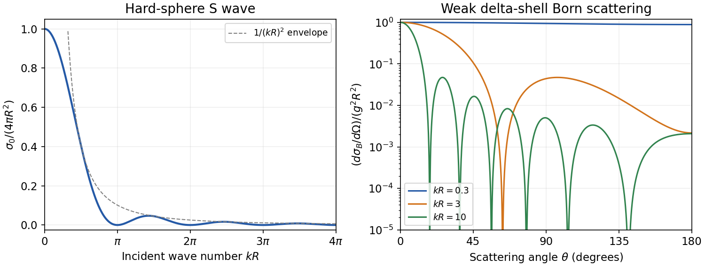

<h1 id="2/c/solution">Solution</h1>

↑ **Parent:** [C](../c.md)

The radial [S wave](../../../../s-wave.md) vanishes at the hard surface, so outside the sphere $u_0(r)=A\sin[k(r-R)]$. Comparison with $A\sin(kr+\delta_0)$ gives

$$
\boxed{\delta_0(k)=-kR\pmod\pi,\qquad a_0=-\lim_{k\to0}\frac{\tan\delta_0}k=R.}
$$

The [hard-sphere S-wave scattering](../../../../hard-sphere-s-wave-scattering.md) amplitude and [cross section](../../../../cross-section-physics.md) are therefore

$$
\boxed{f_0(k)=-e^{-ikR}\frac{\sin(kR)}k,\qquad
\frac{\sigma_0}{4\pi R^2}=\left(\frac{\sin x}{x}\right)^2,\quad x=kR.}
$$

The three prominent features are the finite low-energy limit $\sigma_0\to4\pi R^2$, the oscillations with exact zeros at $x=n\pi$ for positive [integers](../../../../integer-split.md) $n$, and the decreasing envelope $\sigma_0\le4\pi/k^2$. The zero-energy value is four times the geometric area $\pi R^2$. Near zero the normalized [cross section](../../../../cross-section-physics.md) is $1-x^2/3+O(x^4)$. The large-$k$ fall here concerns the [S wave](../../../../s-wave.md) alone; summing all [partial waves](../../../../partial-wave.md) gives a different high-energy total.

**[Figure 1](#2/c/image-hard-sphere-s-wave-cross-section-and-delta-shell-born-angular-scattering). Hard-sphere S-wave cross-section and delta-shell Born angular scattering**. Dimensionless curves calculated directly from the derived scattering amplitudes. The left panel concerns only the S wave, while the right panel shows different incident wave numbers for the weak delta-shell model.

## ↑ Ancestors (14)

1. [C](../c.md)
2. [2](../../2.md)
3. [2019](../../../2019-split.md)
4. [Past exam of the theoretical physics II course of the University of Cambridge](../../../split.md)
5. [Theoretical Physics II course of the University of Cambridge](../../../../theoretical-physics-ii-course-of-the-university-of-cambridge.md)
6. [Theoretical Physics course of the University of Cambridge](../../../../theoretical-physics-course-of-the-university-of-cambridge.md)
7. [Physics course of the year 3 of the natural sciences course of the University of Cambridge](../../../../physics-course-of-the-year-3-of-the-natural-sciences-course-of-the-university-of-cambridge.md)
8. [Year 3 of the natural sciences course of the University of Cambridge](../../../../year-3-of-the-natural-sciences-course-of-the-university-of-cambridge.md)
9. [Year of the natural sciences course of the University of Cambridge](../../../../year-of-the-natural-sciences-course-of-the-university-of-cambridge.md)
10. [Natural sciences course of the University of Cambridge](../../../../natural-sciences-course-of-the-university-of-cambridge.md)
11. [Course of the University of Cambridge](../../../../course-of-the-university-of-cambridge.md)
12. [University of Cambridge](../../../../university-of-cambridge-split.md)
13. [List of universities](../../../../list-of-universities.md)
14. [Codex Wiki](../../../../split.md)
