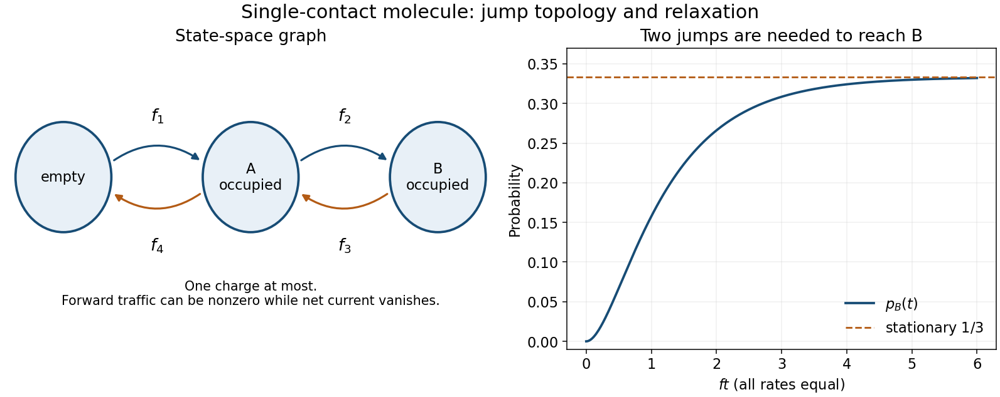

<h1 id="1/b/solution">Solution</h1>

↑ **Parent:** [B](../b.md)

Use states $0,A,B$, where $0$ denotes an empty molecule and the other states denote its single occupied site. The source arrows give $0\to A$ at rate $f_1$, $A\to0$ at rate $f_4$, $A\to B$ at rate $f_2$, and $B\to A$ at rate $f_3$. Thus

$$
\boxed{\frac d{dt}\begin{pmatrix}p_0\\p_A\\p_B\end{pmatrix}
=\begin{pmatrix}
-f_1&f_4&0\\
f_1&-(f_4+f_2)&f_3\\
0&f_2&-f_3
\end{pmatrix}\begin{pmatrix}p_0\\p_A\\p_B\end{pmatrix}.}
$$

Each diagonal entry is the negative total escape rate from its column's state. In particular, the empty state cannot make a direct jump to $B$: the reservoir touches $A$ alone. Conversely, $A\to B$ is not a second charge arriving on the molecule; it is an internal hop of its existing charge. Summing the three equations gives $d(p_0+p_A+p_B)/dt=0$, which checks the [master equation](../../../../master-equation.md) convention and the single-charge constraint.

**[Figure 1](#1/b/image-three-state-charge-kinetics-and-the-two-distinct-stationary-jump-counts). Three-state charge kinetics and the two distinct stationary jump counts**. Original state-space graph inferred from the source rates. Each arrow is a charge jump; an A-to-B jump changes location without changing the molecule's total charge.

## ↑ Ancestors (12)

1. [B](../b.md)
2. [1](../../1.md)
3. [2015](../../../2015-split.md)
4. [Past exam of the theoretical physics major option course of the University of Oxford](../../../split.md)
5. [Theoretical physics major option course of the University of Oxford](../../../../theoretical-physics-major-option-course-of-the-university-of-oxford.md)
6. [Year 4 of the physics course of the University of Oxford](../../../../year-4-of-the-physics-course-of-the-university-of-oxford.md)
7. [Physics course of the University of Oxford](../../../../physics-course-of-the-university-of-oxford.md)
8. [Undergraduate course of the University of Oxford](../../../../undergraduate-course-of-the-university-of-oxford.md)
9. [Course of the University of Oxford](../../../../course-of-the-university-of-oxford.md)
10. [University of Oxford](../../../../university-of-oxford-split.md)
11. [List of universities](../../../../list-of-universities.md)
12. [Codex Wiki](../../../../split.md)
