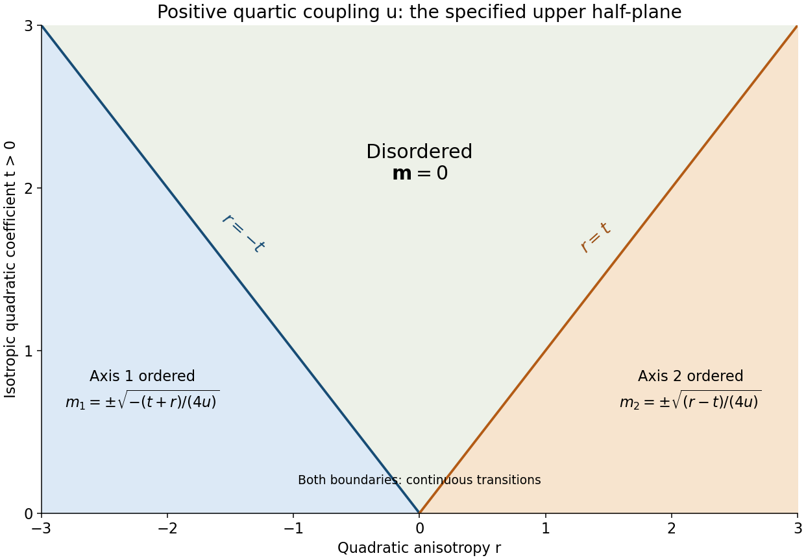

<h1 id="3/c/solution">Solution</h1>

↑ **Parent:** [C](../c.md)

Assume $u>0$, as required for the stable quartic model, and retain the stated domain $t>0$. For the [opposite-axis quadratic anisotropy of a vector order parameter](../../../../opposite-axis-quadratic-anisotropy-of-a-vector-order-parameter.md), fix the magnitude $\rho$. Then the anisotropy lowers the energy most by putting all [magnetization](../../../../magnetization.md) along component 1 if $r<0$ and component 2 if $r>0$. Component 3 has positive quadratic coefficient $t$ and cannot lower the uniform minimum. Minimizing the remaining amplitude gives

$$
\boxed{\begin{array}{c|c|c}
\text{region}&\text{uniform equilibrium magnetization}&f_{\min}\\\hline
r<-t&\bigl(\pm\sqrt{-(t+r)/(4u)},0,0\bigr)&-(t+r)^2/(16u)\\
-t\leq r\leq t&(0,0,0)&0\\
r>t&\bigl(0,\pm\sqrt{(r-t)/(4u)},0\bigr)&-(t-r)^2/(16u)
\end{array}}
$$

The component-1 and component-2 ordered regions each break a discrete sign symmetry, giving two easy-axis orientations rather than a sphere of equivalent directions. To check stability, in the component-1 minimum the longitudinal curvature is $-2(t+r)>0$, while the two transverse curvatures are $-2r>0$ and $-r>0$. The component-2 case similarly has longitudinal curvature $-2(t-r)$ and transverse curvatures $2r,r$, all positive in its region. The disordered state is stable exactly when $t\pm r\geq0$.

Both boundaries $r=-t$ and $r=t$ are continuous, second-order mean-field transitions: the selected component vanishes with a square root, and the first derivatives of the minimum [free energy](../../../../thermodynamic-free-energy.md) agree across the boundary. In the stipulated upper half-plane $t>0$, the two ordered phases are separated by a disordered wedge. There is no direct first-order boundary between them in that domain. Extrapolating a phase boundary through $t<0$ would answer a different, larger phase-diagram question.

**[Figure 2](#3/c/image-uniform-anisotropic-ferromagnet-phase-diagram-in-the-specified-t-positive-half-plane). Uniform anisotropic ferromagnet phase diagram in the specified t-positive half-plane**. Original saddle-point phase diagram for positive quartic coupling. The two continuous transition rays enclose the disordered region; the two outer regions select different easy axes.

## ↑ Ancestors (12)

1. [C](../c.md)
2. [3](../../3.md)
3. [2015](../../../2015-split.md)
4. [Past exam of the theoretical physics major option course of the University of Oxford](../../../split.md)
5. [Theoretical physics major option course of the University of Oxford](../../../../theoretical-physics-major-option-course-of-the-university-of-oxford.md)
6. [Year 4 of the physics course of the University of Oxford](../../../../year-4-of-the-physics-course-of-the-university-of-oxford.md)
7. [Physics course of the University of Oxford](../../../../physics-course-of-the-university-of-oxford.md)
8. [Undergraduate course of the University of Oxford](../../../../undergraduate-course-of-the-university-of-oxford.md)
9. [Course of the University of Oxford](../../../../course-of-the-university-of-oxford.md)
10. [University of Oxford](../../../../university-of-oxford-split.md)
11. [List of universities](../../../../list-of-universities.md)
12. [Codex Wiki](../../../../split.md)
