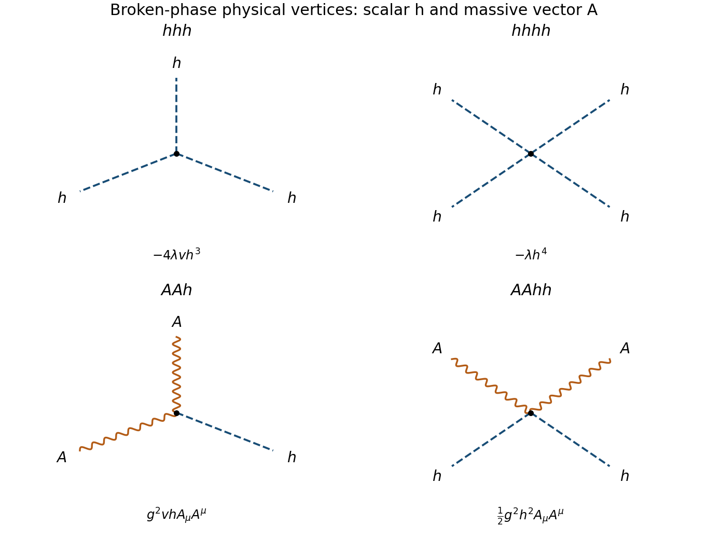

<h1 id="5/d/solution">Solution</h1>

↑ **Parent:** [D](../d.md)

A real antisymmetric generator of the connected rotation group is

$$
T=\begin{pmatrix}0&-1\\1&0\end{pmatrix},\qquad R(\alpha)=e^{\alpha T}.
$$

Choose $D_\mu\boldsymbol\phi=(\partial_\mu-gA_\mu T)\boldsymbol\phi$. Under $\boldsymbol\phi\mapsto R(\alpha(x))\boldsymbol\phi$ and $A_\mu\mapsto A_\mu+\partial_\mu\alpha/g$, the [gauge covariant derivative](../../../../gauge-covariant-derivative.md) transforms in the same way as the field. Include the canonical [gauge kinetic term](../../../../gauge-kinetic-term.md) $-F_{\mu\nu}F^{\mu\nu}/4$ so the vector's mass [normalization](../../../../normalization.md) is specified.

In [unitary gauge](../../../../unitary-gauge.md), $\boldsymbol\phi=(v+h,0)^T$. The relevant [Lagrangian density](../../../../lagrangian-density.md) is

$$
\mathcal L=-\tfrac14F^2+\tfrac12(\partial h)^2
+\tfrac12g^2(v+h)^2A_\mu A^\mu-\lambda(2vh+h^2)^2.
$$

Reading the quadratic vector term as $m_A^2A^2/2$ gives

$$
\boxed{m_A=|gv|.}
$$

The angular scalar supplies the longitudinal polarization of the massive vector; it is not a separate physical massless particle after gauging. The physical scalar still has $m_h^2=8\lambda v^2$.

The interactions among the physical fields are

$$
\boxed{\mathcal L_{\rm int}=-4\lambda vh^3-\lambda h^4
+g^2vhA_\mu A^\mu+\tfrac12g^2h^2A_\mu A^\mu.}
$$

Thus the complete physical vertex list is $hhh$, $hhhh$, $AAh$, and $AAhh$. An Abelian [gauge kinetic term](../../../../gauge-kinetic-term.md) generates no $AAA$ or $AAAA$ self-interaction. Gauge-dependent Goldstone vertices in another gauge do not add physical particle species to this list. These statements concern the broken phase $v\ne0$; when $v=0$ the unitary-gauge broken-phase parametrization is unavailable.

**[Figure 3](#5/d/image-all-physical-interaction-vertices-in-the-broken-two-real-scalar-gauge-model). All physical interaction vertices in the broken two-real-scalar gauge model**. Original vertex inventory in unitary gauge: three and four radial scalars, two vectors with one radial scalar, and two vectors with two radial scalars. Dashed lines denote h and wavy lines A.

## ↑ Ancestors (12)

1. [D](../d.md)
2. [5](../../5.md)
3. [2015](../../../2015-split.md)
4. [Past exam of the theoretical physics major option course of the University of Oxford](../../../split.md)
5. [Theoretical physics major option course of the University of Oxford](../../../../theoretical-physics-major-option-course-of-the-university-of-oxford.md)
6. [Year 4 of the physics course of the University of Oxford](../../../../year-4-of-the-physics-course-of-the-university-of-oxford.md)
7. [Physics course of the University of Oxford](../../../../physics-course-of-the-university-of-oxford.md)
8. [Undergraduate course of the University of Oxford](../../../../undergraduate-course-of-the-university-of-oxford.md)
9. [Course of the University of Oxford](../../../../course-of-the-university-of-oxford.md)
10. [University of Oxford](../../../../university-of-oxford-split.md)
11. [List of universities](../../../../list-of-universities.md)
12. [Codex Wiki](../../../../split.md)
