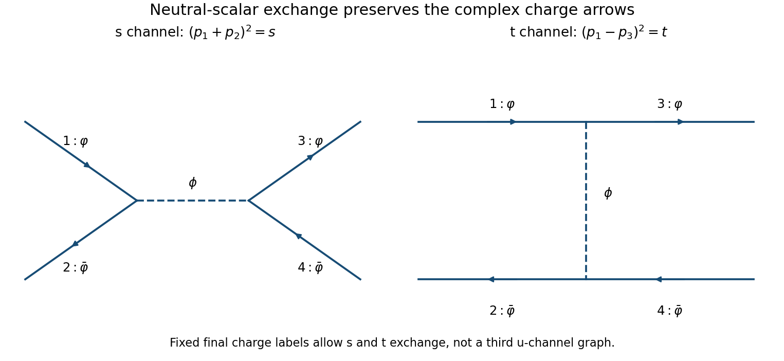

<h1 id="6/d/solution">Solution</h1>

↑ **Parent:** [D](../d.md)

The leading decay is into one complex particle and its antiparticle, which are distinguishable. Using $|\mathcal A|^2=g^2$ in [a](../a.md) gives

$$
\boxed{\Gamma(\phi\to\varphi\bar\varphi)=\frac{g^2}{16\pi m}.}
$$

In four space-time dimensions a canonically normalized scalar has mass dimension one, so $g$ has mass dimension one. The amplitude starts at order $g$, a rate is quadratic in that amplitude, and the only mass scale in the massless-daughter decay is $m$. Those facts already require $\Gamma\propto g^2/m$, leaving only a dimensionless numerical factor to calculate.

For [low-energy charged-scalar scattering through a neutral scalar](../../../../low-energy-charged-scalar-scattering-through-a-neutral-scalar.md), label the incoming particle and antiparticle as $1,2$ and their outgoing counterparts as $3,4$. Charge flow allows $s$-channel annihilation and $t=(p_1-p_3)^2$ exchange of the real massive scalar. It forbids a separate $u$-channel graph for this fixed assignment of distinguishable final charges. The tree amplitude is

$$
\boxed{\mathcal M=-g^2\left(\frac1{s-m^2}+\frac1{t-m^2}\right)
=\frac{2g^2}{m^2}+O\!\left(\frac{g^2s}{m^4},\frac{g^2t}{m^4}\right).}
$$

At low energy it is approximately angle independent. The massless two-body scattering formula then gives

$$
\boxed{\sigma_{\rm tot}\simeq\frac{|\mathcal M|^2}{16\pi s}
=\frac{g^4}{4\pi m^4s}.}
$$

In particular the requested scale estimate is $\sigma\sim g^4/(m^4s)$, not $g^4/m^6$ with the incoming-energy dependence omitted. Integrating out $\phi$ gives $\mathcal L_{\rm eff}=g^2(\varphi^\dagger\varphi)^2/(2m^2)$ at this order, whose complex-scalar four-leg combinatorics reproduce the same $2g^2/m^2$ amplitude. These are weak-coupling perturbative results about the specified vacuum; possible ultraviolet stabilizing interactions are not determined by the cubic term alone.

**[Figure 4](#6/d/image-the-two-allowed-leading-particle-antiparticle-scattering-diagrams). The two allowed leading particle-antiparticle scattering diagrams**. Original s-channel annihilation and t-channel exchange graphs. The internal dashed line is the massive neutral scalar; solid arrows show conserved complex charge. A u-channel graph would connect the wrong final charges for the fixed labeling.

## ↑ Ancestors (12)

1. [D](../d.md)
2. [6](../../6.md)
3. [2015](../../../2015-split.md)
4. [Past exam of the theoretical physics major option course of the University of Oxford](../../../split.md)
5. [Theoretical physics major option course of the University of Oxford](../../../../theoretical-physics-major-option-course-of-the-university-of-oxford.md)
6. [Year 4 of the physics course of the University of Oxford](../../../../year-4-of-the-physics-course-of-the-university-of-oxford.md)
7. [Physics course of the University of Oxford](../../../../physics-course-of-the-university-of-oxford.md)
8. [Undergraduate course of the University of Oxford](../../../../undergraduate-course-of-the-university-of-oxford.md)
9. [Course of the University of Oxford](../../../../course-of-the-university-of-oxford.md)
10. [University of Oxford](../../../../university-of-oxford-split.md)
11. [List of universities](../../../../list-of-universities.md)
12. [Codex Wiki](../../../../split.md)
