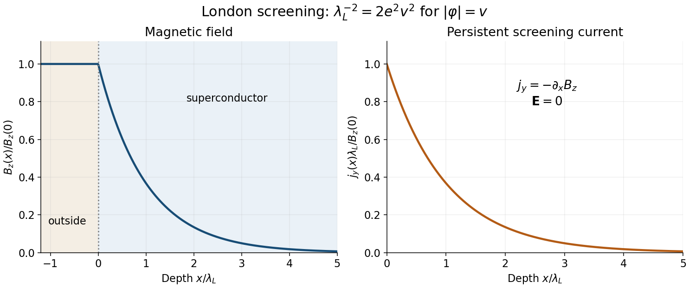

<h1 id="8/d/solution">Solution</h1>

↑ **Parent:** [D](../d.md)

The scalar potential is $V=-\mu^2|\varphi|^2/2+\lambda|\varphi|^4/4$. Minimizing it with respect to $|\varphi|^2$ gives

$$
\boxed{v^2=\frac{\mu^2}{\lambda},\qquad v=\frac{\sqrt{\mu^2}}{\sqrt\lambda}.}
$$

Choose a gauge with constant condensate phase and take the homogeneous-amplitude London limit, $\varphi=v$. Then [c](../c.md) reduces to

$$
\boxed{\mathbf j=-2e^2v^2\mathbf A,\qquad
\nabla^2\mathbf B=2e^2v^2\mathbf B.}
$$

The [London screening with an unnormalized complex condensate](../../../../london-screening-with-an-unnormalized-complex-condensate.md) has a factor of two from the complex-field kinetic term as printed; no $1/\sqrt2$ has been included in the definition of the real positive $v$. Equivalently, the gauge mass is $m_A^2=2e^2v^2$.

For a planar surface at $x=0$ and conductor in $x>0$, take a tangential field $B_z(x)$. The solution bounded at large depth is

$$
\boxed{B_z(x)=B_z(0)e^{-x/\lambda_L},\qquad
\lambda_L=\frac1{\sqrt2|e|v}=\frac{\sqrt\lambda}{\sqrt2|e|\sqrt{\mu^2}}.}
$$

The exponentially growing solution is excluded. The screening current $j_y=-\partial_xB_z=B_z(0)e^{-x/\lambda_L}/\lambda_L$ is nonzero near the surface, demonstrating the [Meissner effect](../../../../meissner-effect.md) through a persistent surface current. The constant-amplitude approximation describes [London screening](../../../../london-screening.md) away from any region where the condensate itself is strongly suppressed.

In the stipulated static gauge, $\mathbf E=-\partial_t\mathbf A-\nabla A_0=0$. Where this equilibrium screening current is nonzero, the assumed local [Ohm's law](../../../../ohm-s-law.md) $\mathbf E=\rho\mathbf j$ therefore demands $\rho=0$. The simultaneous equality $\mathbf E=\mathbf j=0$ deep in the bulk would by itself place **no** constraint on $\rho$; it is not a valid standalone proof of [superconductivity](../../../../superconductivity-split.md).

The lossless condensate also supplies the dynamical check. With fixed amplitude and phase in temporal gauge, differentiating the London relation gives $\partial_t\mathbf j=2e^2v^2\mathbf E$. A steady field accelerates the supercurrent rather than producing a stationary dissipative current. Thus the ideal condensate has zero [electrical resistivity](../../../../electrical-resistivity.md), or an infinite [electrical conductivity](../../../../electrical-conductivity.md), consistent with the static screening solution. This is the superconducting component of the toy model; normal carriers and dissipation are not included. The nonzero field expectation is understood in a gauge-fixed description of the Higgs phase, not as a gauge-invariant local observable.

**[Figure 5](#8/d/image-exponential-magnetic-screening-and-the-persistent-surface-current). Exponential magnetic screening and the persistent surface current**. Original London-limit half-space solution. The magnetic field and screening-current magnitude share the decay length lambda L; their boundary values set the plotted normalization.

## ↑ Ancestors (12)

1. [D](../d.md)
2. [8](../../8.md)
3. [2015](../../../2015-split.md)
4. [Past exam of the theoretical physics major option course of the University of Oxford](../../../split.md)
5. [Theoretical physics major option course of the University of Oxford](../../../../theoretical-physics-major-option-course-of-the-university-of-oxford.md)
6. [Year 4 of the physics course of the University of Oxford](../../../../year-4-of-the-physics-course-of-the-university-of-oxford.md)
7. [Physics course of the University of Oxford](../../../../physics-course-of-the-university-of-oxford.md)
8. [Undergraduate course of the University of Oxford](../../../../undergraduate-course-of-the-university-of-oxford.md)
9. [Course of the University of Oxford](../../../../course-of-the-university-of-oxford.md)
10. [University of Oxford](../../../../university-of-oxford-split.md)
11. [List of universities](../../../../list-of-universities.md)
12. [Codex Wiki](../../../../split.md)
