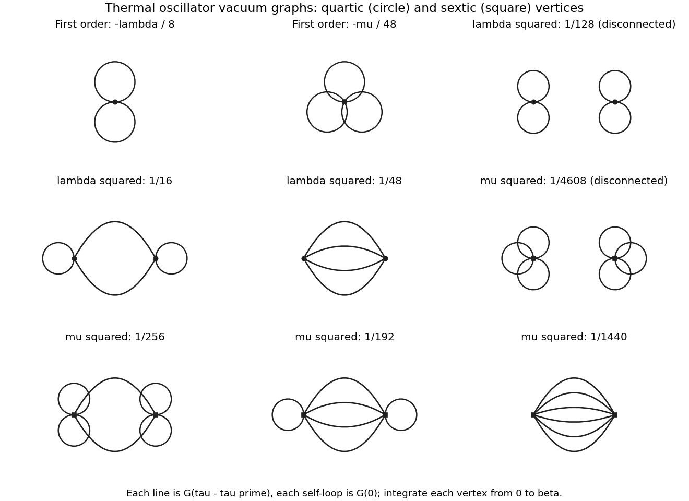
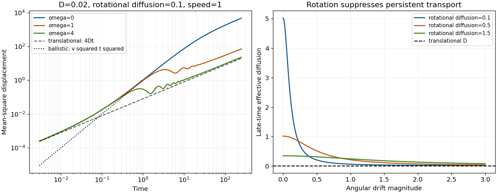
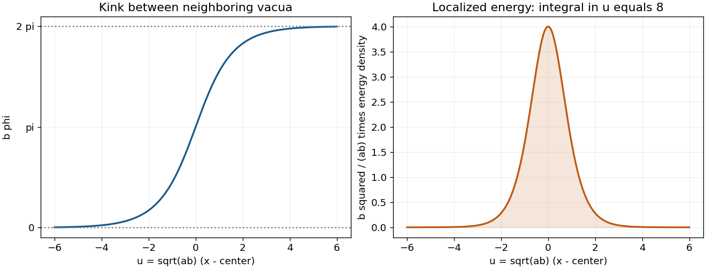
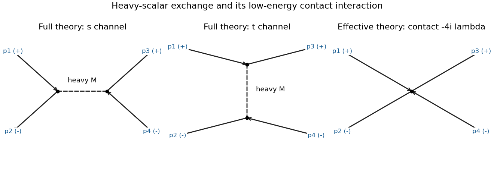

# 2016

↑ **Parent:** [Past exam of the theoretical physics major option course of the University of Oxford](../past-exam-of-the-theoretical-physics-major-option-course-of-the-university-of-oxford.md)

Source paper: [https://www.whatdotheyknow.com/request/physics_past_exam_papers_2015_16/response/973997/attach/3/Cowell%20Attachment.zip?cookie_passthrough=1](https://www.whatdotheyknow.com/request/physics_past_exam_papers_2015_16/response/973997/attach/3/Cowell%20Attachment.zip?cookie_passthrough=1)

All eight questions are solved. Set $\hbar=c=1$ unless a thermal factor $k_B$ is written explicitly. Relativistic calculations use the [Minkowski metric](../special-relativity.md#minkowski-metric) $(+---)$. The unbracketed sums in the first two printed energies are read as sums over all the displayed bond terms, with the common prefactor applying to the entire summand.

**Table of contents**

- [1](#1)
  - [a](#1/a)
    - [Solution](#1/a/solution)
  - [b](#1/b)
    - [Solution](#1/b/solution)
  - [c](#1/c)
    - [Solution](#1/c/solution)
  - [d](#1/d)
    - [Solution](#1/d/solution)
- [2](#2)
  - [a](#2/a)
    - [Solution](#2/a/solution)
  - [b](#2/b)
    - [Solution](#2/b/solution)
  - [c](#2/c)
    - [Solution](#2/c/solution)
  - [d](#2/d)
    - [Solution](#2/d/solution)
  - [e](#2/e)
    - [Solution](#2/e/solution)
- [3](#3)
  - [a](#3/a)
    - [Solution](#3/a/solution)
  - [b](#3/b)
    - [Solution](#3/b/solution)
  - [c](#3/c)
    - [Solution](#3/c/solution)
  - [d](#3/d)
    - [Solution](#3/d/solution)
  - [e](#3/e)
    - [Solution](#3/e/solution)
  - [f](#3/f)
    - [Solution](#3/f/solution)
- [4](#4)
  - [a](#4/a)
    - [Solution](#4/a/solution)
  - [b](#4/b)
    - [Solution](#4/b/solution)
  - [c](#4/c)
    - [Solution](#4/c/solution)
  - [d](#4/d)
    - [Solution](#4/d/solution)
- [5](#5)
  - [a](#5/a)
    - [Solution](#5/a/solution)
  - [b](#5/b)
    - [Solution](#5/b/solution)
  - [c](#5/c)
    - [Solution](#5/c/solution)
  - [d](#5/d)
    - [Solution](#5/d/solution)
- [6](#6)
  - [a](#6/a)
    - [Solution](#6/a/solution)
  - [b](#6/b)
    - [Solution](#6/b/solution)
  - [c](#6/c)
    - [Solution](#6/c/solution)
  - [d](#6/d)
    - [Solution](#6/d/solution)
- [7](#7)
  - [a](#7/a)
    - [Solution](#7/a/solution)
  - [b](#7/b)
    - [Solution](#7/b/solution)
  - [c](#7/c)
    - [Solution](#7/c/solution)
  - [d](#7/d)
    - [Solution](#7/d/solution)
- [8](#8)
  - [a](#8/a)
    - [Solution](#8/a/solution)
  - [b](#8/b)
    - [Solution](#8/b/solution)
  - [c](#8/c)
    - [Solution](#8/c/solution)
  - [d](#8/d)
    - [Solution](#8/d/solution)

## 1

↑ **Parent:** [2016](2016.md)

<h3 id="1/a">a</h3>

↑ **Parent:** [1](#1)

<h4 id="1/a/solution">Solution</h4>

↑ **Parent:** [A](#1/a)

Let $\beta=(k_BT)^{-1}$ and sum over all $2^{2L}$ configurations of the [Ising spins](../spin-model.md#ising-spin-variable). The [canonical partition function](../canonical-ensemble.md#canonical-partition-function) and [Helmholtz free energy](../thermodynamic-potential.md#helmholtz-free-energy) per site are

$$
Z_L=\sum_{\{\sigma,\tau\}}e^{-\beta E(\sigma,\tau)},
\qquad \boxed{f_L=-\frac{k_BT}{2L}\log Z_L.}
$$

Both [spins](../angular-momentum-operator.md#spin) in each cell count as sites. In particular the denominator is $2L$, rather than $L$.

The mean [spin magnetization](../spin-model.md#spin-magnetization) per site is the [Boltzmann distribution](../thermodynamics.md#boltzmann-distribution) average

$$
\boxed{\langle m\rangle=\frac1{2LZ_L}\sum_{\{\sigma,\tau\}}\left[\sum_{j=1}^L(\sigma_j+\tau_j)\right]e^{-\beta E}.}
$$

Equivalently introduce a uniform [magnetic field](../magnetic-field.md) through $E_h=E-h\sum_j(\sigma_j+\tau_j)$ and differentiate:

$$
\langle m\rangle=\left.\frac1{2L\beta}\frac{\partial\log Z_L(h)}{\partial h}\right|_{h=0}.
$$

This convention absorbs the microscopic [magnetic moment](../electromagnetism.md#magnetic-dipole-moment) into $h$. Simultaneous reversal of every [spin](../angular-momentum-operator.md#spin) leaves $E$ invariant and changes the sign of the numerator, so $\langle m\rangle=0$ at zero field for finite $L$.

<h3 id="1/b">b</h3>

↑ **Parent:** [1](#1)

<h4 id="1/b/solution">Solution</h4>

↑ **Parent:** [B](#1/b)

For each pair of adjacent [spins](../angular-momentum-operator.md#spin), define the [transfer matrix for a classical spin chain](../spin-model.md#transfer-matrix-for-a-classical-spin-chain) by $T_{ss'}=e^{-\beta E_0(s,s')}$. Multiplying its entries gives the [Boltzmann factor](../canonical-ensemble.md#boltzmann-factor) of a whole configuration. The [periodic boundary condition](../differential-equation.md#periodic-boundary-conditions) identifies the last index with the first, so

$$
Z_L=\sum_{\sigma_1,\ldots,\sigma_L}T_{\sigma_1\sigma_2}\cdots T_{\sigma_L\sigma_1}
=\boxed{\operatorname{Tr}T^L=\sum_\alpha\lambda_\alpha^L.}
$$

The assumed interchange symmetry of $E_0$ makes $T$ a real [symmetric matrix](../linear-algebra.md#symmetric-matrix), hence it has an orthonormal [eigenbasis](../linear-operator-theory.md#eigenbasis). At finite positive [temperature](../temperature.md), every matrix entry is strictly positive, so the [Perron–Frobenius theorem](../vector-space.md#perron-frobenius-theorem) supplies a unique positive largest [eigenvalue](../linear-operator-theory.md#eigenvalue) $\lambda_+$, larger in modulus than every other one. Therefore $L^{-1}\log Z_L\to\log\lambda_+$.

Local observables become matrix insertions. For example, with $S_{ss'}=s\delta_{ss'}$,

$$
\langle\sigma_1\rangle=\frac{\operatorname{Tr}(ST^L)}{\operatorname{Tr}T^L},
\qquad
\langle\sigma_1\sigma_{1+r}\rangle=\frac{\operatorname{Tr}(ST^rST^{L-r})}{Z_L}.
$$

Thus [partition functions](../canonical-ensemble.md#canonical-partition-function) and [correlation functions](../critical-phenomenon.md#correlation-function) reduce to a fixed-dimensional [eigenvalue](../linear-operator-theory.md#eigenvalue) problem, rather than a sum over exponentially many [microstates](../statistical-physics.md#microstate).

<h3 id="1/c">c</h3>

↑ **Parent:** [1](#1)

<h4 id="1/c/solution">Solution</h4>

↑ **Parent:** [C](#1/c)

For the [sawtooth Ising chain](../spin-model.md#sawtooth-ising-chain), each apex [spin](../angular-momentum-operator.md#spin) occurs in only one triangle. Put $K=\beta J$. Summing that [spin](../angular-momentum-operator.md#spin) first gives the effective [transfer matrix](../combinatorics.md#transfer-matrix)

$$
T_{ss'}=\sum_{t=\pm1}\exp\{K[ss'+t(s+s')]\}
=2e^{Kss'}\cosh[K(s+s')].
$$

In the ordered basis $s=+1,-1$ this is

$$
T=\begin{pmatrix}2e^K\cosh2K&2e^{-K}\\2e^{-K}&2e^K\cosh2K\end{pmatrix}.
$$

Its symmetric and antisymmetric [eigenvectors](../linear-operator-theory.md#eigenvector) are $(1,1)/\sqrt2$ and $(1,-1)/\sqrt2$, with [eigenvalues](../linear-operator-theory.md#eigenvalue)

$$
\lambda_+=e^{3K}+3e^{-K},\qquad\lambda_-=e^{3K}-e^{-K}.
$$

Consequently

$$
\boxed{Z_L=(e^{3K}+3e^{-K})^L+(e^{3K}-e^{-K})^L,\qquad
f_\infty=-\frac{k_BT}{2}\log(e^{3K}+3e^{-K}).}
$$

At $J=0$, the result is $Z_L=4^L$, correctly counting $2L$ independent [Ising spins](../spin-model.md#ising-spin-variable). As $T\to0$, $f_\infty\to-3J/2$, the energy of three satisfied ferromagnetic bonds per two sites.

The printed summand lacks grouping brackets. The result above uses the translation-invariant common-$J$ interpretation. If base and apex bonds instead have independent couplings $J_b,J_a$, the same derivation gives $\lambda_\pm=2e^{\beta J_b}\cosh(2\beta J_a)\pm2e^{-\beta J_b}$; specifying those couplings is essential before giving a different answer.

<h3 id="1/d">d</h3>

↑ **Parent:** [1](#1)

<h4 id="1/d/solution">Solution</h4>

↑ **Parent:** [D](#1/d)

Let $S=\operatorname{diag}(1,-1)$ be the base-[spin](../angular-momentum-operator.md#spin) insertion matrix. In the [eigenbasis](../linear-operator-theory.md#eigenbasis) from [solution](#1/c/solution), its diagonal matrix elements vanish: $\langle+|S|+\rangle=\langle-|S|-\rangle=0$. Hence

$$
\boxed{\langle\sigma_1\rangle=\frac{\operatorname{Tr}(ST^L)}{\operatorname{Tr}T^L}=0,}
$$

not only at large $L$ but for every finite ring at zero field.

This vanishing is not merely an averaging artifact hiding a finite-temperature ordered phase. The two-point [correlation function](../critical-phenomenon.md#correlation-function) is $\langle\sigma_1\sigma_{1+r}\rangle=(\lambda_-^r\lambda_+^{L-r}+\lambda_+^r\lambda_-^{L-r})/Z_L$. In the [thermodynamic limit](../statistical-physics.md#thermodynamic-limit) it becomes $(\lambda_-/\lambda_+)^r$, with finite [correlation length](../critical-phenomenon.md#correlation-length) $\xi^{-1}=\log(\lambda_+/\lambda_-)$ for every $T>0$ and $J>0$. Thermal [domain walls](../critical-phenomenon.md#domain-wall) destroy long-range alignment in this one-dimensional short-range system. At zero [temperature](../temperature.md), the two fully aligned [ground states](../quantum-mechanics.md#ground-state) are degenerate; that limiting case must be distinguished from any fixed positive [temperature](../temperature.md).

## 2

↑ **Parent:** [2016](2016.md)

<h3 id="2/a">a</h3>

↑ **Parent:** [2](#2)

<h4 id="2/a/solution">Solution</h4>

↑ **Parent:** [A](#2/a)

For a uniform classical [spin](../angular-momentum-operator.md#spin) $S\mathbf n$ with $\mathbf n^2=1$, the [energy](../energy.md) per bond is

$$
e=-S^2[J^x n_x^2+J^y n_y^2+J^z n_z^2].
$$

The strict inequalities among the couplings make the $x$ direction the unique easy axis. Thus

$$
\boxed{\mathbf S_j=+S\hat{\mathbf x}\ \hbox{for every }j,
\quad\hbox{or}\quad\mathbf S_j=-S\hat{\mathbf x}\ \hbox{for every }j,\qquad E_0=-LJ^xS^2.}
$$

These uniform configurations are also global classical minima: the largest singular value of the diagonal exchange matrix is $J^x$, so each bond has energy at least $-J^xS^2$, and both configurations saturate that bound.

A global [rotation](../riemannian-geometry.md#rotation-mathematics) by $\pi$ about the $z$ axis sends $(S^x,S^y,S^z)$ to $(-S^x,-S^y,S^z)$, preserves every exchange product, and exchanges the two [ground states](../quantum-mechanics.md#ground-state). A $\pi$ rotation about $y$ does the same. The broken discrete symmetry can be represented by either operation.

<h3 id="2/b">b</h3>

↑ **Parent:** [2](#2)

<h4 id="2/b/solution">Solution</h4>

↑ **Parent:** [B](#2/b)

The [Hamiltonian](../hamiltonian-mechanics.md#hamiltonian) has the discrete [symmetry](../physics.md#symmetry-physics) described in [solution](#2/a/solution), whereas either selected easy-axis [ground state](../quantum-mechanics.md#ground-state) has a nonzero [order parameter](../critical-phenomenon.md#order-parameter) $\langle S^x\rangle$ and is not invariant under it. This is [spontaneous symmetry breaking](../quantum-field-theory.md#spontaneous-symmetry-breaking): the equations preserve the symmetry while the selected macroscopic [quantum state](../quantum-system.md#quantum-state) does not.

An infinitesimal longitudinal [magnetic field](../magnetic-field.md) selects one orientation. The defining order of limits is

$$
\boxed{m_x=\lim_{h\to0^+}\lim_{L\to\infty}\frac1L\sum_j\langle S_j^x\rangle_h\ne0}
$$

in the ordered zero-temperature phase, with the opposite sign for $h\to0^-$. A symmetric finite-volume [quantum state](../quantum-system.md#quantum-state) can instead have zero [magnetization](../electromagnetism.md#magnetization). Quantum ordered states are generally dressed by fluctuations rather than exact fully polarized product states, because unequal transverse exchange can create pairs of [spin waves](../critical-phenomenon.md#spin-wave). Discrete easy-axis symmetry does not imply a gapless [Goldstone mode](../critical-phenomenon.md#goldstone-boson); indeed [solution](#2/e/solution) finds a nonzero [spin wave](../critical-phenomenon.md#spin-wave) gap. Nor does this argument assert positive-temperature order in a one-dimensional short-range chain.[Section 1.2.1, spontaneous symmetry breaking and the order of thermodynamic and zero-field limits](../physics-bibliography.md#statistical-field-theory-by-david-tong)

<h3 id="2/c">c</h3>

↑ **Parent:** [2](#2)

<h4 id="2/c/solution">Solution</h4>

↑ **Parent:** [C](#2/c)

The [Holstein–Primakoff transformation](../angular-momentum-operator.md#holstein-primakoff-transformation) replaces each finite-dimensional [spin](../angular-momentum-operator.md#spin) algebra by a bosonic [creation operator](../quantum-harmonic-oscillator.md#creation-operator) and [annihilation operator](../quantum-harmonic-oscillator.md#annihilation-operator), while restricting the local [occupation number](../quantum-field-theory.md#occupation-number) to $0\le n_j\le2S$. The number $n_j=a_j^\dagger a_j$ counts deviations from the fully polarized reference [quantum state](../quantum-system.md#quantum-state). Its zero-boson [Fock vacuum](../quantum-field-theory.md#fock-vacuum) has $\widetilde S^z=S$.

The representation is exact on this physical subspace: the ordered square root gives $\widetilde S^+|n\rangle=\sqrt{n(2S-n+1)}|n-1\rangle$ and $\widetilde S^-|n\rangle=\sqrt{(n+1)(2S-n)}|n+1\rangle$, reproducing the [spin commutation relations](../angular-momentum-operator.md#spin-commutation-relations). For $n_j\ll S$,

$$
\widetilde S^+_j=\sqrt{2S}\left(1-\frac{n_j}{4S}+\cdots\right)a_j,
$$

so the leading [Hamiltonian](../hamiltonian-mechanics.md#hamiltonian) is quadratic in bosons and describes [spin waves](../critical-phenomenon.md#spin-wave).

The square root generates boson interactions beyond leading order and its operator ordering matters. Truncation also enlarges the [Hilbert space](../hilbert-space.md) to unphysical occupations unless the low-density approximation remains self-consistent. Large fluctuations, particularly near a gap closing or in low dimensions, can invalidate the [linear spin-wave approximation](../critical-phenomenon.md#linear-spin-wave-approximation) even when its algebraic manipulation is straightforward.

<h3 id="2/d">d</h3>

↑ **Parent:** [2](#2)

<h4 id="2/d/solution">Solution</h4>

↑ **Parent:** [D](#2/d)

Choose the positive-$x$ reference [ground state](../quantum-mechanics.md#ground-state) and use the cyclic [rotation](../riemannian-geometry.md#rotation-mathematics)

$$
\widetilde S^z=S^x,\qquad\widetilde S^x=S^y,\qquad\widetilde S^y=S^z.
$$

This is a right-handed permutation, so it preserves the [spin commutation relations](../angular-momentum-operator.md#spin-commutation-relations). It puts the ordered direction along the [Holstein–Primakoff transformation](../angular-momentum-operator.md#holstein-primakoff-transformation)'s quantization axis. To the required order,

$$
\widetilde S^z_j=S-n_j,\quad
\widetilde S^x_j=\sqrt{\frac S2}(a_j+a_j^\dagger),\quad
\widetilde S^y_j=-i\sqrt{\frac S2}(a_j-a_j^\dagger).
$$

The longitudinal exchange contributes $-LJ^xS^2+2SJ^x\sum_jn_j+O(S^0)$. The transverse terms contribute

$$
-\frac S2\sum_j\left[(J^y+J^z)(a_j^\dagger a_{j+1}+a_{j+1}^\dagger a_j)
+(J^y-J^z)(a_ja_{j+1}+a_j^\dagger a_{j+1}^\dagger)\right].
$$

Dropping the constant and all terms of order $S^0$ or smaller gives the stated [linear spin-wave approximation](../critical-phenomenon.md#linear-spin-wave-approximation), with

$$
\boxed{A=-\frac S2(J^y+J^z),\qquad B=-\frac S2(J^y-J^z),\qquad C=2SJ^x.}
$$

The anomalous pair terms are present because the two transverse couplings differ. A different right-handed choice of transverse axes can change the sign of $B$ by a boson phase convention, while leaving the [dispersion relation](../dispersion-relation.md) unchanged.

<h3 id="2/e">e</h3>

↑ **Parent:** [2](#2)

<h4 id="2/e/solution">Solution</h4>

↑ **Parent:** [E](#2/e)

Use the unitary discrete [Fourier transform](../fourier-transform.md) $a_j=L^{-1/2}\sum_ke^{ikj}a_k$, where $k=2\pi n/L$. Then

$$
H_{\rm LSW}=\sum_k\left[\alpha_k a_k^\dagger a_k+
\frac{\beta_k}{2}(a_ka_{-k}+a_k^\dagger a_{-k}^\dagger)\right],
$$

with $\alpha_k=S[2J^x-(J^y+J^z)\cos k]$ and $\beta_k=-S(J^y-J^z)\cos k$. The factor $1/2$ accounts for the duplicated $k,-k$ pair in the full momentum sum.

Make a bosonic [Bogoliubov transformation](../quantum-field-theory.md#bogoliubov-transformation) $a_k=\cosh\theta_k\,b_k+\sinh\theta_k\,b_{-k}^\dagger$. Its coefficients preserve the [canonical commutation relation](../quantum-mechanics.md#canonical-commutation-relation) because $\cosh^2\theta_k-\sinh^2\theta_k=1$. The coefficient of the pair term vanishes when $\tanh2\theta_k=-\beta_k/\alpha_k$. Thus

$$
\boxed{H_{\rm LSW}=\sum_k\varepsilon_k b_k^\dagger b_k+\text{constant},\qquad
\varepsilon_k=2S\sqrt{(J^x-J^y\cos k)(J^x-J^z\cos k)}.}
$$

The dropped constant is $\tfrac12\sum_k(\varepsilon_k-\alpha_k)$ in addition to the classical [ground-state energy](../quantum-mechanics.md#ground-state-energy). Since $J^x>J^y>J^z>0$, $\alpha_k>|\beta_k|$ at every $k$, so the [bosonic Bogoliubov diagonalization](../quantum-field-theory.md#bosonic-bogoliubov-diagonalization) is stable. The minimum occurs at $k=0$ and gives the [energy gap](../linear-operator-theory.md#energy-gap) $2S\sqrt{(J^x-J^y)(J^x-J^z)}$. In the isotropic limit the pair coefficient vanishes and the familiar quadratic small-$k$ ferromagnetic [dispersion relation](../dispersion-relation.md) is recovered.

## 3

↑ **Parent:** [2016](2016.md)

<h3 id="3/a">a</h3>

↑ **Parent:** [3](#3)

<h4 id="3/a/solution">Solution</h4>

↑ **Parent:** [A](#3/a)

Use $\hbar=1$. Taking the trace of the imaginary-time [time-evolution operator](../quantum-system.md#time-evolution-operator) identifies the initial and final position, giving the [path integral](../quantum-field-theory.md#path-integral)

$$
\boxed{Z(\beta)=\operatorname{Tr}e^{-\beta H}
=\int_{x(\beta)=x(0)}\mathcal Dx\,
\exp\left[-\int_0^\beta d\tau\left(\frac m2\dot x^2+\frac\kappa2x^2+
\frac\lambda{4!}x^4+\frac\mu{6!}x^6\right)\right].}
$$

The measure includes integration over the common endpoint. The paths are real periodic bosonic paths on the imaginary-time circle, not paths with fixed zero endpoints and not only classical trajectories. The kinetic measure is defined by time slicing; typical contributing paths need not be differentiable. For the free expansion assume $m,\kappa>0$. The interacting [partition function](../canonical-ensemble.md#canonical-partition-function) requires a potential bounded below; otherwise the following formulas have the meaning of a formal [perturbation series](../perturbative-quantum-field-theory.md#perturbation-series) about the free [harmonic oscillator](../classical-mechanics.md#simple-harmonic-motion).

<h3 id="3/b">b</h3>

↑ **Parent:** [3](#3)

<h4 id="3/b/solution">Solution</h4>

↑ **Parent:** [B](#3/b)

Here the imaginary-time [Heisenberg picture](../quantum-system.md#heisenberg-picture) position operator is $\bar x(\tau)=e^{\tau H_0}\hat x e^{-\tau H_0}$, where $H_0=H(0,0)$. Bosonic [time ordering](../perturbative-quantum-field-theory.md#time-ordering) $T_\tau$ places the larger imaginary time to the left without an exchange sign. The brackets denote the normalized [thermal expectation value](../canonical-ensemble.md#thermal-expectation-value)

$$
\langle O\rangle_\beta=\frac{\operatorname{Tr}(e^{-\beta H_0}O)}{Z_0},
\qquad Z_0=\operatorname{Tr}e^{-\beta H_0}.
$$

The trace is cyclic and $H_0$ is time independent, so the [two-point correlation function](../critical-phenomenon.md#two-point-correlation-function) depends only on the time difference and extends periodically with period $\beta$. This periodicity is a property of the thermal [correlation function](../critical-phenomenon.md#correlation-function), not the operator identity $\bar x(\tau+\beta)=\bar x(\tau)$.

<h3 id="3/c">c</h3>

↑ **Parent:** [3](#3)

<h4 id="3/c/solution">Solution</h4>

↑ **Parent:** [C](#3/c)

The free [Euclidean action](../perturbative-quantum-field-theory.md#euclidean-action) has inverse [propagator](../quantum-field-theory.md#propagator) $D=-m\partial_\tau^2+\kappa$. Therefore the thermal [Green's function](../green-s-function.md) obeys

$$
\boxed{(-m\partial_\tau^2+\kappa)G^{(0)}(\tau)=\delta_\beta(\tau),\qquad
G^{(0)}(\tau+\beta)=G^{(0)}(\tau),}
$$

where $\delta_\beta$ is the periodic [Dirac delta function](../distribution-theory.md#dirac-delta-function). It is continuous, has continuous first derivative away from its source, and satisfies $G'(0^+)-G'(0^-)=-1/m$. These conditions follow by integrating the differential equation across the source and using the bosonic thermal trace.

For $\Omega=\sqrt{\kappa/m}$, solving the homogeneous equation on $0<\tau<\beta$ and imposing these conditions gives

$$
\boxed{G^{(0)}(\tau)=\frac{\cosh[\Omega(\beta/2-\tau)]}{2m\Omega\sinh(\beta\Omega/2)}\quad(0\le\tau\le\beta).}
$$

In particular $g_0\equiv G^{(0)}(0)=\coth(\beta\Omega/2)/(2m\Omega)$. Equivalently $G^{(0)}=\beta^{-1}\sum_ne^{-i\omega_n\tau}/(m\omega_n^2+\kappa)$ with bosonic [Matsubara frequencies](../quantum-field-theory.md#matsubara-frequency) $\omega_n=2\pi n/\beta$.

<h3 id="3/d">d</h3>

↑ **Parent:** [3](#3)

<h4 id="3/d/solution">Solution</h4>

↑ **Parent:** [D](#3/d)

Keep the same measure normalization as in the free [generating functional](../perturbative-quantum-field-theory.md#generating-functional) and define

$$
W[J]=\mathcal N\int_{\rm periodic}\mathcal Dx\,
\exp\left[-S_0[x]-\int_0^\beta d\tau\left(\frac\lambda{4!}x^4+\frac\mu{6!}x^6\right)+\int_0^\beta d\tau\,Jx\right].
$$

Here $W$ is the source-dependent [partition function](../canonical-ensemble.md#canonical-partition-function), despite the common alternative convention in which that letter denotes its logarithm. A [functional derivative](../calculus-of-variations.md#functional-derivative) of $e^{\int Jx}$ brings down one factor $x(\tau)$ at the differentiated point. Expanding the interaction exponential and replacing each such factor by $\delta/\delta J(\tau)$ therefore gives

$$
\boxed{W[J]=\exp\left[-\int_0^\beta d\tau\left\{\frac\lambda{4!}\left(\frac\delta{\delta J(\tau)}\right)^4+
\frac\mu{6!}\left(\frac\delta{\delta J(\tau)}\right)^6\right\}\right]W_0[J].}
$$

Completing the square in the free [Gaussian integral](../integral.md#gaussian-integral) gives $W_0[J]=W_0[0]\exp(\tfrac12\int JG^{(0)}J)$ because $G^{(0)}=D^{-1}$ with periodic [boundary conditions](../differential-equation.md#boundary-condition). Restoring $\hbar$ replaces the upper limit by $\hbar\beta$ and the interaction coefficients by $\lambda/(4!\hbar)$ and $\mu/(6!\hbar)$, exactly as in the source.

<h3 id="3/e">e</h3>

↑ **Parent:** [3](#3)

<h4 id="3/e/solution">Solution</h4>

↑ **Parent:** [E](#3/e)

Set the external source to zero in [solution](#3/d/solution) and apply [Wick's theorem](../perturbative-quantum-field-theory.md#wick-s-theorem). At a single quartic [vertex](../graph.md#vertex-graph-theory), the four position insertions have three pairings; at a single sextic [vertex](../graph.md#vertex-graph-theory), six insertions have $5!!=15$ pairings. Thus

$$
\boxed{\frac{Z}{Z_0}=1-\frac\lambda8\int_0^\beta d\tau\,[G^{(0)}(0)]^2
-\frac\mu{48}\int_0^\beta d\tau\,[G^{(0)}(0)]^3+O(\lambda^2,\lambda\mu,\mu^2).}
$$

Thermal time-translation invariance makes this $1-\lambda\beta g_0^2/8-\mu\beta g_0^3/48+\cdots$, with $g_0$ from [solution](#3/c/solution). If desired the absolute corrections follow by multiplying by the free [partition function](../canonical-ensemble.md#canonical-partition-function) $Z_0=[2\sinh(\beta\Omega/2)]^{-1}$.

The first [Vacuum Feynman diagram](../perturbative-quantum-field-theory.md#vacuum-feynman-diagram) is one quartic [vertex](../graph.md#vertex-graph-theory) carrying two self-loops, with weight $-\lambda/8$ before time integration. The second is one sextic [vertex](../graph.md#vertex-graph-theory) carrying three self-loops, with weight $-\mu/48$. No disconnected subtraction is appropriate for $Z$ itself. The top row of the following figure shows these first-order terms and the conventions for [solution](#3/f/solution).

**[Figure 1](#3/e/image-quartic-and-sextic-oscillator-vacuum-graphs-through-second-order-the-displayed-coefficients-include-factorials-and-vertex-interchange-and-each-vertex-is-integrated-over-the-thermal-circle). Quartic and sextic oscillator vacuum graphs through second order; the displayed coefficients include factorials and vertex interchange, and each vertex is integrated over the thermal circle**.

<h3 id="3/f">f</h3>

↑ **Parent:** [3](#3)

<h4 id="3/f/solution">Solution</h4>

↑ **Parent:** [F](#3/f)

Write $G=G^{(0)}(\tau-\tau')$ and $g_0=G^{(0)}(0)$. With two identical degree-$n$ [vertices](../graph.md#vertex-graph-theory), let $r$ lines join them. The remaining $n-r$ half-edges on each [vertex](../graph.md#vertex-graph-theory) form self-loops. Both $n$ and $r$ are even. The number of [Wick contractions](../perturbative-quantum-field-theory.md#wick-contraction) is

$$
N_{n,r}=\binom nr^2r!\bigl[(n-r-1)!!\bigr]^2,
$$

since one chooses and matches the joining half-edges and then pairs the rest independently. Dividing by the expansion denominator $2!(n!)^2$ gives every [symmetry factor](../perturbative-quantum-field-theory.md#feynman-diagram-symmetry-factor) weight without guessing graph multiplicities.

For two quartic [vertices](../graph.md#vertex-graph-theory), $r=0,2,4$ gives

$$
\boxed{\left.\frac Z{Z_0}\right|_{\lambda^2}
=\lambda^2\int_0^\beta d\tau\,d\tau'\left[\frac{g_0^4}{128}+\frac{g_0^2G^2}{16}+\frac{G^4}{48}\right].}
$$

The graphs are respectively the product of two first-order two-loop graphs; two [vertices](../graph.md#vertex-graph-theory) joined by two lines with one self-loop on each; and two [vertices](../graph.md#vertex-graph-theory) joined by four lines with no self-loops.

For two sextic [vertices](../graph.md#vertex-graph-theory), $r=0,2,4,6$ gives

$$
\boxed{\left.\frac Z{Z_0}\right|_{\mu^2}
=\mu^2\int_0^\beta d\tau\,d\tau'\left[\frac{g_0^6}{4608}+\frac{g_0^4G^2}{256}
+\frac{g_0^2G^4}{192}+\frac{G^6}{1440}\right].}
$$

The corresponding numbers of self-loops on each [vertex](../graph.md#vertex-graph-theory) are $3,2,1,0$. All seven second-order graphs are drawn in [solution](#3/e/solution); in each series the $r=0$ graph is disconnected and the others are connected.

For completeness, a mixed quartic-sextic pair, not needed for the two pure second-order coefficients, contributes

$$
\left.\frac Z{Z_0}\right|_{\lambda\mu}=\lambda\mu\int_0^\beta d\tau\,d\tau'
\left[\frac{g_0^5}{384}+\frac{g_0^3G^2}{32}+\frac{g_0G^4}{48}\right].
$$

Taking $\log Z$ removes the products of first-order graphs, that is, the $r=0$ terms. The requested [partition function](../canonical-ensemble.md#canonical-partition-function) retains them.

## 4

↑ **Parent:** [2016](2016.md)

<h3 id="4/a">a</h3>

↑ **Parent:** [4](#4)

<h4 id="4/a/solution">Solution</h4>

↑ **Parent:** [A](#4/a)

The term $v\mathbf n$ is directed self-propulsion at fixed speed, while the two components of $\mathbf u$ generate translational [Brownian motion](../brownian-motion.md) with [diffusion coefficient](../brownian-motion.md#diffusion-coefficient) $D$. The angle has systematic angular velocity $\omega$ and rotational [diffusion coefficient](../brownian-motion.md#diffusion-coefficient) $D_r$. With independent standard [Brownian motions](../brownian-motion.md), the precise [stochastic differential equations](../stochastic-calculus.md#stochastic-differential-equation) are

$$
d\mathbf r=v\mathbf n(\theta)dt+\sqrt{2D}\,d\mathbf W,
\qquad d\theta=\omega dt+\sqrt{2D_r}\,dW_r.
$$

Independent translational and rotational noises are the usual interpretation; the supplied autocorrelations alone would not specify arbitrary cross-correlated noises.

The complete state $(\mathbf r,\theta\bmod2\pi)$ is a [Markov process](../markov-process.md): its future increments depend only on its present state and independent future noise. Its generator is $v\mathbf n\cdot\nabla+\omega\partial_\theta+D\nabla^2+D_r\partial_\theta^2$. Position alone generally lacks the [Markov property](../markov-chain.md#markov-property), since an unobserved current orientation carries memory into future displacements. At long scales orientation averaging produces the effective positional [diffusion equation](../diffusion-equation.md) in [solution](#4/d/solution).

<h3 id="4/b">b</h3>

↑ **Parent:** [4](#4)

<h4 id="4/b/solution">Solution</h4>

↑ **Parent:** [B](#4/b)

Use the unwrapped angle on the real line. Integrating its [Langevin equation](../stochastic-process.md#langevin-dynamics) gives $\theta(t)-\theta(0)=\omega t+\eta(t)$, where $\eta=\int_0^t\beta(s)ds$ is a centered [Gaussian random variable](../probability-distribution.md#gaussian-random-variable) with variance $2D_rt$. Therefore

$$
\boxed{\langle[\theta(t)-\theta(0)]^2\rangle=\omega^2t^2+2D_rt.}
$$

A wrapped angular difference is bounded and would not satisfy this formula.

For the orientation correlation, $\mathbf n(t)\cdot\mathbf n(0)=\cos[\theta(t)-\theta(0)]$. The [characteristic function](../characteristic-function.md) gives $\langle e^{i\eta}\rangle=e^{-\langle\eta^2\rangle/2}=e^{-D_rt}$, so

$$
\langle\mathbf n(t)\cdot\mathbf n(0)\rangle=e^{-D_rt}\cos\omega t.
$$

The translational noise is independent of the orientation, hence the cross terms vanish. Summing its two component correlations gives $\langle\mathbf u(t)\cdot\mathbf u(0)\rangle=4D\delta(t)$. Consequently, for $t\ge0$,

$$
\boxed{\langle\mathbf v(t)\cdot\mathbf v(0)\rangle=4D\delta(t)+v^2e^{-D_rt}\cos\omega t.}
$$

The extension to negative time uses $e^{-D_r|t|}$. Because the position contains [Brownian motion](../brownian-motion.md), the instantaneous noise velocity and its correlation are [distributions](../distribution-theory.md#distribution-mathematical-analysis); the delta contribution is not a finite ordinary velocity at $t=0$.

<h3 id="4/c">c</h3>

↑ **Parent:** [4](#4)

<h4 id="4/c/solution">Solution</h4>

↑ **Parent:** [C](#4/c)

Integrate the two velocity factors over the time square $0\le s,s'\le t$. The [white noise](../time-series.md#white-noise) contribution is $4Dt$. The orientation contribution depends only on the time separation, giving

$$
M(t)\equiv\langle|\mathbf r(t)-\mathbf r(0)|^2\rangle
=4Dt+2v^2\int_0^t(t-s)e^{-D_rs}\cos(\omega s)ds.
$$

This double-integral derivation fixes the delta contribution without ambiguity about a half-weight at an endpoint. Put $z=D_r-i\omega$. Elementary integration gives

$$
\boxed{M(t)=4Dt+2v^2\operatorname{Re}\left[\frac t z-\frac{1-e^{-zt}}{z^2}\right].}
$$

Using $\operatorname{Re}(1/z)=D_r/(D_r^2+\omega^2)$ and multiplying out the second term yields

$$
\boxed{\begin{aligned}
M(t)={}&4Dt+\frac{2v^2D_rt}{D_r^2+\omega^2}+\frac{2v^2(\omega^2-D_r^2)}{(D_r^2+\omega^2)^2}\\
&+\frac{2v^2e^{-D_rt}}{(D_r^2+\omega^2)^2}
\left[(D_r^2-\omega^2)\cos\omega t-2D_r\omega\sin\omega t\right].
\end{aligned}}
$$

The constant and decaying terms cancel at $t=0$, as required. The apparently singular case $D_r=\omega=0$ is evaluated from the integral, giving $M=4Dt+v^2t^2$.

<h3 id="4/d">d</h3>

↑ **Parent:** [4](#4)

<h4 id="4/d/solution">Solution</h4>

↑ **Parent:** [D](#4/d)

For $t\ll D_r^{-1},|\omega|^{-1}$, expand the exact expression:

$$
\boxed{M(t)=4Dt+v^2t^2-\frac{v^2D_r}{3}t^3+O(t^4).}
$$

At asymptotically short time, translational [diffusion](../thermodynamics.md#diffusion) dominates if $D>0$. A ballistic window occurs when $4D/v^2\ll t\ll\min(D_r^{-1},|\omega|^{-1})$, provided these scales are separated. The swimmer then retains nearly constant direction.

For $D_r>0$ and $t\gg D_r^{-1}$, the oscillatory exponential decays and

$$
\boxed{M(t)=4D_{\rm eff}t+\frac{2v^2(\omega^2-D_r^2)}{(D_r^2+\omega^2)^2}+o(1),
\qquad D_{\rm eff}=D+\frac{v^2D_r}{2(D_r^2+\omega^2)}.}
$$

At intermediate times, the angular drift bends persistent trajectories into arcs. If $|\omega|\gg D_r$, several rotations occur before orientational decorrelation, producing oscillatory shoulders rather than a long straight ballistic regime. In the limit $D_r=0$, $\omega\ne0$, the active contribution is bounded and periodic: $2v^2(1-\cos\omega t)/\omega^2$. At $D_r=\omega=0$, it remains ballistic forever, so ordinary late-time active diffusion does not follow.

For $D_r>0$, the central-limit coarse graining of the position gives the late-time [Fokker-Planck equation](../probability-theory.md#fokker-planck-equation)

$$
\boxed{\partial_tP(\mathbf r,t)=D_{\rm eff}\nabla^2P(\mathbf r,t).}
$$

There is no surviving drift after orientation averaging. This is an effective large-time, large-distance equation, not the exact closed equation for position at all times.

**[Figure 2](#4/d/image-exact-displacement-of-a-persistent-chiral-swimmer-ballistic-and-diffusive-windows-rotation-induced-shoulders-and-suppression-of-active-diffusion-by-angular-drift). Exact displacement of a persistent chiral swimmer: ballistic and diffusive windows, rotation-induced shoulders, and suppression of active diffusion by angular drift**.

## 5

↑ **Parent:** [2016](2016.md)

<h3 id="5/a">a</h3>

↑ **Parent:** [5](#5)

<h4 id="5/a/solution">Solution</h4>

↑ **Parent:** [A](#5/a)

Varying the [real scalar field](../scalar-field-theory.md#real-scalar-field) gives the [Euler-Lagrange field equation](../classical-field-theory.md#euler-lagrange-field-equation) $\partial_t^2\phi-\partial_x^2\phi+V'(\phi)=0$. Since $V'(\phi)=a\sin(b\phi)$, the answer is

$$
\boxed{\partial_t^2\phi-\partial_x^2\phi+a\sin(b\phi)=0.}
$$

For $b\ne0$, introducing $u=b\phi$ gives $u_{tt}-u_{xx}+ab\sin u=0$, the [Sine-Gordon equation](../integrable-systems.md#sine-gordon-equation). The proposed real localized [kink](../classical-field-theory-soliton.md#scalar-field-kink) requires $ab>0$; arbitrary real $a,b$ do not guarantee that condition. In what follows put $k=\sqrt{ab}>0$. The displayed potential itself requires $b\ne0$, unless a limiting prescription is specified.

<h3 id="5/b">b</h3>

↑ **Parent:** [5](#5)

<h4 id="5/b/solution">Solution</h4>

↑ **Parent:** [B](#5/b)

Allow a freely chosen center $x_0$, set $u=k(x-x_0)$ and $z=e^u$. Direct differentiation of the proposed [Sine-Gordon kink](../scalar-field-theory.md#sine-gordon-kink) gives

$$
\phi'=\frac{4kz}{b(1+z^2)}=\frac{2k}{b}\operatorname{sech}u,
\qquad
\phi''=\frac{4k^2z(1-z^2)}{b(1+z^2)^2}.
$$

The angle identity gives

$$
\sin(b\phi)=\sin(4\arctan z)=\frac{4z(1-z^2)}{(1+z^2)^2}.
$$

Since $k^2/b=a$, these formulas show $\boxed{\phi''=a\sin(b\phi)}$, precisely the static [equation of motion](../classical-mechanics.md#equation-of-motion).

For $x\to-\infty$ and $x\to+\infty$, the [field](../algebra.md#field) approaches $0$ and $2\pi/b$ respectively. These are neighboring minima of the [scalar potential](../classical-field-theory.md#scalar-potential) when $ab>0$, and $\phi'$ vanishes exponentially at either end. The [energy](../energy.md) is therefore finite and the [topological charge](../classical-field-theory-soliton.md#topological-charge) $Q=b[\phi(+\infty)-\phi(-\infty)]/(2\pi)$ is one. Reversing $x-x_0$ gives the corresponding antikink. If $ab<0$, the printed real exponential profile is unavailable; its formal imaginary scale is not a real finite-energy solution of the stated form.

<h3 id="5/c">c</h3>

↑ **Parent:** [5](#5)

<h4 id="5/c/solution">Solution</h4>

↑ **Parent:** [C](#5/c)

The [Lagrangian density](../classical-field-theory.md#lagrangian-density) is [Lorentz invariant](../special-relativity.md#lorentz-invariance), so a scalar-valued static solution can be composed with a [Lorentz transformation](../special-relativity.md#lorentz-transformation). Let $X=\gamma(x-vt-x_0)$, with $\gamma=(1-v^2)^{-1/2}$ and $|v|<1$. If $\phi(x,t)=f(X)$, the [chain rule](../calculus.md#chain-rule) gives

$$
(\partial_t^2-\partial_x^2)f(X)=\gamma^2(v^2-1)f''(X)=-f''(X).
$$

The boosted [equation of motion](../classical-mechanics.md#equation-of-motion) is therefore exactly the static one already verified in [solution](#5/b/solution), and

$$
\boxed{\phi(x,t)=\frac4b\arctan\exp\left[k\gamma(x-vt-x_0)\right]}
$$

is a solution. The center moves as $x=x_0+vt$: $v$ is the physical [velocity](../classical-mechanics.md#velocity) in units where the limiting speed is one. The [kink](../classical-field-theory-soliton.md#scalar-field-kink) width contracts from $k^{-1}$ to $(\gamma k)^{-1}$, while its [topological charge](../classical-field-theory-soliton.md#topological-charge) remains unchanged.

<h3 id="5/d">d</h3>

↑ **Parent:** [5](#5)

<h4 id="5/d/solution">Solution</h4>

↑ **Parent:** [D](#5/d)

For a static finite-energy [field](../algebra.md#field), the [Hamiltonian density](../classical-field-theory.md#hamiltonian-density) is $\tfrac12(\phi')^2+V(\phi)$. Multiply the static [equation of motion](../classical-mechanics.md#equation-of-motion) by $\phi'$ and integrate once:

$$
\frac{d}{dx}\left[\frac12(\phi')^2-V(\phi)\right]=0.
$$

At either vacuum endpoint both terms vanish, so $\tfrac12(\phi')^2=V$. The total [energy density](../statistical-physics.md#energy-density) is consequently $(\phi')^2=4k^2\operatorname{sech}^2[k(x-x_0)]/b^2$. Its integral gives

$$
\boxed{E_0=\frac{4k^2}{b^2}\frac2k=\frac{8\sqrt{ab}}{b^2}.}
$$

For the usual positive $a,b$ convention this is

$$
\boxed{E_0=c\sqrt a,\qquad c=\frac8{b^{3/2}}.}
$$

The coefficient depends on the dimensionless parameter $b$; it is not a universal numerical constant independent of the potential. In two [spacetime](../special-relativity.md#spacetime) dimensions, $[\phi]=[b]=0$ and $[a]=2$, so the dimensions are consistent. If both $a$ and $b$ are negative while $ab>0$, the real answer is instead $8\sqrt{|a|}/|b|^{3/2}$; the literal factor $\sqrt a$ would not be real.

An equivalent positive-parameter calculation substitutes $z=b\phi$ in $E_0=\int_0^{2\pi/b}\sqrt{2V}\,d\phi$ and uses the provided integral of $\sqrt{1-\cos z}$. The following original plot shows that the localized [energy density](../statistical-physics.md#energy-density) sits where the [field](../algebra.md#field) passes between the vacua.

**[Figure 3](#5/d/image-the-dimensionless-sine-gordon-kink-profile-and-its-localized-static-energy-density-with-total-dimensionless-energy-eight). The dimensionless sine-Gordon kink profile and its localized static energy density, with total dimensionless energy eight**.

## 6

↑ **Parent:** [2016](2016.md)

<h3 id="6/a">a</h3>

↑ **Parent:** [6](#6)

<h4 id="6/a/solution">Solution</h4>

↑ **Parent:** [A](#6/a)

The continuous [spacetime symmetries](../physics.md#spacetime-symmetry) are [translations](../geometry-and-topology.md#translation-geometry), spatial [rotations](../riemannian-geometry.md#rotation-mathematics) and [Lorentz boosts](../special-relativity.md#lorentz-boost), together the connected [Poincaré group](../special-relativity.md#poincare-group). The theory also has local electromagnetic [U(1) gauge symmetry](../relativistic-quantum-field.md#u-1-gauge-symmetry), which is an internal symmetry rather than a spacetime transformation. A nonzero mass and a dimensionful interaction do not give an additional exact [scale invariance](../mathematics.md#scale-invariance).

In four dimensions the [action](../lagrangian-mechanics.md#action) is dimensionless and $[\partial]=1$. The two [kinetic terms](../classical-field-theory.md#kinetic-term) give

$$
\boxed{[a]=1,\quad[A_\mu]=1,\quad[F_{\mu\nu}]=2,\quad[m_a]=1,\quad[g_a]=-1.}
$$

The axion-photon operator has [mass dimension](../perturbative-quantum-field-theory.md#mass-dimension) five, so this is an [effective field theory](../quantum-field-theory.md#effective-field-theory). Its dimensionless interaction strength grows with energy as $|g_a|E$. Without information about an ultraviolet completion, a conservative parametric validity condition is $E\ll\Lambda$ with $\Lambda\sim|g_a|^{-1}$, and $m_a$ must also lie below that scale for the axion to be a degree of freedom in the effective theory. Numerical factors such as $4\pi$ depend on the ultraviolet dynamics and on the chosen perturbative criterion; the Lagrangian alone does not fix them.

<h3 id="6/b">b</h3>

↑ **Parent:** [6](#6)

<h4 id="6/b/solution">Solution</h4>

↑ **Parent:** [B](#6/b)

The [axion](../relativistic-quantum-field.md#axion) variation gives $\partial\mathcal L/\partial a=-m_a^2a+g_aF_{\mu\nu}\widetilde F^{\mu\nu}/4$, so

$$
\boxed{(\Box+m_a^2)a=\frac{g_a}{4}F_{\mu\nu}\widetilde F^{\mu\nu}.}
$$

For the [photon](../quantum-mechanics.md#photon) variation, the [dual electromagnetic field tensor](../relativistic-electromagnetism.md#dual-electromagnetic-field-tensor) obeys $\delta(F_{\rho\sigma}\widetilde F^{\rho\sigma})=2\widetilde F^{\rho\sigma}\delta F_{\rho\sigma}$. Antisymmetry then gives

$$
\frac{\partial\mathcal L}{\partial(\partial_\mu A_\nu)}=-F^{\mu\nu}+g_a a\widetilde F^{\mu\nu}.
$$

There is no undifferentiated $A_\nu$, hence

$$
\boxed{\partial_\mu F^{\mu\nu}=g_a\partial_\mu(a\widetilde F^{\mu\nu})
=g_a(\partial_\mu a)\widetilde F^{\mu\nu}.}
$$

The last equality uses the electromagnetic [Bianchi identity](../fiber-bundle.md#bianchi-identity) $\partial_\mu\widetilde F^{\mu\nu}=0$. These signs follow from the positive $aF\widetilde F$ interaction in the source; reversing that interaction reverses both source terms. The induced electromagnetic current is identically conserved: its divergence contracts a symmetric second derivative of $a$ with an antisymmetric tensor, while the remaining term vanishes by the same [Bianchi identity](../fiber-bundle.md#bianchi-identity).

<h3 id="6/c">c</h3>

↑ **Parent:** [6](#6)

<h4 id="6/c/solution">Solution</h4>

↑ **Parent:** [C](#6/c)

Evaluate the [two-body Lorentz-invariant phase space](../relativistic-quantum-field.md#two-body-lorentz-invariant-phase-space) in the parent's rest frame, $p=(m,\mathbf0)$. The spatial [Dirac delta function](../distribution-theory.md#dirac-delta-function) sets $\mathbf q_2=-\mathbf q_1$. For massless daughters $E_1=E_2=q$, so

$$
d\Pi_2=\frac1{(2\pi)^2}\frac{q^2dq\,d\Omega}{4q^2}\delta(m-2q)
=\frac{d\Omega}{32\pi^2}.
$$

The factor $1/2$ in the last step is the derivative of the delta-function argument. Substituting into the [decay width](../relativistic-quantum-field.md#decay-width) gives, for labelled or distinct daughters,

$$
\boxed{\Gamma=\frac1{64\pi^2m}\int d\Omega\,|\mathcal A|^2.}
$$

The angular domain is one sphere: $0\le\varphi<2\pi$ and $-1\le\cos\theta\le1$, equivalently $0\le\theta\le\pi$. The printed negative-to-positive polar-angle interval is not a second independent coverage of the sphere.

For identical daughters, integration over the full labelled two-body [phase space](../hamiltonian-mechanics.md#phase-space) counts each physical final state twice. One must therefore include an additional factor $1/2!$, or equivalently integrate over an unordered half-domain. This distinction is necessary for the two identical [photons](../quantum-mechanics.md#photon) in [solution](#6/d/solution).

<h3 id="6/d">d</h3>

↑ **Parent:** [6](#6)

<h4 id="6/d/solution">Solution</h4>

↑ **Parent:** [D](#6/d)

With outgoing physical photon [polarization vectors](../relativistic-quantum-field.md#polarization-vector), the [Feynman rule](../perturbative-quantum-field-theory.md#feynman-rule) gives

$$
\mathcal A_{\lambda_1\lambda_2}=i g_a\epsilon_{\mu\nu\rho\sigma}q_1^\rho q_2^\sigma
\epsilon_1^{\mu *}\epsilon_2^{\nu *}.
$$

The overall phase does not affect the [decay width](../relativistic-quantum-field.md#decay-width). Replacing either polarization vector by its own [four-momentum](../special-relativity.md#four-momentum) gives zero by antisymmetry. Thus the [Ward identity](../perturbative-quantum-field-theory.md#ward-identity) permits replacement of each physical [photon polarization sum](../relativistic-quantum-field.md#photon-polarization-sum) by $-\eta^{\mu\nu}$ inside this amplitude. The printed sum is not an equality of free-standing physical two-polarization tensors: for a photon moving along $z$, its physical $00$ component is zero whereas $-\eta_{00}=-1$. Gauge-dependent longitudinal terms cancel only after contraction with the transverse amplitude.

The contraction of the two [Levi-Civita symbols](../multivariable-calculus.md#levi-civita-symbol) gives

$$
\sum_{\lambda_1,\lambda_2}|\mathcal A|^2
=2g_a^2\left[(q_1\cdot q_2)^2-q_1^2q_2^2\right]
=\frac{g_a^2m_a^4}{2},
$$

since $q_1^2=q_2^2=0$ and $2q_1\cdot q_2=m_a^2$. No initial spin average is needed for the spin-zero [axion](../relativistic-quantum-field.md#axion). The result is independent of direction in its rest frame. Including the identical-particle factor explained in [solution](#6/c/solution) therefore gives

$$
\boxed{\Gamma(a\to\gamma\gamma)=\frac1{2!}\frac{4\pi}{64\pi^2m_a}\frac{g_a^2m_a^4}{2}
=\frac{g_a^2m_a^3}{64\pi}.}
$$

Omitting $1/2!$ would overestimate the physical rate by two. The normalization agrees with the standard axion-photon convention.[Axions and Other Similar Particles, page 4, equation (90.8): two-photon decay width for the coupling multiplying a F dual-F divided by four](../physics-bibliography.md#review-of-particle-physics-by-particle-data-group-2022)

## 7

↑ **Parent:** [2016](2016.md)

<h3 id="7/a">a</h3>

↑ **Parent:** [7](#7)

<h4 id="7/a/solution">Solution</h4>

↑ **Parent:** [A](#7/a)

Impose the discrete [Z2 symmetry](../quantum-field-theory.md#z2-symmetry) $\boxed{\Phi\mapsto-\Phi}$. The quadratic and quartic [trace](../linear-algebra.md#matrix-trace) invariants are unchanged, while $\operatorname{tr}\Phi^3$ changes sign. Invariance therefore forbids a nonzero coefficient of that cubic operator. This is an additional symmetry of the [scalar potential](../classical-field-theory.md#scalar-potential), not a consequence of [SU(5)](../topological-group.md#su-5) conjugation alone; cubic traces are permitted by the latter.

<h3 id="7/b">b</h3>

↑ **Parent:** [7](#7)

<h4 id="7/b/solution">Solution</h4>

↑ **Parent:** [B](#7/b)

The [spectral theorem](../hilbert-space.md#spectral-theorem) for a [Hermitian matrix](../hilbert-space.md#hermitian-operator) gives a unitary diagonalizer $V$ with $V\Phi V^\dagger=\operatorname{diag}(x_1,\ldots,x_5)$ and real $x_i$. Similarity preserves the [trace](../linear-algebra.md#matrix-trace), so $\sum_i x_i=0$.

To ensure that the diagonalizer belongs to [SU(5)](../topological-group.md#su-5) rather than only the [unitary group](../topological-group.md#unitary-group) $U(5)$, write $\det V=e^{i\alpha}$ and put $U=e^{-i\alpha/5}V$. Its determinant is one, and the scalar phase cancels from its conjugation action. Thus

$$
\boxed{U\Phi U^\dagger=\Phi_d=\operatorname{diag}(x_1,\ldots,x_5),\qquad
x_i\in\mathbb R,\quad\sum_i x_i=0,\quad U\in SU(5).}
$$

The same argument shows why no additional reality condition beyond Hermiticity is needed. Permuting the real [eigenvalues](../linear-operator-theory.md#eigenvalue) merely changes their order in the diagonal form.

<h3 id="7/c">c</h3>

↑ **Parent:** [7](#7)

<h4 id="7/c/solution">Solution</h4>

↑ **Parent:** [C](#7/c)

Write $R^2=\sum_ix_i^2$ and impose tracelessness by a [Lagrange multiplier](../mathematical-optimization.md#lagrange-multiplier) $\zeta$. Differentiating $V-\zeta\sum_i x_i$ gives

$$
\boxed{4b x_i^3+(4aR^2-2m^2)x_i-\zeta=0\qquad(i=1,\ldots,5).}
$$

For $b\ne0$, each [eigenvalue](../linear-operator-theory.md#eigenvalue) is a real root of the same nonzero cubic [polynomial](../polynomial.md), so at most three distinct values occur at any stationary point, in particular at any existing minimum. If the multiplicities are $n_1,\ldots,n_k$, the unbroken subgroup is the block centralizer

$$
\boxed{S\bigl(U(n_1)\times\cdots\times U(n_k)\bigr),\qquad
k\le3,\quad\sum_\alpha n_\alpha=5.}
$$

Its connected Lie algebra is $\bigoplus_\alpha\mathfrak{su}(n_\alpha)\oplus\mathfrak u(1)^{k-1}$. The partitions allowed by this upper bound are $5$, $4+1$, $3+2$, $3+1+1$, and $2+2+1$. These are candidate patterns, not a proof that every one is a stable minimum for given couplings. For three distinct roots, the absent quadratic coefficient also implies that their unweighted sum is zero; tracelessness imposes an additional multiplicity-weighted relation.

**The unrestricted printed claim has an exception.** If $b=0$, $a>0$ and $m>0$, every traceless matrix with $R^2=m^2/(2a)$ is a global minimum. For example

$$
\Phi_d=\frac{m}{\sqrt{20a}}\operatorname{diag}(-2,-1,0,1,2)
$$

has five distinct [eigenvalues](../linear-operator-theory.md#eigenvalue) and attains that minimum. Its unbroken subgroup is the maximal torus $U(1)^4$. The cubic argument therefore requires a nonzero $b$, or another condition excluding the identically vanishing stationarity polynomial. Couplings for which the potential is unbounded below have no global minimum to classify.

<h3 id="7/d">d</h3>

↑ **Parent:** [7](#7)

<h4 id="7/d/solution">Solution</h4>

↑ **Parent:** [D](#7/d)

Use a Hermitian [gauge field](../relativistic-quantum-field.md#gauge-field) $A_\mu=A_\mu^AT^A$ and $\operatorname{tr}(T^AT^B)=\delta^{AB}/2$. With fundamental [covariant derivative](../general-relativity.md#covariant-derivative) $\partial_\mu-igA_\mu$, the adjoint derivative is

$$
\boxed{D_\mu\Phi=\partial_\mu\Phi-ig[A_\mu,\Phi].}
$$

It transforms as $D_\mu\Phi\mapsto U(D_\mu\Phi)U^\dagger$, provided $A'_\mu=UA_\mu U^\dagger-(i/g)(\partial_\mu U)U^\dagger$.

The infinitesimal parameter in $U=1+i\epsilon+O(\epsilon^2)$ must be **Hermitian and traceless**, from unitarity and unit determinant. It is not generally antisymmetric as the hint states. The valid generator $\epsilon=\operatorname{diag}(1,-1,0,0,0)$ is a concrete counterexample to that assertion.

Choose canonical adjoint kinetic normalization $\mathcal L_\Phi=\operatorname{tr}(D_\mu\Phi D^\mu\Phi)$, which gives $\tfrac12\partial\Phi^A\partial\Phi^A$. For the diagonal [vacuum expectation value](../quantum-field-theory.md#vacuum-expectation-value) $D=v\operatorname{diag}(2,2,2,-3,-3)$, the matrix unit $E_{ij}$ obeys $[D,E_{ij}]=(d_i-d_j)E_{ij}$. Thus the [mass](../classical-mechanics.md#mass) of the [gauge boson](../relativistic-quantum-field.md#gauge-boson) associated with either normalized Hermitian generator joining $i,j$ is $g|d_i-d_j|$.

Within the three-dimensional and two-dimensional blocks, or for diagonal generators, the commutator vanishes. There are therefore $8+3+1=12$ massless [gauge bosons](../relativistic-quantum-field.md#gauge-boson). The $3\times2$ interblock pairs supply two real generators each, hence 12 equally massive [gauge bosons](../relativistic-quantum-field.md#gauge-boson):

$$
\boxed{m_X=m_Y=5g|v|,\qquad
SU(5)\longrightarrow S(U(3)\times U(2))
\simeq\frac{SU(3)\times SU(2)\times U(1)}{\mathbb Z_6}.}
$$

The absolute mass formula assumes the stated kinetic normalization, which the question leaves implicit. Writing instead $\tfrac12\operatorname{tr}(D\Phi)^2$ without rescaling $\Phi$ would multiply these squared masses by $1/2$.

This is the gauge group of the [Standard Model](../standard-model.md), up to its global quotient, arising from one adjoint [Higgs mechanism](../standard-model.md#higgs-mechanism) in a simple unified group. The unbroken abelian generator can be chosen as $Y=\operatorname{diag}(-1/3,-1/3,-1/3,1/2,1/2)$, so $D=-6vY$. This is the characteristic first breaking step of an [SU(5) grand unified theory](../perturbative-quantum-field-theory.md#su-5-grand-unified-theory), rather than electroweak breaking all the way to electromagnetism.

## 8

↑ **Parent:** [2016](2016.md)

<h3 id="8/a">a</h3>

↑ **Parent:** [8](#8)

<h4 id="8/a/solution">Solution</h4>

↑ **Parent:** [A](#8/a)

Let $\Delta_M$ be the free real-scalar [Feynman propagator](../quantum-field-theory.md#feynman-propagator) and $D_m(x-y)=\langle0|T\varphi(x)\varphi^\dagger(y)|0\rangle_0$ the free complex-scalar one. Expanding the interaction exponential once and applying [Wick's theorem](../perturbative-quantum-field-theory.md#wick-s-theorem) gives the connected decay [Green's function](../green-s-function.md)

$$
\boxed{\langle T\phi(x)\varphi(y)\varphi^\dagger(z)\rangle_c
=-ig\int d^4w\,\Delta_M(x-w)D_m(y-w)D_m(w-z)+O(g^3).}
$$

There is one allowed contraction of each external [field](../algebra.md#field) with the appropriate [vertex](../graph.md#vertex-graph-theory) field, so no factorial remains. Fourier transformation gives the momentum-conserving delta factor times $(-ig)\widetilde\Delta_M(p)\widetilde D_m(q_1)\widetilde D_m(q_2)$, and [amputation of external propagators](../perturbative-quantum-field-theory.md#amputation-of-external-propagators) gives the decay vertex $-ig$. An on-shell physical decay additionally requires $M>2m$.

If one literally asks for the full three-point [correlation function](../critical-phenomenon.md#correlation-function) without a connected restriction or a tadpole condition, it also contains

$$
-ig\int d^4w\,\Delta_M(x-w)D_m(0)D_m(y-z),
$$

the product of the induced heavy-field one-point function and the free light-field two-point function. This disconnected [tadpole diagram](../perturbative-quantum-field-theory.md#tadpole-diagram) does not describe a three-particle decay and drops out of its connected amputated amplitude.

For two equally charged daughters the corresponding [Green's function](../green-s-function.md) vanishes to every perturbative order:

$$
\boxed{\langle T\phi(x)\varphi^\dagger(y)\varphi^\dagger(z)\rangle=0.}
$$

Every interaction contains equal numbers of $\varphi$ and $\varphi^\dagger$, so the two excess conjugate fields can never be paired. Equivalently the exact global [U(1)](../lie-theory.md#circle-group) symmetry $\varphi\mapsto e^{i\alpha}\varphi$, $\varphi^\dagger\mapsto e^{-i\alpha}\varphi^\dagger$ leaves the [vacuum](../physics.md#vacuum) and action invariant, whereas this insertion has charge $-2$. Charge conservation forbids the decay of a neutral [particle](../physics.md#particle-physics) into two particles of the same nonzero charge.

<h3 id="8/b">b</h3>

↑ **Parent:** [8](#8)

<h4 id="8/b/solution">Solution</h4>

↑ **Parent:** [B](#8/b)

The first-order [Dyson series](../perturbative-quantum-field-theory.md#dyson-series) contains $-ig\int d^4w\,\varphi^\dagger\varphi\phi$. For an amputated three-point [Feynman diagram](../perturbative-quantum-field-theory.md#feynman-diagram), each of the three distinct field types contracts in exactly one way. Writing each external plane wave in momentum space produces

$$
\int d^4w\,e^{-i(p_1+p_2+p_3)\cdot w}=(2\pi)^4\delta^4(p_1+p_2+p_3).
$$

Thus the momentum-space [Feynman rule](../perturbative-quantum-field-theory.md#feynman-rule), with all [four-momenta](../special-relativity.md#four-momentum) incoming, is

$$
\boxed{-ig\,(2\pi)^4\delta^4(p_1+p_2+p_3).}
$$

After stripping the conservation delta factor, it is simply $-ig$. There is no $3!$ combinatorial factor because the interaction has three distinct field slots. The charged lines carry opposite charge-flow orientations and the real heavy line is neutral.

<h3 id="8/c">c</h3>

↑ **Parent:** [8](#8)

<h4 id="8/c/solution">Solution</h4>

↑ **Parent:** [C](#8/c)

Put $\rho=\varphi^\dagger\varphi$. The heavy-field [equation of motion](../classical-mechanics.md#equation-of-motion) is

$$
(\Box+M^2)\phi=-g\rho,
\qquad
\phi=-\frac g{M^2}\rho+\frac g{M^4}\Box\rho+O(M^{-6}).
$$

This solution describes the low-energy sector without an independent incoming heavy-particle wave. It is valid when all external [momentum](../momentum.md) invariants and light masses squared are small compared with $M^2$.

After an integration by parts, the terms involving the heavy [field](../algebra.md#field) are $-\tfrac12\phi(\Box+M^2)\phi-g\rho\phi$. Substituting the solution into both terms, rather than the source term alone, gives

$$
\Delta\mathcal L_{\rm eff}=\frac{g^2}{2}\rho(\Box+M^2)^{-1}\rho
=\frac{g^2}{2M^2}\rho^2-\frac{g^2}{2M^4}\rho\Box\rho+O(M^{-6}).
$$

Hence, with the question's sign convention for the local [quartic interaction](../scalar-field-theory.md#quartic-interaction),

$$
\boxed{\lambda=-\frac{g^2}{2M^2},\qquad
\mathcal L_{\rm eff}=\partial_\mu\varphi^\dagger\partial^\mu\varphi-m^2\rho-\lambda\rho^2+O(M^{-4}).}
$$

This is [integrating out a field](../quantum-field-theory.md#integrating-out-a-field) followed by a [derivative expansion](../quantum-field-theory.md#derivative-expansion). The negative quartic means attraction. It also makes the truncated potential unbounded at large fields; minimizing the original potential over $\phi$ reveals the same negative quartic. Thus neither displayed model, without extra stabilizing interactions, supplies a globally stable nonperturbative vacuum. The matching describes perturbative low-energy scattering about the local vacuum. The simple equation-of-motion matching fixes the leading tree-level coefficient; precision quantum matching requires consistent loop renormalization and the additional effective operators at the requested accuracy.

<h3 id="8/d">d</h3>

↑ **Parent:** [8](#8)

<h4 id="8/d/solution">Solution</h4>

↑ **Parent:** [D](#8/d)

Label the initial particle and antiparticle $p_1,p_2$ and the corresponding final momenta $p_3,p_4$, with $s=(p_1+p_2)^2$ and $t=(p_1-p_3)^2$. Charge flow permits an $s$-channel heavy-scalar annihilation graph and a $t$-channel heavy-scalar exchange graph. It excludes a third $u$-channel graph for these fixed charge assignments. The effective theory has one contact graph.

**[Figure 4](#8/d/image-particle-antiparticle-scattering-by-heavy-scalar-annihilation-and-exchange-compared-with-its-low-energy-quartic-contact-interaction-external-charge-labels-are-held-fixed). Particle-antiparticle scattering by heavy scalar annihilation and exchange, compared with its low-energy quartic contact interaction; external charge labels are held fixed**.

The two cubic [Feynman vertices](../perturbative-quantum-field-theory.md#interaction-vertex) and the heavy [propagator](../quantum-field-theory.md#propagator) give

$$
i\mathcal M_{\rm full}=(-ig)^2\left[\frac i{s-M^2+i0}+\frac i{t-M^2+i0}\right].
$$

For $|s|,|t|\ll M^2$,

$$
\mathcal M_{\rm full}=\frac{2g^2}{M^2}+\frac{g^2(s+t)}{M^4}+\cdots,
\qquad
\mathcal M_{\rm eff}=-4\lambda=\frac{2g^2}{M^2}.
$$

This independently checks the sign and the factor $1/2$ in [solution](#8/c/solution). The next difference is the derivative correction of order $M^{-4}$ in the amplitude.

Let $E=\sqrt s$ denote the total center-of-mass [energy](../energy.md), with $m\ll E\ll M$. The final particle and antiparticle are distinct, so no identical-particle factor is needed. The leading isotropic [differential scattering cross-section](../quantum-scattering.md#differential-scattering-cross-section) and total [cross section](../physics.md#cross-section-physics) are

$$
\frac{d\sigma}{d\Omega}=\frac{|\mathcal M|^2}{64\pi^2s},
\qquad
\boxed{\sigma\simeq\frac{|\mathcal M|^2}{16\pi s}
=\frac{g^4}{4\pi M^4E^2}=\frac{\lambda^2}{\pi E^2}.}
$$

Corrections are relatively of order $E^2/M^2$ and, in a high-energy expansion, $m^2/E^2$, in addition to loop corrections when they matter. If instead $E$ denotes each beam particle's energy, substitute $s=4E^2$ before comparing numerical prefactors.

## ↑ Ancestors (9)

1. [Past exam of the theoretical physics major option course of the University of Oxford](../past-exam-of-the-theoretical-physics-major-option-course-of-the-university-of-oxford.md)
2. [Theoretical physics major option course of the University of Oxford](../university-of-oxford.md#theoretical-physics-major-option-course-of-the-university-of-oxford)
3. [Year 4 of the physics course of the University of Oxford](../university-of-oxford.md#year-4-of-the-physics-course-of-the-university-of-oxford)
4. [Physics course of the University of Oxford](../university-of-oxford.md#physics-course-of-the-university-of-oxford)
5. [Undergraduate course of the University of Oxford](../university-of-oxford.md#undergraduate-course-of-the-university-of-oxford)
6. [Course of the University of Oxford](../university-of-oxford.md#course-of-the-university-of-oxford)
7. [University of Oxford](../university-of-oxford.md)
8. [List of universities](../README.md#list-of-universities)
9. [Codex Wiki](../README.md)
