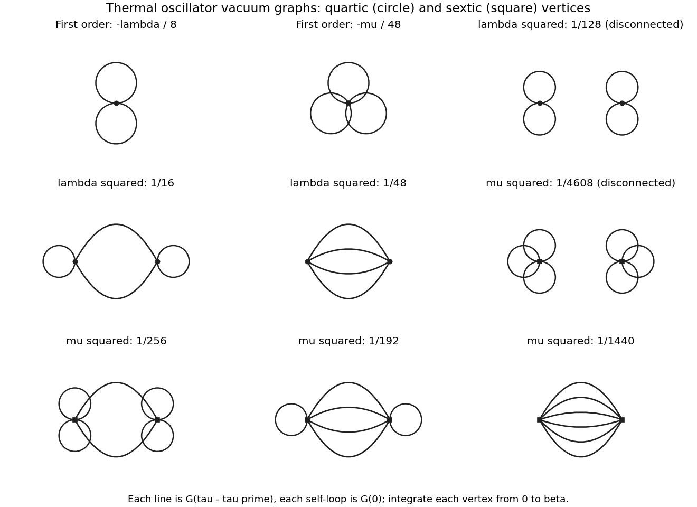

<h1 id="3/e/solution">Solution</h1>

↑ **Parent:** [E](../e.md)

Set the external source to zero in [solution](../d/solution.md) and apply [Wick's theorem](../../../../wick-s-theorem.md). At a single quartic [vertex](../../../../vertex-graph-theory.md), the four position insertions have three pairings; at a single sextic [vertex](../../../../vertex-graph-theory.md), six insertions have $5!!=15$ pairings. Thus

$$
\boxed{\frac{Z}{Z_0}=1-\frac\lambda8\int_0^\beta d\tau\,[G^{(0)}(0)]^2
-\frac\mu{48}\int_0^\beta d\tau\,[G^{(0)}(0)]^3+O(\lambda^2,\lambda\mu,\mu^2).}
$$

Thermal time-translation invariance makes this $1-\lambda\beta g_0^2/8-\mu\beta g_0^3/48+\cdots$, with $g_0$ from [solution](../c/solution.md). If desired the absolute corrections follow by multiplying by the free [partition function](../../../../canonical-partition-function.md) $Z_0=[2\sinh(\beta\Omega/2)]^{-1}$.

The first [Vacuum Feynman diagram](../../../../vacuum-feynman-diagram.md) is one quartic [vertex](../../../../vertex-graph-theory.md) carrying two self-loops, with weight $-\lambda/8$ before time integration. The second is one sextic [vertex](../../../../vertex-graph-theory.md) carrying three self-loops, with weight $-\mu/48$. No disconnected subtraction is appropriate for $Z$ itself. The top row of the following figure shows these first-order terms and the conventions for [solution](../f/solution.md).

**[Figure 1](#3/e/image-quartic-and-sextic-oscillator-vacuum-graphs-through-second-order-the-displayed-coefficients-include-factorials-and-vertex-interchange-and-each-vertex-is-integrated-over-the-thermal-circle). Quartic and sextic oscillator vacuum graphs through second order; the displayed coefficients include factorials and vertex interchange, and each vertex is integrated over the thermal circle**.

## ↑ Ancestors (12)

1. [E](../e.md)
2. [3](../../3.md)
3. [2016](../../../2016-split.md)
4. [Past exam of the theoretical physics major option course of the University of Oxford](../../../split.md)
5. [Theoretical physics major option course of the University of Oxford](../../../../theoretical-physics-major-option-course-of-the-university-of-oxford.md)
6. [Year 4 of the physics course of the University of Oxford](../../../../year-4-of-the-physics-course-of-the-university-of-oxford.md)
7. [Physics course of the University of Oxford](../../../../physics-course-of-the-university-of-oxford.md)
8. [Undergraduate course of the University of Oxford](../../../../undergraduate-course-of-the-university-of-oxford.md)
9. [Course of the University of Oxford](../../../../course-of-the-university-of-oxford.md)
10. [University of Oxford](../../../../university-of-oxford-split.md)
11. [List of universities](../../../../list-of-universities.md)
12. [Codex Wiki](../../../../split.md)

## ← Incoming links (1)

- [Solution](../f/solution.md)
