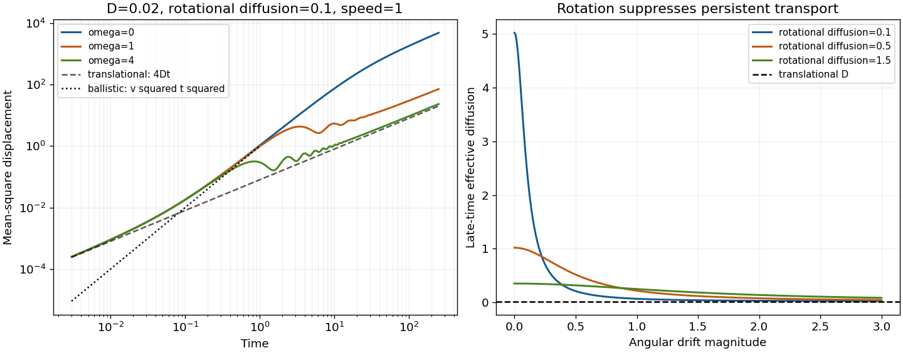

<h1 id="4/d/solution">Solution</h1>

↑ **Parent:** [D](../d.md)

For $t\ll D_r^{-1},|\omega|^{-1}$, expand the exact expression:

$$
\boxed{M(t)=4Dt+v^2t^2-\frac{v^2D_r}{3}t^3+O(t^4).}
$$

At asymptotically short time, translational [diffusion](../../../../diffusion.md) dominates if $D>0$. A ballistic window occurs when $4D/v^2\ll t\ll\min(D_r^{-1},|\omega|^{-1})$, provided these scales are separated. The swimmer then retains nearly constant direction.

For $D_r>0$ and $t\gg D_r^{-1}$, the oscillatory exponential decays and

$$
\boxed{M(t)=4D_{\rm eff}t+\frac{2v^2(\omega^2-D_r^2)}{(D_r^2+\omega^2)^2}+o(1),
\qquad D_{\rm eff}=D+\frac{v^2D_r}{2(D_r^2+\omega^2)}.}
$$

At intermediate times, the angular drift bends persistent trajectories into arcs. If $|\omega|\gg D_r$, several rotations occur before orientational decorrelation, producing oscillatory shoulders rather than a long straight ballistic regime. In the limit $D_r=0$, $\omega\ne0$, the active contribution is bounded and periodic: $2v^2(1-\cos\omega t)/\omega^2$. At $D_r=\omega=0$, it remains ballistic forever, so ordinary late-time active diffusion does not follow.

For $D_r>0$, the central-limit coarse graining of the position gives the late-time [Fokker-Planck equation](../../../../fokker-planck-equation.md)

$$
\boxed{\partial_tP(\mathbf r,t)=D_{\rm eff}\nabla^2P(\mathbf r,t).}
$$

There is no surviving drift after orientation averaging. This is an effective large-time, large-distance equation, not the exact closed equation for position at all times.

**[Figure 2](#4/d/image-exact-displacement-of-a-persistent-chiral-swimmer-ballistic-and-diffusive-windows-rotation-induced-shoulders-and-suppression-of-active-diffusion-by-angular-drift). Exact displacement of a persistent chiral swimmer: ballistic and diffusive windows, rotation-induced shoulders, and suppression of active diffusion by angular drift**.

## ↑ Ancestors (12)

1. [D](../d.md)
2. [4](../../4.md)
3. [2016](../../../2016-split.md)
4. [Past exam of the theoretical physics major option course of the University of Oxford](../../../split.md)
5. [Theoretical physics major option course of the University of Oxford](../../../../theoretical-physics-major-option-course-of-the-university-of-oxford.md)
6. [Year 4 of the physics course of the University of Oxford](../../../../year-4-of-the-physics-course-of-the-university-of-oxford.md)
7. [Physics course of the University of Oxford](../../../../physics-course-of-the-university-of-oxford.md)
8. [Undergraduate course of the University of Oxford](../../../../undergraduate-course-of-the-university-of-oxford.md)
9. [Course of the University of Oxford](../../../../course-of-the-university-of-oxford.md)
10. [University of Oxford](../../../../university-of-oxford-split.md)
11. [List of universities](../../../../list-of-universities.md)
12. [Codex Wiki](../../../../split.md)

## ← Incoming links (1)

- [Solution](../a/solution.md)
