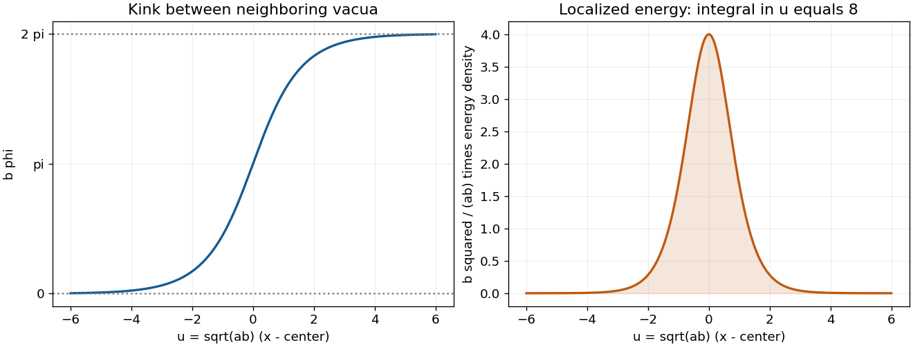

<h1 id="5/d/solution">Solution</h1>

↑ **Parent:** [D](../d.md)

For a static finite-energy [field](../../../../field.md), the [Hamiltonian density](../../../../hamiltonian-density.md) is $\tfrac12(\phi')^2+V(\phi)$. Multiply the static [equation of motion](../../../../equation-of-motion.md) by $\phi'$ and integrate once:

$$
\frac{d}{dx}\left[\frac12(\phi')^2-V(\phi)\right]=0.
$$

At either vacuum endpoint both terms vanish, so $\tfrac12(\phi')^2=V$. The total [energy density](../../../../energy-density.md) is consequently $(\phi')^2=4k^2\operatorname{sech}^2[k(x-x_0)]/b^2$. Its integral gives

$$
\boxed{E_0=\frac{4k^2}{b^2}\frac2k=\frac{8\sqrt{ab}}{b^2}.}
$$

For the usual positive $a,b$ convention this is

$$
\boxed{E_0=c\sqrt a,\qquad c=\frac8{b^{3/2}}.}
$$

The coefficient depends on the dimensionless parameter $b$; it is not a universal numerical constant independent of the potential. In two [spacetime](../../../../spacetime.md) dimensions, $[\phi]=[b]=0$ and $[a]=2$, so the dimensions are consistent. If both $a$ and $b$ are negative while $ab>0$, the real answer is instead $8\sqrt{|a|}/|b|^{3/2}$; the literal factor $\sqrt a$ would not be real.

An equivalent positive-parameter calculation substitutes $z=b\phi$ in $E_0=\int_0^{2\pi/b}\sqrt{2V}\,d\phi$ and uses the provided integral of $\sqrt{1-\cos z}$. The following original plot shows that the localized [energy density](../../../../energy-density.md) sits where the [field](../../../../field.md) passes between the vacua.

**[Figure 3](#5/d/image-the-dimensionless-sine-gordon-kink-profile-and-its-localized-static-energy-density-with-total-dimensionless-energy-eight). The dimensionless sine-Gordon kink profile and its localized static energy density, with total dimensionless energy eight**.

## ↑ Ancestors (12)

1. [D](../d.md)
2. [5](../../5.md)
3. [2016](../../../2016-split.md)
4. [Past exam of the theoretical physics major option course of the University of Oxford](../../../split.md)
5. [Theoretical physics major option course of the University of Oxford](../../../../theoretical-physics-major-option-course-of-the-university-of-oxford.md)
6. [Year 4 of the physics course of the University of Oxford](../../../../year-4-of-the-physics-course-of-the-university-of-oxford.md)
7. [Physics course of the University of Oxford](../../../../physics-course-of-the-university-of-oxford.md)
8. [Undergraduate course of the University of Oxford](../../../../undergraduate-course-of-the-university-of-oxford.md)
9. [Course of the University of Oxford](../../../../course-of-the-university-of-oxford.md)
10. [University of Oxford](../../../../university-of-oxford-split.md)
11. [List of universities](../../../../list-of-universities.md)
12. [Codex Wiki](../../../../split.md)
