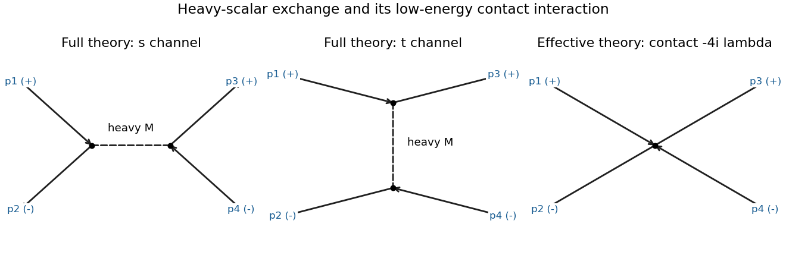

<h1 id="8/d/solution">Solution</h1>

↑ **Parent:** [D](../d.md)

Label the initial particle and antiparticle $p_1,p_2$ and the corresponding final momenta $p_3,p_4$, with $s=(p_1+p_2)^2$ and $t=(p_1-p_3)^2$. Charge flow permits an $s$-channel heavy-scalar annihilation graph and a $t$-channel heavy-scalar exchange graph. It excludes a third $u$-channel graph for these fixed charge assignments. The effective theory has one contact graph.

**[Figure 4](#8/d/image-particle-antiparticle-scattering-by-heavy-scalar-annihilation-and-exchange-compared-with-its-low-energy-quartic-contact-interaction-external-charge-labels-are-held-fixed). Particle-antiparticle scattering by heavy scalar annihilation and exchange, compared with its low-energy quartic contact interaction; external charge labels are held fixed**.

The two cubic [Feynman vertices](../../../../interaction-vertex.md) and the heavy [propagator](../../../../propagator.md) give

$$
i\mathcal M_{\rm full}=(-ig)^2\left[\frac i{s-M^2+i0}+\frac i{t-M^2+i0}\right].
$$

For $|s|,|t|\ll M^2$,

$$
\mathcal M_{\rm full}=\frac{2g^2}{M^2}+\frac{g^2(s+t)}{M^4}+\cdots,
\qquad
\mathcal M_{\rm eff}=-4\lambda=\frac{2g^2}{M^2}.
$$

This independently checks the sign and the factor $1/2$ in [solution](../c/solution.md). The next difference is the derivative correction of order $M^{-4}$ in the amplitude.

Let $E=\sqrt s$ denote the total center-of-mass [energy](../../../../energy-split.md), with $m\ll E\ll M$. The final particle and antiparticle are distinct, so no identical-particle factor is needed. The leading isotropic [differential scattering cross-section](../../../../differential-scattering-cross-section.md) and total [cross section](../../../../cross-section-physics.md) are

$$
\frac{d\sigma}{d\Omega}=\frac{|\mathcal M|^2}{64\pi^2s},
\qquad
\boxed{\sigma\simeq\frac{|\mathcal M|^2}{16\pi s}
=\frac{g^4}{4\pi M^4E^2}=\frac{\lambda^2}{\pi E^2}.}
$$

Corrections are relatively of order $E^2/M^2$ and, in a high-energy expansion, $m^2/E^2$, in addition to loop corrections when they matter. If instead $E$ denotes each beam particle's energy, substitute $s=4E^2$ before comparing numerical prefactors.

## ↑ Ancestors (12)

1. [D](../d.md)
2. [8](../../8.md)
3. [2016](../../../2016-split.md)
4. [Past exam of the theoretical physics major option course of the University of Oxford](../../../split.md)
5. [Theoretical physics major option course of the University of Oxford](../../../../theoretical-physics-major-option-course-of-the-university-of-oxford.md)
6. [Year 4 of the physics course of the University of Oxford](../../../../year-4-of-the-physics-course-of-the-university-of-oxford.md)
7. [Physics course of the University of Oxford](../../../../physics-course-of-the-university-of-oxford.md)
8. [Undergraduate course of the University of Oxford](../../../../undergraduate-course-of-the-university-of-oxford.md)
9. [Course of the University of Oxford](../../../../course-of-the-university-of-oxford.md)
10. [University of Oxford](../../../../university-of-oxford-split.md)
11. [List of universities](../../../../list-of-universities.md)
12. [Codex Wiki](../../../../split.md)
