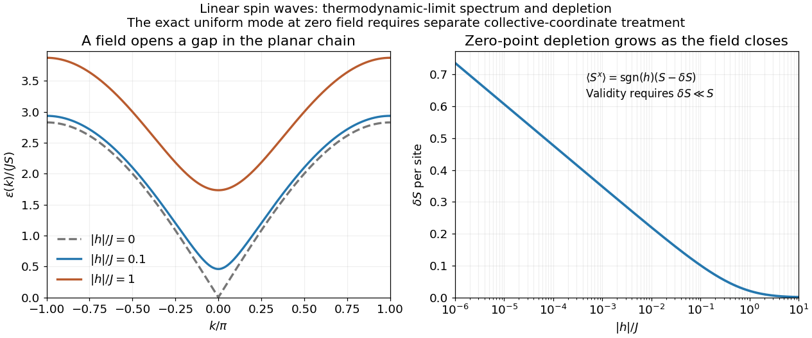
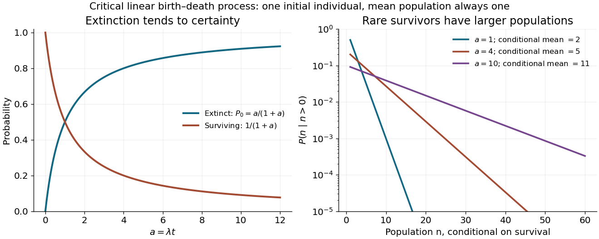
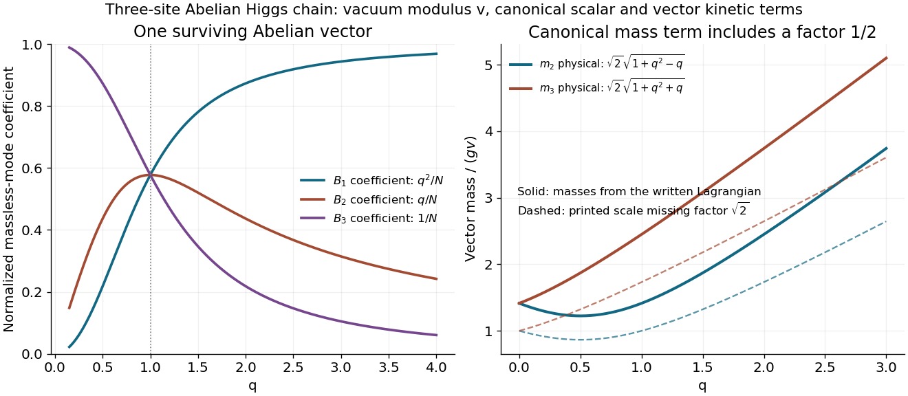

# 2017

↑ **Parent:** [Past exam of the theoretical physics major option course of the University of Oxford](../past-exam-of-the-theoretical-physics-major-option-course-of-the-university-of-oxford.md)

Source paper: [https://www.whatdotheyknow.com/request/oxford_physics_past_papers_2/response/2340696/attach/5/Physics%20Papers%202016.pdf?cookie_passthrough=1.](https://www.whatdotheyknow.com/request/oxford_physics_past_papers_2/response/2340696/attach/5/Physics%20Papers%202016.pdf?cookie_passthrough=1.) The cover identifies Trinity Term 2017, 13 June; the bundle filename does not determine the examination year. We use $\hbar=c=1$ in the [classical field theory](../classical-field-theory.md) and [quantum field theory](../quantum-field-theory.md) and lattice spacing one for the [spin models](../spin-model.md).

**Table of contents**

- [1](#1)
  - [a](#1/a)
    - [Solution](#1/a/solution)
  - [b](#1/b)
    - [Solution](#1/b/solution)
  - [c](#1/c)
    - [Solution](#1/c/solution)
  - [d](#1/d)
    - [Solution](#1/d/solution)
- [2](#2)
  - [a](#2/a)
    - [Solution](#2/a/solution)
  - [b](#2/b)
    - [Solution](#2/b/solution)
  - [c](#2/c)
    - [Solution](#2/c/solution)
  - [d](#2/d)
    - [Solution](#2/d/solution)
  - [e](#2/e)
    - [Solution](#2/e/solution)
- [3](#3)
  - [a](#3/a)
    - [Solution](#3/a/solution)
  - [b](#3/b)
    - [Solution](#3/b/solution)
  - [c](#3/c)
    - [Solution](#3/c/solution)
  - [d](#3/d)
    - [Solution](#3/d/solution)
  - [e](#3/e)
    - [Solution](#3/e/solution)
- [4](#4)
  - [a](#4/a)
    - [Solution](#4/a/solution)
  - [b](#4/b)
    - [Solution](#4/b/solution)
  - [c](#4/c)
    - [Solution](#4/c/solution)
  - [d](#4/d)
    - [Solution](#4/d/solution)
- [5](#5)
  - [a](#5/a)
    - [Solution](#5/a/solution)
  - [b](#5/b)
    - [Solution](#5/b/solution)
  - [c](#5/c)
    - [Solution](#5/c/solution)
  - [d](#5/d)
    - [Solution](#5/d/solution)
- [6](#6)
  - [a](#6/a)
    - [Solution](#6/a/solution)
  - [b](#6/b)
    - [Solution](#6/b/solution)
  - [c](#6/c)
    - [Solution](#6/c/solution)

## 1

↑ **Parent:** [2017](2017.md)

<h3 id="1/a">a</h3>

↑ **Parent:** [1](#1)

<h4 id="1/a/solution">Solution</h4>

↑ **Parent:** [A](#1/a)

Put $\beta=(k_BT)^{-1}$ and label the two [spin values](../angular-momentum-operator.md#spin) in the order $+1,-1$. Assign each bond its [Boltzmann weight](../canonical-ensemble.md#boltzmann-factor),

$$
V_{st}=e^{-\beta E_0(s,t)},\qquad
V=\begin{pmatrix}a&b\\b&d\end{pmatrix},\qquad s,t\in\{+1,-1\}.
$$

The [symmetry](../physics.md#symmetry-physics) of the [bond energy](../energy.md) makes $V$ a [real symmetric matrix](../linear-algebra.md#symmetric-matrix). For a fixed configuration the product of successive [matrix](../vector-space.md#matrix) entries is its [Boltzmann weight](../canonical-ensemble.md#boltzmann-factor). Summing over all [spins](../angular-momentum-operator.md#spin) and identifying the last index with the first therefore gives

$$
\boxed{Z_L=\sum_{\sigma_1,\ldots,\sigma_L}V_{\sigma_1\sigma_2}\cdots V_{\sigma_L\sigma_1}=\operatorname{tr}V^L=\lambda_+^L+\lambda_-^L,}
$$

where

$$
\lambda_\pm=\frac{a+d\pm\sqrt{(a-d)^2+4b^2}}2.
$$

This replaces a sum over $2^L$ configurations by the powers of a two-by-two [matrix](../vector-space.md#matrix). For finite bond [energies](../energy.md) at $T>0$, every [matrix](../vector-space.md#matrix) entry is positive, so the [Perron–Frobenius theorem](../vector-space.md#perron-frobenius-theorem) gives $\lambda_+>0$ and $|\lambda_-|<\lambda_+$. Hence the [Helmholtz free energy](../thermodynamic-potential.md#helmholtz-free-energy) per [spin](../angular-momentum-operator.md#spin) tends to $-k_BT\log\lambda_+$. A diagonal local [observable](../quantum-system.md#observable) $O$ can be inserted at one site: $\langle O_1\rangle=\operatorname{tr}(OV^L)/Z_L$. Its limiting average is the [expectation](../expected-value.md) in the [normalized](../mathematics.md#normalization) [eigenvector](../linear-operator-theory.md#eigenvector) of $\lambda_+$.

<h3 id="1/b">b</h3>

↑ **Parent:** [1](#1)

<h4 id="1/b/solution">Solution</h4>

↑ **Parent:** [B](#1/b)

**The sum needs a stated interpretation.** The original equation leaves the second bond outside explicit parentheses, with its index then formally free. The natural [translation-invariant](../physics.md#translation-invariance), equal-bond interpretation used here is the [energy](../energy.md) $-J\sum_j\tau_j(\sigma_j+\sigma_{j+1})$.

Let $K=\beta J$. Sum over each decorating [spin](../angular-momentum-operator.md#spin) before summing over the remaining [spins](../angular-momentum-operator.md#spin). The [decimation of an alternating mixed-spin chain](../spin-model.md#decimation-of-an-alternating-mixed-spin-chain) gives the effective [transfer matrix](../combinatorics.md#transfer-matrix):

$$
V_{st}=\sum_{t_0=-1}^{1}e^{Kt_0(s+t)}=1+2\cosh[K(s+t)]
=\begin{pmatrix}1+2\cosh2K&3\\3&1+2\cosh2K\end{pmatrix}_{st}.
$$

No on-site entropy has been omitted: the term $1$ is the weight of the zero decorating [spin](../angular-momentum-operator.md#spin). The [normalized](../mathematics.md#normalization) [eigenvectors](../linear-operator-theory.md#eigenvector) are $v_\pm=(1,\pm1)^{\mathsf T}/\sqrt2$, with [eigenvalues](../linear-operator-theory.md#eigenvalue)

$$
\boxed{\lambda_+=4+2\cosh2K=2+4\cosh^2K,\qquad \lambda_-=2\cosh2K-2=4\sinh^2K.}
$$

There are $L$ transfer steps but $2L$ physical sites, so

$$
\boxed{Z_L=\lambda_+^L+\lambda_-^L,\qquad
f=\lim_{L\to\infty}\frac{-k_BT\log Z_L}{2L}=-\frac{k_BT}{2}\log(4+2\cosh2\beta J).}
$$

The [free energy](../thermodynamic-potential.md#thermodynamic-free-energy) per two-site [unit cell](../quantum-scattering.md#unit-cell) is twice this value. At $J=0$, the formula gives $Z_L=6^L$, as required by two states on one sublattice and three on the other. As $T\to0$, the [free energy](../thermodynamic-potential.md#thermodynamic-free-energy) per physical site tends to $-J$, the [energy](../energy.md) of an aligned chain with two satisfied bonds per [unit cell](../quantum-scattering.md#unit-cell). These checks also fix the factor of two in the site count.

<h3 id="1/c">c</h3>

↑ **Parent:** [1](#1)

<h4 id="1/c/solution">Solution</h4>

↑ **Parent:** [C](#1/c)

Insert $D=\operatorname{diag}(1,-1)$ at the first undecorated site. In the [eigenbasis](../linear-operator-theory.md#eigenbasis) of the [transfer matrix](../combinatorics.md#transfer-matrix), $D$ exchanges $v_+$ and $v_-$, and both diagonal [matrix elements](../vector-space.md#matrix-element) vanish. Explicitly,

$$
\boxed{\langle\sigma_1\rangle_L=\frac{\operatorname{tr}(DV^L)}{\operatorname{tr}V^L}
=\frac{\lambda_+^L v_+^{\mathsf T}Dv_++\lambda_-^L v_-^{\mathsf T}Dv_-}{\lambda_+^L+\lambda_-^L}=0.}
$$

Thus its large-$L$ limit is zero at every fixed $T>0$. The result is exact even before taking that limit. Equivalently, simultaneous reversal of all [spins](../angular-momentum-operator.md#spin) pairs configurations of equal [energy](../energy.md) and opposite $\sigma_1$. Positivity of the [transfer matrix](../combinatorics.md#transfer-matrix) at fixed [positive temperature](../temperature.md) prevents a degenerate dominant [eigenvalue](../linear-operator-theory.md#eigenvalue) and [spontaneous magnetization](../spin-model.md#spontaneous-magnetization) in this one-dimensional zero-field chain. Selecting one aligned state at strictly [zero temperature](../temperature.md#absolute-zero) is a different order of limits.

<h3 id="1/d">d</h3>

↑ **Parent:** [1](#1)

<h4 id="1/d/solution">Solution</h4>

↑ **Parent:** [D](#1/d)

Insert the decorating-spin [observable](../quantum-system.md#observable) into the one bond that contains it. The [decorated-spin occupation insertion](../spin-model.md#decorated-spin-occupation-insertion) uses the [matrix](../vector-space.md#matrix):

$$
Q_{st}=\sum_{t_0=-1}^{1}t_0^2e^{Kt_0(s+t)}=2\cosh[K(s+t)]
=\begin{pmatrix}2\cosh2K&2\\2&2\cosh2K\end{pmatrix}_{st}.
$$

The [partition function](../canonical-ensemble.md#canonical-partition-function) still contains $L$ decorating-spin sums; one of them has been replaced by this weighted sum. Hence

$$
\langle\tau_1^2\rangle_L=\frac{\operatorname{tr}(QV^{L-1})}{Z_L}
=\frac{q_+\lambda_+^{L-1}+q_-\lambda_-^{L-1}}{\lambda_+^L+\lambda_-^L},
\qquad q_+=2\cosh2K+2,\quad q_-=2\cosh2K-2.
$$

Taking the dominant [eigenvector](../linear-operator-theory.md#eigenvector) gives

$$
\boxed{\lim_{L\to\infty}\langle\tau_1^2\rangle_L=\frac{q_+}{\lambda_+}
=\frac{\cosh2K+1}{\cosh2K+2}=\frac{2\cosh^2K}{1+2\cosh^2K}.}
$$

This is the [probability](../probability-theory.md#probability) that the decorating site is in either nonzero state. It tends to $2/3$ at high [temperature](../temperature.md), when its three states are equally likely, and to one at low [temperature](../temperature.md), when the nonzero aligned states gain [bond energy](../energy.md). Unlike the [magnetization](../electromagnetism.md#magnetization), this even [observable](../quantum-system.md#observable) is not forced to vanish by [spin](../angular-momentum-operator.md#spin) reversal.

## 2

↑ **Parent:** [2017](2017.md)

<h3 id="2/a">a</h3>

↑ **Parent:** [2](#2)

<h4 id="2/a/solution">Solution</h4>

↑ **Parent:** [A](#2/a)

Interpret the two displayed exchange components as belonging to the common nearest-neighbour sum with coefficient $-J$. Write $H_f=|h|$ and, for $h\ne0$, $s=\operatorname{sgn}h$. The source explicitly fixes $J>0$ but does not separately constrain $h$ in this question; keeping $H_f$ covers either [field](../magnetic-field.md) direction.

For [classical vectors](../vector-space.md#vector) of length $S$, define $\mathbf q_j=(S_j^x,S_j^y)$. The [Cauchy-Schwarz inequality](../probability-and-statistics.md#cauchy-schwarz-inequality) gives $\mathbf q_j\cdot\mathbf q_{j+1}\le|\mathbf q_j||\mathbf q_{j+1}|\le S^2$, and $hS_j^x\le H_fS$. Each term is therefore bounded below, so

$$
E_{\mathrm{cl}}\ge-LJS^2-LH_fS^2.
$$

Uniform alignment along the [field](../magnetic-field.md) saturates every bound:

$$
\boxed{\mathbf S_j=(sS,0,0),\qquad E_{\mathrm{cl,min}}=-L(J+H_f)S^2\quad(h\ne0).}
$$

Equality requires all planar [vectors](../vector-space.md#vector) to be parallel with length $S$, and the nonzero [field](../magnetic-field.md) then fixes their direction. At $h=0$, every uniformly oriented [vector](../vector-space.md#vector) in the $xy$ plane is a [classical ground state](../quantum-mechanics.md#ground-state):

$$
\boxed{\mathbf S_j=S(\cos\phi,\sin\phi,0),\qquad E_{\mathrm{cl,min}}=-LJS^2.}
$$

A nonuniform configuration cannot improve these simultaneously saturated bond bounds, including on the periodic ring.

<h3 id="2/b">b</h3>

↑ **Parent:** [2](#2)

<h4 id="2/b/solution">Solution</h4>

↑ **Parent:** [B](#2/b)

The [Holstein–Primakoff transformation](../angular-momentum-operator.md#holstein-primakoff-transformation) realizes a [spin algebra](../angular-momentum-operator.md#spin-commutation-relations) using [bosonic creation operators](../quantum-harmonic-oscillator.md#bosonic-creation-operator) and [bosonic annihilation operators](../quantum-harmonic-oscillator.md#bosonic-annihilation-operator). A [boson](../tensor-product-of-quantum-systems.md#boson) counts a unit of [spin](../angular-momentum-operator.md#spin) deviation from the local positive quantization axis: $\widetilde S^z=S-n$ with $n=a^\dagger a$. The square root in $\widetilde S^+$ supplies the correct [spin-ladder](../angular-momentum-operator.md#spin-ladder-operator) [matrix elements](../vector-space.md#matrix-element). In particular,

$$
\widetilde S^+|n\rangle=\sqrt{n(2S-n+1)}|n-1\rangle,\qquad
\widetilde S^-|n\rangle=\sqrt{(n+1)(2S-n)}|n+1\rangle.
$$

Their [commutator](../lie-algebra.md#commutator) is $2(S-n)$ on every physical [number state](../quantum-field-theory.md#fock-state), reproducing the [Spin commutation relations](../angular-momentum-operator.md#spin-commutation-relations). Although the [oscillator Fock space](../quantum-field-theory.md#bosonic-fock-space) is infinite, the [physical subspace](../angular-momentum-operator.md#holstein-primakoff-occupation-constraint) is only

$$
\boxed{n=0,1,\ldots,2S.}
$$

The order of the square root and oscillator [operator](../vector-space.md#linear-operator) matters in obtaining these coefficients.

When the [spin deviations](../critical-phenomenon.md#magnon) are dilute, expand the square root in $n/(2S)$. The leading transverse [operators](../vector-space.md#linear-operator) are linear in the [bosonic creation operators](../quantum-harmonic-oscillator.md#bosonic-creation-operator) and [bosonic annihilation operators](../quantum-harmonic-oscillator.md#bosonic-annihilation-operator) and turn [exchange interactions](../electromagnetism.md#exchange-interaction) into a [quadratic Hamiltonian](../quantum-field-theory.md#quadratic-bosonic-hamiltonian), which can be diagonalized. Higher powers describe interactions between [spin waves](../critical-phenomenon.md#spin-wave). The method therefore organizes corrections by inverse powers of $S$ about an ordered classical configuration. Large $S$ alone is insufficient: the average [depletion](../critical-phenomenon.md#one-dimensional-planar-spin-wave-depletion) must remain small compared with $S$. Possible problems include the [occupation](../quantum-field-theory.md#bosonic-occupation-number) constraint after truncation, noncollinear order requiring site-dependent axis [rotations](../riemannian-geometry.md#rotation-mathematics), [zero modes](../linear-operator-theory.md#zero-mode), and [infrared fluctuations](../quantum-field-theory.md#infrared-divergence) that destroy the assumed dilute expansion.

<h3 id="2/c">c</h3>

↑ **Parent:** [2](#2)

<h4 id="2/c/solution">Solution</h4>

↑ **Parent:** [C](#2/c)

Choose the local positive $\widetilde z$ axis along the [classical spin](../angular-momentum-operator.md#classical-spin). For nonzero [field](../magnetic-field.md), a [proper rotation](../riemannian-geometry.md#rotation-mathematics) is

$$
\boxed{S_j^x=s\widetilde S_j^z,\qquad S_j^y=\widetilde S_j^y,\qquad S_j^z=-s\widetilde S_j^x.}
$$

It preserves the [Spin commutation relations](../angular-momentum-operator.md#spin-commutation-relations) and turns the [field](../magnetic-field.md) term into $-H_fS\sum_j\widetilde S_j^z$. At zero [field](../magnetic-field.md) choose the classical direction $+x$, so $s=1$. Expanding about the original $z$ axis without this [rotation](../riemannian-geometry.md#rotation-mathematics) would put the reference state away from the classical minimum and would not give a controlled small-deviation expansion.

To the required order,

$$
\widetilde S_j^z=S-n_j,\qquad
\widetilde S_j^x=\sqrt{\frac S2}(a_j+a_j^\dagger)+O(S^{-1/2}),\qquad
\widetilde S_j^y=-i\sqrt{\frac S2}(a_j-a_j^\dagger)+O(S^{-1/2}).
$$

The longitudinal exchange gives $-JS^2+JS(n_j+n_{j+1})+O(S^0)$ on each bond. The transverse exchange gives

$$
-J\widetilde S_j^y\widetilde S_{j+1}^y
=\frac{JS}{2}\left[a_ja_{j+1}+a_j^\dagger a_{j+1}^\dagger-a_j^\dagger a_{j+1}-a_{j+1}^\dagger a_j\right]+O(S^0).
$$

Finally the [field](../magnetic-field.md) contributes its classical constant and $H_fSn_j$. Each site belongs to two bonds, so after removing the order-$S^2$ constant,

$$
\boxed{A=-\frac{JS}{2},\qquad B=\frac{JS}{2},\qquad C=S(2J+H_f).}
$$

These are the order-$S$ terms; the discarded products of [number operators](../quantum-harmonic-oscillator.md#number-operator) and the next square-root terms are order $S^0$ for [occupations](../quantum-field-theory.md#bosonic-occupation-number) held fixed as $S\to\infty$. A different transverse-axis phase can reverse the sign of $B$ without changing the [spectrum](../energy-eigenvalue.md), but the sign above follows from the stated [rotation](../riemannian-geometry.md#rotation-mathematics) and oscillator convention.

<h3 id="2/d">d</h3>

↑ **Parent:** [2](#2)

<h4 id="2/d/solution">Solution</h4>

↑ **Parent:** [D](#2/d)

Use the [unitary discrete Fourier transform](../discrete-fourier-transform.md)

$$
a_j=\frac1{\sqrt L}\sum_ke^{ikj}a_k,\qquad k=\frac{2\pi n}{L},\quad n=0,\ldots,L-1.
$$

The transformed [operators](../vector-space.md#linear-operator) obey $[a_k,a_q^\dagger]=\delta_{kq}$. The hopping terms contribute $2A\cos k$ to the number coefficient. In the pairing sum, the odd sine part cancels between $k$ and $-k$. Thus

$$
H_{\mathrm{LSW}}=\sum_k\left[\alpha_k a_k^\dagger a_k+\frac{\Delta_k}{2}(a_ka_{-k}+a_k^\dagger a_{-k}^\dagger)\right],
$$

where

$$
\alpha_k=S(H_f+2J-J\cos k),\qquad \Delta_k=JS\cos k.
$$

The factor one half in the full [momentum sum](../arithmetic.md#sum) avoids counting an [anomalous pair](../quantum-field-theory.md#bosonic-bogoliubov-diagonalization) twice. For $H_f>0$, $\alpha_k>|\Delta_k|$ for every allowed [momentum](../momentum.md). Set

$$
a_k=\cosh\theta_k\,b_k-\sinh\theta_k\,b_{-k}^\dagger,\qquad
\tanh2\theta_k=\frac{\Delta_k}{\alpha_k}.
$$

Real even [angles](../geometry-and-topology.md#angle) ensure consistency between opposite [momenta](../momentum.md), and $\cosh^2\theta_k-\sinh^2\theta_k=1$ preserves the [canonical commutation relations](../quantum-mechanics.md#canonical-commutation-relation). The anomalous coefficient becomes $\Delta_k\cosh2\theta_k-\alpha_k\sinh2\theta_k=0$. [Normal ordering](../perturbative-quantum-field-theory.md#normal-ordering) then gives

$$
\boxed{H_{\mathrm{LSW}}=\sum_k\epsilon(k)b_k^\dagger b_k+\frac12\sum_k[\epsilon(k)-\alpha_k],}
$$

with

$$
\boxed{\epsilon(k)=\sqrt{\alpha_k^2-\Delta_k^2}=S\sqrt{(H_f+2J)[H_f+2J(1-\cos k)]}.}
$$

The [field-polarized planar ferromagnetic spin wave](../critical-phenomenon.md#field-polarized-planar-ferromagnetic-spin-wave) has [energy gap](../linear-operator-theory.md#energy-gap) $\epsilon(0)=S\sqrt{H_f(H_f+2J)}$. The [momenta](../momentum.md) run over the whole [Brillouin zone](../bloch-s-theorem.md#brillouin-zone) once, including the self-inverse [momenta](../momentum.md) $0$ and, for even $L$, $\pi$; these use [single-mode squeezing](../quantum-harmonic-oscillator.md#single-mode-squeeze-operator) rather than introducing an extra independent partner.

**The zero-field case has a [zero-mode obstruction to bosonic Bogoliubov diagonalization](../quantum-field-theory.md#zero-mode-obstruction-to-bosonic-bogoliubov-diagonalization).** Its nonzero-momentum modes have $\epsilon(k)=2\sqrt2JS|\sin(k/2)|$, but $\alpha_0=\Delta_0=JS$, so no finite [squeezing angle](../quantum-field-theory.md#bogoliubov-transformation) exists for the uniform mode. With $Q_0=(a_0+a_0^\dagger)/\sqrt2$, its [Hamiltonian](../hamiltonian-mechanics.md#hamiltonian) is $JSQ_0^2-JS/2$, not an identically zero oscillator. For example, its [matrix element](../vector-space.md#matrix-element) between the [vacuum](../quantum-field-theory.md#fock-vacuum) and the two-boson [number state](../quantum-field-theory.md#fock-state) is $JS/\sqrt2$, whereas $\epsilon(0)b_0^\dagger b_0$ would vanish. Consequently the requested oscillator diagonalization is literal for nonzero [field](../magnetic-field.md); at zero [field](../magnetic-field.md) treat the collective orientation separately or introduce a [field](../magnetic-field.md) regulator before taking a limit.

<h3 id="2/e">e</h3>

↑ **Parent:** [2](#2)

<h4 id="2/e/solution">Solution</h4>

↑ **Parent:** [E](#2/e)

For nonzero [field](../magnetic-field.md), the [spin-wave](../critical-phenomenon.md#spin-wave) [ground state](../quantum-mechanics.md#ground-state) is the [vacuum](../quantum-field-theory.md#fock-vacuum) of all $b_k$. The [inverse Bogoliubov transformation](../quantum-field-theory.md#bogoliubov-transformation) gives $\langle a_k^\dagger a_q\rangle=\delta_{kq}\sinh^2\theta_k$ and vanishing one-point oscillator averages. [Translational invariance](../physics.md#translation-invariance) therefore gives the [depletion](../critical-phenomenon.md#one-dimensional-planar-spin-wave-depletion)

$$
\boxed{\delta S=\langle n_j\rangle=\frac1L\sum_k\sinh^2\theta_k
=\frac1{2L}\sum_k\left[\frac{H_f+2J-J\cos k}{\sqrt{(H_f+2J)[H_f+2J(1-\cos k)]}}-1\right].}
$$

Rotating back to the physical axes yields, to the retained [spin-wave](../critical-phenomenon.md#spin-wave) order,

$$
\boxed{\langle S_j^x\rangle=s(S-\delta S),\qquad \langle S_j^y\rangle=0,\qquad\langle S_j^z\rangle=0.}
$$

The zero transverse components also follow from [rotation](../riemannian-geometry.md#rotation-mathematics) by $\pi$ about the physical $x$ axis in a symmetry-preserving [ground state](../quantum-mechanics.md#ground-state). The nonzero [depletion](../critical-phenomenon.md#one-dimensional-planar-spin-wave-depletion) describes [zero-point quantum fluctuations](../quantum-theory.md#quantum-fluctuation): the original [boson](../tensor-product-of-quantum-systems.md#boson) [vacuum](../quantum-field-theory.md#fock-vacuum) is not the [ground state](../quantum-mechanics.md#ground-state) because the [anomalous terms](../quantum-field-theory.md#bosonic-bogoliubov-diagonalization) create pairs. It is nonnegative and must satisfy $\delta S\ll S$ for the expansion to be reliable. At strong [field](../magnetic-field.md) it tends to zero, with $\delta S\sim J^2/(8H_f^2)$ in the infinite-chain limit.

For fixed $H_f>0$, the [momentum sum](../arithmetic.md#sum) has a finite [thermodynamic limit](../statistical-physics.md#thermodynamic-limit) obtained by $L^{-1}\sum_k\to(2\pi)^{-1}\int_{-\pi}^{\pi}dk$. At zero [field](../magnetic-field.md) the uniform mode already has no oscillator [vacuum](../quantum-field-theory.md#fock-vacuum), as explained in part d. Even after removing that mode, the nonzero modes behave as

$$
\sinh^2\theta_k=\frac{1}{2\sqrt2|k|}-\frac12+O(|k|),\qquad
\delta S\sim\frac{\log L}{2\pi\sqrt2}+O(1).
$$

Thus assigning a finite ordered [moment](../expected-value.md#moment) by simply setting $h=0$ in the infinite [momentum sum](../arithmetic.md#sum) is invalid. The divergence indicates failure of this expansion about a fixed planar orientation; it is not a negative physical [magnetization](../electromagnetism.md#magnetization). At finite size an exact zero-field state chosen to have definite total $S^z$ has zero planar one-point [magnetization](../electromagnetism.md#magnetization) by the [continuous rotation symmetry](../angular-momentum-operator.md#global-spin-rotation-symmetry-about-one-axis). Establishing its full [correlations](../variance.md#pearson-correlation-coefficient) requires a treatment beyond the divergent ordered-state approximation.

**[Figure 1](#2/e/image-spin-wave-dispersion-and-zero-point-depletion-for-the-planar-ferromagnetic-chain-in-a-longitudinal-field). Spin-wave dispersion and zero-point depletion for the planar ferromagnetic chain in a longitudinal field**.

## 3

↑ **Parent:** [2017](2017.md)

<h3 id="3/a">a</h3>

↑ **Parent:** [3](#3)

<h4 id="3/a/solution">Solution</h4>

↑ **Parent:** [A](#3/a)

This is a [birth-death master equation](../continuous-time-markov-chain.md#birth-death-master-equation): $q_n$ is the [transition rate](../survival-analysis.md#transition-intensity) $n\to n+1$ and $r_n$ is the [transition rate](../survival-analysis.md#transition-intensity) $n\to n-1$. The first two terms are incoming [probability](../probability-theory.md#probability) flows from the adjacent states; the last removes [probability](../probability-theory.md#probability) at the total escape rate $q_n+r_n$. Rates must be nonnegative. For a population on the nonnegative integers, take $r_0=0$ and no incoming flux from negative states.

Summing over all states and shifting the two incoming indices gives

$$
\frac d{dt}\sum_nP_n=\sum_n r_nP_n+\sum_nq_nP_n-\sum_n(q_n+r_n)P_n=0.
$$

Thus an initially normalized [probability distribution](../probability-distribution.md) remains normalized. The cancellation assumes no boundary flux and legitimate summation; on an infinite state space this means the nonexplosive process or a boundary prescription that conserves total [probability](../probability-theory.md#probability). All rates used in the later parts satisfy this requirement.

<h3 id="3/b">b</h3>

↑ **Parent:** [3](#3)

<h4 id="3/b/solution">Solution</h4>

↑ **Parent:** [B](#3/b)

Multiply the [master equation](../continuous-time-markov-chain.md#master-equation) by $z^n$ and sum over $n$. Shifting indices produces

$$
\boxed{\partial_tF=(z-1)\sum_nq_nz^nP_n+(z^{-1}-1)\sum_nr_nz^nP_n.}
$$

The apparent negative power causes no problem at $z=0$ when $r_0=0$. Let $D=z\partial_z$, so $Dz^n=nz^n$. If the rates are polynomials in $n$, replace their arguments by $D$ to obtain a finite-order [partial differential equation](../partial-differential-equation.md):

$$
\boxed{\partial_tF=\bigl[(z-1)q(D)+(z^{-1}-1)r(D)\bigr]F.}
$$

For arbitrary rates the weighted sums still give an exact generating-function evolution, but need not reduce to a finite-order differential operator. The [probability generating function](../probability-distribution.md#probability-generating-function) obeys

$$
\boxed{F(1,t)=1,}
$$

which is the normalization condition. The evolution has $\partial_tF(1,t)=0$ when the rate sums converge, so an initially normalized distribution stays normalized. Its derivatives at $z=1$ also give the factorial [moments](../expected-value.md#moment), and expansion around $z=0$ recovers individual [probabilities](../probability-theory.md#probability).

<h3 id="3/c">c</h3>

↑ **Parent:** [3](#3)

<h4 id="3/c/solution">Solution</h4>

↑ **Parent:** [C](#3/c)

For the [Poisson process](../poisson-process.md), $q_n=g$ and $r_n=0$, so

$$
\partial_tF=g(z-1)F,\qquad F(z,0)=1.
$$

This is an [ordinary differential equation](../differential-equation.md#ordinary-differential-equation) in time for each fixed $z$, with solution

$$
\boxed{F(z,t)=e^{gt(z-1)}=e^{-gt}\sum_{n=0}^{\infty}\frac{(gt)^n}{n!}z^n.}
$$

Consequently

$$
\boxed{P_n(t)=e^{-gt}\frac{(gt)^n}{n!},\qquad n=0,1,2,\ldots.}
$$

The initial condition is interpreted as $P_0(0)=1$, with all other initial [probabilities](../probability-theory.md#probability) zero. Normalization follows from $F(1,t)=1$. The [mean](../expected-value.md) and [variance](../variance.md) are both $gt$, as expected for independent events arriving at constant rate.

<h3 id="3/d">d</h3>

↑ **Parent:** [3](#3)

<h4 id="3/d/solution">Solution</h4>

↑ **Parent:** [D](#3/d)

With $n$ individuals, each of the $n$ can reproduce at rate $\lambda$ and independently die at rate $\lambda$. Thus the total birth and death rates are $q_n=r_n=\lambda n$. The gain into state $n$ comes from a birth in state $n-1$ and a death in state $n+1$, while its loss rate is $2\lambda n$. Therefore

$$
\boxed{\dot P_n=\lambda(n-1)P_{n-1}+\lambda(n+1)P_{n+1}-2\lambda nP_n.}
$$

At $n=0$, the birth inflow from negative states is absent and $\dot P_0=\lambda P_1$. The empty state is absorbing: once the population reaches zero, neither process can restart it. Equal birth and death rates make this a [critical branching process](../stochastic-process.md#critical-branching-process).

<h3 id="3/e">e</h3>

↑ **Parent:** [3](#3)

<h4 id="3/e/solution">Solution</h4>

↑ **Parent:** [E](#3/e)

The rates in part d turn the generating-function equation into

$$
\partial_tF=\lambda\bigl[(z-1)+(z^{-1}-1)\bigr]z\partial_zF
=\lambda(z-1)^2\partial_zF,\qquad F(z,0)=z.
$$

For the [distribution of a critical linear birth-death population](../stochastic-process.md#distribution-of-a-critical-linear-birth-death-population), the [method of characteristics](../transport-equation.md#method-of-characteristics) gives $\dot z=-\lambda(z-1)^2$ and $\dot F=0$. Setting $w=(1-z)^{-1}$ gives $\dot w=-\lambda$, so the initial characteristic coordinate is $w_0=w+\lambda t$. Hence

$$
\boxed{F(z,t)=1-\frac{1-z}{1+\lambda t(1-z)}.}
$$

It has the correct initial value and $F(1,t)=1$. With $a=\lambda t$, rewrite the denominator as $(1+a)[1-az/(1+a)]$ and expand its [geometric series](../sequence-and-series.md#geometric-series). The [probabilities](../probability-theory.md#probability) are

$$
\boxed{P_0(t)=\frac{a}{1+a},\qquad
P_n(t)=\frac{a^{n-1}}{(1+a)^{n+1}}\quad(n\geq1).}
$$

At $t=0$ this is understood by continuity: $P_1=1$ and all other [probabilities](../probability-theory.md#probability) vanish. Summing the positive-state [probabilities](../probability-theory.md#probability) gives $1/(1+a)$, which together with $P_0$ verifies normalization directly.

There is eventual extinction with [probability](../probability-theory.md#probability) one, because $P_0(t)\to1$. Nevertheless $\langle n\rangle=F_z(1,t)=1$ at every finite time, while $\operatorname{Var}(n)=2\lambda t$. There is no contradiction: the increasingly rare surviving populations have conditional [mean](../expected-value.md) $\langle n\mid n>0\rangle=1+\lambda t$. This is the distinction between a constant ensemble [mean](../expected-value.md) and survival of a typical realization.

**[Figure 2](#3/e/image-extinction-probability-and-surviving-population-distribution-of-the-critical-branching-process). Extinction probability and surviving-population distribution of the critical branching process**.

## 4

↑ **Parent:** [2017](2017.md)

<h3 id="4/a">a</h3>

↑ **Parent:** [4](#4)

<h4 id="4/a/solution">Solution</h4>

↑ **Parent:** [A](#4/a)

The continuous internal [global symmetry in field theory](../classical-field-theory.md#global-symmetry-in-field-theory) is

$$
\boxed{\varphi(x)\longmapsto e^{i\alpha}\varphi(x),\qquad\alpha\in\mathbb R\text{ constant},\qquad G=U(1).}
$$

Both $|\varphi|^2$ and $\partial_\mu\varphi^*\partial^\mu\varphi$ are unchanged. The group is the [circle group](../lie-theory.md#circle-group), acting by phase [rotations](../riemannian-geometry.md#rotation-mathematics). The ordinary derivatives do not make it a local [gauge symmetry](../relativistic-quantum-field.md#gauge-invariance): spacetime-dependent $\alpha$ would add derivative terms. There is also the discrete [symmetry](../physics.md#symmetry-physics) of [complex conjugation](../complex-analysis.md#complex-conjugation); in the two-real-field description the full internal invariance is $O(2)$, whose connected component is this $U(1)$.

<h3 id="4/b">b</h3>

↑ **Parent:** [4](#4)

<h4 id="4/b/solution">Solution</h4>

↑ **Parent:** [B](#4/b)

The [scalar potential](../classical-field-theory.md#scalar-potential) is $V=-m^2|\varphi|^2+\lambda|\varphi|^4/4$. Completing the square gives

$$
V=\frac\lambda4\left(|\varphi|^2-\frac{2m^2}{\lambda}\right)^2-\frac{m^4}{\lambda}.
$$

The [Hamiltonian density](../classical-field-theory.md#hamiltonian-density) also contains the nonnegative terms $|\dot\varphi|^2+|\nabla\varphi|^2$. Its lowest-energy configurations therefore have no time or spatial variation and minimize the displayed square. Thus

$$
\boxed{|\varphi|^2=v^2=\frac{2m^2}{\lambda},\qquad v=\frac{\sqrt2\,m}{\sqrt\lambda}>0.}
$$

The minima form a circle of phases. Selecting the real positive representative $\varphi=v$ chooses one [vacuum](../physics.md#vacuum) and spontaneously breaks the continuous [global symmetry in field theory](../classical-field-theory.md#global-symmetry-in-field-theory). The stationarity at $\varphi=0$ is a local maximum of the radial potential, not the [ground state](../quantum-mechanics.md#ground-state).

<h3 id="4/c">c</h3>

↑ **Parent:** [4](#4)

<h4 id="4/c/solution">Solution</h4>

↑ **Parent:** [C](#4/c)

Put $r=v+\sigma/\sqrt2$. Direct differentiation of $\varphi=re^{i\pi/f}$ cancels the mixed radial-angular terms, leaving

$$
|\partial\varphi|^2=\frac12(\partial\sigma)^2+\frac{r^2}{f^2}(\partial\pi)^2.
$$

Use $\lambda=2m^2/v^2$ from part b to expand the potential. The complete local expression is

$$
\boxed{\begin{aligned}
\mathcal L={}&\frac12(\partial\sigma)^2+\frac{v^2}{f^2}(\partial\pi)^2-m^2\sigma^2
-\frac{m^2}{\sqrt2v}\sigma^3-\frac{m^2}{8v^2}\sigma^4\\
&+\frac{\sqrt2v}{f^2}\sigma(\partial\pi)^2
+\frac1{2f^2}\sigma^2(\partial\pi)^2+\frac{m^2v^2}{2}.
\end{aligned}}
$$

The radial [field](../algebra.md#field) is canonically normalized, giving $m_\sigma^2=2m^2$. For arbitrary $f$, the canonically normalized angular [field](../algebra.md#field) is $\pi_c=\sqrt2v\,\pi/f$ and has zero [mass](../classical-mechanics.md#mass):

$$
\boxed{m_\sigma=\sqrt2\,m,\qquad m_{\pi_c}=0.}
$$

The interactions comprise radial cubic and quartic self-couplings, a derivative $\sigma\pi\pi$ [coupling](../probability-and-statistics.md#coupling) and a derivative $\sigma\sigma\pi\pi$ [coupling](../probability-and-statistics.md#coupling). In canonical variables the latter coefficients are $1/(\sqrt2v)$ and $1/(4v^2)$ respectively. The additive constant shifts the [vacuum](../physics.md#vacuum) [energy](../energy.md) and does not affect these [masses](../classical-mechanics.md#mass) or interactions.

The original phase [symmetry](../physics.md#symmetry-physics) becomes the exact shift $\pi\mapsto\pi+f\alpha$, with $\sigma$ unchanged. Any undifferentiated polynomial $\pi^3$ or $\pi^4$ would violate this shift, so such terms are absent. This argument allows derivative interactions; it forbids an angular potential. The massless angular excitation is the [Goldstone boson](../critical-phenomenon.md#goldstone-boson) for the broken global $U(1)$.

<h3 id="4/d">d</h3>

↑ **Parent:** [4](#4)

<h4 id="4/d/solution">Solution</h4>

↑ **Parent:** [D](#4/d)

Choose the current convention corresponding to $\delta\varphi=i\alpha\varphi$. [Noether's theorem](../calculus-of-variations.md#noether-conserved-quantity-for-a-mechanical-point-symmetry) gives

$$
J^\mu=i\bigl[(\partial^\mu\varphi^*)\varphi-\varphi^*\partial^\mu\varphi\bigr]
=\frac{2r^2}{f}\partial^\mu\pi.
$$

For the requested terms with no $\sigma$ and $f=\sqrt2v$, the [Lagrangian](../calculus-of-variations.md#lagrangian) is $\tfrac12(\partial\pi)^2$ and the current becomes $J^\mu=f\partial^\mu\pi$. The supplied covariant oscillator normalization cancels the invariant measure when the [annihilation operator](../quantum-harmonic-oscillator.md#annihilation-operator) contracts with $a^\dagger(p)$, so

$$
\langle0|\pi(x)|\pi(p)\rangle=e^{-ip\cdot x},\qquad
\boxed{\langle0|J^\mu(x)|\pi(p)\rangle=-ifp^\mu e^{-ip\cdot x}.}
$$

The [momentum](../momentum.md) is on the massless shell, $p^2=0$. Differentiating once more therefore gives

$$
\boxed{\langle0|\partial_\mu J^\mu(x)|\pi(p)\rangle=-fp^2e^{-ip\cdot x}=0.}
$$

This [Goldstone current matrix element in a phase-only scalar theory](../quantum-field-theory.md#goldstone-current-matrix-element-in-a-phase-only-scalar-theory) shows that a conserved current can have a nonzero [matrix](../vector-space.md#matrix) element proportional to a null [momentum](../momentum.md). Thus current conservation is fully consistent with the current creating a massless one-particle state from the [vacuum](../physics.md#vacuum); the nonzero coefficient $f$ is its Goldstone-current [coupling](../probability-and-statistics.md#coupling). It is the divergence that vanishes, not the current [matrix](../vector-space.md#matrix) element. Reversing the current convention reverses the nonzero [matrix](../vector-space.md#matrix) element but leaves this zero divergence unchanged.

## 5

↑ **Parent:** [2017](2017.md)

<h3 id="5/a">a</h3>

↑ **Parent:** [5](#5)

<h4 id="5/a/solution">Solution</h4>

↑ **Parent:** [A](#5/a)

The [Proca action](../electromagnetism.md#proca-action) is invariant under spacetime translations and proper continuous [Lorentz transformations](../special-relativity.md#lorentz-transformation), together forming the connected [Poincaré group](../special-relativity.md#poincare-group). The fixed nonzero [mass](../classical-mechanics.md#mass) excludes scale invariance. In four dimensions, a dimensionless [action](../lagrangian-mechanics.md#action) and the canonical [kinetic term](../classical-field-theory.md#kinetic-term) imply

$$
\boxed{[A^\mu]=1,\qquad[F^{\mu\nu}]=2,\qquad[m_A]=1.}
$$

These are [mass dimensions](../perturbative-quantum-field-theory.md#mass-dimension). The field-strength term is invariant under $A_\mu\to A_\mu+\partial_\mu\chi$, but the [mass](../classical-mechanics.md#mass) term is not: its change contains $m_A^2 A^\mu\partial_\mu\chi+\tfrac12m_A^2(\partial\chi)^2$. Thus the displayed massive-vector theory has no Maxwell-type local gauge invariance. The massless limit has a different constraint structure.

<h3 id="5/b">b</h3>

↑ **Parent:** [5](#5)

<h4 id="5/b/solution">Solution</h4>

↑ **Parent:** [B](#5/b)

Varying the [vector field](../multivariable-calculus.md#vector-field) gives the [Proca equation](../electromagnetism.md#proca-equation),

$$
\partial_\mu F^{\mu\nu}+m_A^2A^\nu=0.
$$

Its divergence uses antisymmetry of $F^{\mu\nu}$ to cancel the first term. Since $m_A\ne0$,

$$
\boxed{\partial_\nu A^\nu=0,\qquad(\Box+m_A^2)A^\nu=0.}
$$

For an on-shell [momentum](../momentum.md) this imposes $p_\nu\epsilon^\nu=0$ on the four [polarization](../wave.md#polarization-waves) components, leaving three independent solutions. In the rest frame, $p=(m_A,\mathbf0)$ makes $\epsilon^0=0$, leaving precisely the three spatial [polarizations](../wave.md#polarization-waves) of a massive spin-one particle.

There is no fourth independent oscillator hidden in $A^0$. Its canonical [momentum](../momentum.md) is zero because the [Lagrangian](../calculus-of-variations.md#lagrangian) has no $\dot A^0$, and the temporal equation constrains $A^0$ in terms of the spatial data. Equivalently the primary and secondary [second-class constraints](../classical-mechanics.md#second-class-constraint) remove two variables from the eight-dimensional [phase space](../hamiltonian-mechanics.md#phase-space), leaving six phase-space variables, or three physical degrees of freedom.

<h3 id="5/c">c</h3>

↑ **Parent:** [5](#5)

<h4 id="5/c/solution">Solution</h4>

↑ **Parent:** [C](#5/c)

Take $p^\mu=(e,0,0,k)$ with $e^2=k^2+m_A^2$. A real orthonormal basis that satisfies the source's stated bilinear normalization is

$$
\boxed{\epsilon_+^\mu=(0,1,0,0),\qquad
\epsilon_-^\mu=(0,0,1,0),\qquad
\epsilon_L^\mu=\frac1{m_A}(k,0,0,e).}
$$

Each obeys $p\cdot\epsilon_i=0$. The two transverse norms are $-1$, while $\epsilon_L^2=(k^2-e^2)/m_A^2=-1$, and all cross products vanish. For [momentum](../momentum.md) in the opposite direction, one consistent longitudinal choice is $\epsilon_L(-k)=(k,0,0,-e)/m_A$ for $k>0$; an overall sign of any [polarization](../wave.md#polarization-waves) is immaterial.

Here $+$ and $-$ label the two linear transverse basis vectors. If those symbols are intended to denote circular [helicities](../special-relativity.md#helicity), choose $\epsilon_\pm^{\mathrm{hel}}=(\epsilon_x\pm i\epsilon_y)/\sqrt2$ instead. The corresponding orthonormality relation must contain [complex conjugation](../complex-analysis.md#complex-conjugation), $\epsilon_i^*\cdot\epsilon_j=-\delta_{ij}$. Without that conjugation, a circular [polarization](../wave.md#polarization-waves) has $\epsilon_+^{\mathrm{hel}}\cdot\epsilon_+^{\mathrm{hel}}=0$, a concrete counterexample to interpreting the printed bilinear condition as a [helicity](../special-relativity.md#helicity) normalization.

<h3 id="5/d">d</h3>

↑ **Parent:** [5](#5)

<h4 id="5/d/solution">Solution</h4>

↑ **Parent:** [D](#5/d)

For [longitudinal-vector annihilation through a scalar contact interaction](../electromagnetism.md#longitudinal-vector-annihilation-through-a-scalar-contact-interaction), first use the **supplied vertex** $2ig^2\eta_{\mu\nu}$. Let $s=(p_1+p_2)^2$ and work in the [center-of-mass frame](../special-relativity.md#center-of-momentum-frame). The amplitude is $\mathcal M=2g^2\epsilon_1\cdot\epsilon_2$, up to its overall phase. For two longitudinal incoming vectors,

$$
\epsilon_L(p_1)\cdot\epsilon_L(p_2)=\frac{p_1\cdot p_2}{m_A^2}=\frac{s-2m_A^2}{2m_A^2},
\qquad
|\mathcal M_{LL}|^2=g^4\frac{(s-2m_A^2)^2}{m_A^4}.
$$

This grows as $s^2/m_A^4$, whereas transverse amplitudes stay of order $g^2$ and mixed longitudinal-transverse amplitudes vanish in this frame. Consequently the leading high-energy contribution is longitudinal.

For an **[unpolarized](../physics.md#unpolarized-cross-section)** total [cross section](../physics.md#cross-section-physics), average over the $3\times3$ incoming [polarizations](../wave.md#polarization-waves). The massive-vector [polarization](../wave.md#polarization-waves) sum gives

$$
\sum_{i,j}|\epsilon_i(p_1)\cdot\epsilon_j(p_2)|^2
=2+\frac{(p_1\cdot p_2)^2}{m_A^4}.
$$

The identical final scalars require a factor $1/2!$ in the two-body [phase space](../hamiltonian-mechanics.md#phase-space). With $\beta_A=\sqrt{1-4m_A^2/s}$ and $\beta_h=\sqrt{1-4m_h^2/s}$, the angle-independent result is

$$
\boxed{\sigma_{\mathrm{unpol}}(s)=\frac{\beta_h}{\beta_A}\frac{g^4}{288\pi s}
\left[\frac{(s-2m_A^2)^2}{m_A^4}+8\right]
\underset{s\gg m^2}{\sim}\frac{g^4s}{288\pi m_A^4}.}
$$

For a prepared longitudinal pair there is no incoming [polarization](../wave.md#polarization-waves) average, giving instead

$$
\boxed{\sigma_{LL}(s)\sim\frac{g^4s}{32\pi m_A^4}=9\sigma_{\mathrm{unpol}}(s).}
$$

There is no extra initial-state factor $1/2$: a [cross section](../physics.md#cross-section-physics) uses the incoming beam flux, while the final-state factor removes double counting of indistinguishable outgoing states.

Define the [energy](../energy.md) in the stated bound to be the total [center-of-mass energy](../special-relativity.md#center-of-mass-energy), $E=\sqrt s$. Equating the leading expressions to $4\pi/E^2$ gives

$$
\boxed{E_{\mathrm{unpol}}=(1152\pi^2)^{1/4}\frac{m_A}{g}\simeq2.58\ \mathrm{TeV},\qquad
E_{LL}=(128\pi^2)^{1/4}\frac{m_A}{g}\simeq1.49\ \mathrm{TeV},}
$$

for $m_A=100\ \mathrm{GeV}$ and $g=0.4$. The second value shows that a longitudinal channel reaches the supplied perturbative bound earlier. If the source's unspecified $E$ denotes the [energy](../energy.md) of _one_ incoming particle and the bound is literally $4\pi/E^2$, substitute $s=4E^2$ instead: the corresponding values are $1.83\ \mathrm{TeV}$ [unpolarized](../physics.md#unpolarized-cross-section) and $1.05\ \mathrm{TeV}$ longitudinal. Stating the [energy](../energy.md) and [polarization](../wave.md#polarization-waves) conventions is necessary for a numerical answer.

**Interaction-normalization qualification:** the written $\mathcal L_{\mathrm{int}}=g^2 A_\mu A^\mu h^2$ differentiates to $4ig^2\eta_{\mu\nu}$, because there are $2!$ vector assignments and $2!$ scalar assignments. For example, differentiating $g^2(A^0)^2h^2$ twice in each variable gives $4g^2$. The supplied $2ig^2\eta_{\mu\nu}$ would instead follow from $\mathcal L_{\mathrm{int}}=g^2 A_\mu A^\mu h^2/2$. Thus all [cross sections](../physics.md#cross-section-physics) above follow the explicitly requested rule. Using the literal written interaction multiplies them by four and divides every quoted threshold [energy](../energy.md) by $\sqrt2$. The [energy](../energy.md) growth itself is the physical issue: a contact interaction of massive longitudinal vectors needs additional dynamics before its perturbative high-energy extrapolation becomes reliable.

## 6

↑ **Parent:** [2017](2017.md)

<h3 id="6/a">a</h3>

↑ **Parent:** [6](#6)

<h4 id="6/a/solution">Solution</h4>

↑ **Parent:** [A](#6/a)

Introduce three independent local parameters $\alpha_j(x)$. A consistent convention for the three Abelian [gauge transformations](../electromagnetism.md#gauge-transformation) is

$$
\boxed{B_\mu^j\longmapsto B_\mu^j-\frac1g\partial_\mu\alpha_j,\qquad
\phi_1\longmapsto e^{i(\alpha_1-q\alpha_2)}\phi_1,\qquad
\phi_2\longmapsto e^{i(\alpha_2-q\alpha_3)}\phi_2.}
$$

Indeed, $g(B_\mu^k-qB_\mu^{k+1})$ shifts by $-\partial_\mu(\alpha_k-q\alpha_{k+1})$, cancelling the derivative of the scalar phase. Thus $D_\mu\phi_k$ transforms by the same phase as $\phi_k$. The two [kinetic terms](../classical-field-theory.md#kinetic-term), the absolute-value potentials and all Abelian [field](../algebra.md#field) strengths are invariant.

In units where the gauge [coupling](../probability-and-statistics.md#coupling) is $g$, the charge vectors under the three factors are

$$
\boxed{Q(\phi_1)=(1,-q,0),\qquad Q(\phi_2)=(0,1,-q).}
$$

Locally this is the gauge algebra of $U(1)^3$. To interpret it globally as three compact circle groups, the charges must belong to a compatible charge lattice: in the stated unit-charge convention integer $q$ is sufficient, while arbitrary irrational $q$ is not a single-valued compact-group representation. The local transformations and [mass](../classical-mechanics.md#mass) calculation remain meaningful for general positive real $q$ as a Lie-algebra calculation, or with noncompact Abelian factors.

<h3 id="6/b">b</h3>

↑ **Parent:** [6](#6)

<h4 id="6/b/solution">Solution</h4>

↑ **Parent:** [B](#6/b)

For this [three-site Abelian Higgs chain](../relativistic-quantum-field.md#three-site-abelian-higgs-chain), the potential is minimized by $|\phi_1|=|\phi_2|=v$. Choose their phases real in a local [unitary gauge](../standard-model.md#unitary-gauge). The scalar [kinetic terms](../classical-field-theory.md#kinetic-term) then give

$$
\mathcal L_{\mathrm{mass}}=g^2v^2\left[(B^1-qB^2)^2+(B^2-qB^3)^2\right]
=g^2v^2B^{\mathsf T}KB,
$$

where Lorentz contractions are understood and

$$
K=R^{\mathsf T}R=\begin{pmatrix}1&-q&0\\-q&1+q^2&-q\\0&-q&q^2\end{pmatrix},\qquad
R=\begin{pmatrix}1&-q&0\\0&1&-q\end{pmatrix}.
$$

The nonzero [eigenvalues](../linear-operator-theory.md#eigenvalue) of $K$ equal those of

$$
RR^{\mathsf T}=\begin{pmatrix}1+q^2&-q\\-q&1+q^2\end{pmatrix},
$$

namely $1+q^2-q$ and $1+q^2+q$. The third [eigenvalue](../linear-operator-theory.md#eigenvalue) is zero because $R$ has rank two. Both nonzero [eigenvalues](../linear-operator-theory.md#eigenvalue) are positive for $q>0$.

**Mass-normalization correction:** the canonical vector [mass](../classical-mechanics.md#mass) term is $\tfrac12B^{\mathsf T}\mathsf M^2B$, so the [Lagrangian](../calculus-of-variations.md#lagrangian) actually gives $\mathsf M^2=2g^2v^2K$. Its physical [masses](../classical-mechanics.md#mass) are therefore

$$
\boxed{m_1=0,\qquad m_2=\sqrt2gv\sqrt{q^2-q+1},\qquad
m_3=\sqrt2gv\sqrt{q^2+q+1}.}
$$

The printed dimensionless [eigenvalue](../linear-operator-theory.md#eigenvalue) pattern is correct, but its common scale must be $m=\sqrt2gv$, not $gv$, for the written [kinetic terms](../classical-field-theory.md#kinetic-term) and [vacuum](../physics.md#vacuum) value. For a concrete counterexample set $q=1$ and $B=(A,0,-A)/\sqrt2$. This is a canonically normalized eigenmode and its [mass](../classical-mechanics.md#mass) term is $g^2v^2A_\mu A^\mu$, giving physical squared [mass](../classical-mechanics.md#mass) $2g^2v^2$ rather than the printed $g^2v^2$. The printed scale $gv$ would require a [vacuum](../physics.md#vacuum) modulus $v/\sqrt2$ or a corresponding change in scalar normalization, neither of which is the specified potential minimum.

The unbroken transformations preserve both [vacuum](../physics.md#vacuum) phases:

$$
\alpha_1-q\alpha_2=0,\qquad\alpha_2-q\alpha_3=0,
\qquad (\alpha_1,\alpha_2,\alpha_3)=\alpha(q^2,q,1).
$$

Thus the local breaking pattern is

$$
\boxed{U(1)^3\longrightarrow U(1).}
$$

Two scalar phases supply the longitudinal [polarizations](../wave.md#polarization-waves) of the two massive [vector bosons](../tensor-product-of-quantum-systems.md#vector-boson); one massless vector remains. This is the [Higgs mechanism](../standard-model.md#higgs-mechanism), with its [mass](../classical-mechanics.md#mass) [matrix](../vector-space.md#matrix) fixed by the scalar charge [matrix](../vector-space.md#matrix) and the [vacuum](../physics.md#vacuum) normalization.[Section 2.5.2, expanding scalar kinetic terms around a condensate to obtain a vector mass](../physics-bibliography.md#gauge-theory-by-david-tong)

<h3 id="6/c">c</h3>

↑ **Parent:** [6](#6)

<h4 id="6/c/solution">Solution</h4>

↑ **Parent:** [C](#6/c)

A massless [eigenvector](../linear-operator-theory.md#eigenvector) must lie in the [null space](../kernel-of-a-linear-map.md) of $R$, so its coefficients satisfy $c_1=qc_2$ and $c_2=qc_3$. Hence they are proportional to $(q^2,q,1)$. The original gauge [kinetic terms](../classical-field-theory.md#kinetic-term) have the Euclidean unit [matrix](../vector-space.md#matrix) in species space, so normalize this vector by its ordinary squared length. The massless [field](../algebra.md#field) is

$$
\boxed{A_1^\mu=\frac{q^2B_1^\mu+qB_2^\mu+B_3^\mu}{\sqrt{q^4+q^2+1}}.}
$$

The remaining two [eigenvectors](../linear-operator-theory.md#eigenvector) can be chosen orthogonal to it, making the full transformation orthogonal and preserving canonical vector [kinetic terms](../classical-field-theory.md#kinetic-term). At $q=1$, the formula is exactly $(B_1^\mu+B_2^\mu+B_3^\mu)/\sqrt3$ as required. This null direction and its normalization are unaffected by the common mass-scale correction in part b.

For $q>1$, the massless mode has geometrically unequal components; a matter [field](../algebra.md#field) coupled to one end can therefore couple more weakly to this surviving vector than a [field](../algebra.md#field) coupled to the other end. This follows directly from the [eigenvector](../linear-operator-theory.md#eigenvector) coefficients, without changing the equal microscopic gauge [coupling](../probability-and-statistics.md#coupling) $g$.

**[Figure 3](#6/c/image-massless-vector-profile-and-canonically-normalized-masses-of-the-three-site-abelian-higgs-chain). Massless-vector profile and canonically normalized masses of the three-site Abelian Higgs chain**.

## ↑ Ancestors (9)

1. [Past exam of the theoretical physics major option course of the University of Oxford](../past-exam-of-the-theoretical-physics-major-option-course-of-the-university-of-oxford.md)
2. [Theoretical physics major option course of the University of Oxford](../university-of-oxford.md#theoretical-physics-major-option-course-of-the-university-of-oxford)
3. [Year 4 of the physics course of the University of Oxford](../university-of-oxford.md#year-4-of-the-physics-course-of-the-university-of-oxford)
4. [Physics course of the University of Oxford](../university-of-oxford.md#physics-course-of-the-university-of-oxford)
5. [Undergraduate course of the University of Oxford](../university-of-oxford.md#undergraduate-course-of-the-university-of-oxford)
6. [Course of the University of Oxford](../university-of-oxford.md#course-of-the-university-of-oxford)
7. [University of Oxford](../university-of-oxford.md)
8. [List of universities](../README.md#list-of-universities)
9. [Codex Wiki](../README.md)
