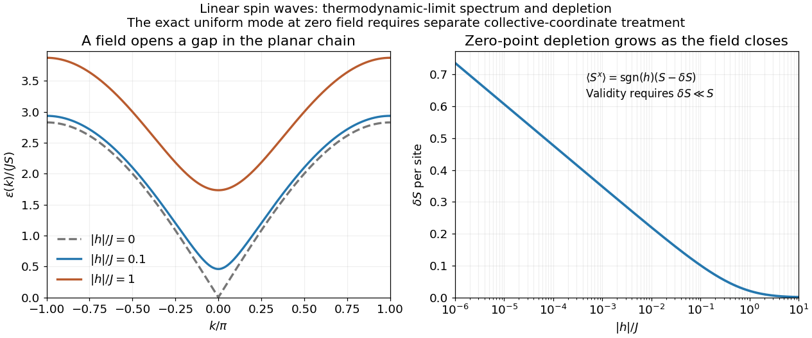

<h1 id="2/e/solution">Solution</h1>

↑ **Parent:** [E](../e.md)

For nonzero [field](../../../../magnetic-field-split.md), the [spin-wave](../../../../spin-wave.md) [ground state](../../../../ground-state.md) is the [vacuum](../../../../fock-vacuum.md) of all $b_k$. The [inverse Bogoliubov transformation](../../../../bogoliubov-transformation.md) gives $\langle a_k^\dagger a_q\rangle=\delta_{kq}\sinh^2\theta_k$ and vanishing one-point oscillator averages. [Translational invariance](../../../../translation-invariance.md) therefore gives the [depletion](../../../../one-dimensional-planar-spin-wave-depletion.md)

$$
\boxed{\delta S=\langle n_j\rangle=\frac1L\sum_k\sinh^2\theta_k
=\frac1{2L}\sum_k\left[\frac{H_f+2J-J\cos k}{\sqrt{(H_f+2J)[H_f+2J(1-\cos k)]}}-1\right].}
$$

Rotating back to the physical axes yields, to the retained [spin-wave](../../../../spin-wave.md) order,

$$
\boxed{\langle S_j^x\rangle=s(S-\delta S),\qquad \langle S_j^y\rangle=0,\qquad\langle S_j^z\rangle=0.}
$$

The zero transverse components also follow from [rotation](../../../../rotation-mathematics.md) by $\pi$ about the physical $x$ axis in a symmetry-preserving [ground state](../../../../ground-state.md). The nonzero [depletion](../../../../one-dimensional-planar-spin-wave-depletion.md) describes [zero-point quantum fluctuations](../../../../quantum-fluctuation.md): the original [boson](../../../../boson.md) [vacuum](../../../../fock-vacuum.md) is not the [ground state](../../../../ground-state.md) because the [anomalous terms](../../../../bosonic-bogoliubov-diagonalization.md) create pairs. It is nonnegative and must satisfy $\delta S\ll S$ for the expansion to be reliable. At strong [field](../../../../magnetic-field-split.md) it tends to zero, with $\delta S\sim J^2/(8H_f^2)$ in the infinite-chain limit.

For fixed $H_f>0$, the [momentum sum](../../../../sum.md) has a finite [thermodynamic limit](../../../../thermodynamic-limit.md) obtained by $L^{-1}\sum_k\to(2\pi)^{-1}\int_{-\pi}^{\pi}dk$. At zero [field](../../../../magnetic-field-split.md) the uniform mode already has no oscillator [vacuum](../../../../fock-vacuum.md), as explained in part d. Even after removing that mode, the nonzero modes behave as

$$
\sinh^2\theta_k=\frac{1}{2\sqrt2|k|}-\frac12+O(|k|),\qquad
\delta S\sim\frac{\log L}{2\pi\sqrt2}+O(1).
$$

Thus assigning a finite ordered [moment](../../../../moment.md) by simply setting $h=0$ in the infinite [momentum sum](../../../../sum.md) is invalid. The divergence indicates failure of this expansion about a fixed planar orientation; it is not a negative physical [magnetization](../../../../magnetization.md). At finite size an exact zero-field state chosen to have definite total $S^z$ has zero planar one-point [magnetization](../../../../magnetization.md) by the [continuous rotation symmetry](../../../../global-spin-rotation-symmetry-about-one-axis.md). Establishing its full [correlations](../../../../pearson-correlation-coefficient.md) requires a treatment beyond the divergent ordered-state approximation.

**[Figure 1](#2/e/image-spin-wave-dispersion-and-zero-point-depletion-for-the-planar-ferromagnetic-chain-in-a-longitudinal-field). Spin-wave dispersion and zero-point depletion for the planar ferromagnetic chain in a longitudinal field**.

## ↑ Ancestors (12)

1. [E](../e.md)
2. [2](../../2.md)
3. [2017](../../../2017-split.md)
4. [Past exam of the theoretical physics major option course of the University of Oxford](../../../split.md)
5. [Theoretical physics major option course of the University of Oxford](../../../../theoretical-physics-major-option-course-of-the-university-of-oxford.md)
6. [Year 4 of the physics course of the University of Oxford](../../../../year-4-of-the-physics-course-of-the-university-of-oxford.md)
7. [Physics course of the University of Oxford](../../../../physics-course-of-the-university-of-oxford.md)
8. [Undergraduate course of the University of Oxford](../../../../undergraduate-course-of-the-university-of-oxford.md)
9. [Course of the University of Oxford](../../../../course-of-the-university-of-oxford.md)
10. [University of Oxford](../../../../university-of-oxford-split.md)
11. [List of universities](../../../../list-of-universities.md)
12. [Codex Wiki](../../../../split.md)
