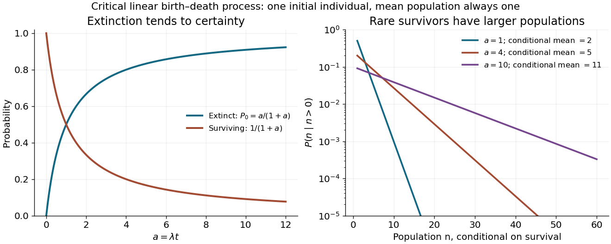

<h1 id="3/e/solution">Solution</h1>

↑ **Parent:** [E](../e.md)

The rates in part d turn the generating-function equation into

$$
\partial_tF=\lambda\bigl[(z-1)+(z^{-1}-1)\bigr]z\partial_zF
=\lambda(z-1)^2\partial_zF,\qquad F(z,0)=z.
$$

For the [distribution of a critical linear birth-death population](../../../../distribution-of-a-critical-linear-birth-death-population.md), the [method of characteristics](../../../../method-of-characteristics.md) gives $\dot z=-\lambda(z-1)^2$ and $\dot F=0$. Setting $w=(1-z)^{-1}$ gives $\dot w=-\lambda$, so the initial characteristic coordinate is $w_0=w+\lambda t$. Hence

$$
\boxed{F(z,t)=1-\frac{1-z}{1+\lambda t(1-z)}.}
$$

It has the correct initial value and $F(1,t)=1$. With $a=\lambda t$, rewrite the denominator as $(1+a)[1-az/(1+a)]$ and expand its [geometric series](../../../../geometric-series.md). The [probabilities](../../../../probability.md) are

$$
\boxed{P_0(t)=\frac{a}{1+a},\qquad
P_n(t)=\frac{a^{n-1}}{(1+a)^{n+1}}\quad(n\geq1).}
$$

At $t=0$ this is understood by continuity: $P_1=1$ and all other [probabilities](../../../../probability.md) vanish. Summing the positive-state [probabilities](../../../../probability.md) gives $1/(1+a)$, which together with $P_0$ verifies normalization directly.

There is eventual extinction with [probability](../../../../probability.md) one, because $P_0(t)\to1$. Nevertheless $\langle n\rangle=F_z(1,t)=1$ at every finite time, while $\operatorname{Var}(n)=2\lambda t$. There is no contradiction: the increasingly rare surviving populations have conditional [mean](../../../../expected-value-split.md) $\langle n\mid n>0\rangle=1+\lambda t$. This is the distinction between a constant ensemble [mean](../../../../expected-value-split.md) and survival of a typical realization.

**[Figure 2](#3/e/image-extinction-probability-and-surviving-population-distribution-of-the-critical-branching-process). Extinction probability and surviving-population distribution of the critical branching process**.

## ↑ Ancestors (12)

1. [E](../e.md)
2. [3](../../3.md)
3. [2017](../../../2017-split.md)
4. [Past exam of the theoretical physics major option course of the University of Oxford](../../../split.md)
5. [Theoretical physics major option course of the University of Oxford](../../../../theoretical-physics-major-option-course-of-the-university-of-oxford.md)
6. [Year 4 of the physics course of the University of Oxford](../../../../year-4-of-the-physics-course-of-the-university-of-oxford.md)
7. [Physics course of the University of Oxford](../../../../physics-course-of-the-university-of-oxford.md)
8. [Undergraduate course of the University of Oxford](../../../../undergraduate-course-of-the-university-of-oxford.md)
9. [Course of the University of Oxford](../../../../course-of-the-university-of-oxford.md)
10. [University of Oxford](../../../../university-of-oxford-split.md)
11. [List of universities](../../../../list-of-universities.md)
12. [Codex Wiki](../../../../split.md)
