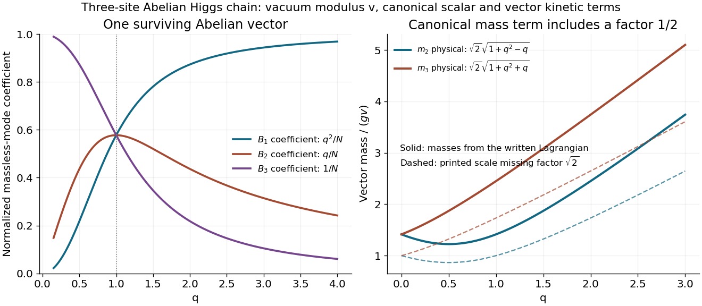

<h1 id="6/c/solution">Solution</h1>

↑ **Parent:** [C](../c.md)

A massless [eigenvector](../../../../eigenvector.md) must lie in the [null space](../../../../kernel-of-a-linear-map-split.md) of $R$, so its coefficients satisfy $c_1=qc_2$ and $c_2=qc_3$. Hence they are proportional to $(q^2,q,1)$. The original gauge [kinetic terms](../../../../kinetic-term.md) have the Euclidean unit [matrix](../../../../matrix.md) in species space, so normalize this vector by its ordinary squared length. The massless [field](../../../../field.md) is

$$
\boxed{A_1^\mu=\frac{q^2B_1^\mu+qB_2^\mu+B_3^\mu}{\sqrt{q^4+q^2+1}}.}
$$

The remaining two [eigenvectors](../../../../eigenvector.md) can be chosen orthogonal to it, making the full transformation orthogonal and preserving canonical vector [kinetic terms](../../../../kinetic-term.md). At $q=1$, the formula is exactly $(B_1^\mu+B_2^\mu+B_3^\mu)/\sqrt3$ as required. This null direction and its normalization are unaffected by the common mass-scale correction in part b.

For $q>1$, the massless mode has geometrically unequal components; a matter [field](../../../../field.md) coupled to one end can therefore couple more weakly to this surviving vector than a [field](../../../../field.md) coupled to the other end. This follows directly from the [eigenvector](../../../../eigenvector.md) coefficients, without changing the equal microscopic gauge [coupling](../../../../coupling.md) $g$.

**[Figure 3](#6/c/image-massless-vector-profile-and-canonically-normalized-masses-of-the-three-site-abelian-higgs-chain). Massless-vector profile and canonically normalized masses of the three-site Abelian Higgs chain**.

## ↑ Ancestors (12)

1. [C](../c.md)
2. [6](../../6.md)
3. [2017](../../../2017-split.md)
4. [Past exam of the theoretical physics major option course of the University of Oxford](../../../split.md)
5. [Theoretical physics major option course of the University of Oxford](../../../../theoretical-physics-major-option-course-of-the-university-of-oxford.md)
6. [Year 4 of the physics course of the University of Oxford](../../../../year-4-of-the-physics-course-of-the-university-of-oxford.md)
7. [Physics course of the University of Oxford](../../../../physics-course-of-the-university-of-oxford.md)
8. [Undergraduate course of the University of Oxford](../../../../undergraduate-course-of-the-university-of-oxford.md)
9. [Course of the University of Oxford](../../../../course-of-the-university-of-oxford.md)
10. [University of Oxford](../../../../university-of-oxford-split.md)
11. [List of universities](../../../../list-of-universities.md)
12. [Codex Wiki](../../../../split.md)
