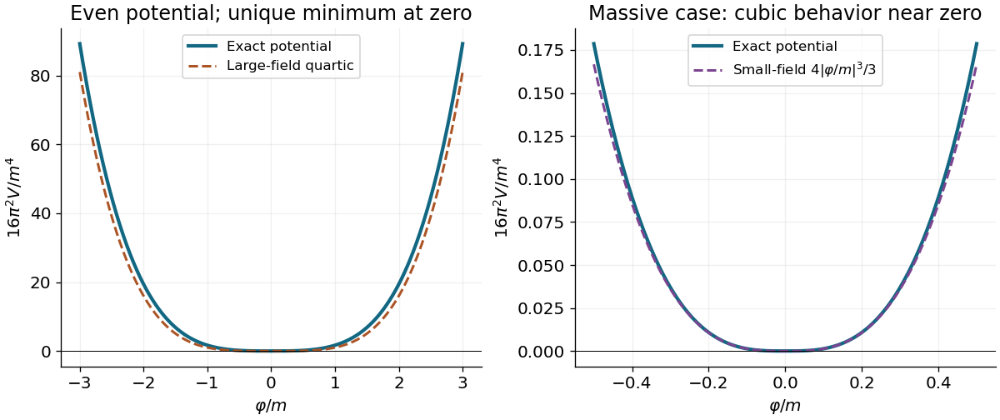
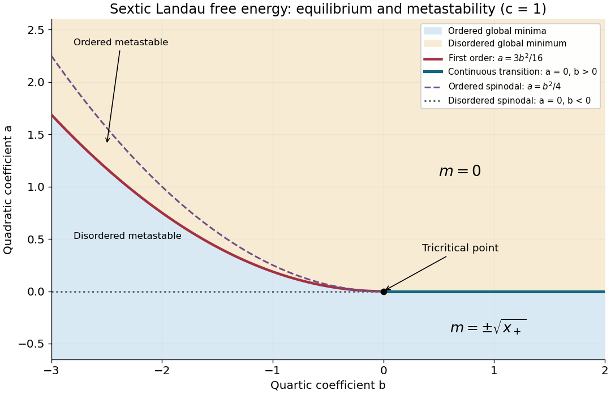

# 2018

↑ **Parent:** [Past exam of the theoretical physics major option course of the University of Oxford](../past-exam-of-the-theoretical-physics-major-option-course-of-the-university-of-oxford.md)

Source paper: [https://www.whatdotheyknow.com/request/oxford_physics_past_papers_2/response/2340696/attach/6/Physics%20Papers%202017.pdf?cookie_passthrough=1.](https://www.whatdotheyknow.com/request/oxford_physics_past_papers_2/response/2340696/attach/6/Physics%20Papers%202017.pdf?cookie_passthrough=1.) The cover identifies Trinity Term 2018; the annual bundle's 2017 filename does not determine the examination year. We use [natural units](../mathematical-physics.md#natural-units) $\hbar=c=1$ for the [classical field theory](../classical-field-theory.md) and [quantum field theory](../quantum-field-theory.md) in four spacetime dimensions and [Minkowski metric](../special-relativity.md#minkowski-metric) $\eta=\operatorname{diag}(1,-1,-1,-1)$.

**Table of contents**

- [1](#1)
  - [a](#1/a)
    - [Solution](#1/a/solution)
  - [b](#1/b)
    - [Solution](#1/b/solution)
  - [c](#1/c)
    - [Solution](#1/c/solution)
  - [d](#1/d)
    - [Solution](#1/d/solution)
- [2](#2)
  - [a](#2/a)
    - [Solution](#2/a/solution)
  - [b](#2/b)
    - [Solution](#2/b/solution)
  - [c](#2/c)
    - [Solution](#2/c/solution)
  - [d](#2/d)
    - [Solution](#2/d/solution)
  - [e](#2/e)
    - [Solution](#2/e/solution)
- [3](#3)
  - [a](#3/a)
    - [Solution](#3/a/solution)
  - [b](#3/b)
    - [i](#3/b/i)
      - [Solution](#3/b/i/solution)
    - [ii](#3/b/ii)
      - [Solution](#3/b/ii/solution)
  - [c](#3/c)
    - [Solution](#3/c/solution)
  - [d](#3/d)
    - [Solution](#3/d/solution)
  - [e](#3/e)
    - [Solution](#3/e/solution)
- [4](#4)
  - [a](#4/a)
    - [Solution](#4/a/solution)
  - [b](#4/b)
    - [Solution](#4/b/solution)
  - [c](#4/c)
    - [Solution](#4/c/solution)
  - [d](#4/d)
    - [Solution](#4/d/solution)
- [5](#5)
  - [a](#5/a)
    - [Solution](#5/a/solution)
  - [b](#5/b)
    - [Solution](#5/b/solution)
  - [c](#5/c)
    - [Solution](#5/c/solution)
  - [d](#5/d)
    - [Solution](#5/d/solution)
- [6](#6)
  - [a](#6/a)
    - [Solution](#6/a/solution)
  - [b](#6/b)
    - [Solution](#6/b/solution)
  - [c](#6/c)
    - [Solution](#6/c/solution)
  - [d](#6/d)
    - [Solution](#6/d/solution)
  - [e](#6/e)
    - [Solution](#6/e/solution)

## 1

↑ **Parent:** [2018](2018.md)

<h3 id="1/a">a</h3>

↑ **Parent:** [1](#1)

<h4 id="1/a/solution">Solution</h4>

↑ **Parent:** [A](#1/a)

The [Euler-Lagrange equation](../analysis.md#euler-lagrange-equation) for the [real scalar field](../scalar-field-theory.md#real-scalar-field) gives

$$
\partial_\mu\frac{\partial\mathcal L}{\partial(\partial_\mu\phi)}-\frac{\partial\mathcal L}{\partial\phi}=0
\quad\Longrightarrow\quad
\boxed{(\Box+m^2)\phi=0.}
$$

Thus the [conjugate momentum](../hamiltonian-mechanics.md#canonical-momentum) and [Hamiltonian density](../classical-field-theory.md#hamiltonian-density) are

$$
\boxed{\pi=\frac{\partial\mathcal L}{\partial\dot\phi}=\dot\phi,\qquad
\mathcal H=\pi\dot\phi-\mathcal L=\frac12\bigl[\pi^2+(\nabla\phi)^2+m^2\phi^2\bigr],\qquad H=\int d^3x\,\mathcal H.}
$$

The spatial [Fourier transform](../fourier-transform.md) reduces the [Klein-Gordon equation](../wave-equation.md#klein-gordon-equation) to $\ddot\phi_{\mathbf p}+\omega_{\mathbf p}^2\phi_{\mathbf p}=0$, with positive [frequency](../wave.md#frequency) $\omega_{\mathbf p}=\sqrt{\mathbf p^2+m^2}$. Hence a general real solution is the [mode expansion of a free field](../quantum-field-theory.md#mode-expansion-of-a-free-field)

$$
\boxed{\phi(t,\mathbf x)=\int\frac{d^3p}{(2\pi)^3\sqrt{2\omega_{\mathbf p}}}
\left[a_{\mathbf p}e^{-i\omega_{\mathbf p}t+i\mathbf p\cdot\mathbf x}
+a_{\mathbf p}^*e^{i\omega_{\mathbf p}t-i\mathbf p\cdot\mathbf x}\right].}
$$

The two coefficients are complex conjugates because the [field](../algebra.md#field) is real. Each pair of initial data $\phi(0,\mathbf x),\pi(0,\mathbf x)$ fixes these coefficients. The normalization anticipates [canonical quantization](../quantum-mechanics.md#canonical-quantization) and the relativistic normalization of one-particle states.

<h3 id="1/b">b</h3>

↑ **Parent:** [1](#1)

<h4 id="1/b/solution">Solution</h4>

↑ **Parent:** [B](#1/b)

Promote the [mode expansion of a free field](../quantum-field-theory.md#mode-expansion-of-a-free-field) coefficients to [annihilation operators](../quantum-harmonic-oscillator.md#annihilation-operator) and [creation operators](../quantum-harmonic-oscillator.md#creation-operator), replacing $a^*$ by $a^\dagger$. The [canonical commutation relations](../quantum-mechanics.md#canonical-commutation-relation) are

$$
\boxed{[a_{\mathbf p},a_{\mathbf q}^\dagger]=(2\pi)^3\delta^3(\mathbf p-\mathbf q),\qquad
[a_{\mathbf p},a_{\mathbf q}]=[a_{\mathbf p}^\dagger,a_{\mathbf q}^\dagger]=0.}
$$

Together with the normalization in part a, they give $[\phi(t,\mathbf x),\pi(t,\mathbf y)]=i\delta^3(\mathbf x-\mathbf y)$ and vanishing equal-time [commutators](../lie-algebra.md#commutator) between two [fields](../algebra.md#field) or two [conjugate momenta](../hamiltonian-mechanics.md#canonical-momentum).

Insert the [mode expansion of a free field](../quantum-field-theory.md#mode-expansion-of-a-free-field) in the [Hamiltonian](../hamiltonian-mechanics.md#hamiltonian). The spatial integral produces $(2\pi)^3\delta^3(\mathbf p\pm\mathbf q)$. The $aa$ and $a^\dagger a^\dagger$ coefficients cancel because $\omega_{\mathbf p}^2=\mathbf p^2+m^2$. The remaining terms give

$$
H=\frac12\int\frac{d^3p}{(2\pi)^3}\omega_{\mathbf p}
\left(a_{\mathbf p}^\dagger a_{\mathbf p}+a_{\mathbf p}a_{\mathbf p}^\dagger\right)
=\int\frac{d^3p}{(2\pi)^3}\omega_{\mathbf p}a_{\mathbf p}^\dagger a_{\mathbf p}
+\frac{(2\pi)^3\delta^3(0)}2\int\frac{d^3p}{(2\pi)^3}\omega_{\mathbf p}.
$$

This is a continuum of [quantum harmonic oscillators](../quantum-harmonic-oscillator.md). In a finite periodic volume $V$, $(2\pi)^3\delta^3(0)=V$. The [Fock vacuum](../quantum-field-theory.md#fock-vacuum) satisfies $a_{\mathbf p}|0\rangle=0$, so its [vacuum energy density](../perturbative-quantum-field-theory.md#vacuum-energy-density) is

$$
\boxed{\mathcal E=\frac{\langle0|H|0\rangle}{V}=\frac12\int\frac{d^3p}{(2\pi)^3}\sqrt{\mathbf p^2+m^2}.}
$$

[Normal ordering](../perturbative-quantum-field-theory.md#normal-ordering) would subtract this constant; here it must be retained because it is the quantity being calculated.[Section 2, canonical quantization of the real scalar field and its zero-point Hamiltonian](../physics-bibliography.md#quantum-field-theory-by-david-tong)

<h3 id="1/c">c</h3>

↑ **Parent:** [1](#1)

<h4 id="1/c/solution">Solution</h4>

↑ **Parent:** [C](#1/c)

A spherical three-[momentum](../momentum.md) [ultraviolet cutoff](../quantum-field-theory.md#ultraviolet-cutoff) gives

$$
\mathcal E(\Lambda)=\frac1{4\pi^2}\int_0^\Lambda dp\,p^2\sqrt{p^2+m^2}
=\boxed{\frac{\Lambda\sqrt{\Lambda^2+m^2}(2\Lambda^2+m^2)-m^4\operatorname{arsinh}(\Lambda/m)}{32\pi^2}}.
$$

For $m>0$ and $\Lambda\gg m$, the [asymptotic expansion](../asymptotic-expansion.md) is

$$
\boxed{\mathcal E(\Lambda)=\frac{\Lambda^4}{16\pi^2}+\frac{m^2\Lambda^2}{16\pi^2}
-\frac{m^4}{32\pi^2}\log\frac{2\Lambda}{m}+\frac{m^4}{128\pi^2}+O(m^6/\Lambda^2).}
$$

In particular, the leading [ultraviolet divergence](../perturbative-quantum-field-theory.md#ultraviolet-divergence) is quartic. For $m=0$, $\mathcal E=\Lambda^4/(16\pi^2)$ exactly.

Write $\varphi=\langle\psi\rangle$. Under the proposed identification, the [scalar potential from a field-dependent momentum cutoff](../perturbative-quantum-field-theory.md#scalar-potential-from-a-field-dependent-momentum-cutoff) is $V_{\mathrm{ind}}(\varphi)=\mathcal E(|\varphi|)$. It is even and nonnegative, and its derivative with respect to $|\varphi|$ is $|\varphi|^2\sqrt{\varphi^2+m^2}/(4\pi^2)>0$ away from zero. Consequently its only [global minimum](../analysis.md#global-minimum) is at $\varphi=0$: this contribution alone does not cause [spontaneous symmetry breaking](../quantum-field-theory.md#spontaneous-symmetry-breaking). At large $|\varphi|$ it grows quartically. At small $|\varphi|$ with fixed positive $m$, however,

$$
V_{\mathrm{ind}}(\varphi)=\frac{m|\varphi|^3}{12\pi^2}+O(|\varphi|^5/m).
$$

Thus the quartic sketch is an asymptotic shape, not the exact small-field behavior for a massive original [field](../algebra.md#field). Identifying a regulator with a new [field](../algebra.md#field) is an additional modeling prescription; an actual [effective potential](../mathematical-physics.md#effective-potential) also depends on the new [field](../algebra.md#field)'s dynamics and any other allowed terms.

**[Figure 1](#1/c/image-scalar-potential-obtained-by-identifying-a-ultraviolet-cutoff-with-a-scalar-field-expectation-value). Scalar potential obtained by identifying a ultraviolet cutoff with a scalar field expectation value**.

<h3 id="1/d">d</h3>

↑ **Parent:** [1](#1)

<h4 id="1/d/solution">Solution</h4>

↑ **Parent:** [D](#1/d)

Use one common [ultraviolet cutoff](../quantum-field-theory.md#ultraviolet-cutoff) for all physical degrees of freedom, with positive sign for each [bosonic](../tensor-product-of-quantum-systems.md#boson) degree of freedom and negative sign for each [fermionic](../tensor-product-of-quantum-systems.md#fermion) degree of freedom. For the [mass-moment cancellation of vacuum energy divergences](../perturbative-quantum-field-theory.md#mass-moment-cancellation-of-vacuum-energy-divergences), define the weighted [supertrace](../supersymmetric-quantum-mechanics.md#supertrace) $\operatorname{Str}f(m)=\sum_Bf(m_B)-\sum_Ff(m_F)$. The large-[momentum](../momentum.md) expansion is

$$
\sum_B\sqrt{p^2+m_B^2}-\sum_F\sqrt{p^2+m_F^2}
=p\,\operatorname{Str}1+\frac{\operatorname{Str}m^2}{2p}-\frac{\operatorname{Str}m^4}{8p^3}+O(p^{-5}).
$$

After multiplication by the radial measure $p^2dp$, these three terms produce quartic, quadratic and logarithmic [ultraviolet divergences](../perturbative-quantum-field-theory.md#ultraviolet-divergence). Therefore the necessary and sufficient cancellations for the displayed _unsubtracted_ finite-species [vacuum energy](../perturbative-quantum-field-theory.md#vacuum-energy) are

$$
\boxed{\operatorname{Str}1=0,\qquad\operatorname{Str}m^2=0,\qquad\operatorname{Str}m^4=0.}
$$

They respectively mean equal numbers of [bosonic](../tensor-product-of-quantum-systems.md#boson) and [fermionic](../tensor-product-of-quantum-systems.md#fermion) physical degrees of freedom, equal sums of squared [masses](../classical-mechanics.md#mass), and equal sums of fourth powers of [masses](../classical-mechanics.md#mass). Once they hold, the remaining radial integrand falls as $p^{-3}$ and is integrable at infinity. Nonnegative [masses](../classical-mechanics.md#mass) introduce no lower-end divergence.

Pairing every [bosonic](../tensor-product-of-quantum-systems.md#boson) degree of freedom with a [fermionic](../tensor-product-of-quantum-systems.md#fermion) one of the same [mass](../classical-mechanics.md#mass), as in an unbroken [supersymmetric](../supersymmetry.md) spectrum, is sufficient and cancels the entire expression. It is stronger than these three moment conditions. For a concrete non-paired example, take bosonic squared [masses](../classical-mechanics.md#mass) $\{0,3,3\}m_*^2$ and fermionic squared [masses](../classical-mechanics.md#mass) $\{1,1,4\}m_*^2$. Both have three degrees of freedom, squared-[mass](../classical-mechanics.md#mass) sum $6m_*^2$ and fourth-power-[mass](../classical-mechanics.md#mass) sum $18m_*^4$, but their spectra differ. If a [vacuum energy](../perturbative-quantum-field-theory.md#vacuum-energy) [counterterm](../perturbative-quantum-field-theory.md#counterterm) is instead permitted, a renormalized finite answer need not satisfy them; that is a different prescription from finiteness of the source's bare sum.

## 2

↑ **Parent:** [2018](2018.md)

<h3 id="2/a">a</h3>

↑ **Parent:** [2](#2)

<h4 id="2/a/solution">Solution</h4>

↑ **Parent:** [A](#2/a)

[Goldstone's theorem](../quantum-field-theory.md#goldstone-theorem) states that a spontaneously broken continuous internal [global symmetry in field theory](../classical-field-theory.md#global-symmetry-in-field-theory) of a local relativistic [quantum field theory](../quantum-field-theory.md) produces massless [Goldstone bosons](../critical-phenomenon.md#goldstone-boson). For a [Lorentz invariance](../special-relativity.md#lorentz-invariance) [vacuum](../physics.md#vacuum) breaking $G$ to its stabilizer $H$, there are $\dim G-\dim H$ independent symmetry-required massless directions. Additional accidentally massless modes are possible. A gauge redundancy does not obey this physical-state counting, and nonrelativistic systems need not have one independent mode per broken generator.

For the classical proof, consider real [scalar fields](../classical-field-theory.md#scalar-field) $\phi_i$ with a positive canonical [kinetic term](../classical-field-theory.md#kinetic-term) and an invariant smooth [scalar potential](../classical-field-theory.md#scalar-potential) $V$. An infinitesimal generator $T^a$ satisfies

$$
\frac{\partial V}{\partial\phi_i}(T^a\phi)_i=0.
$$

Let $v$ be a stationary [vacuum](../physics.md#vacuum) and differentiate this identity with respect to $\phi_j$. At $v$, the term proportional to $\partial_iV$ vanishes, leaving

$$
\boxed{\mathsf M^2_{ji}(T^av)_i=0,\qquad \mathsf M^2_{ji}=\left.\frac{\partial^2V}{\partial\phi_j\partial\phi_i}\right|_v.}
$$

The [Hessian matrix](../multivariable-calculus.md#hessian-matrix) $\mathsf M^2$ is the [scalar mass matrix](../quantum-field-theory.md#scalar-mass-matrix). An unbroken generator has $T^av=0$; broken generators span the tangent space of the [vacuum manifold](../quantum-field-theory.md#vacuum-manifold) $G/H$. Each independent nonzero tangent vector is a zero [eigenvector](../linear-operator-theory.md#eigenvector) of $\mathsf M^2$. The quadratic [Euler-Lagrange equations](../analysis.md#euler-lagrange-equation) in these directions are $\Box\pi^a=0$, giving the massless [dispersion relation](../dispersion-relation.md) $\omega^2=\mathbf p^2$. This proves the classical result and explains why the [Goldstone bosons](../critical-phenomenon.md#goldstone-boson) describe motion along the degenerate minima rather than against a restoring curvature.

<h3 id="2/b">b</h3>

↑ **Parent:** [2](#2)

<h4 id="2/b/solution">Solution</h4>

↑ **Parent:** [B](#2/b)

Both the canonical [kinetic term](../classical-field-theory.md#kinetic-term) and $V(\phi^{\mathsf T}\phi)$ are invariant under the [orthogonal group](../linear-algebra.md#orthogonal-group) $O(n)$. The stated nonzero [vacuum expectation value](../quantum-field-theory.md#vacuum-expectation-value) has length $|v|$. Its stabilizer is the [orthogonal group](../linear-algebra.md#orthogonal-group) $O(n-1)$ acting on the perpendicular subspace. Hence

$$
\boxed{N_{\mathrm{GB}}=\frac{n(n-1)}2-\frac{(n-1)(n-2)}2=n-1.}
$$

The two nonzero coordinates of this particular [vacuum](../physics.md#vacuum) do not break more generators than an axis-aligned [vacuum](../physics.md#vacuum): the two choices are related by a common [orthogonal transformation](../linear-algebra.md#orthogonal-transformation).

Explicitly, with $s=\phi^{\mathsf T}\phi$,

$$
\mathsf M^2=2V'(v^2)\mathsf I+4V''(v^2)vv^{\mathsf T}.
$$

[stationary point](../calculus-of-variations.md#stationary-point) at nonzero $v$ requires $V'(v^2)=0$. The $n-1$ transverse [eigenvalues](../linear-operator-theory.md#eigenvalue) vanish, while the radial squared [mass](../classical-mechanics.md#mass) is $4v^2V''(v^2)$. If this curvature also vanishes, there is an additional accidental massless radial mode; the number of symmetry-protected [Goldstone bosons](../critical-phenomenon.md#goldstone-boson) remains $n-1$. If $v=0$, the [symmetry](../physics.md#symmetry-physics) is unbroken and none is required.

<h3 id="2/c">c</h3>

↑ **Parent:** [2](#2)

<h4 id="2/c/solution">Solution</h4>

↑ **Parent:** [C](#2/c)

Assume $\mu^2,\lambda>0$. At zero source, the [vacuum manifold](../quantum-field-theory.md#vacuum-manifold) is the sphere of radius $v_0=\mu/\sqrt\lambda$. The source tilts the [scalar potential](../classical-field-theory.md#scalar-potential) by $-\epsilon\phi_1$. Its force should be small compared with the radial restoring-force scale $\mu^2v_0$, so a useful quantitative condition is

$$
\boxed{|\epsilon|\ll\mu^2v_0=\frac{\mu^3}{\sqrt\lambda}.}
$$

For nonzero $\epsilon$, the exact [global symmetry in field theory](../classical-field-theory.md#global-symmetry-in-field-theory) of the [Lagrangian](../calculus-of-variations.md#lagrangian) is $O(n-1)$, rotating $\phi_2,\ldots,\phi_n$. The global [vacuum](../physics.md#vacuum) aligns with the source:

$$
\langle\phi\rangle=(\operatorname{sgn}(\epsilon)w,0,\ldots,0),\qquad
\lambda w^3-\mu^2w=|\epsilon|,\qquad
w=v_0+\frac{|\epsilon|}{2\mu^2}+O\!\left(\frac{\epsilon^2}{\mu^4v_0}\right).
$$

This [vacuum](../physics.md#vacuum) preserves the entire remaining $O(n-1)$ [symmetry](../physics.md#symmetry-physics). There is therefore no exact [Goldstone boson](../critical-phenomenon.md#goldstone-boson) for $\epsilon\ne0$. Expanding the [scalar potential](../classical-field-theory.md#scalar-potential) to quadratic order gives

$$
\boxed{m_{\perp}^2=-\mu^2+\lambda w^2=\frac{|\epsilon|}{w},\qquad
m_{\parallel}^2=-\mu^2+3\lambda w^2=2\mu^2+\frac{3|\epsilon|}{w}.}
$$

Thus there are $n-1$ degenerate light [pseudo-Goldstone bosons](../quantum-field-theory.md#pseudo-goldstone-boson) and one heavy radial [scalar](../vector-space.md#scalar). The small-source condition makes their squared [masses](../classical-mechanics.md#mass) parametrically smaller than the radial squared [mass](../classical-mechanics.md#mass). Sending $\epsilon$ to zero restores the original massless modes.

<h3 id="2/d">d</h3>

↑ **Parent:** [2](#2)

<h4 id="2/d/solution">Solution</h4>

↑ **Parent:** [D](#2/d)

The breaking of the internal [global symmetry in field theory](../classical-field-theory.md#global-symmetry-in-field-theory) $SU(n)\times SU(n)$ to $SU(n)$ removes $2(n^2-1)-(n^2-1)$ generators. The relativistic [Goldstone theorem](../quantum-field-theory.md#goldstone-theorem) therefore requires

$$
\boxed{n^2-1\text{ massless Goldstone bosons}.}
$$

Other states fall into multiplets of the unbroken [special unitary group](../topological-group.md#special-unitary-group), but their [masses](../classical-mechanics.md#mass) are not fixed by this counting. For the usual diagonal embedding $SU(n)_V\subset SU(n)_L\times SU(n)_R$, the [Goldstone bosons](../critical-phenomenon.md#goldstone-boson) form its adjoint multiplet.

If small explicit symmetry-breaking terms are added, the broken-generator directions generally acquire small curvature, producing light [pseudo-Goldstone bosons](../quantum-field-theory.md#pseudo-goldstone-boson) rather than exactly massless states. Their squared [masses](../classical-mechanics.md#mass) tend to zero with those breaking parameters. Small breaking can also split multiplet degeneracies. These claims concern a small perturbation of the broken phase; approximate [symmetry](../physics.md#symmetry-physics) alone does not establish which [vacuum](../physics.md#vacuum) is selected.

<h3 id="2/e">e</h3>

↑ **Parent:** [2](#2)

<h4 id="2/e/solution">Solution</h4>

↑ **Parent:** [E](#2/e)

The light states have the counting $3+4+1=8$. This suggests approximate [chiral symmetry breaking](../standard-model.md#chiral-symmetry-breaking)

$$
\boxed{SU(3)_L\times SU(3)_R\longrightarrow SU(3)_V,\qquad 2(3^2-1)-(3^2-1)=8,}
$$

with a nonzero [quark chiral condensate](../standard-model.md#quark-chiral-condensate) $\langle\bar q_R^{\,j}q_L^{\,i}\rangle\propto\delta^{ij}$ for the three light flavours $u,d,s$. The three [pions](../standard-model.md#pion), four [kaons](../physics.md#kaon) and predominantly octet [eta meson](../physics.md#eta-meson) are the resulting [pseudo-Goldstone bosons](../quantum-field-theory.md#pseudo-goldstone-boson). Their small nonzero [masses](../classical-mechanics.md#mass) reflect explicit [chiral symmetry](../standard-model.md#chiral-symmetry) breaking by the light-quark [masses](../classical-mechanics.md#mass); for example, $m_\pi^2$ is proportional to $m_u+m_d$ at leading order. The larger strange-quark [mass](../classical-mechanics.md#mass) makes the [kaons](../physics.md#kaon) and octet [eta meson](../physics.md#eta-meson) heavier than the [pions](../standard-model.md#pion), while [electromagnetic interactions](../electromagnetism.md#electromagnetic-interaction) help split charged and neutral partners.[Chapter 5, chiral symmetry breaking and section 5.3 on adding quark masses](../physics-bibliography.md#gauge-theory-by-david-tong)

Although the massless strong-interaction terms admit independent rotations of all six flavours, the charm, bottom and top [masses](../classical-mechanics.md#mass) are too large to treat six-flavour [chiral symmetry](../standard-model.md#chiral-symmetry) as a small explicit breaking at the light-hadron scale. Full approximate $SU(6)_L\times SU(6)_R$ breaking would suggest 35 light modes, rather than this octet. The classical axial $U(1)$ is also broken by the [chiral anomaly](../relativistic-quantum-field.md#chiral-anomaly), so it does not supply a ninth equally light [Goldstone boson](../critical-phenomenon.md#goldstone-boson).

**Terminology qualification:** these mesons have [spin](../angular-momentum-operator.md#spin) zero but negative [parity](../quantum-mechanics.md#parity): they are [pseudoscalar mesons](../physics.md#pseudoscalar-meson), with $J^P=0^-$, rather than positive-parity [scalar](../vector-space.md#scalar) [particles](../physics.md#particle-physics) with $J^P=0^+$. Calling the listed states “[scalar](../vector-space.md#scalar)” is acceptable only if it is being used loosely to mean [spin](../angular-momentum-operator.md#spin) zero.

## 3

↑ **Parent:** [2018](2018.md)

<h3 id="3/a">a</h3>

↑ **Parent:** [3](#3)

<h4 id="3/a/solution">Solution</h4>

↑ **Parent:** [A](#3/a)

The [action](../lagrangian-mechanics.md#action) is dimensionless and $[d^4x]=-4$, so $[\mathcal L]=4$. A canonical [scalar](../vector-space.md#scalar) [kinetic term](../classical-field-theory.md#kinetic-term) then requires $2+2[\phi]=4$, and the electromagnetic [kinetic term](../classical-field-theory.md#kinetic-term) requires $2[F_{\mu\nu}]=4$. Thus

$$
\boxed{[\Phi]=[a]=[b]=1,\qquad[F_{\mu\nu}]=2.}
$$

The brackets here denote [mass dimension](../perturbative-quantum-field-theory.md#mass-dimension). The [Lagrangian](../calculus-of-variations.md#lagrangian) has no explicit coordinate dependence, and all indices are contracted as [Lorentz scalars](../special-relativity.md#lorentz-scalar). Its continuous spacetime [symmetry](../physics.md#symmetry-physics) is the [Poincaré group](../special-relativity.md#poincare-group). [Noether's theorem](../calculus-of-variations.md#noether-conserved-quantity-for-a-mechanical-point-symmetry) gives conserved [four-momentum](../special-relativity.md#four-momentum) from translations and conserved [angular momentum](../momentum.md#angular-momentum), including the boost generators, from [Lorentz transformations](../special-relativity.md#lorentz-transformation). The nonzero [mass](../classical-mechanics.md#mass) $M$ and dimensionful [couplings](../probability-and-statistics.md#coupling) prevent a dilation [symmetry](../physics.md#symmetry-physics).

**Sign qualification:** the printed electromagnetic [kinetic term](../classical-field-theory.md#kinetic-term) has the opposite healthy relative sign to the [scalar](../vector-space.md#scalar) [kinetic terms](../classical-field-theory.md#kinetic-term). With the stated mostly-minus [Minkowski metric](../special-relativity.md#minkowski-metric), a physical [Maxwell Lagrangian](../relativistic-electromagnetism.md#maxwell-lagrangian) is $-F_{\mu\nu}F^{\mu\nu}/4$. The printed plus sign instead gives [photon](../quantum-mechanics.md#photon) [Hamiltonian density](../classical-field-theory.md#hamiltonian-density) $-(\mathbf E^2+\mathbf B^2)/2$; a nonzero purely electric configuration already has negative [energy](../energy.md), unbounded below as its amplitude grows. The physical [decay widths](../relativistic-quantum-field.md#decay-width) below use the healthy Maxwell sign with the given interaction normalization. The dimensional and spacetime-symmetry conclusions themselves do not depend on this sign correction.

<h3 id="3/b">b</h3>

↑ **Parent:** [3](#3)

<h4 id="3/b/i">i</h4>

↑ **Parent:** [B](#3/b)

<h5 id="3/b/i/solution">Solution</h5>

↑ **Parent:** [I](#3/b/i)

Counting the [mass dimensions](../perturbative-quantum-field-theory.md#mass-dimension) of each interaction operator gives

$$
\boxed{[\lambda_a]=-1,\qquad[\lambda_b]=-3,\qquad[\lambda_\gamma]=-1.}
$$

Indeed $\Phi(\partial a)^2$ and $\Phi F^2$ have dimension five, whereas $\Phi b^2(\partial b)^2$ has dimension seven. These are interactions of an [effective field theory](../quantum-field-theory.md#effective-field-theory) with dimensionful [couplings](../probability-and-statistics.md#coupling).

The direct one-vertex [decay channels](../physics.md#decay-channel) are $\Phi\to aa$, $\Phi\to bbbb$ and $\Phi\to\gamma\gamma$. Each leading [scattering amplitude](../quantum-scattering.md#scattering-amplitude) is linear in its corresponding [coupling](../probability-and-statistics.md#coupling), and a [decay width](../relativistic-quantum-field.md#decay-width) is quadratic in the amplitude. Therefore, holding the parent [mass](../classical-mechanics.md#mass) fixed,

$$
\boxed{\Gamma_{aa}\propto|\lambda_a|^2,\qquad\Gamma_{bbbb}\propto|\lambda_b|^2,\qquad\Gamma_{\gamma\gamma}\propto|\lambda_\gamma|^2.}
$$

There are no tree-level interference terms between these different final states.

<h4 id="3/b/ii">ii</h4>

↑ **Parent:** [B](#3/b)

<h5 id="3/b/ii/solution">Solution</h5>

↑ **Parent:** [Ii](#3/b/ii)

All daughter [particles](../physics.md#particle-physics) are massless, so the parent [mass](../classical-mechanics.md#mass) $M$ supplies the only kinematic scale at [tree level](../perturbative-quantum-field-theory.md#tree-level-feynman-diagram). Each vertex has two derivatives, making its [scattering amplitude](../quantum-scattering.md#scattering-amplitude) scale as $\lambda_iM^2$. For the four-$b$ vertex, symmetrizing over the derivative-bearing legs yields a sum of pairwise [four-momentum](../special-relativity.md#four-momentum) products, which is proportional to $M^2$ by [four-momentum conservation](../special-relativity.md#four-momentum-conservation).

For $n$ massless daughters, the [Lorentz invariance](../special-relativity.md#lorentz-invariance) [Lorentz-invariant phase-space measure](../quantum-scattering.md#lorentz-invariant-phase-space-measure) scales as $M^{2n-4}$: each $d^3q/(2E)$ contributes two powers and the four-dimensional [Dirac delta](../distribution-theory.md#dirac-delta-function) removes four powers. Including the parent factor $1/(2M)$ gives $\Gamma\sim|\lambda_i|^2M^{2n-1}$. Thus

$$
\boxed{\Gamma_{aa}\propto|\lambda_a|^2M^3,\qquad
\Gamma_{bbbb}\propto|\lambda_b|^2M^7,\qquad
\Gamma_{\gamma\gamma}\propto|\lambda_\gamma|^2M^3.}
$$

The unspecified factors are dimensionless angular integrals and identical-particle factors. Each result has [mass dimension](../perturbative-quantum-field-theory.md#mass-dimension) one, as a [decay width](../relativistic-quantum-field.md#decay-width) must in [natural units](../mathematical-physics.md#natural-units).

<h3 id="3/c">c</h3>

↑ **Parent:** [3](#3)

<h4 id="3/c/solution">Solution</h4>

↑ **Parent:** [C](#3/c)

Every interaction contains an even number of $b$ [fields](../algebra.md#field), so the exact discrete [symmetry](../physics.md#symmetry-physics) $b\mapsto-b$ forbids $\Phi\to bbb$ to every perturbative order. There is no such prohibition for $\Phi\to bb$.

The latter [decay channel](../physics.md#decay-channel) is absent at [tree level](../perturbative-quantum-field-theory.md#tree-level-feynman-diagram) in the displayed interactions, but contracting two $b$ legs at a $\Phi b^2(\partial b)^2$ vertex produces a [tadpole diagram](../perturbative-quantum-field-theory.md#tadpole-diagram) with two external $b$ legs. For example, contracting the undifferentiated pair leaves the local operator $\Phi(\partial b)^2$ multiplied by an integral proportional to $\int d^4\ell/(\ell^2+i0)$. Contracting the differentiated pair instead gives a local $\Phi b^2$ contribution. Both are allowed [effective field theory](../quantum-field-theory.md#effective-field-theory) operators. With a [ultraviolet cutoff](../quantum-field-theory.md#ultraviolet-cutoff), these local terms generically carry quadratic or quartic cutoff dependence and require matching coefficients or [counterterms](../perturbative-quantum-field-theory.md#counterterm).

There is a relevant qualification to a claim that the one-loop [decay width](../relativistic-quantum-field.md#decay-width) must be nonzero. Since $b$ is exactly massless here, the one-vertex [tadpole integrals](../perturbative-quantum-field-theory.md#tadpole-integral) have no external scale and are [scaleless integrals](../perturbative-quantum-field-theory.md#scaleless-integral). They vanish in [dimensional regularization](../perturbative-quantum-field-theory.md#dimensional-regularization). Thus the correct conclusion is **allowed, and generically generated by quantum corrections or matching**, not a regulator-independent nonzero one-loop prediction from $\lambda_b$ alone. No exact [symmetry](../physics.md#symmetry-physics) protects the two-$b$ channel; its numerical rate requires the renormalized coefficients of the allowed operators.

<h3 id="3/d">d</h3>

↑ **Parent:** [3](#3)

<h4 id="3/d/solution">Solution</h4>

↑ **Parent:** [D](#3/d)

Work in the parent [rest frame](../mathematical-physics.md#rest-frame), $p=(M,\mathbf0)$. For massless daughters, the spatial [Dirac delta](../distribution-theory.md#dirac-delta-function) fixes $\mathbf q_2=-\mathbf q_1$ and $E_1=E_2=q$. The [Lorentz invariance](../special-relativity.md#lorentz-invariance) two-body [Lorentz-invariant phase-space measure](../quantum-scattering.md#lorentz-invariant-phase-space-measure) becomes

$$
\begin{aligned}
d\Pi_2&=\frac{(2\pi)^4}{(2\pi)^6}\frac{q^2dq\,d\Omega}{4q^2}\,\delta(M-2q)\\
&=\frac{dq\,d\Omega}{16\pi^2}\,\delta(M-2q)
\quad\Longrightarrow\quad
\boxed{d\Pi_2=\frac{d\Omega}{32\pi^2}.}
\end{aligned}
$$

The factor $1/2$ in the last step is the Jacobian of the energy-conservation [Dirac delta](../distribution-theory.md#dirac-delta-function). Consequently the labelled two-body [decay width](../relativistic-quantum-field.md#decay-width) is

$$
\boxed{\Gamma_{\mathrm{labelled}}=\frac1{64\pi^2M}\int d\Omega\,|\mathcal A|^2.}
$$

For two identical final [particles](../physics.md#particle-physics), the full angular integral counts each unordered final state twice, so the physical [decay width](../relativistic-quantum-field.md#decay-width) includes an additional factor $1/2!$. This factor is needed for both channels in part e; it is separate from any vertex combinatorics already included in the [Feynman rule](../perturbative-quantum-field-theory.md#feynman-rule).

<h3 id="3/e">e</h3>

↑ **Parent:** [3](#3)

<h4 id="3/e/solution">Solution</h4>

↑ **Parent:** [E](#3/e)

The massless two-body [kinematics](../classical-mechanics.md#kinematics) gives $q_1\cdot q_2=M^2/2$. The [scalar](../vector-space.md#scalar) [scattering amplitude](../quantum-scattering.md#scattering-amplitude) therefore has constant magnitude $|\mathcal A_{aa}|=|\lambda_a|M^2/2$. Use $\int d\Omega=4\pi$ and the identical-particle factor from part d:

$$
\boxed{\Gamma_{aa}=\frac1{2!}\frac{4\pi}{64\pi^2M}\frac{|\lambda_a|^2M^4}{4}
=\frac{|\lambda_a|^2M^3}{128\pi}.}
$$

For the [photons](../quantum-mechanics.md#photon), the [two-photon vertex of a scalar field-strength interaction](../perturbative-quantum-field-theory.md#two-photon-vertex-of-a-scalar-field-strength-interaction) following from $\Phi F_{\mu\nu}F^{\mu\nu}$ is, up to an irrelevant overall phase,

$$
\mathcal A_{\gamma\gamma}=\lambda_\gamma\left[(q_1\cdot q_2)(\epsilon_1\cdot\epsilon_2)
-(q_1\cdot\epsilon_2)(q_2\cdot\epsilon_1)\right].
$$

**Vertex qualification:** the source prints same-index [polarization](../wave.md#polarization-waves) contractions in the second product, whereas the contractions must be crossed as above. The printed expression fails the [Ward identity](../perturbative-quantum-field-theory.md#ward-identity). For a concrete counterexample take $q_1=(E,0,0,E)$, $q_2=(E,0,0,-E)$ and $\epsilon_2=(1,1,0,-1)$. This is a transverse unit spacelike [photon polarization vector](../quantum-mechanics.md#photon-polarization-vector), since $q_2\cdot\epsilon_2=0$ and $\epsilon_2^2=-1$. Replacing $\epsilon_1$ by $q_1$ in the printed expression leaves $4\lambda_\gamma E^3$ instead of zero. The corrected crossed expression vanishes under either such replacement.

Choose physical spatial transverse [photon polarizations](../quantum-mechanics.md#photon-polarization) along $x$ and $y$ in the parent [rest frame](../mathematical-physics.md#rest-frame). Then both crossed products vanish; the two equal-polarization combinations have $|\epsilon_1\cdot\epsilon_2|^2=1$ and the two orthogonal combinations give zero. There is no initial-spin average for a spin-zero parent. Hence

$$
\sum_{\mathrm{pol}}|\mathcal A_{\gamma\gamma}|^2=2|\lambda_\gamma|^2\left(\frac{M^2}{2}\right)^2
=\frac{|\lambda_\gamma|^2M^4}{2},
\qquad
\boxed{\Gamma_{\gamma\gamma}=\frac{|\lambda_\gamma|^2M^3}{64\pi}.}
$$

The calculation in this spatial transverse gauge also yields the intended result from the misprinted expression, but only the corrected vertex makes its [gauge invariance](../relativistic-quantum-field.md#gauge-invariance) explicit. For equal-magnitude [couplings](../probability-and-statistics.md#coupling), the [photon](../quantum-mechanics.md#photon) [decay width](../relativistic-quantum-field.md#decay-width) is twice the two-scalar [decay width](../relativistic-quantum-field.md#decay-width) because of its two nonzero [polarization](../wave.md#polarization-waves) combinations.

## 4

↑ **Parent:** [2018](2018.md)

<h3 id="4/a">a</h3>

↑ **Parent:** [4](#4)

<h4 id="4/a/solution">Solution</h4>

↑ **Parent:** [A](#4/a)

Let $\beta=1/(k_BT)$ and use the two [spin](../angular-momentum-operator.md#spin) values $+1,-1$ as row and column labels. Define the [spin-chain transfer matrix](../spin-model.md#transfer-matrix-for-a-classical-spin-chain)

$$
W_{st}=e^{-\beta E_0(s,t)},\qquad s,t\in\{+1,-1\}.
$$

It is a real [symmetric matrix](../linear-algebra.md#symmetric-matrix) because $E_0(s,t)=E_0(t,s)$; every entry is strictly positive for finite bond [energies](../energy.md) at $T>0$. The [Boltzmann factor](../canonical-ensemble.md#boltzmann-factor) of a [spin](../angular-momentum-operator.md#spin) configuration factorizes into the product $W_{\sigma_1\sigma_2}\cdots W_{\sigma_L\sigma_1}$. Summing the intermediate [spin](../angular-momentum-operator.md#spin) labels is exactly [matrix multiplication](../vector-space.md#matrix-multiplication), and the final closure imposes [periodic boundary conditions](../differential-equation.md#periodic-boundary-conditions). Thus

$$
\boxed{Z_L=\sum_{\sigma_1,\ldots,\sigma_L}\prod_{j=1}^LW_{\sigma_j\sigma_{j+1}}=\operatorname{Tr}W^L.}
$$

Writing $W=\left(\begin{smallmatrix}a&b\\b&d\end{smallmatrix}\right)$, its [eigenvalues](../linear-operator-theory.md#eigenvalue) are

$$
\lambda_\pm=\frac{a+d\pm\sqrt{(a-d)^2+4b^2}}2,
\qquad \boxed{Z_L=\lambda_+^L+\lambda_-^L.}
$$

A positive-entry [matrix](../vector-space.md#matrix) need not have two positive [eigenvalues](../linear-operator-theory.md#eigenvalue); $\lambda_-$ can be negative. The [Perron–Frobenius theorem](../vector-space.md#perron-frobenius-theorem) ensures $\lambda_+>|\lambda_-|$ here. Therefore the [Helmholtz free energy](../thermodynamic-potential.md#helmholtz-free-energy) is $F_L=-k_BT\ln Z_L$, and its value per [spin](../angular-momentum-operator.md#spin) in the [thermodynamic limit](../statistical-physics.md#thermodynamic-limit) is $-k_BT\ln\lambda_+$.

<h3 id="4/b">b</h3>

↑ **Parent:** [4](#4)

<h4 id="4/b/solution">Solution</h4>

↑ **Parent:** [B](#4/b)

For an open chain there are $L-1$ bonds, with both endpoint [Ising spins](../spin-model.md#ising-spin-variable) independently summed. Retain the same [spin-chain transfer matrix](../spin-model.md#transfer-matrix-for-a-classical-spin-chain), but replace the trace by endpoint vectors. With $\mathbf1=(1,1)^{\mathsf T}$,

$$
\boxed{Z_L^{\mathrm{open}}=\mathbf1^{\mathsf T}W^{L-1}\mathbf1.}
$$

This follows directly by expanding the product of $L-1$ [Boltzmann factors](../canonical-ensemble.md#boltzmann-factor). If $\mathbf v_\pm$ are orthonormal [eigenvectors](../linear-operator-theory.md#eigenvector) of the [symmetric matrix](../linear-algebra.md#symmetric-matrix) $W$, the equivalent [spectral decomposition](../linear-operator-theory.md#spectral-decomposition) is

$$
Z_L^{\mathrm{open}}=\sum_{\nu=\pm}(\mathbf1^{\mathsf T}\mathbf v_\nu)^2\lambda_\nu^{L-1}.
$$

Fixed endpoint [Ising spins](../spin-model.md#ising-spin-variable) replace the corresponding $\mathbf1$ by a basis vector; extra endpoint [energies](../energy.md) replace its entries by the corresponding [Boltzmann factors](../canonical-ensemble.md#boltzmann-factor). The leading bulk [Helmholtz free energy](../thermodynamic-potential.md#helmholtz-free-energy) per [spin](../angular-momentum-operator.md#spin) agrees with the periodic result, because the boundary changes only subextensive terms. In particular, $L=1$ gives $Z_1^{\mathrm{open}}=\mathbf1^{\mathsf T}\mathbf1=2$, as required for one free [Ising spin](../spin-model.md#ising-spin-variable).

<h3 id="4/c">c</h3>

↑ **Parent:** [4](#4)

<h4 id="4/c/solution">Solution</h4>

↑ **Parent:** [C](#4/c)

Let $M=L/2$, so that the total number of [Ising spins](../spin-model.md#ising-spin-variable) is $3M$. Write $K=\beta J$ and group each triangle's two base spins and its apex into one cell. The [Ising chain with alternating triangular decorations](../spin-model.md#ising-chain-with-alternating-triangular-decorations) has a triangle bond followed by an undecorated connecting bond. Summing an apex [Ising spin](../spin-model.md#ising-spin-variable) first gives a decorated-bond [Boltzmann weight](../canonical-ensemble.md#boltzmann-factor)

$$
A_{st}=\sum_{\tau=\pm1}e^{-K[st+(s+t)\tau]}=2e^{-Kst}\cosh[K(s+t)].
$$

The undecorated bridge has [Boltzmann weight](../canonical-ensemble.md#boltzmann-factor) $B_{ts'}=e^{-Kts'}$. In the basis $+1,-1$,

$$
A=\begin{pmatrix}e^K+e^{-3K}&2e^K\\2e^K&e^K+e^{-3K}\end{pmatrix},\qquad
B=\begin{pmatrix}e^{-K}&e^K\\e^K&e^{-K}\end{pmatrix}.
$$

Each cell contributes $T=AB$, so [periodic boundary conditions](../differential-equation.md#periodic-boundary-conditions) give

$$
\boxed{Z_L=\operatorname{Tr}(AB)^M.}
$$

The two [matrices](../vector-space.md#matrix) have common normalized [eigenvectors](../linear-operator-theory.md#eigenvector) $(1,1)^{\mathsf T}/\sqrt2$ and $(1,-1)^{\mathsf T}/\sqrt2$, expressing [spin inversion symmetry](../spin-model.md#spin-inversion-symmetry). Their respective [eigenvalues](../linear-operator-theory.md#eigenvalue) are

$$
a_+=3e^K+e^{-3K},\quad a_-=e^{-3K}-e^K,\qquad
b_+=e^{-K}+e^K,\quad b_-=e^{-K}-e^K.
$$

Consequently the cell [transfer matrix](../combinatorics.md#transfer-matrix) has [eigenvalues](../linear-operator-theory.md#eigenvalue)

$$
\begin{aligned}
\lambda_+&=(3e^K+e^{-3K})(e^{-K}+e^K)=3+e^{-4K}+e^{-2K}+3e^{2K},\\
\lambda_-&=(e^{-3K}-e^K)(e^{-K}-e^K)=e^{-4K}-e^{-2K}-1+e^{2K},
\end{aligned}
$$

and the finite-size [partition function](../canonical-ensemble.md#canonical-partition-function) is

$$
\boxed{Z_L=\lambda_+^{L/2}+\lambda_-^{L/2}.}
$$

For $K>0$, $\lambda_-\geq0$ and $\lambda_+-\lambda_-=4+2e^{-2K}+2e^{2K}>0$, so only $\lambda_+$ survives in the [thermodynamic limit](../statistical-physics.md#thermodynamic-limit). Divide the [Helmholtz free energy](../thermodynamic-potential.md#helmholtz-free-energy) by $3M$, the number of sites rather than the number of cells or base spins:

$$
\boxed{f(T)=-\frac{k_BT}{3}\ln\lambda_+
=-\frac{k_BT}{3}\ln\!\left(3+e^{-4\beta J}+e^{-2\beta J}+3e^{2\beta J}\right).}
$$

As a counting check, $K=0$ gives $\lambda_+=8$, $\lambda_-=0$, hence $Z_L=8^M=2^{3M}$, exactly the number of independent [Ising spin](../spin-model.md#ising-spin-variable) configurations. This model has separated decorated bonds and should not be confused with the corner-sharing [sawtooth Ising chain](../spin-model.md#sawtooth-ising-chain), which has a different site count.

<h3 id="4/d">d</h3>

↑ **Parent:** [4](#4)

<h4 id="4/d/solution">Solution</h4>

↑ **Parent:** [D](#4/d)

For low [temperature](../temperature.md), factor out the largest [Boltzmann factor](../canonical-ensemble.md#boltzmann-factor) from the dominant [eigenvalue](../linear-operator-theory.md#eigenvalue):

$$
\lambda_+=3e^{2K}\left(1+e^{-2K}+\frac13e^{-4K}+\frac13e^{-6K}\right).
$$

Thus the [Helmholtz free energy](../thermodynamic-potential.md#helmholtz-free-energy) per site has the expansion

$$
f=-\frac{2J}{3}-\frac{k_BT}{3}\ln3-\frac{k_BT}{3}e^{-2K}+O\!\left(k_BT e^{-4K}\right).
$$

Differentiate at fixed $J$, remembering that $K=J/(k_BT)$. The [entropy](../entropy.md) per site is

$$
s=\frac{k_B}{3}\ln3+\frac{k_B}{3}(1+2K)e^{-2K}+O\!\left(k_B(1+K)e^{-4K}\right),
\qquad \boxed{\lim_{T\to0^+}s(T)=\frac{k_B}{3}\ln3.}
$$

The nonzero [residual entropy](../entropy.md#residual-entropy) comes from an exponentially large [ground-state degeneracy](../quantum-mechanics.md#ground-state-degeneracy), generated by [geometrical frustration](../statistical-physics.md#geometrical-frustration). A triangle with antiferromagnetic [energy](../energy.md) $J[st+(s+t)\tau]$ has minimum [energy](../energy.md) $-J$: if $s=t$, the apex must have the opposite sign; if $s=-t$, either apex sign is permitted. The two all-equal configurations instead have [energy](../energy.md) $3J$. Thus exactly one of a minimum-energy triangle's bonds is frustrated. The bridge can simultaneously minimize its [energy](../energy.md) at $-J$ by requiring $t=-s'$, where $s'$ is the next cell's first base [spin](../angular-momentum-operator.md#spin).

For fixed $s$ and $s'$, the number of allowed apex choices is therefore two when $s=s'$ and one when $s=-s'$. The zero-temperature counting [transfer matrix](../combinatorics.md#transfer-matrix) on successive first base spins is

$$
G=\begin{pmatrix}2&1\\1&2\end{pmatrix},\qquad
\boxed{g_M=\operatorname{Tr}G^M=3^M+1,\qquad E_{\mathrm{GS}}=-2JM=-JL.}
$$

The [eigenvalues](../linear-operator-theory.md#eigenvalue) of $G$ are $3$ and $1$. Dividing $k_B\ln g_M$ by the $3M$ sites and taking the [thermodynamic limit](../statistical-physics.md#thermodynamic-limit) gives $k_B\ln3/3$, independently confirming the derivative calculation. This does not assert a unique ordered [ground state](../quantum-mechanics.md#ground-state): the extensive choice of frustrated bonds is precisely what leaves [entropy](../entropy.md) at zero [temperature](../temperature.md). At high [temperature](../temperature.md), all [Ising spins](../spin-model.md#ising-spin-variable) become independent and $s\to k_B\ln2$ per site.

## 5

↑ **Parent:** [2018](2018.md)

<h3 id="5/a">a</h3>

↑ **Parent:** [5](#5)

<h4 id="5/a/solution">Solution</h4>

↑ **Parent:** [A](#5/a)

With no pairing, the [Hamiltonian](../hamiltonian-mechanics.md#hamiltonian) is diagonal in the [fermionic occupation numbers](../quantum-field-theory.md#fermionic-occupation-number). The [Pauli exclusion principle](../tensor-product-of-quantum-systems.md#pauli-exclusion-principle) allows each [momentum](../momentum.md) mode to be either empty or occupied once. Without a fixed [fermion number](../relativistic-quantum-field.md#fermion-number) constraint, occupying a mode lowers the [energy](../energy.md) precisely when its single-particle [energy](../energy.md) is negative. Therefore, with $|0\rangle$ the [Fock vacuum](../quantum-field-theory.md#fock-vacuum), a [ground state](../quantum-mechanics.md#ground-state) is

$$
\boxed{|\mathrm{GS}\rangle=\prod_{p:\,\epsilon(p)<0}c_p^\dagger|0\rangle,\qquad E_{\mathrm{GS}}=\sum_{p:\,\epsilon(p)<0}\epsilon(p).}
$$

Choose a fixed ordering of the [fermionic creation operators](../relativistic-quantum-field.md#fermionic-creation-operator); changing it alters only the overall [phase](../wave.md#phase-waves). Any zero-energy modes may be occupied or empty without changing the [ground-state energy](../quantum-mechanics.md#ground-state-energy).

To identify the occupied modes, complete the square:

$$
\frac{\epsilon(p)}\alpha=\left(p^2-\frac\beta2\right)^2+\mu-\frac{\beta^2}{4}.
$$

Here $\beta$ is the dispersion parameter, not [inverse temperature](../temperature.md#inverse-temperature). If $\beta^2<4\mu$, every mode has positive [energy](../energy.md) and the unique [ground state](../quantum-mechanics.md#ground-state) is the [Fock vacuum](../quantum-field-theory.md#fock-vacuum), with $E_{\mathrm{GS}}=0$. If $\beta^2=4\mu$, there are still no negative-energy modes, but $p=\pm\sqrt{\beta/2}$ have zero [energy](../energy.md) if they lie on the allowed [momentum](../momentum.md) grid. Each such mode doubles the [ground-state degeneracy](../quantum-mechanics.md#ground-state-degeneracy).

For $\beta^2>4\mu$, define

$$
p_-^2=\frac{\beta-\sqrt{\beta^2-4\mu}}2,\qquad
p_+^2=\frac{\beta+\sqrt{\beta^2-4\mu}}2.
$$

Both are positive, and the occupied [Fermi sea](../quantum-ideal-gas-statistics.md#fermi-sea) consists of the two intervals $p_-<|p|<p_+$. With $p=2\pi n/L$, the requested finite-size [ground-state energy](../quantum-mechanics.md#ground-state-energy) is explicitly

$$
\boxed{E_{\mathrm{GS}}=2\alpha\!\sum_{\substack{n\in\mathbb Z_{>0}\\ Lp_-/(2\pi)<n<Lp_+/(2\pi)}}\left[\left(\frac{2\pi n}L\right)^4-\beta\left(\frac{2\pi n}L\right)^2+\mu\right].}
$$

The factor two counts opposite [momenta](../momentum.md). Endpoints are excluded from this [sum](../arithmetic.md#sum) because they have zero [energy](../energy.md); when an endpoint is allowed, its optional occupation adds [ground-state degeneracy](../quantum-mechanics.md#ground-state-degeneracy). A narrow negative-energy interval can contain no allowed finite-size [momenta](../momentum.md), in which case the [sum](../arithmetic.md#sum) is empty. The zero-momentum mode is always empty since $\epsilon(0)=\alpha\mu>0$.

<h3 id="5/b">b</h3>

↑ **Parent:** [5](#5)

<h4 id="5/b/solution">Solution</h4>

↑ **Parent:** [B](#5/b)

For real angles write $u_p=\cos\theta_p$ and $v_p=\sin\theta_p$. For one independent pair $p>0$, the transformation and its conjugate read

$$
c_p=u_p\alpha_p+i v_p\alpha_{-p}^\dagger,\qquad
c_{-p}=u_p\alpha_{-p}-i v_p\alpha_p^\dagger.
$$

Using the [canonical anticommutation relations](../supersymmetric-quantum-mechanics.md#canonical-anticommutation-relations) for the $\alpha$ modes gives

$$
\begin{aligned}
\{c_p,c_p^\dagger\}&=u_p^2+v_p^2=1,\\
\{c_{-p},c_{-p}^\dagger\}&=u_p^2+v_p^2=1,\\
\{c_p,c_{-p}\}&=-i u_pv_p+i v_pu_p=0,\\
\{c_p,c_{-p}^\dagger\}&=0.
\end{aligned}
$$

The remaining [anticommutators](../vector-space.md#anticommutator) vanish for independent [momentum](../momentum.md) pairs. The displayed two-by-two [matrix](../vector-space.md#matrix) is [unitary](../vector-bundle.md#unitary-connection) and its inverse is obtained by changing $i$ to $-i$.

When the same formula is indexed over both signs of [momentum](../momentum.md), its first row at $-p$ must agree with the conjugate of its second row at $p$. Thus a consistent global convention requires

$$
\boxed{u_{-p}=u_p,\qquad v_{-p}=-v_p,\qquad \theta_{-p}=-\theta_p\pmod{2\pi}.}
$$

This is the [odd-momentum fermionic Bogoliubov angle](../quantum-field-theory.md#odd-momentum-fermionic-bogoliubov-angle) convention. If one checks only the first-row formulas, their cross [anticommutator](../vector-space.md#anticommutator) is $i\sin(\theta_p+\theta_{-p})$; its vanishing gives the condition modulo $\pi$, with possible signs absorbable in the $\alpha$ modes. Requiring both rows to describe the same operators fixes the convention above. Merely checking a separate [unitary matrix](../linear-operator-theory.md#unitary-matrix) at each [momentum](../momentum.md) misses this redundancy: choosing $\theta_p=\theta_{-p}=\pi/4$ in both first rows would give $\{c_p,c_{-p}\}=i$.

At $p=0$, the [annihilation operator](../quantum-harmonic-oscillator.md#annihilation-operator) and its conjugate belong to one mode. The full displayed formula is consistent only with $v_0=0$; choose $\theta_0=0$ and $\alpha_0=c_0$. This mode is not a two-mode pair.

<h3 id="5/c">c</h3>

↑ **Parent:** [5](#5)

<h4 id="5/c/solution">Solution</h4>

↑ **Parent:** [C](#5/c)

Group the nonzero modes into independent pairs $p>0$. For one pair set $\varepsilon=\epsilon(p)=p^2/(2m)+\mu$, and introduce the [Nambu spinor](../quantum-field-theory.md#nambu-spinor) $\Psi_p=(c_p,c_{-p}^\dagger)^{\mathsf T}$. [Normal ordering](../perturbative-quantum-field-theory.md#normal-ordering) using $c_{-p}c_{-p}^\dagger=1-c_{-p}^\dagger c_{-p}$ gives

$$
H_p=\Psi_p^\dagger\begin{pmatrix}\varepsilon&i\Delta\\-i\Delta&-\varepsilon\end{pmatrix}\Psi_p+\varepsilon.
$$

This exactly contains both [kinetic terms](../classical-field-theory.md#kinetic-term) and the pairing terms once; there is no additional factor of one half because only $p>0$ is summed.

Insert $\Psi_p=U_p\mathcal A_p$, where $\mathcal A_p=(\alpha_p,\alpha_{-p}^\dagger)^{\mathsf T}$ and $U_p$ is the [Bogoliubov transformation](../quantum-field-theory.md#bogoliubov-transformation) [matrix](../vector-space.md#matrix). Direct [matrix multiplication](../vector-space.md#matrix-multiplication) yields

$$
U_p^\dagger h_pU_p=\begin{pmatrix}
\varepsilon\cos2\theta_p-\Delta\sin2\theta_p&i(\varepsilon\sin2\theta_p+\Delta\cos2\theta_p)\\
-i(\varepsilon\sin2\theta_p+\Delta\cos2\theta_p)&-\varepsilon\cos2\theta_p+\Delta\sin2\theta_p
\end{pmatrix}.
$$

Choose the diagonalizing branch

$$
\boxed{\cos2\theta_p=\frac{\varepsilon}{E_p},\qquad \sin2\theta_p=-\frac\Delta{E_p},\qquad E_p=\sqrt{\varepsilon^2+\Delta^2},\quad p>0.}
$$

Then the off-diagonal terms vanish and the upper diagonal entry is $E_p>0$. Extend the angle to negative [momenta](../momentum.md) as in part b; the sine relation just written applies to the positive representative of each pair. The [BCS coherence factors](../fermi-liquid.md#bcs-coherence-factors) can be chosen as

$$
u_p=\sqrt{\frac{E_p+\varepsilon}{2E_p}},\qquad
v_p=-\frac{\Delta}{\sqrt{2E_p(E_p+\varepsilon)}}.
$$

Here $u_p$ denotes $\cos\theta_p$, and $v_p$ denotes $\sin\theta_p$; these expressions are nonsingular because $\mu>0$ and $m>0$. The minus sign of $v_p$ for positive $\Delta$ is fixed by the pairing [phase](../wave.md#phase-waves) in this [Hamiltonian](../hamiltonian-mechanics.md#hamiltonian).

A second use of the [canonical anticommutation relations](../supersymmetric-quantum-mechanics.md#canonical-anticommutation-relations) gives

$$
H_p=E_p\left(\alpha_p^\dagger\alpha_p-\alpha_{-p}\alpha_{-p}^\dagger\right)+\varepsilon
=E_p\left(\alpha_p^\dagger\alpha_p+\alpha_{-p}^\dagger\alpha_{-p}\right)+\varepsilon-E_p.
$$

The zero-momentum term was never paired and is simply $\mu\alpha_0^\dagger\alpha_0$. Hence

$$
\boxed{H=\sum_pE(p)\alpha_p^\dagger\alpha_p+C,\qquad
C=\sum_{p>0}\bigl[\epsilon(p)-\sqrt{\epsilon(p)^2+\Delta^2}\bigr],}
$$

with

$$
\boxed{E(0)=\mu,\qquad E(p)=\sqrt{\epsilon(p)^2+\Delta^2}\quad(p\ne0).}
$$

The constant is the [ground-state energy](../quantum-mechanics.md#ground-state-energy). At fixed $L$, its ultraviolet tail converges: $\epsilon(p)-E(p)=-\Delta^2/[\epsilon(p)+E(p)]\sim-m\Delta^2/p^2$ in one dimension. Replacing $E(0)$ by $\sqrt{\mu^2+\Delta^2}$ would incorrectly pair a spinless mode with itself.

<h3 id="5/d">d</h3>

↑ **Parent:** [5](#5)

<h4 id="5/d/solution">Solution</h4>

↑ **Parent:** [D](#5/d)

Since every [quasiparticle](../quantum-mechanics.md#quasiparticle) [energy](../energy.md) is positive, the [ground state](../quantum-mechanics.md#ground-state) is the [vacuum](../physics.md#vacuum) of all the $\alpha_p$ [annihilation operators](../quantum-harmonic-oscillator.md#annihilation-operator), including $\alpha_0=c_0$. Its zero-momentum mode is therefore empty. For each positive [momentum](../momentum.md), the inverse [Bogoliubov transformation](../quantum-field-theory.md#bogoliubov-transformation) gives

$$
\alpha_p=u_pc_p-i v_pc_{-p}^\dagger,\qquad
\alpha_{-p}=u_pc_{-p}+i v_pc_p^\dagger.
$$

Both annihilate the normalized pair state $(u_p+i v_pc_p^\dagger c_{-p}^\dagger)|0\rangle$. For example, applying $\alpha_p$ produces the two cancelling terms $i u_pv_pc_{-p}^\dagger|0\rangle$. Thus

$$
\boxed{|\Omega\rangle=\prod_{p>0}\left(u_p+i v_pc_p^\dagger c_{-p}^\dagger\right)|0\rangle,\qquad c_0|\Omega\rangle=0.}
$$

The factors have even [fermion parity](../topological-quantum-matter.md#fermion-parity) and commute for disjoint [momentum](../momentum.md) pairs. Each normalized factor is a [superposition](../vector-space.md#superposition-principle) of zero and two [fermions](../tensor-product-of-quantum-systems.md#fermion), whose pair-occupation [probability](../probability-theory.md#probability) is $v_p^2$. Therefore

$$
\boxed{\langle\Omega|\widehat N|\Omega\rangle=2\sum_{p>0}v_p^2=\sum_{p>0}\left(1-\frac{\epsilon(p)}{E_p}\right).}
$$

There is no zero-mode contribution. For fixed $L$, the [sum](../arithmetic.md#sum) converges since $v_p^2=O(p^{-4})$.

A normalized simple excited state is $|k\rangle=\alpha_k^\dagger|\Omega\rangle$ for $k>0$. Its [excitation energy](../quantum-mechanics.md#excitation-energy) is $E_k$, and its total [momentum](../momentum.md) is $k$: both terms in $\alpha_k^\dagger=u_kc_k^\dagger+i v_kc_{-k}$ add [momentum](../momentum.md) $k$. Acting on the $k,-k$ pair gives

$$
\alpha_k^\dagger\left(u_k+i v_kc_k^\dagger c_{-k}^\dagger\right)|0\rangle
=(u_k^2+v_k^2)c_k^\dagger|0\rangle=c_k^\dagger|0\rangle.
$$

The affected pair now contains exactly one [fermion](../tensor-product-of-quantum-systems.md#fermion) instead of mean number $2v_k^2$; all other pairs are unchanged. Consequently

$$
\boxed{\langle k|\widehat N|k\rangle=\langle\widehat N\rangle_\Omega+1-2v_k^2
=\langle\widehat N\rangle_\Omega+\frac{\epsilon(k)}{E_k}.}
$$

This is the [fermion number of a Bogoliubov excitation](../quantum-mechanics.md#fermion-number-of-a-bogoliubov-excitation). Its change in mean [fermion number](../relativistic-quantum-field.md#fermion-number) lies between zero and one for $\mu>0$, with the value one at $\Delta=0$. The [Bogoliubov quasiparticle](../quantum-mechanics.md#bogoliubov-quasiparticle) coherently mixes adding a [fermion](../tensor-product-of-quantum-systems.md#fermion) and removing the opposite-momentum [fermion](../tensor-product-of-quantum-systems.md#fermion); it is not an eigen-excitation of the original [fermion number operator](../supersymmetric-quantum-mechanics.md#fermion-number-operator). Indeed,

$$
[\widehat N,H]=2i\Delta\sum_{p>0}\left(c_p^\dagger c_{-p}^\dagger+c_{-p}c_p\right),
$$

so [fermion number](../relativistic-quantum-field.md#fermion-number) is not conserved when $\Delta\ne0$, while [fermion parity](../topological-quantum-matter.md#fermion-parity) is conserved. The generally noninteger change is an [expectation value](../quantum-system.md#expectation-value) in a coherent paired background, rather than a fractional [eigenvalue](../linear-operator-theory.md#eigenvalue) of the [fermion number operator](../supersymmetric-quantum-mechanics.md#fermion-number-operator). In the weak-pairing limit at fixed $k$, it tends to one, as expected for an ordinary added [fermion](../tensor-product-of-quantum-systems.md#fermion).

## 6

↑ **Parent:** [2018](2018.md)

<h3 id="6/a">a</h3>

↑ **Parent:** [6](#6)

<h4 id="6/a/solution">Solution</h4>

↑ **Parent:** [A](#6/a)

Choose a coarse-grained [magnetization](../electromagnetism.md#magnetization) $m(\mathbf x)$ as the [order parameter](../critical-phenomenon.md#order-parameter): it vanishes in the [paramagnetism](../electromagnetism.md#paramagnetism) phase and develops a spontaneous nonzero value in the [ferromagnetism](../electromagnetism.md#ferromagnetism) phase. In zero applied [magnetic field](../magnetic-field.md), [spin](../angular-momentum-operator.md#spin) reversal sends $m\mapsto-m$, so the local [Landau free energy](../critical-phenomenon.md#landau-free-energy) contains only even powers. A minimal spatially inhomogeneous [free-energy functional](../thermodynamic-potential.md#free-energy-functional) is

$$
\mathcal F[m]=F_{\mathrm{reg}}(T)+\int d^dx\left[\frac{a(T)}2m^2+\frac b4m^4+\frac c6m^6
+\frac\kappa2|\nabla m|^2-hm+\cdots\right],\qquad\kappa>0.
$$

The positive [gradient](../multivariable-calculus.md#gradient) coefficient penalizes rapid spatial variations. Near an ordinary transition take $a(T)=a_0(T-T_0)$, $a_0>0$, and positive $b$; retain the sextic term when $b$ can approach or cross zero. The source $h$ is conjugate to the [magnetization](../electromagnetism.md#magnetization) and explicitly breaks [spin](../angular-momentum-operator.md#spin) reversal.

Determine equilibrium by minimizing this [free-energy functional](../thermodynamic-potential.md#free-energy-functional), imposing the appropriate [boundary conditions](../differential-equation.md#boundary-condition). Its [Euler-Lagrange equation](../analysis.md#euler-lagrange-equation) is

$$
\boxed{-\kappa\nabla^2m+a(T)m+bm^3+cm^5-h=0.}
$$

For a uniform system at $h=0$, compare the values of all stable stationary solutions, rather than accepting every solution of this equation. The selected [global minimum](../analysis.md#global-minimum) gives the equilibrium [magnetization](../electromagnetism.md#magnetization); derivatives of its [free energy](../thermodynamic-potential.md#thermodynamic-free-energy) give [entropy](../entropy.md), [heat capacity](../heat.md#heat-capacity) and [magnetic susceptibility](../statistical-physics.md#magnetic-susceptibility). At an ordinary transition the two ordered minima emerge continuously from zero. Spatial dependence also permits [domain walls](../critical-phenomenon.md#domain-wall) and an estimate of the [correlation length](../critical-phenomenon.md#correlation-length).

This is a [mean-field approximation](../critical-phenomenon.md#mean-field-approximation): it selects a minimizing profile and neglects statistical fluctuations around it. The [symmetry](../physics.md#symmetry-physics) constrains the expansion, but its numerical coefficients are phenomenological. Close enough to a transition, [thermal fluctuations](../statistical-physics.md#thermal-fluctuation) near a [critical point](../analysis.md#critical-point) can invalidate the resulting [mean-field critical exponents](../critical-phenomenon.md#mean-field-critical-exponent).[Chapter 1, the Landau-Ginzburg free-energy functional, spatial gradients and mean-field phase transitions](../physics-bibliography.md#statistical-field-theory-by-david-tong)

<h3 id="6/b">b</h3>

↑ **Parent:** [6](#6)

<h4 id="6/b/solution">Solution</h4>

↑ **Parent:** [B](#6/b)

For the sextic polynomial to be bounded below at large $|m|$ while allowing either sign of $b$, its leading coefficient must obey

$$
\boxed{c>0.}
$$

If $c<0$, the [free energy](../thermodynamic-potential.md#thermodynamic-free-energy) tends to $-\infty$ as $|m|\to\infty$, so it cannot define an equilibrium within this truncation. The exceptional case $c=0$ is stable for $b>0$ and gives the ordinary quartic [Landau theory](../critical-phenomenon.md#landau-theory); it cannot stabilize the negative-$b$ region required for the full sextic [phase diagram](../thermodynamic-potential.md#phase-diagram). Higher positive powers could stabilize a negative $c$, but they are absent from this model.

<h3 id="6/c">c</h3>

↑ **Parent:** [6](#6)

<h4 id="6/c/solution">Solution</h4>

↑ **Parent:** [C](#6/c)

Fix $c>0$. [Stationary points](../calculus-of-variations.md#stationary-point) satisfy $m(a+bm^2+cm^4)=0$. With $x=m^2$, the nonzero candidates are

$$
x_\pm=\frac{-b\pm\sqrt{b^2-4ac}}{2c}.
$$

Keep only real positive roots. At such a point,

$$
F''(m)=2x(b+2cx),
$$

so $x_+$ gives [local minima](../analysis.md#local-minimum) and $x_-$ gives local maxima when both exist. The solution $m=0$ is a [local minimum](../analysis.md#local-minimum) for $a>0$. To choose the phase, compare [free energies](../thermodynamic-potential.md#thermodynamic-free-energy): using the [stationary point](../calculus-of-variations.md#stationary-point) relation $a=-bx-cx^2$ gives

$$
F(m)-F(0)=-\frac b4x^2-\frac c3x^3.
$$

For $b>0$, this expression is negative whenever a nonzero stationary minimum exists. The [paramagnetism](../electromagnetism.md#paramagnetism) phase is stable for $a>0$, and the [ferromagnetism](../electromagnetism.md#ferromagnetism) phase with $m=\pm\sqrt{x_+}$ is stable for $a<0$. The [phase transition](../critical-phenomenon.md#phase-transition) at $a=0$, $b>0$, is continuous and second order.

For $b<0$, equality with $F(0)$ requires $x=-3b/(4c)$. Substitution into the stationary equation gives the first-order coexistence curve

$$
\boxed{a_{\mathrm t}=\frac{3b^2}{16c},\quad b<0,\qquad
m_{\mathrm t}^2=-\frac{3b}{4c}.}
$$

The disordered phase is the [global minimum](../analysis.md#global-minimum) above this curve, and the ordered phase is the [global minimum](../analysis.md#global-minimum) below it. At coexistence the factorization

$$
\boxed{F(m)=\frac c6m^2\left(m^2+\frac{3b}{4c}\right)^2}
$$

exhibits three equally low minima, $m=0$ and $m=\pm\sqrt{-3b/(4c)}$, proving the discontinuous jump.

The ordered [spinodal](../critical-phenomenon.md#spinodal) is $a=b^2/(4c)$, $b<0$, where its [local minimum](../analysis.md#local-minimum) meets the intervening local maximum. The disordered [spinodal](../critical-phenomenon.md#spinodal) is $a=0$, $b<0$. Thus the ordered phase is metastable for $a_{\mathrm t}<a<b^2/(4c)$; the disordered phase is metastable for $0<a<a_{\mathrm t}$. These [spinodals](../critical-phenomenon.md#spinodal) are limits of [metastability](../critical-phenomenon.md#metastability), not equilibrium transition curves.

The first-order curve meets the continuous transition line at the [tricritical point](../critical-phenomenon.md#tricritical-point) $(a,b)=(0,0)$. On the specially tuned path $b=0$, the equilibrium ordered solution is $m=\pm(-a/c)^{1/4}$ for $a<0$ and tends continuously to zero at the origin.

**[Figure 2](#6/c/image-phase-diagram-of-the-sextic-landau-free-energy-including-coexistence-spinodals-and-the-tricritical-point). Phase diagram of the sextic Landau free energy, including coexistence, spinodals and the tricritical point**.

<h3 id="6/d">d</h3>

↑ **Parent:** [6](#6)

<h4 id="6/d/solution">Solution</h4>

↑ **Parent:** [D](#6/d)

Write $a=a_0(T-T_c)$, $a_0>0$, at fixed $b\geq0$, and define the [critical exponent](../critical-phenomenon.md#critical-exponent) by $|m|\sim(T_c-T)^\beta$ on the ordered side. For fixed $b>0$ and small negative $a$, the stationary equation gives $m^2=-a/b+O(a^2)$. Consequently

$$
\boxed{\beta=\frac12\quad\text{on the ordinary line }a=0,\ b>0.}
$$

At the [tricritical point](../critical-phenomenon.md#tricritical-point) approached along the tuned path $b=0$, the stationary equation instead gives $m^4=-a/c$, so

$$
\boxed{\beta_{\mathrm{tri}}=\frac14\quad\text{at }a=b=0\text{ along }b=0.}
$$

For fixed $b<0$, the transition occurs before $a$ reaches zero and the [magnetization](../electromagnetism.md#magnetization) jumps; it is not a second-order transition and has no vanishing-order-parameter exponent of this form. A path that does not keep the quartic coefficient tuned to zero generally crosses over to the ordinary result.

<h3 id="6/e">e</h3>

↑ **Parent:** [6](#6)

<h4 id="6/e/solution">Solution</h4>

↑ **Parent:** [E](#6/e)

Take $a=a_0(T-T_c)$ and hold $b,c$ fixed. The [heat capacity](../heat.md#heat-capacity) comes from the minimized [free energy](../thermodynamic-potential.md#thermodynamic-free-energy), $C=-T\,d^2F_{\min}/dT^2$, with any smooth background added separately. For $b>0$ and $T<T_c$,

$$
F_{\min}-F_{\mathrm{reg}}=-\frac{a^2}{4b}+O(a^3),\qquad
C_{\mathrm{sing},-}=\frac{T a_0^2}{2b}+O(T_c-T).
$$

Above $T_c$, $m=0$ and the polynomial contributes zero. There is a finite jump, rather than a divergence: the conventional ordinary [mean-field critical exponents](../critical-phenomenon.md#mean-field-critical-exponent) are

$$
\boxed{\alpha_-=\alpha_+=0\quad(b>0),\qquad \Delta C=\frac{T_ca_0^2}{2b}.}
$$

The upper branch has zero order-parameter contribution; a finite regular [heat capacity](../heat.md#heat-capacity) has exponent zero.

Along the tuned tricritical path $b=0$, the ordered minimum gives

$$
F_{\min}-F_{\mathrm{reg}}=-\frac{(-a)^{3/2}}{3\sqrt c},\qquad
\boxed{C_{\mathrm{sing},-}=\frac{T a_0^2}{4\sqrt c\sqrt{-a}}
=\frac{T a_0^{3/2}}{4\sqrt c}(T_c-T)^{-1/2},\quad \alpha_-^{\mathrm{tri}}=\frac12.}
$$

**Upper-side qualification:** the [vanishing disordered-side heat-capacity amplitude in Landau theory](../critical-phenomenon.md#vanishing-disordered-side-heat-capacity-amplitude-in-landau-theory) matters here: for $b=0$ and $a>0$, the minimizing solution is still exactly $m=0$, so this saddle-point polynomial gives $F_{\min}-F_{\mathrm{reg}}=0$ and $C_{\mathrm{sing},+}=0$. A zero function cannot determine a nonzero-amplitude power-law exponent. For example, adding the allowed smooth background $F_{\mathrm{reg}}=-C_0T\log(T/T_*)$, with $C_0>0$, leaves the entire [phase diagram](../thermodynamic-potential.md#phase-diagram) unchanged but makes the upper-side [heat capacity](../heat.md#heat-capacity) exactly $C_0$, not a $(T-T_c)^{-1/2}$ divergence.

One convention assigns the tricritical scaling exponent $\alpha=1/2$ to both sides, writing $C_{\mathrm{sing},\pm}=A_\pm|T-T_c|^{-1/2}$ with $A_+=0$ at this [mean-field approximation](../critical-phenomenon.md#mean-field-approximation) saddle. If the source's literal $C\sim|T-T_c|^{-\alpha_+}$ is meant to have a nonzero leading coefficient, the given polynomial establishes **no upper-side tricritical singular exponent**; with a nonzero smooth background its leading upper-side exponent is zero. A nonzero upper-side singularity requires fluctuation information beyond this minimization. This distinction prevents claiming an upper-side divergence that the displayed [Landau free energy](../critical-phenomenon.md#landau-free-energy) does not produce.

## ↑ Ancestors (9)

1. [Past exam of the theoretical physics major option course of the University of Oxford](../past-exam-of-the-theoretical-physics-major-option-course-of-the-university-of-oxford.md)
2. [Theoretical physics major option course of the University of Oxford](../university-of-oxford.md#theoretical-physics-major-option-course-of-the-university-of-oxford)
3. [Year 4 of the physics course of the University of Oxford](../university-of-oxford.md#year-4-of-the-physics-course-of-the-university-of-oxford)
4. [Physics course of the University of Oxford](../university-of-oxford.md#physics-course-of-the-university-of-oxford)
5. [Undergraduate course of the University of Oxford](../university-of-oxford.md#undergraduate-course-of-the-university-of-oxford)
6. [Course of the University of Oxford](../university-of-oxford.md#course-of-the-university-of-oxford)
7. [University of Oxford](../university-of-oxford.md)
8. [List of universities](../README.md#list-of-universities)
9. [Codex Wiki](../README.md)
