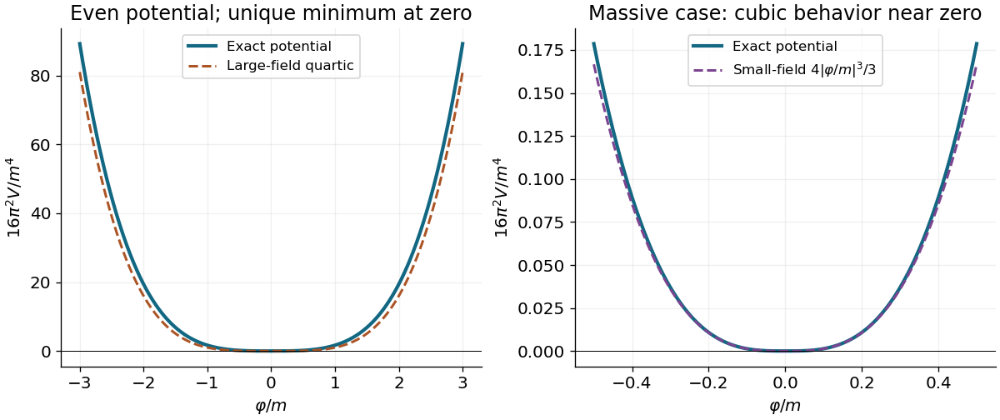

<h1 id="1/c/solution">Solution</h1>

↑ **Parent:** [C](../c.md)

A spherical three-[momentum](../../../../momentum-split.md) [ultraviolet cutoff](../../../../ultraviolet-cutoff.md) gives

$$
\mathcal E(\Lambda)=\frac1{4\pi^2}\int_0^\Lambda dp\,p^2\sqrt{p^2+m^2}
=\boxed{\frac{\Lambda\sqrt{\Lambda^2+m^2}(2\Lambda^2+m^2)-m^4\operatorname{arsinh}(\Lambda/m)}{32\pi^2}}.
$$

For $m>0$ and $\Lambda\gg m$, the [asymptotic expansion](../../../../asymptotic-expansion-split.md) is

$$
\boxed{\mathcal E(\Lambda)=\frac{\Lambda^4}{16\pi^2}+\frac{m^2\Lambda^2}{16\pi^2}
-\frac{m^4}{32\pi^2}\log\frac{2\Lambda}{m}+\frac{m^4}{128\pi^2}+O(m^6/\Lambda^2).}
$$

In particular, the leading [ultraviolet divergence](../../../../ultraviolet-divergence.md) is quartic. For $m=0$, $\mathcal E=\Lambda^4/(16\pi^2)$ exactly.

Write $\varphi=\langle\psi\rangle$. Under the proposed identification, the [scalar potential from a field-dependent momentum cutoff](../../../../scalar-potential-from-a-field-dependent-momentum-cutoff.md) is $V_{\mathrm{ind}}(\varphi)=\mathcal E(|\varphi|)$. It is even and nonnegative, and its derivative with respect to $|\varphi|$ is $|\varphi|^2\sqrt{\varphi^2+m^2}/(4\pi^2)>0$ away from zero. Consequently its only [global minimum](../../../../global-minimum.md) is at $\varphi=0$: this contribution alone does not cause [spontaneous symmetry breaking](../../../../spontaneous-symmetry-breaking.md). At large $|\varphi|$ it grows quartically. At small $|\varphi|$ with fixed positive $m$, however,

$$
V_{\mathrm{ind}}(\varphi)=\frac{m|\varphi|^3}{12\pi^2}+O(|\varphi|^5/m).
$$

Thus the quartic sketch is an asymptotic shape, not the exact small-field behavior for a massive original [field](../../../../field.md). Identifying a regulator with a new [field](../../../../field.md) is an additional modeling prescription; an actual [effective potential](../../../../effective-potential.md) also depends on the new [field](../../../../field.md)'s dynamics and any other allowed terms.

**[Figure 1](#1/c/image-scalar-potential-obtained-by-identifying-a-ultraviolet-cutoff-with-a-scalar-field-expectation-value). Scalar potential obtained by identifying a ultraviolet cutoff with a scalar field expectation value**.

## ↑ Ancestors (12)

1. [C](../c.md)
2. [1](../../1.md)
3. [2018](../../../2018-split.md)
4. [Past exam of the theoretical physics major option course of the University of Oxford](../../../split.md)
5. [Theoretical physics major option course of the University of Oxford](../../../../theoretical-physics-major-option-course-of-the-university-of-oxford.md)
6. [Year 4 of the physics course of the University of Oxford](../../../../year-4-of-the-physics-course-of-the-university-of-oxford.md)
7. [Physics course of the University of Oxford](../../../../physics-course-of-the-university-of-oxford.md)
8. [Undergraduate course of the University of Oxford](../../../../undergraduate-course-of-the-university-of-oxford.md)
9. [Course of the University of Oxford](../../../../course-of-the-university-of-oxford.md)
10. [University of Oxford](../../../../university-of-oxford-split.md)
11. [List of universities](../../../../list-of-universities.md)
12. [Codex Wiki](../../../../split.md)
