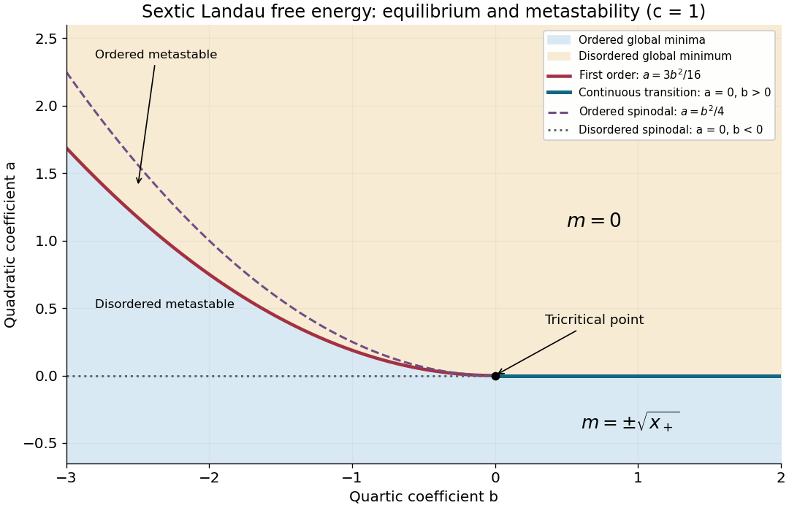

<h1 id="6/c/solution">Solution</h1>

↑ **Parent:** [C](../c.md)

Fix $c>0$. [Stationary points](../../../../stationary-point.md) satisfy $m(a+bm^2+cm^4)=0$. With $x=m^2$, the nonzero candidates are

$$
x_\pm=\frac{-b\pm\sqrt{b^2-4ac}}{2c}.
$$

Keep only real positive roots. At such a point,

$$
F''(m)=2x(b+2cx),
$$

so $x_+$ gives [local minima](../../../../local-minimum.md) and $x_-$ gives local maxima when both exist. The solution $m=0$ is a [local minimum](../../../../local-minimum.md) for $a>0$. To choose the phase, compare [free energies](../../../../thermodynamic-free-energy.md): using the [stationary point](../../../../stationary-point.md) relation $a=-bx-cx^2$ gives

$$
F(m)-F(0)=-\frac b4x^2-\frac c3x^3.
$$

For $b>0$, this expression is negative whenever a nonzero stationary minimum exists. The [paramagnetism](../../../../paramagnetism.md) phase is stable for $a>0$, and the [ferromagnetism](../../../../ferromagnetism.md) phase with $m=\pm\sqrt{x_+}$ is stable for $a<0$. The [phase transition](../../../../phase-transition.md) at $a=0$, $b>0$, is continuous and second order.

For $b<0$, equality with $F(0)$ requires $x=-3b/(4c)$. Substitution into the stationary equation gives the first-order coexistence curve

$$
\boxed{a_{\mathrm t}=\frac{3b^2}{16c},\quad b<0,\qquad
m_{\mathrm t}^2=-\frac{3b}{4c}.}
$$

The disordered phase is the [global minimum](../../../../global-minimum.md) above this curve, and the ordered phase is the [global minimum](../../../../global-minimum.md) below it. At coexistence the factorization

$$
\boxed{F(m)=\frac c6m^2\left(m^2+\frac{3b}{4c}\right)^2}
$$

exhibits three equally low minima, $m=0$ and $m=\pm\sqrt{-3b/(4c)}$, proving the discontinuous jump.

The ordered [spinodal](../../../../spinodal.md) is $a=b^2/(4c)$, $b<0$, where its [local minimum](../../../../local-minimum.md) meets the intervening local maximum. The disordered [spinodal](../../../../spinodal.md) is $a=0$, $b<0$. Thus the ordered phase is metastable for $a_{\mathrm t}<a<b^2/(4c)$; the disordered phase is metastable for $0<a<a_{\mathrm t}$. These [spinodals](../../../../spinodal.md) are limits of [metastability](../../../../metastability.md), not equilibrium transition curves.

The first-order curve meets the continuous transition line at the [tricritical point](../../../../tricritical-point.md) $(a,b)=(0,0)$. On the specially tuned path $b=0$, the equilibrium ordered solution is $m=\pm(-a/c)^{1/4}$ for $a<0$ and tends continuously to zero at the origin.

**[Figure 2](#6/c/image-phase-diagram-of-the-sextic-landau-free-energy-including-coexistence-spinodals-and-the-tricritical-point). Phase diagram of the sextic Landau free energy, including coexistence, spinodals and the tricritical point**.

## ↑ Ancestors (12)

1. [C](../c.md)
2. [6](../../6.md)
3. [2018](../../../2018-split.md)
4. [Past exam of the theoretical physics major option course of the University of Oxford](../../../split.md)
5. [Theoretical physics major option course of the University of Oxford](../../../../theoretical-physics-major-option-course-of-the-university-of-oxford.md)
6. [Year 4 of the physics course of the University of Oxford](../../../../year-4-of-the-physics-course-of-the-university-of-oxford.md)
7. [Physics course of the University of Oxford](../../../../physics-course-of-the-university-of-oxford.md)
8. [Undergraduate course of the University of Oxford](../../../../undergraduate-course-of-the-university-of-oxford.md)
9. [Course of the University of Oxford](../../../../course-of-the-university-of-oxford.md)
10. [University of Oxford](../../../../university-of-oxford-split.md)
11. [List of universities](../../../../list-of-universities.md)
12. [Codex Wiki](../../../../split.md)
