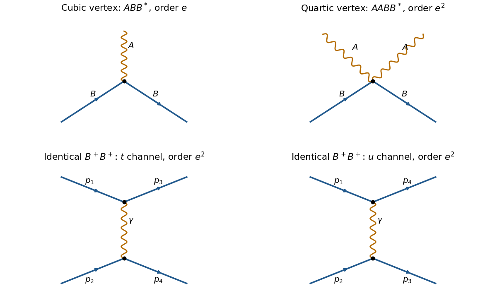

# 2022

↑ **Parent:** [Past exam of the theoretical physics major option course of the University of Oxford](../past-exam-of-the-theoretical-physics-major-option-course-of-the-university-of-oxford.md)

Source: [https://www.whatdotheyknow.com/request/oxford_physics_past_papers_2/response/2340696/attach/10/Physics%20Papers%202021.pdf?cookie_passthrough=1](https://www.whatdotheyknow.com/request/oxford_physics_past_papers_2/response/2340696/attach/10/Physics%20Papers%202021.pdf?cookie_passthrough=1)

Source bundle pages 48–54; the cover identifies Trinity Term 2022 despite the attachment filename. Solutions use $\hbar=c=1$ except where $\hbar$ is displayed. In Questions 4–6 the [Minkowski metric](../special-relativity.md#minkowski-metric) is $\eta=\operatorname{diag}(1,-1,-1,-1)$, and spatial surface terms vanish or cancel under [periodic boundary conditions](../differential-equation.md#periodic-boundary-conditions).

**Table of contents**

- [1](#1)
  - [a](#1/a)
    - [Solution](#1/a/solution)
  - [b](#1/b)
    - [Solution](#1/b/solution)
  - [c](#1/c)
    - [Solution](#1/c/solution)
  - [d](#1/d)
    - [Solution](#1/d/solution)
- [2](#2)
  - [a](#2/a)
    - [Solution](#2/a/solution)
  - [b](#2/b)
    - [Solution](#2/b/solution)
  - [c](#2/c)
    - [Solution](#2/c/solution)
  - [d](#2/d)
    - [Solution](#2/d/solution)
  - [e](#2/e)
    - [Solution](#2/e/solution)
- [3](#3)
  - [a](#3/a)
    - [Solution](#3/a/solution)
  - [b](#3/b)
    - [Solution](#3/b/solution)
  - [c](#3/c)
    - [Solution](#3/c/solution)
  - [d](#3/d)
    - [Solution](#3/d/solution)
  - [e](#3/e)
    - [Solution](#3/e/solution)
- [4](#4)
  - [a](#4/a)
    - [Solution](#4/a/solution)
  - [b](#4/b)
    - [Solution](#4/b/solution)
  - [c](#4/c)
    - [Solution](#4/c/solution)
  - [d](#4/d)
    - [Solution](#4/d/solution)
  - [e](#4/e)
    - [Solution](#4/e/solution)
  - [f](#4/f)
    - [Solution](#4/f/solution)
  - [g](#4/g)
    - [Solution](#4/g/solution)
- [5](#5)
  - [a](#5/a)
    - [Solution](#5/a/solution)
  - [b](#5/b)
    - [Solution](#5/b/solution)
  - [c](#5/c)
    - [Solution](#5/c/solution)
  - [d](#5/d)
    - [Solution](#5/d/solution)
  - [e](#5/e)
    - [Solution](#5/e/solution)
  - [f](#5/f)
    - [Solution](#5/f/solution)
- [6](#6)
  - [a](#6/a)
    - [Solution](#6/a/solution)
  - [b](#6/b)
    - [Solution](#6/b/solution)
  - [c](#6/c)
    - [Solution](#6/c/solution)
  - [d](#6/d)
    - [Solution](#6/d/solution)
  - [e](#6/e)
    - [Solution](#6/e/solution)
  - [f](#6/f)
    - [Solution](#6/f/solution)
  - [g](#6/g)
    - [Solution](#6/g/solution)

## 1

↑ **Parent:** [2022](2022.md)

<h3 id="1/a">a</h3>

↑ **Parent:** [1](#1)

<h4 id="1/a/solution">Solution</h4>

↑ **Parent:** [A](#1/a)

For the [sawtooth Ising chain](../spin-model.md#sawtooth-ising-chain), there is a source inconsistency: the printed [Ising spin](../spin-model.md#ising-spin-variable) values are $\{-1,r+1\}$, with no definition of $r$. The requested [transfer matrix](../combinatorics.md#transfer-matrix) follows for $r=0$, namely the usual [Ising model](../spin-model.md#ising-model) with values $\{-1,+1\}$. For arbitrary $r$, summing an apex [spin](../angular-momentum-operator.md#spin) actually gives

$$
A^{(r)}_{ss'}=e^{-\beta Jss'}\left[e^{\beta\bar J(s+s')}+e^{-\beta\bar J(r+1)(s+s')}\right].
$$

For example, $r=1$, $s=s'=-1$ and $\beta\bar J=1$ give the bracket $e^{-2}+e^4$, whereas the claimed [hyperbolic cosine](../calculus.md#hyperbolic-cosine) gives $e^{-2}+e^2$. Thus the printed identity is false literally. The rest of Question 1 uses the intended symmetric [Ising spin](../spin-model.md#ising-spin-variable) values, $r=0$.

For a fixed configuration of base [spins](../angular-momentum-operator.md#spin), each apex [spin](../angular-momentum-operator.md#spin) appears in only one local [Boltzmann factor](../canonical-ensemble.md#boltzmann-factor). The apex [spins](../angular-momentum-operator.md#spin) are therefore conditionally independent, and their finite sums factorize:

$$
\begin{aligned}
Z&=\sum_{s_0,\ldots,s_{L-1}=\pm1}\prod_{i=0}^{L-1}\left[e^{-\beta Js_is_{i+1}}\sum_{\bar s_i=\pm1}e^{-\beta\bar J\bar s_i(s_i+s_{i+1})}\right]\\
&=\sum_{s_0,\ldots,s_{L-1}=\pm1}\prod_i A_{s_i s_{i+1}},\qquad s_L=s_0,\\
&\boxed{A_{ss'}=2e^{-\beta Jss'}\cosh[\beta\bar J(s+s')],\qquad Z=\operatorname{Tr}A^L.}
\end{aligned}
$$

Only the base [spins](../angular-momentum-operator.md#spin) carry information from one triangle to the next. The apex [spins](../angular-momentum-operator.md#spin) have already been summed out, so no apex index remains in the [transfer matrix](../combinatorics.md#transfer-matrix); the final [trace](../linear-algebra.md#matrix-trace) implements the [periodic boundary condition](../differential-equation.md#periodic-boundary-conditions).

<h3 id="1/b">b</h3>

↑ **Parent:** [1](#1)

<h4 id="1/b/solution">Solution</h4>

↑ **Parent:** [B](#1/b)

In the $s=+1,-1$ basis the [transfer matrix](../combinatorics.md#transfer-matrix) and its [eigenvalues](../linear-operator-theory.md#eigenvalue) are

$$
A=\begin{pmatrix}a&b\\b&a\end{pmatrix},\qquad a=2e^{-\beta J}\cosh(2\beta\bar J),\quad b=2e^{\beta J},\qquad \lambda_\pm=a\pm b.
$$

For finite positive [temperature](../temperature.md), $a,b>0$ and $\lambda_+>|\lambda_-|$. Consequently $Z=\lambda_+^L+\lambda_-^L$ and $L^{-1}\log Z\to\log\lambda_+$ in the [thermodynamic limit](../statistical-physics.md#thermodynamic-limit). There are $2L$ [spins](../angular-momentum-operator.md#spin), so the [Helmholtz free energy](../thermodynamic-potential.md#helmholtz-free-energy) per [spin](../angular-momentum-operator.md#spin) is

$$
\boxed{f(\beta,J,\bar J)=-\frac1{2\beta}\log\left[2e^{-\beta J}\cosh(2\beta\bar J)+2e^{\beta J}\right].}
$$

The factor $1/2$ is essential: one [transfer matrix](../combinatorics.md#transfer-matrix) step counts two [spins](../angular-momentum-operator.md#spin). For completeness, if the undefined $r$ is retained, set $a_r=A^{(r)}_{-1,-1}$, $d_r=A^{(r)}_{r+1,r+1}$ and $b_r=A^{(r)}_{-1,r+1}$. The same [thermodynamic limit](../statistical-physics.md#thermodynamic-limit) gives $f_r=-(2\beta)^{-1}\log[(a_r+d_r+\sqrt{(a_r-d_r)^2+4b_r^2})/2]$ whenever these are two distinct [spin](../angular-momentum-operator.md#spin) values.

<h3 id="1/c">c</h3>

↑ **Parent:** [1](#1)

<h4 id="1/c/solution">Solution</h4>

↑ **Parent:** [C](#1/c)

Differentiate the [Helmholtz free energy](../thermodynamic-potential.md#helmholtz-free-energy) at fixed couplings. With $\lambda=\lambda_+$ from [solution](#1/b/solution), the [entropy](../entropy.md) per [spin](../angular-momentum-operator.md#spin) is

$$
s=-\frac{\partial f}{\partial T}=\frac{k_B}{2}\left(\log\lambda-\beta\frac{\partial\log\lambda}{\partial\beta}\right).
$$

It is particularly useful to write

$$
\lambda=e^{\beta(2\bar J-J)}+e^{-\beta(2\bar J+J)}+2e^{\beta J}.
$$

At $\bar J=J$, this is $3e^{\beta J}+e^{-3\beta J}$, so $f=-J/2-(\log3)/(2\beta)+o(\beta^{-1})$. For fixed $\bar J>J$, the first exponential dominates alone, giving $f=(J-2\bar J)/2+o(\beta^{-1})$. Hence the [residual entropy](../entropy.md#residual-entropy) is

$$
\boxed{\lim_{T\to0}s=\begin{cases}(k_B/2)\log3,&\bar J=J,\\0,&\bar J>J.\end{cases}}
$$

The finite positive difference $\bar J-J$ must be kept fixed in the second limit; taking it to zero first gives the other answer.

At high [temperature](../temperature.md), $\lambda\to4$ and $\beta\partial_\beta\log\lambda\to0$, whence

$$
\boxed{\lim_{T\to\infty}s=k_B\log2.}
$$

All $2^{2L}$ configurations become equally probable because their [Boltzmann factors](../canonical-ensemble.md#boltzmann-factor) tend to one. The two available states per [spin](../angular-momentum-operator.md#spin), rather than the coupling values, determine this [entropy](../entropy.md).

<h3 id="1/d">d</h3>

↑ **Parent:** [1](#1)

<h4 id="1/d/solution">Solution</h4>

↑ **Parent:** [D](#1/d)

For one triangle, equal base [spins](../angular-momentum-operator.md#spin) $s=s'=\sigma$ give [energy](../energy.md) $J+2\bar J\sigma\bar s$. Their minimum occurs at $\bar s=-\sigma$ and is $J-2\bar J$. Opposite base [spins](../angular-momentum-operator.md#spin) give [energy](../energy.md) $-J$, independently of the apex [spin](../angular-momentum-operator.md#spin). The all-equal configurations have [energy](../energy.md) $J+2\bar J$.

When $\bar J=J$, the six configurations with precisely one [spin](../angular-momentum-operator.md#spin) different from the other two all have minimum [energy](../energy.md) $-J$. For a fixed first base [spin](../angular-momentum-operator.md#spin), there is one minimum choice if the next base [spin](../angular-momentum-operator.md#spin) is the same, and two choices of apex if it is opposite. The ground-configuration counting [transfer matrix](../combinatorics.md#transfer-matrix) is therefore

$$
C=\begin{pmatrix}1&2\\2&1\end{pmatrix},\qquad \Omega_L=\operatorname{Tr}C^L=3^L+(-1)^L.
$$

This [ground-state counting of the frustrated sawtooth Ising chain](../spin-model.md#ground-state-counting-of-the-frustrated-sawtooth-ising-chain) proves the extensive [geometric frustration](../statistical-physics.md#geometrical-frustration) and the [residual entropy](../entropy.md#residual-entropy) $k_B\lim_{L\to\infty}\log\Omega_L/(2L)=(k_B/2)\log3$.

When $\bar J>J$, $J-2\bar J<-J$. Every triangle must have equal base [spins](../angular-momentum-operator.md#spin) and the opposite apex [spin](../angular-momentum-operator.md#spin). Shared base [spins](../angular-momentum-operator.md#spin) propagate that choice around the chain, leaving just two global [ground states](../quantum-mechanics.md#ground-state), of [energy](../energy.md) $L(J-2\bar J)$. Their [entropy](../entropy.md) per [spin](../angular-momentum-operator.md#spin) is $k_B\log2/(2L)\to0$.

For couplings favoring [ferromagnetism](../electromagnetism.md#ferromagnetism), write $J=-K$, $\bar J=-\bar K$ with $K,\bar K>0$. Both orientations of an all-equal triangle minimize every bond simultaneously. The common base [spins](../angular-momentum-operator.md#spin) then make the whole chain uniform. There are two global [ground states](../quantum-mechanics.md#ground-state) for either $K=\bar K$ or $K\ne\bar K$, so no corresponding distinction in [residual entropy](../entropy.md#residual-entropy) occurs. This statement assumes all bonds remain nonzero.

## 2

↑ **Parent:** [2022](2022.md)

<h3 id="2/a">a</h3>

↑ **Parent:** [2](#2)

<h4 id="2/a/solution">Solution</h4>

↑ **Parent:** [A](#2/a)

The continuous internal [symmetry](../physics.md#symmetry-physics) is a common [rotation](../riemannian-geometry.md#rotation-mathematics) around $z$:

$$
S_j^\pm\longmapsto e^{\pm i\theta}S_j^\pm,\qquad S_j^z\longmapsto S_j^z.
$$

Both the transverse exchange and the [Dzyaloshinskii-Moriya interaction](../spin-model.md#antisymmetric-exchange) contain one raising and one lowering [spin operator](../angular-momentum-operator.md#spin-operator), so the phases cancel. Equivalently, $[H,\sum_jS_j^z]=0$ and the continuous group is [U(1)](../lie-theory.md#circle-group).

The discrete internal [symmetry](../physics.md#symmetry-physics) is [time reversal](../quantum-field-theory.md#t-symmetry), $\mathcal T\mathbf S_j\mathcal T^{-1}=-\mathbf S_j$, together with $\mathcal T i\mathcal T^{-1}=-i$. Each term in $H$ contains two [spin operators](../angular-momentum-operator.md#spin-operator), so it is invariant. The operation is [antiunitary](../vector-space.md#antiunitary-operator); treating the reversal of all three [spin](../angular-momentum-operator.md#spin) components as a unitary [rotation](../riemannian-geometry.md#rotation-mathematics) would violate the [spin commutation relations](../angular-momentum-operator.md#spin-commutation-relations). It reverses the [magnetization](../electromagnetism.md#magnetization) and interchanges the two easy-axis ordered orientations. A convenient equivalent representative, composed with a $z$ [rotation](../riemannian-geometry.md#rotation-mathematics), is $R_z(\pi)\mathcal T$, which reverses $S^z$ while preserving $S^x,S^y$ as operators.

The statement about one continuous and one discrete internal [symmetry](../physics.md#symmetry-physics) describes generic parameters. At $D=0$, additional unitary $\pi$ [rotations](../riemannian-geometry.md#rotation-mathematics) about transverse axes are allowed; at $D=u=0$, the continuous internal [symmetry](../physics.md#symmetry-physics) enlarges to full [spin](../angular-momentum-operator.md#spin) [rotation](../riemannian-geometry.md#rotation-mathematics) symmetry. Spatial translations of the uniform chain are separate [symmetries](../physics.md#symmetry-physics) of the sites.

<h3 id="2/b">b</h3>

↑ **Parent:** [2](#2)

<h4 id="2/b/solution">Solution</h4>

↑ **Parent:** [B](#2/b)

The [Holstein–Primakoff transformation](../angular-momentum-operator.md#holstein-primakoff-transformation) maps the finite [spin](../angular-momentum-operator.md#spin) basis $|S,m\rangle$ to bosonic [Fock states](../quantum-field-theory.md#fock-state) $|n\rangle$ with $n=S-m$. Thus $n=0$ is the fully polarized reference state, and creating a [boson](../tensor-product-of-quantum-systems.md#boson) lowers $S^z$ by one. The physical subspace has the [Holstein–Primakoff occupation constraint](../angular-momentum-operator.md#holstein-primakoff-occupation-constraint) $0\le n\le2S$, not the whole infinite oscillator [Hilbert space](../hilbert-space.md).

The specified ordering of the square root gives

$$
S^+|n\rangle=\sqrt{n(2S-n+1)}\,|n-1\rangle,\qquad S^-|n\rangle=\sqrt{(n+1)(2S-n)}\,|n+1\rangle.
$$

These are the exact [spin ladder operator](../angular-momentum-operator.md#spin-ladder-operator) matrix elements; in particular, the lowering amplitude vanishes at $n=2S$. The underlying oscillator obeys its usual [canonical commutation relation](../quantum-mechanics.md#canonical-commutation-relation) on the enlarged space, while the [spin operators](../angular-momentum-operator.md#spin-operator) preserve the constrained physical subspace. Projecting the oscillator operators themselves to a finite space would change their commutator at its upper endpoint.

Expanding $\sqrt{2S-n}=\sqrt{2S}(1-n/(4S)+\cdots)$ converts an ordered [spin](../angular-momentum-operator.md#spin) problem to approximately free [magnons](../critical-phenomenon.md#magnon), with interactions in higher orders of $1/S$. Two complications are the nonpolynomial, order-sensitive square roots, which generate interacting [bosons](../tensor-product-of-quantum-systems.md#boson), and loss of the occupation bound when a truncated expansion uses the full bosonic [Fock space](../quantum-field-theory.md#fock-space). Large depletion, high [temperature](../temperature.md), or soft modes near a [phase transition](../critical-phenomenon.md#phase-transition) can invalidate the assumption $\langle n\rangle\ll S$ even when $S$ is large.

<h3 id="2/c">c</h3>

↑ **Parent:** [2](#2)

<h4 id="2/c/solution">Solution</h4>

↑ **Parent:** [C](#2/c)

Expand around the $+z$ polarized [ground state](../quantum-mechanics.md#ground-state). With $n_j=a_j^\dagger a_j$ fixed as $S\to\infty$, the [Holstein–Primakoff transformation](../angular-momentum-operator.md#holstein-primakoff-transformation) gives $S_j^+=\sqrt{2S}a_j+O(S^{-1/2})$, $S_j^-=\sqrt{2S}a_j^\dagger+O(S^{-1/2})$ and $S_j^z=S-n_j$. The longitudinal exchange contributes

$$
-J(1+u)\sum_j(S-n_j)(S-n_{j+1})=-LJ(1+u)S^2+2JS(1+u)\sum_jn_j+O(S^0).
$$

Use

$$
\begin{aligned}
S_j^xS_{j+1}^x+S_j^yS_{j+1}^y&=\tfrac12(S_j^+S_{j+1}^-+S_j^-S_{j+1}^+),\\
(\mathbf S_j\times\mathbf S_{j+1})_z&=\tfrac{i}{2}(S_j^+S_{j+1}^--S_j^-S_{j+1}^+).
\end{aligned}
$$

The transverse exchange then gives $-JS(a_{j+1}^\dagger a_j+a_j^\dagger a_{j+1})$, and the [Dzyaloshinskii-Moriya interaction](../spin-model.md#antisymmetric-exchange) gives $-iDS(a_{j+1}^\dagger a_j-a_j^\dagger a_{j+1})$. Discarding the constant $-LJ(1+u)S^2$ and all $O(S^0)$ interactions yields

$$
\boxed{H_{\rm LSW}=\sum_j\left[Aa_{j+1}^\dagger a_j+A^*a_j^\dagger a_{j+1}+Bn_j\right],\quad A=-S(J+iD),\quad B=2JS(1+u).}
$$

Here [periodic boundary conditions](../differential-equation.md#periodic-boundary-conditions) make each $n_j$ occur twice in the longitudinal sum. The approximation is the [linear spin-wave approximation](../critical-phenomenon.md#linear-spin-wave-approximation), controlled by small local [magnon](../critical-phenomenon.md#magnon) occupation compared with $S$.

<h3 id="2/d">d</h3>

↑ **Parent:** [2](#2)

<h4 id="2/d/solution">Solution</h4>

↑ **Parent:** [D](#2/d)

Choose the unitary [discrete Fourier transform](../discrete-fourier-transform.md)

$$
a_j=\frac1{\sqrt L}\sum_ke^{ikj}b_k,\qquad b_k=\frac1{\sqrt L}\sum_je^{-ikj}a_j,\qquad k=\frac{2\pi\ell}{L},\quad \ell=0,\ldots,L-1.
$$

The finite-sum orthogonality identity gives $[b_k,b_q^\dagger]=\delta_{kq}$. It also gives $\sum_ja_{j+1}^\dagger a_j=\sum_ke^{-ik}b_k^\dagger b_k$. Substituting $A,B$ from [solution](#2/c/solution) therefore gives the [dispersion relation](../dispersion-relation.md)

$$
\boxed{H_{\rm LSW}=\sum_k\epsilon(k)b_k^\dagger b_k,\qquad\epsilon(k)=2S[J(1+u)-J\cos k-D\sin k].}
$$

Using the opposite sign in the [Fourier transform](../fourier-transform.md) reverses $k$ and the sine term together, without changing the spectrum.

For $u\gg1$ every $\epsilon(k)>0$, so the [ground state](../quantum-mechanics.md#ground-state) of this quadratic [Hamiltonian](../hamiltonian-mechanics.md#hamiltonian) is the bosonic vacuum, $b_k|{\rm GS}\rangle=0$ for every $k$. In the original [spin](../angular-momentum-operator.md#spin) variables it is the fully $+z$ polarized product state. Its [energy](../energy.md) is zero after the constant subtraction. Repeating the construction about the fully $-z$ polarized state describes the other easy-axis sector of the original [Hamiltonian](../hamiltonian-mechanics.md#hamiltonian).

A one-[magnon](../critical-phenomenon.md#magnon) excitation $b_k^\dagger|{\rm GS}\rangle$ has [energy](../energy.md) $\epsilon(k)$ above the reference [ground state](../quantum-mechanics.md#ground-state). A normalized many-[magnon](../critical-phenomenon.md#magnon) [Fock state](../quantum-field-theory.md#fock-state) with occupations $n_k$ has excitation [energy](../energy.md) $\sum_kn_k\epsilon(k)$, within the dilute regime of the [linear spin-wave approximation](../critical-phenomenon.md#linear-spin-wave-approximation). The lowest excitation in this sector has the minimum allowed $\epsilon(k)$.

<h3 id="2/e">e</h3>

↑ **Parent:** [2](#2)

<h4 id="2/e/solution">Solution</h4>

↑ **Parent:** [E](#2/e)

Let $R=\sqrt{J^2+D^2}$ and $k_0=\arctan(D/J)$. Since $J\cos k+D\sin k=R\cos(k-k_0)$, the continuum minimum of the [dispersion relation](../dispersion-relation.md) is

$$
\Delta=2S[J(1+u)-R],\qquad \boxed{u_c=\sqrt{1+(D/J)^2}-1.}
$$

For $D>0$, the [energy gap](../linear-operator-theory.md#energy-gap) closes at a positive $u_c$, at [wave vector](../elasticity-physics.md#wavevector) $k_0$. Below it, the quadratic expansion about the polarized state has a negative mode and is no longer a stable [ground state](../quantum-mechanics.md#ground-state) approximation; higher-order terms and a different ordered reference state are needed.

Two qualifications are required by the actual assumptions. First, $D=0$ is permitted, in which case $u_c=0$; it is a concrete counterexample to the printed strict inequality $u_c>0$. Second, a finite ring only has discrete [momenta](../momentum.md). Its [finite-ring spin-wave threshold with antisymmetric exchange](../critical-phenomenon.md#finite-ring-spin-wave-threshold-with-antisymmetric-exchange) is

$$
\boxed{u_c(L)=\max_{\ell=0,\ldots,L-1}\left[\cos\frac{2\pi\ell}{L}+\frac DJ\sin\frac{2\pi\ell}{L}\right]-1.}
$$

This approaches $u_c$ in the [thermodynamic limit](../statistical-physics.md#thermodynamic-limit) and equals it when $k_0$ is allowed. For example, $L=4$ and $0<D<J$ give $u_c(L)=0$, since the maximum of $1,D/J,-1,-D/J$ is one. Thus the continuum formula and its positive threshold require the large-ring interpretation. The two symmetry-related polarized [ground states](../quantum-mechanics.md#ground-state) already have equal exact [energy](../energy.md); the calculated [energy gap](../linear-operator-theory.md#energy-gap) refers to excitations about one chosen orientation.

## 3

↑ **Parent:** [2022](2022.md)

<h3 id="3/a">a</h3>

↑ **Parent:** [3](#3)

<h4 id="3/a/solution">Solution</h4>

↑ **Parent:** [A](#3/a)

Here $p_n(t)$ is the [probability](../probability-theory.md#probability) of occupying state $n$, and $W_{nm}$ for $n\ne m$ is the transition rate from $m$ to $n$. More precisely, over $dt>0$ that transition has [probability](../probability-theory.md#probability) $W_{nm}dt+o(dt)$. This is a time-homogeneous [continuous-time Markov chain](../continuous-time-markov-chain.md): the present state contains all information needed for the next transition, the rates do not depend on time, and finite rates make multiple jumps have [probability](../probability-theory.md#probability) $o(dt)$. In a physical rate description, untracked coherent dynamics or memory must be negligible on the timescale being modeled.

The [master equation](../continuous-time-markov-chain.md#master-equation) separates incoming and outgoing terms:

$$
\dot p_n=\sum_{m\ne n}(W_{nm}p_m-W_{mn}p_n),\qquad\boxed{W_{nm}\ge0\ (n\ne m),\quad W_{mm}=-\sum_{n\ne m}W_{nm}.}
$$

Columns, rather than rows, sum to zero with this indexing. These conditions preserve normalization and nonnegative [probabilities](../probability-theory.md#probability). For infinitely many states one also needs a well-defined nonexplosive process. [Detailed balance](../markov-chain.md#detailed-balance) is an additional equilibrium condition, not a general requirement on a [master equation](../continuous-time-markov-chain.md#master-equation).

<h3 id="3/b">b</h3>

↑ **Parent:** [3](#3)

<h4 id="3/b/solution">Solution</h4>

↑ **Parent:** [B](#3/b)

Write the [probability](../probability-theory.md#probability) column vector as $\mathbf p=(p_0,p_A,p_B)^T$, with $0$ denoting the uncharged state. The arrows in the original figure give transitions $0\to A$ at rate $f_1$, $A\to B$ at rate $f_2$, $B\to0$ at rate $f_3$, and $B\to A$ at rate $f_4$. Exclusion of double occupation means injection occurs only from state $0$. Thus the [master equation](../continuous-time-markov-chain.md#master-equation) is

$$
\boxed{\frac{d}{dt}\begin{pmatrix}p_0\\p_A\\p_B\end{pmatrix}=\begin{pmatrix}-f_1&0&f_3\\f_1&-f_2&f_4\\0&f_2&-(f_3+f_4)\end{pmatrix}\begin{pmatrix}p_0\\p_A\\p_B\end{pmatrix}.}
$$

For example, $\dot p_B=f_2p_A-(f_3+f_4)p_B$. Every allowed jump adds to one [probability](../probability-theory.md#probability) and subtracts from another, which verifies the zero column sums.

<h3 id="3/c">c</h3>

↑ **Parent:** [3](#3)

<h4 id="3/c/solution">Solution</h4>

↑ **Parent:** [C](#3/c)

Set the time derivatives in the [master equation](../continuous-time-markov-chain.md#master-equation) to zero. The first and third rows give $f_1p_0=f_3p_B$ and $f_2p_A=(f_3+f_4)p_B$. Normalization then gives, with $\mathcal N=f_2f_3+f_1(f_3+f_4)+f_1f_2$,

$$
\boxed{p_0^{\rm st}=\frac{f_2f_3}{\mathcal N},\qquad p_A^{\rm st}=\frac{f_1(f_3+f_4)}{\mathcal N},\qquad p_B^{\rm st}=\frac{f_1f_2}{\mathcal N}.}
$$

These expressions assume positive rates, or a limiting choice for which $\mathcal N\ne0$ and the [stationary distribution](../markov-chain.md#stationary-distribution) is unique. If rates vanish so that multiple closed classes appear, the initial condition can matter.

The word “equilibrium” in this part must mean a [stationary distribution](../markov-chain.md#stationary-distribution). With positive $f_1,f_2,f_3$ the one-way contact transitions support a nonzero stationary [electric current](../electric-charge.md#electric-current), so the process is not in thermodynamic equilibrium and does not satisfy [detailed balance](../markov-chain.md#detailed-balance). In particular, $0\to A$ carries positive probability flow while the direct reverse rate is zero.

<h3 id="3/d">d</h3>

↑ **Parent:** [3](#3)

<h4 id="3/d/solution">Solution</h4>

↑ **Parent:** [D](#3/d)

Count net transmitted charges per unit time, taking left-to-right as positive. The contact on the left, the internal bond, and the contact on the right give respectively

$$
I_L=f_1p_0^{\rm st},\qquad I_{AB}=f_2p_A^{\rm st}-f_4p_B^{\rm st},\qquad I_R=f_3p_B^{\rm st}.
$$

The backward rate $f_4$ must be subtracted in the internal count. Substitution of [solution](#3/c/solution) yields

$$
\boxed{I_L=I_{AB}=I_R=\frac{f_1f_2f_3}{\mathcal N}.}
$$

The equalities also follow directly from $\dot p_0=I_R-I_L=0$ and $\dot p_B=I_{AB}-I_R=0$: there can be no stationary accumulation of [electric charge](../electric-charge.md). If each carrier has charge $q$, the [electric current](../electric-charge.md#electric-current) is $qI_R$. During a stationary interval of duration $t$, the expected net number crossing any one bond is $I_Rt$. In particular, counting both directions of internal hopping as positive would count traffic, not transmitted charge.

<h3 id="3/e">e</h3>

↑ **Parent:** [3](#3)

<h4 id="3/e/solution">Solution</h4>

↑ **Parent:** [E](#3/e)

For $f>0$ set $\tau=ft$ and $y(\tau)=p_0(t)$. The [master equation](../continuous-time-markov-chain.md#master-equation) becomes

$$
y'=-y+2p_B,\qquad p_A'=y-p_A+p_B,\qquad p_B'=p_A-3p_B.
$$

Using $p_A=1-y-p_B$ and $p_B=(y'+y)/2$ gives

$$
y''+5y'+6y=2.
$$

Initially the molecule occupies $B$, so $y(0)=0$ and $y'(0)=2$. The characteristic roots are $-2,-3$; the constant particular solution is $1/3$. Consequently

$$
y=\frac13+Ce^{-2\tau}+De^{-3\tau},\qquad C+D=-\frac13,\quad -2C-3D=2,
$$

whence

$$
\boxed{p(t)=\frac13+e^{-2ft}-\frac43e^{-3ft}.}
$$

It has the required initial slope $2f$, tends to the stationary uncharged [probability](../probability-theory.md#probability) $1/3$, and remains nonnegative. As a further check, $p_B=1/6-e^{-2ft}/2+4e^{-3ft}/3$ and $p_A=1/2-e^{-2ft}/2$ are nonnegative and sum with $p(t)$ to one. If $f=0$, no jump occurs and $p(t)=0$, also obtained directly from the boxed expression.

## 4

↑ **Parent:** [2022](2022.md)

<h3 id="4/a">a</h3>

↑ **Parent:** [4](#4)

<h4 id="4/a/solution">Solution</h4>

↑ **Parent:** [A](#4/a)

The free complex [Proca field](../electromagnetism.md#proca-field) has [Poincaré symmetry](../special-relativity.md#poincare-symmetry), with $B_\mu$ transforming as a spacetime [four-vector](../special-relativity.md#four-vector), and the global internal [U(1)](../lie-theory.md#circle-group) [symmetry](../physics.md#symmetry-physics)

$$
B_\mu\longmapsto e^{i\alpha}B_\mu,\qquad B_\mu^*\longmapsto e^{-i\alpha}B_\mu^*.
$$

The free theory is also invariant under charge conjugation $B_\mu\leftrightarrow B_\mu^*$ and the usual parity and [time reversal](../quantum-field-theory.md#t-symmetry) transformations of a vector field. The internal real-field description consists of two equal-mass real [Proca fields](../electromagnetism.md#proca-field), with an $O(2)$ symmetry containing the phase rotations and charge conjugation.

A gradient shift of $B_\mu$ leaves $G_{\mu\nu}$ unchanged, because partial derivatives commute. It changes the mass term by

$$
\Delta\mathcal L=M^2\left[-B_\mu^*\partial^\mu\lambda-(\partial_\mu\lambda^*)B^\mu+(\partial_\mu\lambda^*)\partial^\mu\lambda\right].
$$

This is generally nonzero: for example, $B_\mu=0$ and real $\lambda=at$ produce $\Delta\mathcal L=M^2a^2$. Thus a massive [Proca field](../electromagnetism.md#proca-field) has no such [gauge symmetry](../relativistic-quantum-field.md#gauge-invariance). The massless kinetic term alone would have it.

<h3 id="4/b">b</h3>

↑ **Parent:** [4](#4)

<h4 id="4/b/solution">Solution</h4>

↑ **Parent:** [B](#4/b)

Treat $B_\mu$ and $B_\mu^*$ as independent variables in the [Euler-Lagrange equation](../analysis.md#euler-lagrange-equation). Varying $B_\nu^*$ gives the [Proca equation](../electromagnetism.md#proca-equation)

$$
\partial_\mu G^{\mu\nu}+M^2B^\nu=0.
$$

The divergence of its first term vanishes by antisymmetry and commuting partial derivatives. Since $M\ne0$, it follows that $\partial_\nu B^\nu=0$. Substitution into the original equation gives

$$
\boxed{(\Box+M^2)B^\nu=0,\qquad\partial_\nu B^\nu=0.}
$$

The complex-conjugate variation gives $\partial_\mu G^{*\mu\nu}+M^2B^{*\nu}=0$, hence $(\Box+M^2)B^{*\nu}=0$ and $\partial_\nu B^{*\nu}=0$.

For an on-shell [plane wave](../wave-function.md#plane-wave) $B^\mu=\varepsilon^\mu e^{-ipx}$, the [Lorenz constraint in Proca theory](../electromagnetism.md#lorenz-constraint-in-proca-theory) is $p_\mu\varepsilon^\mu=0$. In the rest frame it sets $\varepsilon^0=0$, leaving three complex [particle polarizations](../special-relativity.md#particle-polarization). Thus the complex [Proca field](../electromagnetism.md#proca-field) has **three independent complex dynamical components**, or six real ones; its quantized particle and antiparticle each have three physical [particle polarizations](../special-relativity.md#particle-polarization). The conjugate field is not another unrelated classical field.

<h3 id="4/c">c</h3>

↑ **Parent:** [4](#4)

<h4 id="4/c/solution">Solution</h4>

↑ **Parent:** [C](#4/c)

Use the upper-index coordinates $B^\mu,B^{*\mu}$ specified in the paper. Differentiation of the [Lagrangian density](../classical-field-theory.md#lagrangian-density) gives the [canonical momenta](../hamiltonian-mechanics.md#canonical-momentum)

$$
\boxed{\pi_\mu=-G^{*0}{}_{\mu},\qquad\pi_\mu^*=-G^0{}_{\mu},\qquad\pi_0=\pi_0^*=0.}
$$

In particular, $\pi_i=G^{*0i}$ and $\pi_i^*=G^{0i}$. No time derivative of $B^0$ appears, so the zero momenta are primary [constraints](../classical-mechanics.md#constraint-mechanics), not invertible equations for $\dot B^0$.

For spatial indices, $G^{0i}=\dot B^i+\partial_iB_0$, so $\dot B^i=\pi_i^*+\partial^iB_0$, with the conjugate relation for $B^{*i}$. Also

$$
\mathcal L=\sum_i|G^{0i}|^2-\frac12G_{ik}^*G^{ik}+M^2|B_0|^2-M^2\sum_i|B^i|^2.
$$

The [Legendre transform](../convex-optimization.md#convex-conjugate) for the [complex Proca Hamiltonian](../electromagnetism.md#complex-proca-hamiltonian), $\mathcal H_c=\pi_i\dot B^i+\pi_i^*\dot B^{*i}-\mathcal L$ therefore gives

$$
\boxed{H_c=\int d^3x\left[\pi_i^*\pi_i+\pi_i\partial^iB_0+\pi_i^*\partial^iB_0^*+\frac12G_{ik}^*G^{ik}-M^2B_0^*B_0-M^2B_i^*B^i\right].}
$$

Repeated spatial indices in the positive product $\pi_i^*\pi_i$ denote an ordinary three-component sum. A total [Hamiltonian](../hamiltonian-mechanics.md#hamiltonian) additionally includes multipliers for $\pi_0=\pi_0^*=0$.

The Hamiltonian printed in the source cannot follow from the given complex [Lagrangian density](../classical-field-theory.md#lagrangian-density): its missing conjugations, mass coefficients and spatial mass sign are inconsistent. A concrete check is spatially uniform initial data $B^1=b\in\mathbb R$, $B^0=B^2=B^3=0$, with all [canonical momenta](../hamiltonian-mechanics.md#canonical-momentum) zero. The correct [Hamiltonian density](../classical-field-theory.md#hamiltonian-density) is $M^2b^2$, while the printed expression gives $-M^2b^2/2$. These data satisfy the initial [constraints](../classical-mechanics.md#constraint-mechanics) and evolve as a spatially uniform massive oscillator. Thus the discrepancy is not a harmless surface term or a different complex-field normalization.

<h3 id="4/d">d</h3>

↑ **Parent:** [4](#4)

<h4 id="4/d/solution">Solution</h4>

↑ **Parent:** [D](#4/d)

Preserve the primary [constraints](../classical-mechanics.md#constraint-mechanics) using the corrected [Hamiltonian](../hamiltonian-mechanics.md#hamiltonian) from [solution](#4/c/solution). After a spatial integration by parts, the $B_0$ terms in its density are $B_0\partial_i\pi_i+B_0^*\partial_i\pi_i^*-M^2B_0^*B_0$. [Hamilton's equations](../hamiltonian-mechanics.md#hamilton-s-equations) give

$$
0=\dot\pi_0=-\partial_i\pi_i+M^2B_0^*,\qquad0=\dot\pi_0^*=-\partial_i\pi_i^*+M^2B_0.
$$

With the definitions of $E^i,E^{*i}$ in the paper, the actual massive [Gauss law](../maxwell-equations.md#gauss-s-law) is therefore

$$
\boxed{\partial_iE^{*i}=M^2B_0^*,\qquad\partial_iE^i=M^2B_0.}
$$

This is also the $\nu=0$ component of the [Proca equation](../electromagnetism.md#proca-equation). The zero right-hand sides printed in the source apply only to the massless theory or to special configurations with $B_0=0$.

For a concrete counterexample, take $k\ne0$, $\omega^2=k^2+M^2$, and the longitudinal on-shell [plane wave](../wave-function.md#plane-wave)

$$
B^\mu=\left(\frac kM,0,0,\frac\omega M\right)e^{-i\omega t+ikz}.
$$

It satisfies $\partial_\mu B^\mu=0$, but $E^3=-iM e^{-i\omega t+ikz}$ and $\partial_iE^i=kM e^{-i\omega t+ikz}\ne0$. Imposing the printed zero-divergence condition would incorrectly remove the physical longitudinal [particle polarization](../special-relativity.md#particle-polarization).

<h3 id="4/e">e</h3>

↑ **Parent:** [4](#4)

<h4 id="4/e/solution">Solution</h4>

↑ **Parent:** [E](#4/e)

The naive equal-time [canonical commutation relations](../quantum-mechanics.md#canonical-commutation-relation) would be

$$
[B^\mu(t,\mathbf x),\pi_\nu(t,\mathbf y)]=i\delta^\mu{}_{\nu}\delta^{(3)}(\mathbf x-\mathbf y),\qquad[B^{*\mu}(t,\mathbf x),\pi_\nu^*(t,\mathbf y)]=i\delta^\mu{}_{\nu}\delta^{(3)}(\mathbf x-\mathbf y),
$$

with all coordinate-coordinate, momentum-momentum and mixed conjugate-sector commutators zero before enforcing [constraints](../classical-mechanics.md#constraint-mechanics). But the $\mu=\nu=0$ relation contradicts $\pi_0=0$ as an operator identity: its left side would vanish and its right side would not.

The primary zero-momentum [constraints](../classical-mechanics.md#constraint-mechanics) and the secondary massive [Gauss laws](../maxwell-equations.md#gauss-s-law) form [second-class constraints](../classical-mechanics.md#second-class-constraint); their [Poisson bracket](../hamiltonian-mechanics.md#poisson-bracket) matrix contains nonzero terms proportional to $M^2$. They must be eliminated, or treated using a [Dirac bracket](../hamiltonian-mechanics.md#dirac-bracket), before quantization. In a reduced description the three complex spatial coordinates and their momenta are canonical, while

$$
B_0=\frac{\partial_i\pi_i^*}{M^2},\qquad B_0^*=\frac{\partial_i\pi_i}{M^2}
$$

are dependent operators. Substituting them in the integrated [Hamiltonian](../hamiltonian-mechanics.md#hamiltonian) gives the positive density, up to a surface term,

$$
\mathcal H_{\rm red}=\sum_i|\pi_i|^2+\frac{|\partial_i\pi_i|^2}{M^2}+\frac12G_{ik}^*G^{ik}+M^2\sum_i|B^i|^2.
$$

Thus the problem is a constrained choice of canonical variables, not an absence of a consistent free [quantum field theory](../quantum-field-theory.md).

<h3 id="4/f">f</h3>

↑ **Parent:** [4](#4)

<h4 id="4/f/solution">Solution</h4>

↑ **Parent:** [F](#4/f)

Introduce the electromagnetic [electromagnetic field tensor](../relativistic-electromagnetism.md#electromagnetic-field-tensor) $F_{\mu\nu}=\partial_\mu A_\nu-\partial_\nu A_\mu$ and the charged vector field strength $\mathcal G_{\mu\nu}=D_\mu B_\nu-D_\nu B_\mu$, with $D_\mu=\partial_\mu+ieA_\mu$. [Minimal coupling](../quantum-theory.md#minimal-coupling) gives

$$
\boxed{\mathcal L_{\rm tot}=-\frac14F_{\mu\nu}F^{\mu\nu}-\frac12\mathcal G_{\mu\nu}^*\mathcal G^{\mu\nu}+M^2B_\mu^*B^\mu.}
$$

Under $B_\mu'=e^{i\alpha(x)}B_\mu$ and $A_\mu'=A_\mu-\partial_\mu\Lambda$,

$$
D_\mu'B_\nu'=e^{i\alpha}\left[D_\mu B_\nu+i(\partial_\mu\alpha-e\partial_\mu\Lambda)B_\nu\right].
$$

Consequently the required relation is

$$
\boxed{\partial_\mu\alpha=e\partial_\mu\Lambda,\qquad\alpha=e\Lambda+\text{constant}.}
$$

Then $\mathcal G_{\mu\nu}'=e^{i\alpha}\mathcal G_{\mu\nu}$, its complex conjugate transforms oppositely, the mass bilinear is invariant, and $F_{\mu\nu}'=F_{\mu\nu}$. Each term in the total [Lagrangian density](../classical-field-theory.md#lagrangian-density) is therefore invariant under the electromagnetic [U(1) gauge symmetry](../relativistic-quantum-field.md#u-1-gauge-symmetry). This phase [gauge symmetry](../relativistic-quantum-field.md#gauge-invariance) does not reinstate the broken gradient-shift [gauge symmetry](../relativistic-quantum-field.md#gauge-invariance) of the massive field itself.

<h3 id="4/g">g</h3>

↑ **Parent:** [4](#4)

<h4 id="4/g/solution">Solution</h4>

↑ **Parent:** [G](#4/g)

Set $C_{\mu\nu}=A_\mu B_\nu-A_\nu B_\mu$, so $\mathcal G=G+ieC$. Expanding the minimally coupled [Lagrangian density](../classical-field-theory.md#lagrangian-density) gives

$$
\mathcal L_{\rm int}=\frac{ie}{2}(C_{\mu\nu}^*G^{\mu\nu}-G_{\mu\nu}^*C^{\mu\nu})-\frac{e^2}{2}C_{\mu\nu}^*C^{\mu\nu}.
$$

Thus there is a derivative cubic $ABB^*$ [interaction vertex](../perturbative-quantum-field-theory.md#interaction-vertex) of order $e$, and a quartic $AABB^*$ [interaction vertex](../perturbative-quantum-field-theory.md#interaction-vertex) of order $e^2$. There is no pure $B^4$ contact term in this [minimal coupling](../quantum-theory.md#minimal-coupling) theory, nor an Abelian three-photon [interaction vertex](../perturbative-quantum-field-theory.md#interaction-vertex).

**[Figure 1](#4/g/image-cubic-and-quartic-charged-vector-vertices-and-the-two-photon-exchange-channels-for-identical-charged-vector-bosons). Cubic and quartic charged-vector vertices, and the two photon-exchange channels for identical charged vector bosons**.

The straight arrowed lines in the original schematic denote charged massive [vector bosons](../tensor-product-of-quantum-systems.md#vector-boson); the wavy lines denote [photons](../quantum-mechanics.md#photon). For two identical positively charged [vector bosons](../tensor-product-of-quantum-systems.md#vector-boson), the leading scattering amplitude has the order-$e^2$ $t$-channel photon-exchange [Feynman diagram](../perturbative-quantum-field-theory.md#feynman-diagram), together with its $u$-channel interchange required by identical [bosons](../tensor-product-of-quantum-systems.md#boson). A quartic $AABB^*$ [interaction vertex](../perturbative-quantum-field-theory.md#interaction-vertex) cannot directly attach four external massive [vector bosons](../tensor-product-of-quantum-systems.md#vector-boson). For a particle-antiparticle incoming pair, the leading channels instead are $t$-channel exchange and $s$-channel photon annihilation. The shown arrows track charge flow; an outgoing charged particle corresponds to the conjugate field at a vertex.

## 5

↑ **Parent:** [2022](2022.md)

<h3 id="5/a">a</h3>

↑ **Parent:** [5](#5)

<h4 id="5/a/solution">Solution</h4>

↑ **Parent:** [A](#5/a)

At fixed time, the coordinate field and the [canonical momentum](../hamiltonian-mechanics.md#canonical-momentum) are independent variables. Their [functional derivatives](../calculus-of-variations.md#functional-derivative) satisfy

$$
\frac{\delta\phi_a(\mathbf x)}{\delta\phi_b(\mathbf y)}=\delta_{ab}\delta^{(3)}(\mathbf x-\mathbf y),\qquad\frac{\delta\phi_a(\mathbf x)}{\delta\pi_b(\mathbf y)}=0.
$$

Putting $F=Q$, $G=\phi_a(\mathbf x)$ in the [Poisson bracket](../hamiltonian-mechanics.md#poisson-bracket) definition therefore gives

$$
\{Q,\phi_a(\mathbf x)\}_{\rm PB}=-\int d^3y\,\frac{\delta Q}{\delta\pi_b(\mathbf y)}\delta_{ba}\delta^{(3)}(\mathbf x-\mathbf y),\qquad\boxed{\{Q,\phi_a(x)\}_{\rm PB}=-\frac{\delta Q}{\delta\pi_a(x)}.}
$$

The superscript on the species label $a$ in the printed denominator has no spacetime-metric significance; with the ordinary species Kronecker metric it is the same expression.

<h3 id="5/b">b</h3>

↑ **Parent:** [5](#5)

<h4 id="5/b/solution">Solution</h4>

↑ **Parent:** [B](#5/b)

A [scalar field](../classical-field-theory.md#scalar-field) has $\delta\phi_a=0$ for a pure change of spacetime argument. With $\delta x^k=\epsilon^k$ and $\delta x^0=0$, its variation at a fixed argument is $\bar\delta\phi_a=-\epsilon^k\partial_k\phi_a$. The supplied [Noether charge](../classical-field-theory.md#noether-charge) becomes

$$
Q=-\epsilon^kP_k,\qquad P_k=\int d^3y\,\pi_b(\mathbf y)\partial_k\phi_b(\mathbf y).
$$

Since $\delta Q/\delta\pi_a=-\epsilon^k\partial_k\phi_a$, [solution](#5/a/solution) and antisymmetry of the [Poisson bracket](../hamiltonian-mechanics.md#poisson-bracket) give

$$
\boxed{\bar\delta\phi_a=\{\phi_a,Q\}_{\rm PB}.}
$$

Canonical quantization replaces the [Poisson bracket](../hamiltonian-mechanics.md#poisson-bracket) by a commutator divided by $i\hbar$:

$$
\boxed{\bar\delta\hat\phi_a=\frac1{i\hbar}[\hat\phi_a,\hat Q].}
$$

With this sign convention one may use $U=e^{-i\hat Q/\hbar}$ and $\hat\phi_a'=U^\dagger\hat\phi_aU$. Because $Q=-\epsilon^kP_k$, the negative shift of the field argument follows with the required sign.

<h3 id="5/c">c</h3>

↑ **Parent:** [5](#5)

<h4 id="5/c/solution">Solution</h4>

↑ **Parent:** [C](#5/c)

For $\delta x^0=\epsilon^0$ the [Noether charge](../classical-field-theory.md#noether-charge) is $Q=-\epsilon^0H$, with the [Hamiltonian density](../classical-field-theory.md#hamiltonian-density) $\mathcal H=\pi_a v_a-\mathcal L(\phi,v,\nabla\phi)$ and $v_a=\dot\phi_a$. Invertibility of the momentum-velocity relation allows $v_a=v_a(\phi,\pi,\nabla\phi)$. When taking a [functional derivative](../calculus-of-variations.md#functional-derivative) at fixed $\phi$, the implicit dependence of $v$ cancels in the [Legendre transform](../convex-optimization.md#convex-conjugate):

$$
\frac{\delta H}{\delta\pi_a}=v_a+\left(\pi_b-\frac{\partial\mathcal L}{\partial v_b}\right)\frac{\partial v_b}{\partial\pi_a}=v_a.
$$

It follows that

$$
\boxed{\{\phi_a,Q\}_{\rm PB}=\frac{\delta Q}{\delta\pi_a}=-\epsilon^0\dot\phi_a=\bar\delta\phi_a.}
$$

This proves the same generator relation for time translations. In a constrained theory the assumed inversion fails, so the appropriate reduced variables or [Dirac brackets](../hamiltonian-mechanics.md#dirac-bracket) are needed instead. That is precisely the issue encountered for the [Proca field](../electromagnetism.md#proca-field) in Question 4.

<h3 id="5/d">d</h3>

↑ **Parent:** [5](#5)

<h4 id="5/d/solution">Solution</h4>

↑ **Parent:** [D](#5/d)

For a first-derivative [Lagrangian density](../classical-field-theory.md#lagrangian-density) with no explicit spacetime dependence, introduce the canonical [energy-momentum tensor](../stress-energy-tensor.md)

$$
T^\rho{}_{\mu}=\frac{\partial\mathcal L}{\partial(\partial_\rho\phi_a)}\partial_\mu\phi_a-\delta^\rho{}_{\mu}\mathcal L.
$$

Direct differentiation gives

$$
\partial_\rho T^\rho{}_{\mu}=\left[\partial_\rho\frac{\partial\mathcal L}{\partial(\partial_\rho\phi_a)}-\frac{\partial\mathcal L}{\partial\phi_a}\right]\partial_\mu\phi_a=0
$$

on solutions of the [Euler-Lagrange equations](../analysis.md#euler-lagrange-equation). The four [Noether currents](../classical-field-theory.md#noether-current) are the four columns of this tensor, whereas their spatial integrals are the conserved [four-momentum](../special-relativity.md#four-momentum) components:

$$
\boxed{P_\mu=\int d^3x\,T^0{}_{\mu}=\int d^3x\,[\pi_a\partial_\mu\phi_a-\eta_{0\mu}\mathcal L].}
$$

For $\mu=0$ this is the [Hamiltonian](../hamiltonian-mechanics.md#hamiltonian); for a spatial lower index it is $P_k=\int\pi_a\partial_k\phi_a$. Under the paper's passive-translation convention, the corresponding generator is $Q=-\epsilon^\mu P_\mu$. Conservation of the integrated quantities also uses the stated vanishing boundary flux.

<h3 id="5/e">e</h3>

↑ **Parent:** [5](#5)

<h4 id="5/e/solution">Solution</h4>

↑ **Parent:** [E](#5/e)

For the spatial [momenta](../momentum.md), integration by parts gives

$$
\frac{\delta P_i}{\delta\pi_a}=\partial_i\phi_a,\qquad\frac{\delta P_i}{\delta\phi_a}=-\partial_i\pi_a.
$$

Their [Poisson bracket](../hamiltonian-mechanics.md#poisson-bracket) is therefore

$$
\begin{aligned}
\{P_i,P_j\}_{\rm PB}&=\int d^3x\,[-\partial_i\pi_a\partial_j\phi_a+\partial_i\phi_a\partial_j\pi_a]\\
&=\int d^3x\,\pi_a(\partial_i\partial_j\phi_a-\partial_j\partial_i\phi_a)=0.
\end{aligned}
$$

For the mixed case, $P_0=H$ and the spatial generator acts on both canonical fields by differentiation: $\{\phi_a,P_i\}=\partial_i\phi_a$, $\{\pi_a,P_i\}=\partial_i\pi_a$. Hence, for a translation-invariant local [Hamiltonian density](../classical-field-theory.md#hamiltonian-density),

$$
\{H,P_i\}_{\rm PB}=\int d^3x\,\partial_i\mathcal H=0.
$$

Finally $\{H,H\}_{\rm PB}=0$ by antisymmetry. Together these prove

$$
\boxed{\{P_\mu,P_\nu\}_{\rm PB}=0.}
$$

The proof requires commuting derivatives and no surviving boundary terms. It expresses the Abelian translation subgroup of [Poincaré symmetry](../special-relativity.md#poincare-symmetry) at the level of its canonical generators.

<h3 id="5/f">f</h3>

↑ **Parent:** [5](#5)

<h4 id="5/f/solution">Solution</h4>

↑ **Parent:** [F](#5/f)

Write $d\Pi_p=d^3p/[(2\pi)^3 2\omega_p]$, $p^\mu=(\omega_p,\mathbf p)$ and $\omega_p=\sqrt{\mathbf p^2+m^2}$. The [Fourier expansion](../fourier-series.md) in the source is compatible with the oscillator [canonical commutation relations](../quantum-mechanics.md#canonical-commutation-relation)

$$
[a_{\mathbf p},a_{\mathbf q}^\dagger]=(2\pi)^3 2\omega_p\delta^{(3)}(\mathbf p-\mathbf q),\qquad[a,a]=[a^\dagger,a^\dagger]=0.
$$

For the free real [scalar field](../classical-field-theory.md#scalar-field), $\pi=\dot\phi$ and

$$
P_0=\frac12\int d^3x\,[\pi^2+(\nabla\phi)^2+m^2\phi^2],\qquad P_i=\int d^3x\,\pi\partial_i\phi.
$$

Substitution of the [Fourier expansion](../fourier-series.md) produces spatial [Dirac delta functions](../distribution-theory.md#dirac-delta-function). Terms with two [annihilation operators](../quantum-harmonic-oscillator.md#annihilation-operator) or two [creation operators](../quantum-harmonic-oscillator.md#creation-operator) cancel: in $P_0$ their coefficient is $-\omega_p^2+\mathbf p^2+m^2=0$, and in $P_i$ their integral is odd under $\mathbf p\mapsto-\mathbf p$. The two mixed terms combine, with [normal ordering](../perturbative-quantum-field-theory.md#normal-ordering) removing the vacuum constant, to give

$$
\boxed{\hat P_\mu=\int d\Pi_p\,p_\mu a_{\mathbf p}^\dagger a_{\mathbf p}.}
$$

In particular, $P_i$ contains the lower component $p_i=-\mathbf p_i$ in this [Minkowski metric](../special-relativity.md#minkowski-metric) convention.

To check commutativity without manipulating a square of a [Dirac delta function](../distribution-theory.md#dirac-delta-function), define $N_f=\int d\Pi_p f(p)a_p^\dagger a_p$. The oscillator algebra gives $[N_f,a_q]=-f(q)a_q$ and $[N_f,a_q^\dagger]=f(q)a_q^\dagger$. Thus $[N_f,a_q^\dagger a_q]=0$ and $[N_f,N_g]=0$. Taking $f=p_\mu$, $g=p_\nu$ proves

$$
\boxed{[\hat P_\mu,\hat P_\nu]=0.}
$$

These identities hold on the usual dense domain of finite-particle states, or can first be proved in a finite box and then continued to the continuum.

## 6

↑ **Parent:** [2022](2022.md)

<h3 id="6/a">a</h3>

↑ **Parent:** [6](#6)

<h4 id="6/a/solution">Solution</h4>

↑ **Parent:** [A](#6/a)

The real [scalar field](../classical-field-theory.md#scalar-field) action has spacetime translations and [Lorentz invariance](../special-relativity.md#lorentz-invariance), together giving [Poincaré symmetry](../special-relativity.md#poincare-symmetry). With a real scalar transformation law it also has parity and [time reversal](../quantum-field-theory.md#t-symmetry). A generic polynomial potential has no continuous internal [symmetry](../physics.md#symmetry-physics). The additional field reversal $\phi\mapsto-\phi$ is a [symmetry](../physics.md#symmetry-physics) precisely when every nonzero odd-power coupling vanishes. The free massless special case also admits a constant shift of $\phi$; generic interactions remove it.

In mass units, $[\partial_\mu]=1$ and the dimensionless [action](../lagrangian-mechanics.md#action) requires $[\mathcal L]=D$. Normalizing the kinetic term fixes the classical [mass dimension](../perturbative-quantum-field-theory.md#mass-dimension) of the [scalar field](../classical-field-theory.md#scalar-field):

$$
2+2[\phi]=D,\qquad[\phi]=\frac{D-2}{2},\qquad[m]=1.
$$

For each interaction, $[\lambda_n]+n[\phi]=D$, so

$$
\boxed{[\lambda_n]=D-\frac{n(D-2)}2.}
$$

These are classical or engineering [scaling dimensions](../string-theory.md#scaling-dimension); quantum corrections can change the scaling of operators and couplings. The scale transformation prescribed later has field weight one, which equals this canonical weight only at $D=4$.

<h3 id="6/b">b</h3>

↑ **Parent:** [6](#6)

<h4 id="6/b/solution">Solution</h4>

↑ **Parent:** [B](#6/b)

Put $V(\phi)=m^2\phi^2/2+\sum_{n>2}\lambda_n\phi^n/n!$. The [Euler-Lagrange equation](../analysis.md#euler-lagrange-equation) for the [scalar field](../classical-field-theory.md#scalar-field) is $\Box\phi+V'(\phi)=0$, or explicitly

$$
\boxed{(\Box+m^2)\phi+\sum_{n>2}\frac{\lambda_n}{(n-1)!}\phi^{n-1}=0.}
$$

The derivative of $\phi^n/n!$ is $\phi^{n-1}/(n-1)!$; all interaction terms therefore enter with the displayed plus sign for the chosen [Minkowski metric](../special-relativity.md#minkowski-metric).

<h3 id="6/c">c</h3>

↑ **Parent:** [6](#6)

<h4 id="6/c/solution">Solution</h4>

↑ **Parent:** [C](#6/c)

The finite passive [dilatation](../mathematics.md#dilatation) is $x'=e^{-\alpha}x$, $\phi'(x')=e^\alpha\phi(x)$. To compare at the same argument, invert the coordinate change:

$$
\phi'(x)=e^\alpha\phi(e^\alpha x)=\phi(x)+\alpha\phi(x)+\alpha x^\mu\partial_\mu\phi(x)+O(\alpha^2).
$$

Consequently the fixed-argument infinitesimal [variation](../calculus-of-variations.md#variation) is

$$
\boxed{\bar\delta\phi(x)=\alpha(\phi+x^\mu\partial_\mu\phi).}
$$

This also follows from $\delta\phi=\alpha\phi$ and $\delta x^\mu=-\alpha x^\mu$. The plus sign on the derivative term is a consequence of this specified contraction of coordinates.

<h3 id="6/d">d</h3>

↑ **Parent:** [6](#6)

<h4 id="6/d/solution">Solution</h4>

↑ **Parent:** [D](#6/d)

Under the finite [dilatation](../mathematics.md#dilatation), $d^Dx'=e^{-D\alpha}d^Dx$, $\partial_\mu'\phi'(x')=e^{2\alpha}\partial_\mu\phi(x)$ and $\phi'(x')^n=e^{n\alpha}\phi(x)^n$. Keeping the couplings fixed gives

$$
S'=\int d^Dx\left[\frac12e^{(4-D)\alpha}(\partial\phi)^2-\frac{m^2}{2}e^{(2-D)\alpha}\phi^2-\sum_{n>2}\frac{\lambda_n}{n!}e^{(n-D)\alpha}\phi^n\right].
$$

Thus the full finite change is

$$
\boxed{\Delta S=\int d^Dx\left[\frac{e^{(4-D)\alpha}-1}{2}(\partial\phi)^2-\frac{m^2}{2}(e^{(2-D)\alpha}-1)\phi^2-\sum_{n>2}\frac{\lambda_n}{n!}(e^{(n-D)\alpha}-1)\phi^n\right].}
$$

For invariance for arbitrary fields and all constant $\alpha$, the fixed nonzero kinetic term requires $D=4$. Then the mass term requires $m=0$, and every nonzero coupling must have $n=4$. Hence

$$
\boxed{\mathcal L_{\rm scale}=\frac12\partial_\mu\phi\partial^\mu\phi-\frac{\lambda_4}{4!}\phi^4,\qquad D=4,\ m=0,}
$$

including the free choice $\lambda_4=0$. At $D=4$ the canonical [mass dimension](../perturbative-quantum-field-theory.md#mass-dimension) is $[\phi]=1$ and $[\lambda_n]=4-n$, so only the quartic interaction has a dimensionless coupling. A mass introduces a scale. This recovers the same result from [solution](#6/a/solution).

The fixed field weight in the question matters: if it were replaced by the general canonical weight $(D-2)/2$, the kinetic term could be invariant in other dimensions, and a nonzero monomial interaction would require $n=2D/(D-2)$ for $D\ne2$. That is a different transformation from the one specified here. The result above is classical; quantum running generally breaks the quartic theory's [scale invariance](../mathematics.md#scale-invariance).

<h3 id="6/e">e</h3>

↑ **Parent:** [6](#6)

<h4 id="6/e/solution">Solution</h4>

↑ **Parent:** [E](#6/e)

In the classically scale-invariant case from [solution](#6/d/solution), use $\partial\mathcal L/\partial(\partial_\mu\phi)=\partial^\mu\phi$, $\bar\delta\phi=\alpha(\phi+x^\nu\partial_\nu\phi)$ and $\delta x^\mu=-\alpha x^\mu$. Dividing the supplied [Noether current](../classical-field-theory.md#noether-current) expression by $\alpha$ gives

$$
j^\mu=\phi\partial^\mu\phi+\partial^\mu\phi\,x^\nu\partial_\nu\phi-x^\mu\mathcal L.
$$

Since $\theta^{\mu\nu}=\partial^\mu\phi\partial^\nu\phi-\eta^{\mu\nu}\mathcal L$, this is

$$
\boxed{j^\mu=\phi\partial^\mu\phi+\theta^{\mu\nu}x_\nu.}
$$

The first term in this [dilatation current](../classical-field-theory.md#dilatation-current) comes from the intrinsic weight of the [scalar field](../classical-field-theory.md#scalar-field), while the second comes from moving its spacetime argument. Using the canonical [energy-momentum tensor](../stress-energy-tensor.md) alone without the first term would not give the stated conserved current.

<h3 id="6/f">f</h3>

↑ **Parent:** [6](#6)

<h4 id="6/f/solution">Solution</h4>

↑ **Parent:** [F](#6/f)

For a translation-invariant potential, the on-shell [energy-momentum tensor](../stress-energy-tensor.md) obeys $\partial_\mu\theta^{\mu\nu}=0$. The [divergence](../multivariable-calculus.md#divergence) of the [dilatation current](../classical-field-theory.md#dilatation-current) is therefore

$$
\partial_\mu j^\mu=(\partial\phi)^2+\phi\Box\phi+\theta^\mu{}_{\mu},\qquad\theta^\mu{}_{\mu}=\left(1-\frac D2\right)(\partial\phi)^2+DV(\phi).
$$

Use the [equation of motion](../classical-mechanics.md#equation-of-motion) $\Box\phi=-V'(\phi)$ to obtain the useful general identity

$$
\boxed{\partial_\mu j^\mu=\frac{4-D}{2}(\partial\phi)^2+\left(\frac D2-1\right)m^2\phi^2+\sum_{n>2}(D-n)\frac{\lambda_n}{n!}\phi^n\quad\text{on shell}.}
$$

For $D=4$, $m=0$ and only $\lambda_4$ nonzero, every term vanishes. More explicitly, $\phi\Box\phi=-\lambda_4\phi^4/6$ while $\theta^\mu{}_{\mu}=-(\partial\phi)^2+\lambda_4\phi^4/6$; adding the first kinetic term cancels both remaining contributions. Thus $\partial_\mu j^\mu=0$, and $\int d^3x\,j^0$ is conserved when the boundary flux vanishes. Outside the parameter conditions of [solution](#6/d/solution), the boxed formula displays the classical sources of scale breaking; the same current need not be conserved.

<h3 id="6/g">g</h3>

↑ **Parent:** [6](#6)

<h4 id="6/g/solution">Solution</h4>

↑ **Parent:** [G](#6/g)

For a free real [scalar field](../classical-field-theory.md#scalar-field) in four spacetime dimensions, $\mathcal L=(\partial\phi)^2/2-m^2\phi^2/2$ and $\pi=\dot\phi$. Canonical quantization promotes these canonical fields to Hermitian operator-valued distributions with equal-time [canonical commutation relations](../quantum-mechanics.md#canonical-commutation-relation)

$$
[\phi(t,\mathbf x),\pi(t,\mathbf y)]=i\delta^{(3)}(\mathbf x-\mathbf y),\qquad[\phi(t,\mathbf x),\phi(t,\mathbf y)]=[\pi(t,\mathbf x),\pi(t,\mathbf y)]=0.
$$

Expand the solution of the [Klein-Gordon equation](../wave-equation.md#klein-gordon-equation) into positive- and negative-frequency modes:

$$
\phi(x)=\int d\Pi_k\,[a(\mathbf k)e^{-ikx}+a^\dagger(\mathbf k)e^{ikx}],\quad d\Pi_k=\frac{d^3k}{(2\pi)^3 2\omega_k},\quad\omega_k=\sqrt{\mathbf k^2+m^2}.
$$

Hermiticity pairs the two coefficients as adjoints. The field commutators are equivalent to

$$
[a(\mathbf k),a^\dagger(\mathbf q)]=(2\pi)^3 2\omega_k\delta^{(3)}(\mathbf k-\mathbf q),\qquad[a,a]=[a^\dagger,a^\dagger]=0.
$$

For example, inserting the expansion in $[\phi,\dot\phi]$ yields two equal Fourier integrals, each with coefficient $i/2$, and hence $i\delta^{(3)}$. The vacuum obeys $a(\mathbf k)|0\rangle=0$, and repeated [creation operators](../quantum-harmonic-oscillator.md#creation-operator) generate the symmetric bosonic [Fock space](../quantum-field-theory.md#fock-space). [Normal ordering](../perturbative-quantum-field-theory.md#normal-ordering) of the quadratic [Hamiltonian](../hamiltonian-mechanics.md#hamiltonian) removes its vacuum constant and gives $H=\int d\Pi_k\,\omega_k a^\dagger a$; the same computation for the spatial [momentum](../momentum.md) gives the stipulated [four-momentum](../special-relativity.md#four-momentum) $P^\mu=\int d\Pi_k\,k^\mu a^\dagger a$.

The oscillator algebra now implies

$$
[P^\mu,a(\mathbf k)]=-k^\mu a(\mathbf k),\qquad[P^\mu,a^\dagger(\mathbf k)]=k^\mu a^\dagger(\mathbf k).
$$

Consequently

$$
\begin{aligned}
[P^\mu,\phi(x)]&=\int d\Pi_k\,[-k^\mu a(\mathbf k)e^{-ikx}+k^\mu a^\dagger(\mathbf k)e^{ikx}]\\
&=\boxed{-i\partial^\mu\phi(x)}.
\end{aligned}
$$

Indeed, $\partial^\mu e^{\mp ikx}=\mp ik^\mu e^{\mp ikx}$. For $\mu=0$, the result is $[H,\phi]=-i\dot\phi$, which is the [Heisenberg equation of motion](../quantum-system.md#heisenberg-equation-of-motion) with the correct sign. As usual, the field identities are interpreted after smearing the operator-valued distributions, or on a suitable common finite-particle domain.

## ↑ Ancestors (9)

1. [Past exam of the theoretical physics major option course of the University of Oxford](../past-exam-of-the-theoretical-physics-major-option-course-of-the-university-of-oxford.md)
2. [Theoretical physics major option course of the University of Oxford](../university-of-oxford.md#theoretical-physics-major-option-course-of-the-university-of-oxford)
3. [Year 4 of the physics course of the University of Oxford](../university-of-oxford.md#year-4-of-the-physics-course-of-the-university-of-oxford)
4. [Physics course of the University of Oxford](../university-of-oxford.md#physics-course-of-the-university-of-oxford)
5. [Undergraduate course of the University of Oxford](../university-of-oxford.md#undergraduate-course-of-the-university-of-oxford)
6. [Course of the University of Oxford](../university-of-oxford.md#course-of-the-university-of-oxford)
7. [University of Oxford](../university-of-oxford.md)
8. [List of universities](../README.md#list-of-universities)
9. [Codex Wiki](../README.md)
