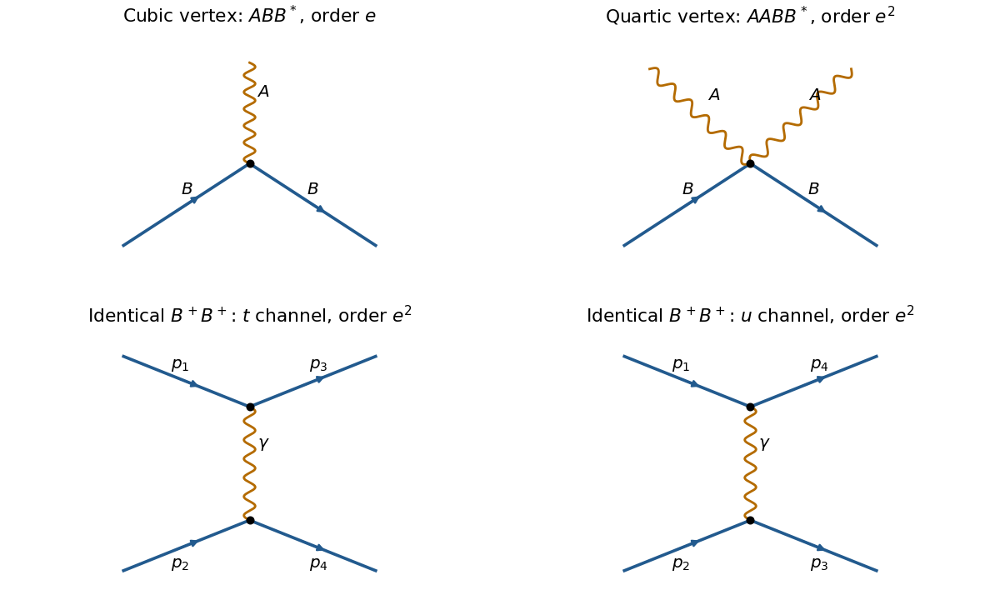

<h1 id="4/g/solution">Solution</h1>

↑ **Parent:** [G](../g.md)

Set $C_{\mu\nu}=A_\mu B_\nu-A_\nu B_\mu$, so $\mathcal G=G+ieC$. Expanding the minimally coupled [Lagrangian density](../../../../lagrangian-density.md) gives

$$
\mathcal L_{\rm int}=\frac{ie}{2}(C_{\mu\nu}^*G^{\mu\nu}-G_{\mu\nu}^*C^{\mu\nu})-\frac{e^2}{2}C_{\mu\nu}^*C^{\mu\nu}.
$$

Thus there is a derivative cubic $ABB^*$ [interaction vertex](../../../../interaction-vertex.md) of order $e$, and a quartic $AABB^*$ [interaction vertex](../../../../interaction-vertex.md) of order $e^2$. There is no pure $B^4$ contact term in this [minimal coupling](../../../../minimal-coupling.md) theory, nor an Abelian three-photon [interaction vertex](../../../../interaction-vertex.md).

**[Figure 1](#4/g/image-cubic-and-quartic-charged-vector-vertices-and-the-two-photon-exchange-channels-for-identical-charged-vector-bosons). Cubic and quartic charged-vector vertices, and the two photon-exchange channels for identical charged vector bosons**.

The straight arrowed lines in the original schematic denote charged massive [vector bosons](../../../../vector-boson.md); the wavy lines denote [photons](../../../../photon.md). For two identical positively charged [vector bosons](../../../../vector-boson.md), the leading scattering amplitude has the order-$e^2$ $t$-channel photon-exchange [Feynman diagram](../../../../feynman-diagram.md), together with its $u$-channel interchange required by identical [bosons](../../../../boson.md). A quartic $AABB^*$ [interaction vertex](../../../../interaction-vertex.md) cannot directly attach four external massive [vector bosons](../../../../vector-boson.md). For a particle-antiparticle incoming pair, the leading channels instead are $t$-channel exchange and $s$-channel photon annihilation. The shown arrows track charge flow; an outgoing charged particle corresponds to the conjugate field at a vertex.

## ↑ Ancestors (12)

1. [G](../g.md)
2. [4](../../4.md)
3. [2022](../../../2022-split.md)
4. [Past exam of the theoretical physics major option course of the University of Oxford](../../../split.md)
5. [Theoretical physics major option course of the University of Oxford](../../../../theoretical-physics-major-option-course-of-the-university-of-oxford.md)
6. [Year 4 of the physics course of the University of Oxford](../../../../year-4-of-the-physics-course-of-the-university-of-oxford.md)
7. [Physics course of the University of Oxford](../../../../physics-course-of-the-university-of-oxford.md)
8. [Undergraduate course of the University of Oxford](../../../../undergraduate-course-of-the-university-of-oxford.md)
9. [Course of the University of Oxford](../../../../course-of-the-university-of-oxford.md)
10. [University of Oxford](../../../../university-of-oxford-split.md)
11. [List of universities](../../../../list-of-universities.md)
12. [Codex Wiki](../../../../split.md)
