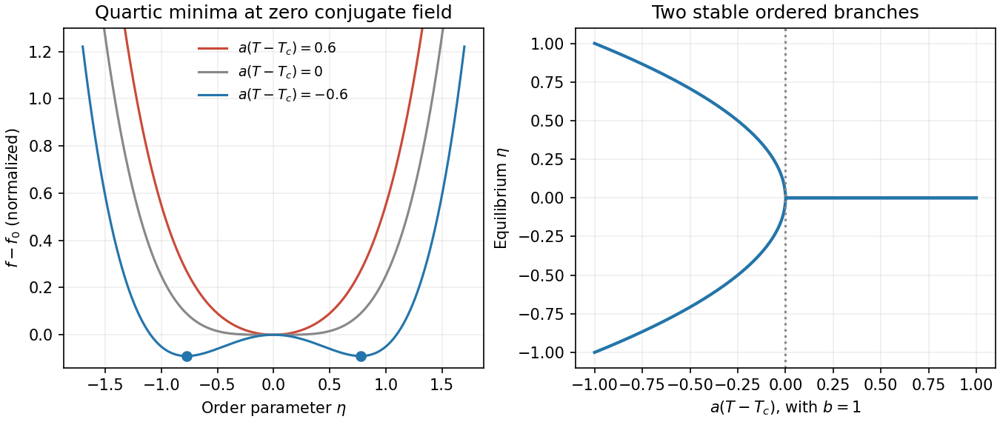

<h1 id="2/a/solution">Solution</h1>

↑ **Parent:** [A](../a.md)

[Landau theory](../../../../../landau-theory.md) expands a thermodynamic potential in an [order parameter](../../../../../order-parameter.md), constrained by [symmetry](../../../../../symmetry-physics.md). For a scalar with sign-reversal [symmetry](../../../../../symmetry-physics.md), a useful [free-energy density](../../../../../free-energy-density.md) is

$$
f=f_0+\frac{a(T-T_c)}2\eta^2+\frac b4\eta^4-h\eta,
\qquad a,b>0.
$$

Here $h$ is the [conjugate field](../../../../../field-conjugate-to-an-order-parameter.md). At $h=0$, minimizing rather than merely finding stationary points gives

$$
\boxed{\eta_{\rm eq}=0\quad(T>T_c),\qquad
\eta_{\rm eq}=\pm\sqrt{\frac{a(T_c-T)}b}\quad(T<T_c).}
$$

The symmetry-related minima represent [spontaneous symmetry breaking](../../../../../spontaneous-symmetry-breaking.md), as for a simple uniaxial [ferromagnet](../../../../../ferromagnet.md) with [magnetization](../../../../../magnetization.md) as [order parameter](../../../../../order-parameter.md). An infinitesimal field selects one sign. Above $T_c$, the susceptibility is $1/[a(T-T_c)]$; below it the stable-branch susceptibility is $1/[2a(T_c-T)]$. Minimization lowers $f$ by $-a^2(T-T_c)^2/(4b)$ below $T_c$, producing a heat-capacity [density](../../../../../density.md) jump $T_ca^2/(2b)$ with continuous [entropy](../../../../../entropy-split.md).

**[Figure 1](#2/a/image-landau-minima). Landau minima**. Original normalized quartic free-energy curves above, at and below a continuous transition, with the two symmetry-related equilibrium order-parameter branches.

A negative quartic coefficient requires a stabilizing $+c\eta^6/6$ with $c>0$. It can produce a first-order transition before the quadratic coefficient changes sign: coexistence occurs at $a(T-T_c)=3b^2/(16c)$ and $\eta^2=-3b/(4c)$. Odd terms are allowed when the assumed [symmetry](../../../../../symmetry-physics.md) is absent. [Landau theory](../../../../../landau-theory.md) predicts mean-field exponents; spatial fluctuations can change critical behaviour, especially close to a [critical point](../../../../../critical-point.md) in low dimensions. A [gradient](../../../../../gradient.md) term extends the model to nonuniform [order parameters](../../../../../order-parameter.md) but does not by itself supply dynamical equations.

## ↑ Ancestors (14)

1. [A](../a.md)
2. [2](../../2.md)
3. [Paper 1](../../../paper-1-split.md)
4. [2012](../../../split.md)
5. [Past exam of the thermal and statistical physics course of the University of Cambridge](../../../../split.md)
6. [Thermal and Statistical Physics course of the University of Cambridge](../../../../../thermal-and-statistical-physics-course-of-the-university-of-cambridge.md)
7. [Physics course of the year 3 of the natural sciences course of the University of Cambridge](../../../../../physics-course-of-the-year-3-of-the-natural-sciences-course-of-the-university-of-cambridge.md)
8. [Year 3 of the natural sciences course of the University of Cambridge](../../../../../year-3-of-the-natural-sciences-course-of-the-university-of-cambridge.md)
9. [Year of the natural sciences course of the University of Cambridge](../../../../../year-of-the-natural-sciences-course-of-the-university-of-cambridge.md)
10. [Natural sciences course of the University of Cambridge](../../../../../natural-sciences-course-of-the-university-of-cambridge.md)
11. [Course of the University of Cambridge](../../../../../course-of-the-university-of-cambridge.md)
12. [University of Cambridge](../../../../../university-of-cambridge-split.md)
13. [List of universities](../../../../../list-of-universities.md)
14. [Codex Wiki](../../../../../split.md)
