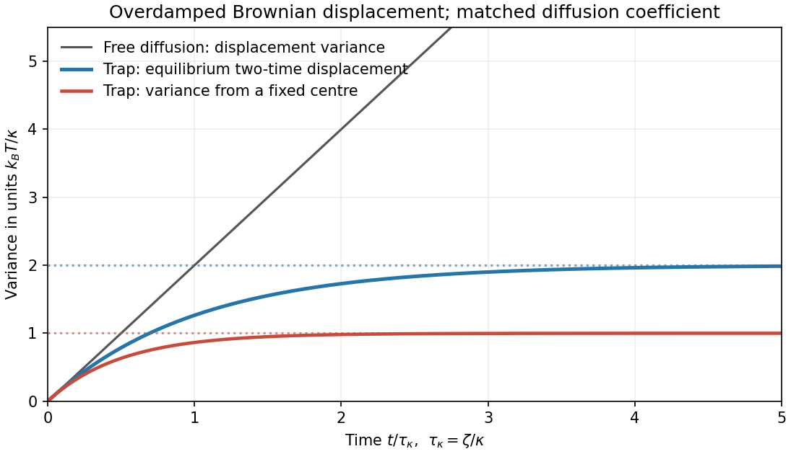

<h1 id="2/b/solution">Solution</h1>

↑ **Parent:** [B](../b.md)

[Brownian motion](../../../../../brownian-motion-split.md) arises from many microscopic collisions. A one-dimensional Langevin description is

$$
m\dot v=-\zeta v-\kappa x+\xi(t),\qquad
\langle\xi(t)\rangle=0,\qquad
\langle\xi(t)\xi(t')\rangle=2\zeta k_BT\delta(t-t').
$$

The fluctuation-dissipation relation ties random forcing to drag, ensuring [thermal equilibrium](../../../../../thermal-equilibrium-split.md). For a free particle set $\kappa=0$. With initially thermal [velocities](../../../../../velocity.md), its mean-square displacement is

$$
\boxed{\langle[x(t)-x(0)]^2\rangle
=2D[t-\tau_v(1-e^{-t/\tau_v})],\qquad
D=\frac{k_BT}{\zeta},\quad \tau_v=\frac m\zeta.}
$$

It is ballistic, $(k_BT/m)t^2$, at short times and diffusive, $2Dt$, for $t\gg\tau_v$. In three dimensions the corresponding long-time result is $6Dt$. At diffusive times, the position propagator from a specified origin is [Gaussian](../../../../../normal-distribution.md) with [variance](../../../../../variance-split.md) $2Dt$ per coordinate. A small [sphere](../../../../../sphere.md) in a viscous liquid supplies a physical example; in the slow unbounded-fluid limit its drag is $6\pi\eta_fa$.

For a harmonic trap, overdamped relaxation has time $\tau_\kappa=\zeta/\kappa$, equilibrium [variance](../../../../../variance-split.md) $k_BT/\kappa$ and stationary [correlation](../../../../../pearson-correlation-coefficient.md)

$$
\langle x(t)x(0)\rangle=\frac{k_BT}{\kappa}e^{-|t|/\tau_\kappa}.
$$

Consequently [stationary trapped Brownian displacement](../../../../../stationary-trapped-brownian-displacement.md) obeys

$$
\boxed{\langle[x(t)-x(0)]^2\rangle=\frac{2k_BT}{\kappa}(1-e^{-t/\tau_\kappa}).}
$$

Confinement makes this displacement saturate, unlike free [diffusion](../../../../../diffusion.md). A trajectory initialized exactly at the centre instead has [variance](../../../../../variance-split.md) $(k_BT/\kappa)(1-e^{-2t/\tau_\kappa})$; confusing that conditional [variance](../../../../../variance-split.md) with the stationary displacement gives an erroneous factor of two. The equilibrium position distribution is proportional to $\exp[-\kappa x^2/(2k_BT)]$. More general finite confinement has a geometry-dependent equilibrium distribution and bounded displacement, not necessarily a [Gaussian](../../../../../normal-distribution.md) one.

**[Figure 2](#2/b/image-free-and-trapped-brownian-motion). Free and trapped Brownian motion**. Original analytic mean-square-displacement curves compare free overdamped diffusion, a stationary harmonic trap and a fixed-origin harmonic-trap variance. The last two have different initial ensembles.

## ↑ Ancestors (14)

1. [B](../b.md)
2. [2](../../2.md)
3. [Paper 1](../../../paper-1-split.md)
4. [2012](../../../split.md)
5. [Past exam of the thermal and statistical physics course of the University of Cambridge](../../../../split.md)
6. [Thermal and Statistical Physics course of the University of Cambridge](../../../../../thermal-and-statistical-physics-course-of-the-university-of-cambridge.md)
7. [Physics course of the year 3 of the natural sciences course of the University of Cambridge](../../../../../physics-course-of-the-year-3-of-the-natural-sciences-course-of-the-university-of-cambridge.md)
8. [Year 3 of the natural sciences course of the University of Cambridge](../../../../../year-3-of-the-natural-sciences-course-of-the-university-of-cambridge.md)
9. [Year of the natural sciences course of the University of Cambridge](../../../../../year-of-the-natural-sciences-course-of-the-university-of-cambridge.md)
10. [Natural sciences course of the University of Cambridge](../../../../../natural-sciences-course-of-the-university-of-cambridge.md)
11. [Course of the University of Cambridge](../../../../../course-of-the-university-of-cambridge.md)
12. [University of Cambridge](../../../../../university-of-cambridge-split.md)
13. [List of universities](../../../../../list-of-universities.md)
14. [Codex Wiki](../../../../../split.md)
