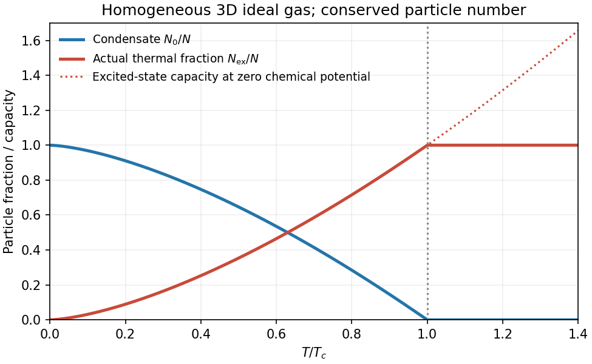

<h1 id="2/c/solution">Solution</h1>

↑ **Parent:** [C](../c.md)

[Bose-Einstein condensation](../../../../../bose-einstein-condensation.md) is macroscopic occupation of a single lowest-energy one-particle state. For a homogeneous three-dimensional [ideal gas](../../../../../ideal-gas-split.md) of conserved massive [bosons](../../../../../boson.md), set that [energy](../../../../../energy-split.md) to zero. The excited-state population is

$$
N_{\rm ex}=\frac{V}{\lambda_T^3}g_{3/2}(z),\qquad
z=e^{\mu/(k_BT)}\le1,\qquad
\lambda_T=\sqrt{\frac{2\pi\hbar^2}{mk_BT}}.
$$

Here $g_{3/2}(z)=\sum_{r\ge1}z^r/r^{3/2}$. As $\mu\to0^-$, the [excited states](../../../../../excited-state.md) can hold only $V\zeta(3/2)/\lambda_T^3$ particles. Additional particles occupy the [ground state](../../../../../ground-state.md). Thus

$$
\boxed{T_c=\frac{2\pi\hbar^2}{mk_B}\left[\frac{n}{\zeta(3/2)}\right]^{2/3},\qquad
\frac{N_0}{N}=1-\left(\frac T{T_c}\right)^{3/2}\quad(T<T_c).}
$$

The isolated [ground state](../../../../../ground-state.md) must be counted separately from the continuum [density of states](../../../../../density-of-states.md); otherwise one misses the condensate. A dilute atomic gas is a physical realization of the quantum-degeneracy regime, but trapping geometry and interactions modify the homogeneous ideal-gas formulas.[§3.5.3: saturation of excited states, separate ground-state occupation and ideal-gas condensation temperature](../../../../../statistical-physics-by-david-tong.md)

**[Figure 3](#2/c/image-ideal-bose-condensate-fraction). Ideal Bose condensate fraction**. Original homogeneous three-dimensional ideal-gas condensate fraction and maximum thermal population, normalized to the critical temperature. No trapped-gas or experimental data are implied.

In the homogeneous [ideal gas](../../../../../ideal-gas-split.md), one and two dimensions do not have finite-temperature condensation in the [thermodynamic limit](../../../../../thermodynamic-limit.md) because the low-energy population integral diverges. Finite size or a trap changes that conclusion's assumptions. Condensation and [superfluidity](../../../../../superfluidity.md) are distinct: the ideal quadratic gas has zero [Landau critical velocity](../../../../../landau-critical-velocity.md), while interactions can support a sound mode and superfluid flow. Neither zero [viscosity](../../../../../dynamic-viscosity-split.md) nor phase-rigid flow follows from the occupation formula alone.

## ↑ Ancestors (14)

1. [C](../c.md)
2. [2](../../2.md)
3. [Paper 1](../../../paper-1-split.md)
4. [2012](../../../split.md)
5. [Past exam of the thermal and statistical physics course of the University of Cambridge](../../../../split.md)
6. [Thermal and Statistical Physics course of the University of Cambridge](../../../../../thermal-and-statistical-physics-course-of-the-university-of-cambridge.md)
7. [Physics course of the year 3 of the natural sciences course of the University of Cambridge](../../../../../physics-course-of-the-year-3-of-the-natural-sciences-course-of-the-university-of-cambridge.md)
8. [Year 3 of the natural sciences course of the University of Cambridge](../../../../../year-3-of-the-natural-sciences-course-of-the-university-of-cambridge.md)
9. [Year of the natural sciences course of the University of Cambridge](../../../../../year-of-the-natural-sciences-course-of-the-university-of-cambridge.md)
10. [Natural sciences course of the University of Cambridge](../../../../../natural-sciences-course-of-the-university-of-cambridge.md)
11. [Course of the University of Cambridge](../../../../../course-of-the-university-of-cambridge.md)
12. [University of Cambridge](../../../../../university-of-cambridge-split.md)
13. [List of universities](../../../../../list-of-universities.md)
14. [Codex Wiki](../../../../../split.md)
