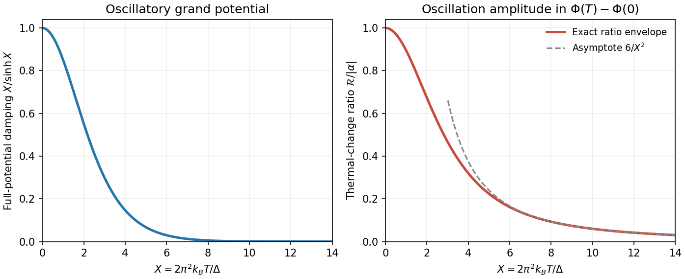

<h1 id="3/solution">Solution</h1>

↑ **Parent:** [3](../3.md)

Let $\beta=1/(k_BT)$. Each independent [fermion](../../../../fermion.md) orbital is either empty or occupied once, so its grand partition factor is $1+e^{-\beta(\epsilon_j-\mu)}$. Multiplying factors and taking the logarithm gives

$$
\Xi=\prod_j[1+e^{-\beta(\epsilon_j-\mu)}],\qquad
\Phi=-k_BT\ln\Xi=-k_BT\int_0^\infty g(\epsilon)\ln[1+e^{-\beta(\epsilon-\mu)}]d\epsilon.
$$

Since $1-n_F=[1+e^{-\beta(\epsilon-\mu)}]^{-1}$, this is the requested form. Spin or other orbital degeneracy is already included in $g$.

For the [Fermi-window convolution of the grand potential](../../../../fermi-window-convolution-of-the-grand-potential.md), define

$$
A(\epsilon)=\int_0^\epsilon g(t)dt,\qquad
\Phi_0(\epsilon)=-\int_0^\epsilon A(t)dt,\qquad
F(\epsilon)=k_BT\ln[1-n_F(\epsilon,\mu)].
$$

Direct differentiation gives **$F'=+n_F$**. The supplied PDF hint has the opposite sign; using that sign would contradict its grand-potential formula. Integrating twice with $A(0)=\Phi_0(0)=0$ and vanishing upper boundary terms,

$$
\Phi=\int_0^\infty A'F\,d\epsilon
=-\int_0^\infty A n_F\,d\epsilon
=\int_0^\infty\Phi'_0 n_F\,d\epsilon
=\boxed{\int_0^\infty\Phi_0(\epsilon)[-\partial_\epsilon n_F]d\epsilon.}
$$

At zero [temperature](../../../../temperature-split.md) $-\partial_\epsilon n_F\to\delta(\epsilon-\mu)$, confirming $\Phi_0(\mu)=\Phi(0,\mu)$.

Use the source's implicit unit normalization of the constant [density of states](../../../../density-of-states.md); restoring a constant baseline $g_0$ multiplies the following potentials by $g_0$. For the sinusoidal [density of states](../../../../density-of-states.md), direct integration gives

$$
\Phi_0(\epsilon)=-\frac{\epsilon^2}{2}
+\frac{\alpha\Delta^2}{4\pi^2}\left[\cos\left(\frac{2\pi\epsilon}{\Delta}\right)-1\right].
$$

Physical nonnegative [density of states](../../../../density-of-states.md) requires $|\alpha|\le1$. Write $t=k_BT$ and $y=\epsilon-\mu$. The [Fermi window](../../../../fermi-window.md)

$$
w(y)=\frac1{4t}\operatorname{sech}^2\left(\frac y{2t}\right)
$$

is even, with full-line moments $\int w\,dy=1$, $\int yw\,dy=0$ and $\int y^2w\,dy=\pi^2t^2/3$. The last integral follows, for example, by expanding $e^x/(1+e^x)^2$ on $x>0$ into its alternating exponential series. When $t\ll\mu$, extending the lower integration limit to $-\infty$ introduces only exponentially small band-edge corrections. The supplied [Fourier transform](../../../../fourier-transform-split.md) gives

$$
\int_{-\infty}^{\infty}w(y)\cos\left[\frac{2\pi(\mu+y)}\Delta\right]dy
=\frac X{\sinh X}\cos\left(\frac{2\pi\mu}\Delta\right),\qquad
X=\frac{2\pi^2t}\Delta.
$$

The odd [sine](../../../../sine.md) term vanishes. Substitution proves

$$
\boxed{\Phi(T,\mu)=\Phi_0(\mu)-\frac{\pi^2t^2}{6}
+\frac{\alpha\Delta^2}{4\pi^2}\left(\frac X{\sinh X}-1\right)
\cos\left(\frac{2\pi\mu}\Delta\right).}
$$

The [thermal damping of a sinusoidal density of states](../../../../thermal-damping-of-a-sinusoidal-density-of-states.md) is therefore $X/\sinh X$ in the full oscillatory potential. The requested ratio instead concerns the thermal change $\Phi(T,\mu)-\Phi_0(\mu)$. Its [oscillatory thermal-change amplitude ratio](../../../../oscillatory-thermal-change-amplitude-ratio.md) is

$$
\boxed{\mathcal R(X)=\frac{6|\alpha|}{X^2}\left(1-\frac X{\sinh X}\right).}
$$

For positive $X$ it decreases smoothly from the limit $|\alpha|$ to zero:

$$
\mathcal R=|\alpha|\left[1-\frac{7X^2}{60}+O(X^4)\right]\quad(X\ll1),\qquad
\mathcal R\sim\frac{6|\alpha|}{X^2}\quad(X\gg1).
$$

At exactly $T=0$ both thermal changes vanish; the quoted value is their limiting ratio. The [amplitude](../../../../wave-amplitude.md) is the envelope in [chemical potential](../../../../chemical-potential-split.md). At a particular fixed $\mu$, the signed contribution ratio has $\alpha\cos(2\pi\mu/\Delta)$ in place of $|\alpha|$; at an [oscillation](../../../../oscillation.md) [node](../../../../node-dynamical-systems.md) the actual oscillatory contribution is zero. The large-$X$ behaviour still requires $k_BT\ll\mu$, so the useful range is $1\ll X\ll2\pi^2\mu/\Delta$.

**[Figure 4](#3/image-fermion-thermal-smoothing). Fermion thermal smoothing**. Original curves distinguish exponential damping of the full oscillatory grand potential from the algebraically decreasing oscillatory-to-smooth amplitude ratio in its thermal change. The right curve is divided by the stipulated oscillation amplitude.

## ↑ Ancestors (13)

1. [3](../3.md)
2. [Paper 1](../../paper-1-split.md)
3. [2012](../../split.md)
4. [Past exam of the thermal and statistical physics course of the University of Cambridge](../../../split.md)
5. [Thermal and Statistical Physics course of the University of Cambridge](../../../../thermal-and-statistical-physics-course-of-the-university-of-cambridge.md)
6. [Physics course of the year 3 of the natural sciences course of the University of Cambridge](../../../../physics-course-of-the-year-3-of-the-natural-sciences-course-of-the-university-of-cambridge.md)
7. [Year 3 of the natural sciences course of the University of Cambridge](../../../../year-3-of-the-natural-sciences-course-of-the-university-of-cambridge.md)
8. [Year of the natural sciences course of the University of Cambridge](../../../../year-of-the-natural-sciences-course-of-the-university-of-cambridge.md)
9. [Natural sciences course of the University of Cambridge](../../../../natural-sciences-course-of-the-university-of-cambridge.md)
10. [Course of the University of Cambridge](../../../../course-of-the-university-of-cambridge.md)
11. [University of Cambridge](../../../../university-of-cambridge-split.md)
12. [List of universities](../../../../list-of-universities.md)
13. [Codex Wiki](../../../../split.md)
