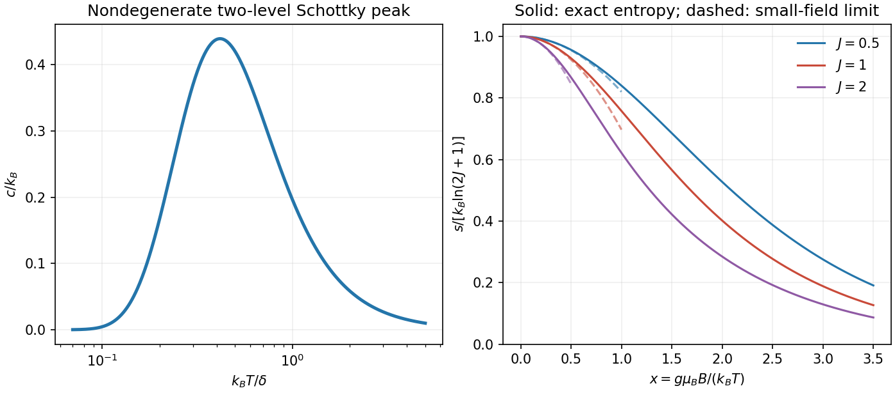

<h1 id="4/solution">Solution</h1>

↑ **Parent:** [4](../4.md)

For two localized [energy](../../../../energy-split.md) levels $0,\delta$ with degeneracies $d_0,d_1$, let $x=\delta/(k_BT)$. Canonical equilibrium gives

$$
z=d_0+d_1e^{-x},\qquad p_1=\frac{d_1e^{-x}}z,\qquad
u=\delta p_1,\qquad s=k_B(\ln z+xp_1),\qquad
c=k_Bx^2p_1(1-p_1).
$$

Here $p_1$ is the total upper-level occupation [probability](../../../../probability.md) and $u,s,c$ are per unit. For nondegenerate levels the [entropy](../../../../entropy-split.md) rises from zero to $k_B\ln2$, while the [heat capacity](../../../../heat-capacity.md) vanishes at both low and high [temperatures](../../../../temperature-split.md) and has a Schottky maximum near $k_BT=0.417\delta$. A [spin one-half](../../../../spin-one-half.md) in a field, or a localized defect with two configurations, supplies an example. Higher levels must be thermally inaccessible; unequal degeneracies change the populations and peak. Distinguishable localized units have total [partition function](../../../../canonical-partition-function.md) $z^N$, unlike a gas of indistinguishable particles sharing just two orbitals.

For the magnetic atom, choose level labels with $E_m=-mg\mu_BB$, $m=-J,\ldots,J$. Put $x=T_B/T=g\mu_BB/(k_BT)$. Its [partition function](../../../../canonical-partition-function.md) and exact [entropy of a finite magnetic multiplet](../../../../entropy-of-a-finite-magnetic-multiplet.md) are

$$
\boxed{Z_J(x)=\sum_{m=-J}^{J}e^{mx}
=\frac{\sinh[(2J+1)x/2]}{\sinh(x/2)},\qquad
\frac{s_J}{k_B}=\ln Z_J-x\frac{d\ln Z_J}{dx}.}
$$

The ratio form has removable limit $Z_J(0)=2J+1$. Since $s_J$ is a function of $x$ only, it depends on field and [temperature](../../../../temperature-split.md) solely through $B/T$. For fixed $J$ at small $x$, [symmetry](../../../../symmetry-physics.md) removes the odd [powers](../../../../power.md) and the supplied sum of $m^2$ gives

$$
Z_J=(2J+1)\left[1+\frac{J(J+1)}6x^2+O(x^4)\right],
\qquad
\boxed{s_J=k_B\left[\ln(2J+1)-\frac{J(J+1)}6\frac{T_B^2}{T^2}+O(x^4)\right].}
$$

For large $J$, the expansion requires $J|x|\ll1$, not merely $|x|\ll1$.

**[Figure 5](#4/image-two-level-heat-and-magnetic-entropy). Two-level heat and magnetic entropy**. Original Schottky heat-capacity curve and exact finite-spin entropies show the entropy deficit removed by isothermal magnetization. Quadratic high-temperature expansions are shown only over a limited small-field interval.

For [demagnetization with a linear-heat-capacity load](../../../../demagnetization-with-a-linear-heat-capacity-load.md), integrate its specified $C_L/T$:

$$
S_L(T)=S_L(0)+\frac{Mk_B}{\theta}T.
$$

Isothermal [magnetization](../../../../magnetization.md) at $T_i$ removes spin [entropy](../../../../entropy-split.md); the bath receives the corresponding heat. During the following reversible, thermally isolated demagnetization, it is the combined [entropy](../../../../entropy-split.md) of spins and load that stays constant. At the minimum-field endpoint $B_f=0$, the ideal independent spins reach $s_{\max}=k_B\ln(2J+1)$. Therefore

$$
Ns_J(T_i,B_i)+S_L(T_i)=Nk_B\ln(2J+1)+S_L(T_{\min}),
$$

$$
\boxed{N\left[k_B\ln(2J+1)-s_J(T_i,B_i)\right]
=\frac{Mk_B}{\theta}(T_i-T_{\min}).}
$$

The bracket is the initial [magnetic entropy deficit](../../../../magnetic-entropy-deficit.md). The PDF's intermediate equality uses the initial [entropy](../../../../entropy-split.md) itself instead; with its preceding definition of $s$, that equality omits the maximum-entropy term. The corrected balance recovers its final [temperature](../../../../temperature-split.md) formula:

$$
\boxed{T_{\min}=T_i-\frac{N\theta J(J+1)g^2\mu_B^2B_i^2}{6Mk_B^2T_i^2}.}
$$

Without the small-field expansion, the exact independent-spin prediction is $T_i-(N\theta/M)[\ln(2J+1)-s_J(T_i,B_i)/k_B]$. As a check, zero initial field gives zero [entropy](../../../../entropy-split.md) deficit and no cooling. The incorrectly printed intermediate balance would fail this check.

The result requires the load law throughout the [temperature](../../../../temperature-split.md) interval, hence $T_i\ll\theta$; a small initial [Zeeman splitting](../../../../zeeman-splitting.md), quantitatively $JT_{B,i}/T_i\ll1$; positive final [temperature](../../../../temperature-split.md); negligible additional [heat capacities](../../../../heat-capacity.md) and heat leaks; thermal equilibration between subsystems; and a reversible sweep slow enough to maintain equilibrium. A negative extrapolated [temperature](../../../../temperature-split.md) is a breakdown of this approximation, not a cooling prediction. Spins alone would keep $B/T$ fixed, but the attached load changes that adiabat by transferring [entropy](../../../../entropy-split.md) to them as it cools.

Interactions invalidate the product of independent one-site [partition functions](../../../../canonical-partition-function.md). The [entropy](../../../../entropy-split.md) must be computed from the many-body [energy](../../../../energy-split.md) spectrum or a justified interacting approximation. [Correlations](../../../../pearson-correlation-coefficient.md) and possible magnetic ordering introduce an interaction scale and can remove the independent-spin [entropy](../../../../entropy-split.md) available for cooling near zero field. Internal fields and ordering commonly limit practical demagnetization. The detailed correction and any residual [entropy](../../../../entropy-split.md) depend on the interaction Hamiltonian, dimensionality and frustration; neither a universal ordering [temperature](../../../../temperature-split.md) nor a numerical final-temperature correction is specified here.

## ↑ Ancestors (13)

1. [4](../4.md)
2. [Paper 1](../../paper-1-split.md)
3. [2012](../../split.md)
4. [Past exam of the thermal and statistical physics course of the University of Cambridge](../../../split.md)
5. [Thermal and Statistical Physics course of the University of Cambridge](../../../../thermal-and-statistical-physics-course-of-the-university-of-cambridge.md)
6. [Physics course of the year 3 of the natural sciences course of the University of Cambridge](../../../../physics-course-of-the-year-3-of-the-natural-sciences-course-of-the-university-of-cambridge.md)
7. [Year 3 of the natural sciences course of the University of Cambridge](../../../../year-3-of-the-natural-sciences-course-of-the-university-of-cambridge.md)
8. [Year of the natural sciences course of the University of Cambridge](../../../../year-of-the-natural-sciences-course-of-the-university-of-cambridge.md)
9. [Natural sciences course of the University of Cambridge](../../../../natural-sciences-course-of-the-university-of-cambridge.md)
10. [Course of the University of Cambridge](../../../../course-of-the-university-of-cambridge.md)
11. [University of Cambridge](../../../../university-of-cambridge-split.md)
12. [List of universities](../../../../list-of-universities.md)
13. [Codex Wiki](../../../../split.md)
