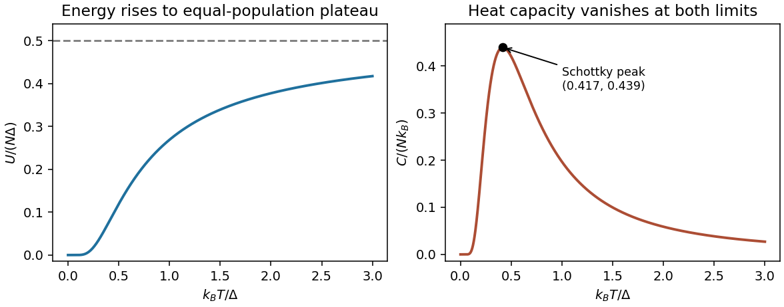
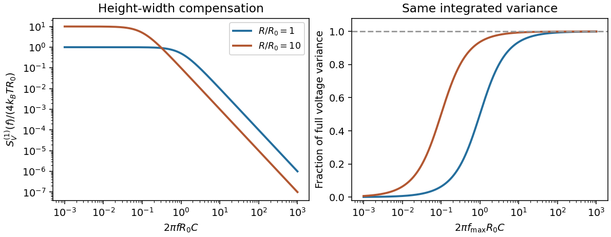
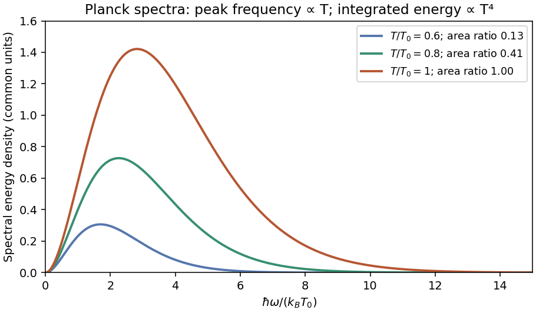
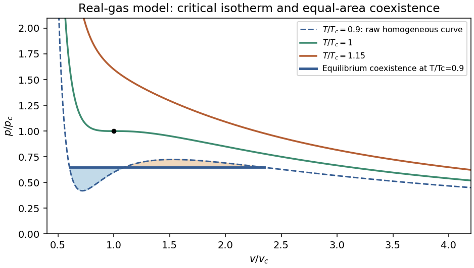
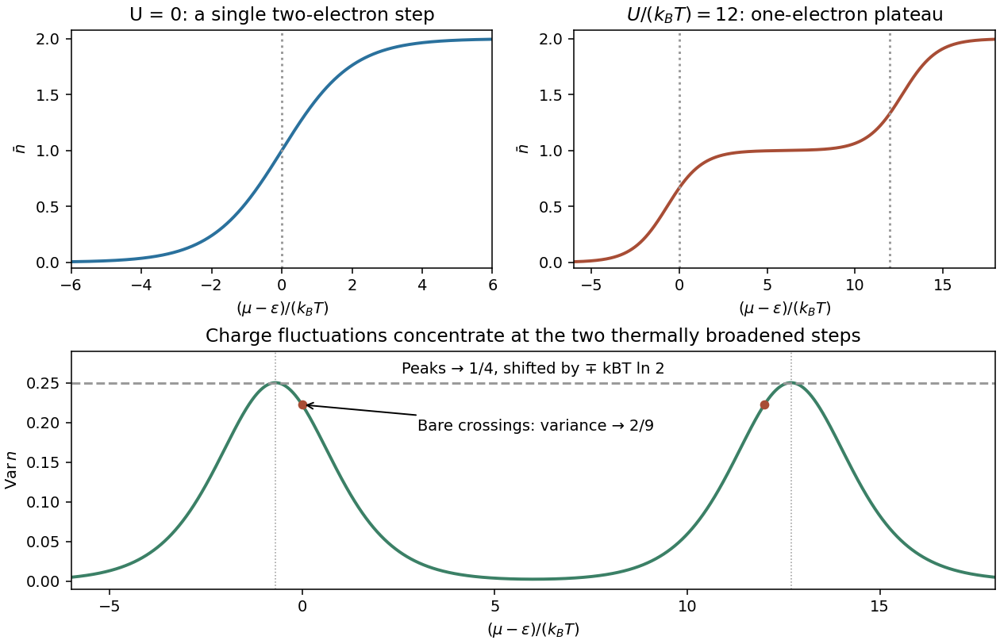
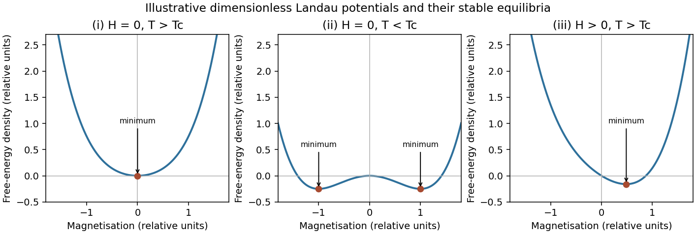

# Paper 1

↑ **Parent:** [2013](../2013.md)

Original paper: [Public original PDF, physical pages 242–245; cover on page 242 and questions on pages 243–245](https://www.whatdotheyknow.com/request/natural_science_tripos_physics_e_2/response/2340776/attach/2/FOI%202023%20399%20Zahid%20materials.pdf?cookie_passthrough=1#page=242).

**Table of contents**

- [1](#1)
  - [a](#1/a)
    - [Solution](#1/a/solution)
  - [b](#1/b)
    - [Solution](#1/b/solution)
  - [c](#1/c)
    - [Solution](#1/c/solution)
- [2](#2)
  - [a](#2/a)
    - [Solution](#2/a/solution)
  - [b](#2/b)
    - [Solution](#2/b/solution)
  - [c](#2/c)
    - [Solution](#2/c/solution)
- [3](#3)
  - [Solution](#3/solution)
- [4](#4)
  - [i](#4/i)
    - [Solution](#4/i/solution)
  - [ii](#4/ii)
    - [Solution](#4/ii/solution)
  - [iii](#4/iii)
    - [Solution](#4/iii/solution)
  - [Solution](#4/solution)

## 1

↑ **Parent:** [Paper 1](paper-1.md)

<h3 id="1/a">a</h3>

↑ **Parent:** [1](#1)

<h4 id="1/a/solution">Solution</h4>

↑ **Parent:** [A](#1/a)

In the classical equilibrium circuit, the [capacitor](../../electromagnetism.md#capacitor) stores $CV^2/2$. [Equipartition](../../canonical-ensemble.md#equipartition-theorem) assigns this quadratic term mean [energy](../../energy.md) $k_BT/2$, so

$$
\boxed{V_{\rm rms}=\sqrt{\frac{k_BT}{C}}\simeq6.4\,\mathrm{\mu V}\quad(T\simeq300\,\mathrm K).}
$$

The mean [voltage](../../random-walk.md#voltage) is zero and its [variance](../../variance.md) is $k_BT/C$. Resistance determines the equilibration time and noise spectrum, not this full-band equilibrium [variance](../../variance.md). A finite-bandwidth or appreciably loading readout can measure less than the ideal result.

<h3 id="1/b">b</h3>

↑ **Parent:** [1](#1)

<h4 id="1/b/solution">Solution</h4>

↑ **Parent:** [B](#1/b)

Let $\Delta=\hbar\Omega$ and choose the nondegenerate [energy](../../energy.md) levels as 0 and $\Delta$. For N [independent](../../random-variable.md#independent-random-variables) identical units, $Z=(1+e^{-\beta\Delta})^N$; set N=1 for a single [two-level system](../../canonical-ensemble.md#two-level-system). Differentiating its logarithm gives

$$
\boxed{U=\frac{N\Delta}{1+e^{\Delta/(k_BT)}},\qquad
C_V=Nk_B\frac{x^2e^x}{(1+e^x)^2},\quad x=\frac\Delta{k_BT}.}
$$

At low [temperature](../../temperature.md), $U\sim N\Delta e^{-x}$ and $C_V\sim Nk_Bx^2e^{-x}$: the upper level is frozen out. At high [temperature](../../temperature.md), the two levels approach equal populations, giving $U\to N\Delta/2$ while $C_V\sim Nk_Bx^2/4\to0$. The [energy](../../energy.md) therefore rises monotonically to a plateau, while the [heat capacity](../../heat.md#heat-capacity) has a Schottky peak:

$$
\boxed{k_BT_{\rm peak}\simeq0.417\Delta,\qquad C_{V,\rm peak}\simeq0.439Nk_B.}
$$

Unequal degeneracies would change the populations and peak; the usual equal-degeneracy model is stated here. Shifting both [energy](../../energy.md) levels changes the [energy](../../energy.md) baseline but not [heat capacity](../../heat.md#heat-capacity).

**[Figure 1](#1/b/image-original-equal-degeneracy-two-level-internal-energy-and-heat-capacity-curves-with-the-high-temperature-plateau-and-schottky-peak-marked). Original equal-degeneracy two-level internal-energy and heat-capacity curves, with the high-temperature plateau and Schottky peak marked**.

<h3 id="1/c">c</h3>

↑ **Parent:** [1](#1)

<h4 id="1/c/solution">Solution</h4>

↑ **Parent:** [C](#1/c)

Use a three-dimensional [ideal gas](../../ideal-gas.md) at the same [number density](../../statistical-physics.md#number-density) n for both [isotopes](../../chemical-substance.md#isotope). An unpolarized [helium-3](../../chemical-substance.md#helium-3) gas has [spin degeneracy](../../statistical-physics.md#spin-degeneracy) two, hence

$$
k_BT_F=\frac{\hbar^2}{2m_3}(3\pi^2n)^{2/3}.
$$

[Helium-4](../../chemical-substance.md#helium-4) has a single [spin](../../angular-momentum-operator.md#spin) state, and the ideal Bose-gas saturation condition gives

$$
k_BT_B=\frac{2\pi\hbar^2}{m_4}\left[\frac{n}{\zeta(3/2)}\right]^{2/3}.
$$

Eliminating n, using $m_3/m_4\simeq3/4$ and $\zeta(3/2)=2.612$, yields

$$
\boxed{\frac{T_B}{T_F}=\frac{4\pi}{(3\pi^2)^{2/3}\zeta(3/2)^{2/3}}\frac{m_3}{m_4}
\simeq0.519,\qquad T_B\simeq2.6\,\mathrm K.}
$$

The fermionic [spin degeneracy](../../statistical-physics.md#spin-degeneracy) must be included. This is an ideal-gas estimate; strong interactions in liquid helium prevent identifying it with an exact experimental transition [temperature](../../temperature.md).

## 2

↑ **Parent:** [Paper 1](paper-1.md)

<h3 id="2/a">a</h3>

↑ **Parent:** [2](#2)

<h4 id="2/a/solution">Solution</h4>

↑ **Parent:** [A](#2/a)

[Equipartition](../../canonical-ensemble.md#equipartition-theorem) gives mean [energy](../../energy.md) $k_BT/2$ for each [independent](../../random-variable.md#independent-random-variables) quadratic term in a classical canonical [Hamiltonian](../../hamiltonian-mechanics.md#hamiltonian). For example, $p^2/(2m)$ and $kx^2/2$ each contribute this amount in a [harmonic oscillator](../../classical-mechanics.md#simple-harmonic-motion). It is a thermal average, not an instantaneous equality; constraints, nonquadratic terms or quantum level spacings large compared with $k_BT$ require a different calculation.

The [fluctuation-dissipation theorem](../../quantum-field-theory.md#fluctuation-dissipation-theorem) connects equilibrium fluctuations with the dissipative part of [linear response](../../statistical-physics.md#linear-response-theory). If an applied [force](../../force.md) couples as $-f(t)x$, use response to $e^{-i\omega t}$ and define the two-sided angular-frequency spectrum $S_{xx}(\omega)=\int e^{i\omega t}\langle\delta x(t)\delta x(0)\rangle dt$. The classical relation is

$$
\boxed{S_{xx}(\omega)=\frac{2k_BT}{\omega}\operatorname{Im}\chi(\omega).}
$$

For a viscously damped particle, $m\dot v=-\zeta v+\xi(t)$, the corresponding white-noise [force](../../force.md) satisfies $\langle\xi(t)\xi(t')\rangle=2\zeta k_BT\delta(t-t')$. Noise replenishes [energy](../../energy.md) lost by [friction](../../newtonian-mechanics.md#friction); their strengths cannot be varied independently at fixed equilibrium [temperature](../../temperature.md).

Electrically, the one-sided voltage-noise spectrum per hertz of an equilibrium [resistor](../../electric-charge.md#resistor) is $4k_BTR$. A [capacitor](../../electromagnetism.md#capacitor) in parallel filters it to

$$
S_V^{(1)}(f)=\frac{4k_BTR}{1+(2\pi fRC)^2},\qquad
\int_0^\infty S_V^{(1)}(f)\,df=\frac{k_BT}{C}.
$$

The same equilibrium [voltage](../../random-walk.md#voltage) [variance](../../variance.md) follows from [equipartition](../../canonical-ensemble.md#equipartition-theorem). Increasing R makes the spectrum taller and narrower without changing its integrated area. This thermodynamic connection between dissipative conductance and thermal electrical fluctuations is the content of the classical noise calculation.[1928, abstract: equilibrium thermodynamic and statistical calculation of thermal electromotive force](../../physics-bibliography.md#thermal-agitation-of-electric-charge-in-conductors-by-harry-nyquist)

**[Figure 2](#2/a/image-original-normalized-resistor-capacitor-noise-spectra-increasing-resistance-changes-the-spectral-width-and-height-while-preserving-the-full-equilibrium-variance). Original normalized resistor-capacitor noise spectra: increasing resistance changes the spectral width and height while preserving the full equilibrium variance**.

<h3 id="2/b">b</h3>

↑ **Parent:** [2](#2)

<h4 id="2/b/solution">Solution</h4>

↑ **Parent:** [B](#2/b)

A black body absorbs incident electromagnetic radiation and, in equilibrium, emits a spectrum determined by [temperature](../../temperature.md) alone. A cavity with a small aperture approximates this ideal. [Photon](../../quantum-mechanics.md#photon) number is not conserved in [thermal equilibrium](../../thermal-equilibrium.md), so its [chemical potential](../../chemical-potential.md) is zero. Combining the Bose occupation with the two-polarization electromagnetic [mode](../../probability-and-statistics.md#mode-statistics) [density](../../fluid-mechanics.md#density) gives the spectral [energy](../../energy.md) [density](../../fluid-mechanics.md#density)

$$
u_\omega=\frac{\hbar\omega^3}{\pi^2c^3}\frac1{e^{\hbar\omega/(k_BT)}-1}.
$$

Changing variable to $x=\hbar\omega/(k_BT)$ shows directly why the total [energy](../../energy.md) [density](../../fluid-mechanics.md#density) is proportional to $T^4$:

$$
u(T)=\frac{(k_BT)^4}{\pi^2\hbar^3c^3}\int_0^\infty\frac{x^3\,dx}{e^x-1}
=\frac{\pi^2k_B^4}{15\hbar^3c^3}T^4.
$$

Three [powers](../../energy.md#power) of T arise from the number of thermally populated [modes](../../probability-and-statistics.md#mode-statistics) and one from their characteristic [energy](../../energy.md). Isotropic radiation incident on a surface has outward hemispherical [flux](../../mathematical-physics.md#flux) $cu/4$, giving

$$
\boxed{j^\star=\sigma_{\rm SB}T^4,\qquad
\sigma_{\rm SB}=\frac{\pi^2k_B^4}{60\hbar^3c^2}.}
$$

The factor 1/4 is the hemispherical angular average; multiplying [energy](../../energy.md) [density](../../fluid-mechanics.md#density) by c alone would overcount. The spectrum's [frequency](../../wave.md#frequency) scale grows with T. Classical [equipartition](../../canonical-ensemble.md#equipartition-theorem) over all [modes](../../probability-and-statistics.md#mode-statistics) would instead produce the Rayleigh-Jeans ultraviolet divergence; the Planck occupation suppresses high-frequency [modes](../../probability-and-statistics.md#mode-statistics). Real materials can have wavelength-dependent [emissivity](../../heat.md#emissivity), and a body's net radiative exchange also includes absorbed environmental radiation.

**[Figure 3](#2/b/image-original-planck-energy-spectra-for-three-relative-temperatures-showing-the-shift-to-higher-frequencies-and-the-growth-of-the-integrated-energy-as-temperature-to-the-fourth-power). Original Planck energy spectra for three relative temperatures, showing the shift to higher frequencies and the growth of the integrated energy as temperature to the fourth power**.

<h3 id="2/c">c</h3>

↑ **Parent:** [2](#2)

<h4 id="2/c/solution">Solution</h4>

↑ **Parent:** [C](#2/c)

An [equation of state](../../pressure.md#equation-of-state) relates equilibrium pressure, [temperature](../../temperature.md) and [density](../../fluid-mechanics.md#density). The ideal-gas form $p=nk_BT$ neglects intermolecular [forces](../../force.md) and excluded [volume](../../geometry-and-topology.md#volume). A low-density real-gas expansion is

$$
\frac p{nk_BT}=1+B_2(T)n+B_3(T)n^2+\cdots,
$$

where the virial coefficients encode interaction effects and generally depend on [temperature](../../temperature.md).

A simple phenomenological example is the molar [Van der Waals equation](../../pressure.md#van-der-waals-equation)

$$
\boxed{p=\frac{RT}{v-b}-\frac a{v^2}.}
$$

Here v is molar [volume](../../geometry-and-topology.md#volume), b represents excluded [volume](../../geometry-and-topology.md#volume) and the attractive interaction lowers pressure through a. Its dilute expansion gives $pv/(RT)=1+[b-a/(RT)]/v+\cdots$. It recovers the ideal-gas limit but is not a quantitatively universal equation for all [real gases](../../thermodynamics.md#real-gas).

Below its [critical temperature](../../quantum-ideal-gas-statistics.md#critical-temperature), the raw isotherm contains a region with $(\partial p/\partial v)_T>0$, corresponding to negative [isothermal compressibility](../../thermodynamics.md#isothermal-compressibility) and mechanical instability. Equilibrium [phase](../../wave.md#phase-waves) separation replaces that segment by a coexistence pressure satisfying equal [chemical potentials](../../chemical-potential.md), equivalently the [Maxwell equal-area construction](../../thermodynamic-potential.md#maxwell-construction). The [critical point](../../analysis.md#critical-point) follows from $p_v=p_{vv}=0$:

$$
\boxed{v_c=3b,\qquad T_c=\frac{8a}{27Rb},\qquad p_c=\frac{a}{27b^2}.}
$$

The distinction between an unstable homogeneous branch and a stable two-phase state is essential when interpreting a real-gas [equation of state](../../pressure.md#equation-of-state).

**[Figure 4](#2/c/image-original-reduced-van-der-waals-isotherms-and-a-calculated-maxwell-coexistence-segment-these-are-model-curves-not-copied-experimental-data). Original reduced van der Waals isotherms and a calculated Maxwell coexistence segment; these are model curves, not copied experimental data**.

## 3

↑ **Parent:** [Paper 1](paper-1.md)

<h3 id="3/solution">Solution</h3>

↑ **Parent:** [3](#3)

Write $z=e^{\beta(\mu-\epsilon)}$. For one nondegenerate fermionic [quantum state](../../quantum-system.md#quantum-state), the allowed occupations 0 and 1 give $\Xi_F=1+z$. For a bosonic state, summing all nonnegative occupations gives $\Xi_B=(1-z)^{-1}$, requiring $z<1$ or $\mu<\epsilon$. Differentiating the logarithm,

$$
\bar n=z\frac{\partial\ln\Xi}{\partial z},\qquad
\boxed{\bar n_F=\frac1{e^{\beta(\epsilon-\mu)}+1},\qquad
\bar n_B=\frac1{e^{\beta(\epsilon-\mu)}-1}.}
$$

The [interacting point defect](../../statistical-physics.md#single-orbital-interacting-defect) has two distinct [spin](../../angular-momentum-operator.md#spin) states, not one fermionic state. Its four [microstates](../../statistical-physics.md#microstate) have grand-canonical weights $1,z,z,qz^2$, with $q=e^{-\beta U}$. The first two single-electron weights are separate up/down [spin](../../angular-momentum-operator.md#spin) possibilities; the double state has one [electron](../../physics.md#electron) of each [spin](../../angular-momentum-operator.md#spin). Thus

$$
\Xi=1+2z+qz^2,\qquad
\boxed{\bar n=\frac{2z+2qz^2}{1+2z+qz^2}.}
$$

For $U=0$, $\Xi=(1+z)^2$ and $\bar n=2z/(1+z)$. The sketch is a single smooth step from 0 to 2, centred on $\mu=\epsilon$, where $\bar n=1$. As $T\to0$ its width tends to zero.

For positive U with $\beta U\gg1$, the lowest grand energies are successively $0$, $\epsilon-\mu$ and $2\epsilon+U-2\mu$. Away from the two crossings,

$$
\boxed{\bar n\simeq\begin{cases}
0,&\mu<\epsilon,\\
1,&\epsilon<\mu<\epsilon+U,\\
2,&\mu>\epsilon+U.
\end{cases}}
$$

Finite [temperature](../../temperature.md) smooths each step over an [energy](../../energy.md) range of order $k_BT$. Near the lower step double occupation is exponentially suppressed, so $\bar n\simeq2z/(1+2z)$. Near the upper step put $y=e^{\beta(\mu-\epsilon-U)}$ and neglect the empty state, giving $\bar n\simeq1+y/(2+y)$. [Spin degeneracy](../../statistical-physics.md#spin-degeneracy) shifts the half-step positions to $\epsilon-k_BT\ln2$ and $\epsilon+U+k_BT\ln2$.

For a grand-canonical probability $p_s\propto e^{-\beta(E_s-\mu n_s)}$, differentiation gives $\partial_\mu p_s=\beta(n_s-\bar n)p_s$. Multiplying by $n_s$ and summing proves

$$
\boxed{\sigma^2=k_BT\left(\frac{\partial\bar n}{\partial\mu}\right)_T.}
$$

For this defect, direct state counting gives

$$
\langle n^2\rangle=\frac{2z+4qz^2}{\Xi},\qquad
\sigma^2=\frac{2z(1+2qz+qz^2)}{(1+2z+qz^2)^2}.
$$

At $\mu=\epsilon$, $z=1$ and therefore

$$
\boxed{\sigma^2=\frac{2+6e^{-\beta U}}{(3+e^{-\beta U})^2}\longrightarrow\frac29.}
$$

The same limit gives $\bar n=2/3$: empty, up and down states have equal weights, while the double state is suppressed. Replacing this degeneracy by a two-outcome equal-weight model would incorrectly give [variance](../../variance.md) $1/4$ at this [chemical potential](../../chemical-potential.md).

Across the full chemical-potential range the [variance](../../variance.md) has two well-separated narrow peaks and tends to zero on the 0, 1 and 2 plateaux. The limiting shapes are $2z/(1+2z)^2$ near the lower step and $2y/(2+y)^2$ near the upper one. Each peak has height $1/4$, at the shifted half-step position; the [variance](../../variance.md) at the unshifted crossings is instead $2/9$.

**[Figure 5](#3/image-original-grand-canonical-defect-occupations-and-number-variance-showing-the-interaction-induced-one-electron-plateau-and-spin-degeneracy-shifts-of-the-variance-peaks). Original grand-canonical defect occupations and number variance, showing the interaction-induced one-electron plateau and spin-degeneracy shifts of the variance peaks**.

## 4

↑ **Parent:** [Paper 1](paper-1.md)

<h3 id="4/i">i</h3>

↑ **Parent:** [4](#4)

<h4 id="4/i/solution">Solution</h4>

↑ **Parent:** [I](#4/i)

For $H=0$ and $a>0$, $F(M)=aM^2/2+bM^4/4$ is a symmetric single well. Its only minimum is

$$
\boxed{\langle M\rangle=0,\qquad F_{\min}=0.}
$$

The zero is relative to the smooth background omitted from the supplied expansion.

**[Figure 6](#4/i/image-original-dimensionless-quartic-landau-free-energy-sketches-for-the-three-printed-cases-with-their-equilibrium-minima-marked). Original dimensionless quartic Landau free-energy sketches for the three printed cases, with their equilibrium minima marked**.

<h3 id="4/ii">ii</h3>

↑ **Parent:** [4](#4)

<h4 id="4/ii/solution">Solution</h4>

↑ **Parent:** [Ii](#4/ii)

For $H=0$ and $a<0$, the [free energy](../../thermodynamic-potential.md#thermodynamic-free-energy) is a symmetric double well. The central stationary point is a maximum; the two stable minima are

$$
\boxed{M_0=\pm\sqrt{-\frac ab},\qquad F_{\min}=-\frac{a^2}{4b}.}
$$

These are the magnetisations of the two symmetry-broken [phases](../../wave.md#phase-waves), selected by an infinitesimal field or a [boundary condition](../../differential-equation.md#boundary-condition). An exactly symmetric finite-system ensemble can have $\langle M\rangle=0$ by averaging both wells; that does not make the central maximum a stable homogeneous [phase](../../wave.md#phase-waves).

<h3 id="4/iii">iii</h3>

↑ **Parent:** [4](#4)

<h4 id="4/iii/solution">Solution</h4>

↑ **Parent:** [Iii](#4/iii)

For $a>0$ and $H>0$, the field tilts the single well toward positive M. Since $F''=a+3bM^2>0$ everywhere, there is exactly one minimum, at the positive solution $M_H$ of the [equation of state](../../pressure.md#equation-of-state). At that solution,

$$
\boxed{\langle M\rangle=M_H>0,\qquad
F_{\min}=-\frac a2M_H^2-\frac{3b}{4}M_H^4.}
$$

This follows by eliminating $\mu_0H=aM_H+bM_H^3$ from F. At weak field, $M_H\simeq\mu_0H/a$ and $F_{\min}\simeq-\mu_0^2H^2/(2a)$.

<h3 id="4/solution">Solution</h3>

↑ **Parent:** [4](#4)

At zero applied field, [time-reversal symmetry](../../quantum-field-theory.md#t-symmetry) interchanges $M$ and $-M$ without changing the [free energy](../../thermodynamic-potential.md#thermodynamic-free-energy), so the analytic expansion contains only even [powers](../../energy.md#power). The term $-\mu_0HM$ breaks this symmetry at fixed nonzero H. Stationarity and local stability require

$$
\boxed{\mu_0H=a(T)M+bM^3,\qquad a(T)+3bM^2>0.}
$$

For $T>T_c$ at small field, the cubic term is higher order and $M\simeq\mu_0H/a(T)$. Thus the susceptibility as defined in the question is

$$
\boxed{\chi=\left(\frac{\partial M}{\partial H}\right)_T\xrightarrow[H\to0]{}\frac{\mu_0}{a(T)}.}
$$

The three requested free-energy sketches and their minima are given separately above.

For the plotted isotherms, divide the [equation of state](../../pressure.md#equation-of-state) by nonzero M and rearrange:

$$
\boxed{M^2=\frac{\mu_0}{b}\frac HM-\frac{a(T)}b.}
$$

This is an [Arrott plot](../../critical-phenomenon.md#arrott-plot): its slope determines b, and the isotherm through the origin identifies the mean-field [Curie temperature](../../electromagnetism.md#curie-temperature).[1957, abstract: molecular-field criterion from cubic magnetisation versus internal field at the Curie temperature](../../physics-bibliography.md#criterion-for-ferromagnetism-from-observations-of-magnetic-isotherms-by-anthony-arrott) Under the paper's stated uniform-field Landau model, use H as supplied on its axis.

The ordinate unit is $(10^4\,\mathrm{A\,m^{-1}})^2=10^8\,\mathrm{A^2\,m^{-2}}$. Reading the original graph gives slopes about $0.076$–$0.080$ ordinate units per unit H/M, so the physical slope is approximately $7.8\times10^6\,\mathrm{A^2\,m^{-2}}$. Consequently

$$
\boxed{b\simeq1.6\times10^{-13}\,\mathrm{J\,m\,A^{-4}}.}
$$

Approximate horizontal intercepts and the corresponding $a=\mu_0(H/M)_{M^2=0}$ are:

- $4.2\,\mathrm K$: intercept $-62$, giving $a\simeq-7.8\times10^{-5}\,\mathrm{H\,m^{-1}}$.
- $13\,\mathrm K$: intercept $-40$, giving $a\simeq-5.1\times10^{-5}\,\mathrm{H\,m^{-1}}$.
- $19\,\mathrm K$: intercept $-15$, giving $a\simeq-1.9\times10^{-5}\,\mathrm{H\,m^{-1}}$.
- $25\,\mathrm K$: intercept $+17$, giving $a\simeq+2.2\times10^{-5}\,\mathrm{H\,m^{-1}}$.

The sign change brackets the transition between 19 and 25 K. A linear fit of $a(T)=\alpha(T-T_c)$ across the four read-offs gives approximately $\alpha=4.8\times10^{-6}\,\mathrm{H\,m^{-1}\,K^{-1}}$ and

$$
\boxed{T_c\simeq22\,\mathrm K.}
$$

Interpolating only the two nearest isotherms also gives about 22 K. These are graph estimates, not exact recovered measurements.

Below $T_c$ at zero field, the stable branches have $M_0^2=-a/b$. Substitution gives the [free-energy density](../../statistical-physics.md#free-energy-density) relative to the omitted smooth background:

$$
F_{\min}=-\frac{a(T)^2}{4b}=-\frac{\alpha^2(T-T_c)^2}{4b}.
$$

The equilibrium excess heat-capacity [density](../../fluid-mechanics.md#density) is $c_H=-T\partial_T^2F_{\min}=T\alpha^2/(2b)$ below $T_c$ and zero above it. Therefore

$$
\boxed{\Delta c_H=\frac{T_c\alpha^2}{2b}>0.}
$$

The all-isotherm linear fit gives **about $1.5\times10^3\,\mathrm{J\,m^{-3}\,K^{-1}}$**. Estimating the slope only between the 19 K and 25 K curves instead gives $\alpha\simeq6.9\times10^{-6}\,\mathrm{H\,m^{-1}\,K^{-1}}$ and a jump near $3\times10^3\,\mathrm{J\,m^{-3}\,K^{-1}}$. The lines are not exactly parallel and the intercepts are not perfectly linear in T, so **a jump of order a few $10^3\,\mathrm{J\,m^{-3}\,K^{-1}}$ is supported; finer precision is not**. This is per [volume](../../geometry-and-topology.md#volume) because F is a [density](../../fluid-mechanics.md#density); no sample [volume](../../geometry-and-topology.md#volume) is given to convert it to a total [heat capacity](../../heat.md#heat-capacity).

If $b<0$, the quartic truncation is unbounded below. Add a positive sixth-order term $cM^6/6$ with $c>0$. At zero field the coexistence conditions give

$$
M_{\rm jump}^2=-\frac{3b}{4c},\qquad
 a_{\rm transition}=\frac{3b^2}{16c}>0.
$$

Thus the zero-field transition is generically first order, with a discontinuous spontaneous magnetisation and possible [metastability](../../critical-phenomenon.md#metastability). It occurs before the quadratic coefficient reaches zero. The case $b=0$ is the tricritical boundary of this mean-field model; no value of c is invented.

## ↑ Ancestors (11)

1. [2013](../2013.md)
2. [Past exam of the thermal and statistical physics course of the University of Cambridge](../../past-exam-of-the-thermal-and-statistical-physics-course-of-the-university-of-cambridge.md)
3. [Thermal and Statistical Physics course of the University of Cambridge](../../university-of-cambridge.md#thermal-and-statistical-physics-course-of-the-university-of-cambridge)
4. [Physics course of the year 3 of the natural sciences course of the University of Cambridge](../../university-of-cambridge.md#physics-course-of-the-year-3-of-the-natural-sciences-course-of-the-university-of-cambridge)
5. [Year 3 of the natural sciences course of the University of Cambridge](../../university-of-cambridge.md#year-3-of-the-natural-sciences-course-of-the-university-of-cambridge)
6. [Year of the natural sciences course of the University of Cambridge](../../university-of-cambridge.md#year-of-the-natural-sciences-course-of-the-university-of-cambridge)
7. [Natural sciences course of the University of Cambridge](../../university-of-cambridge.md#natural-sciences-course-of-the-university-of-cambridge)
8. [Course of the University of Cambridge](../../university-of-cambridge.md#course-of-the-university-of-cambridge)
9. [University of Cambridge](../../university-of-cambridge.md)
10. [List of universities](../../README.md#list-of-universities)
11. [Codex Wiki](../../README.md)
