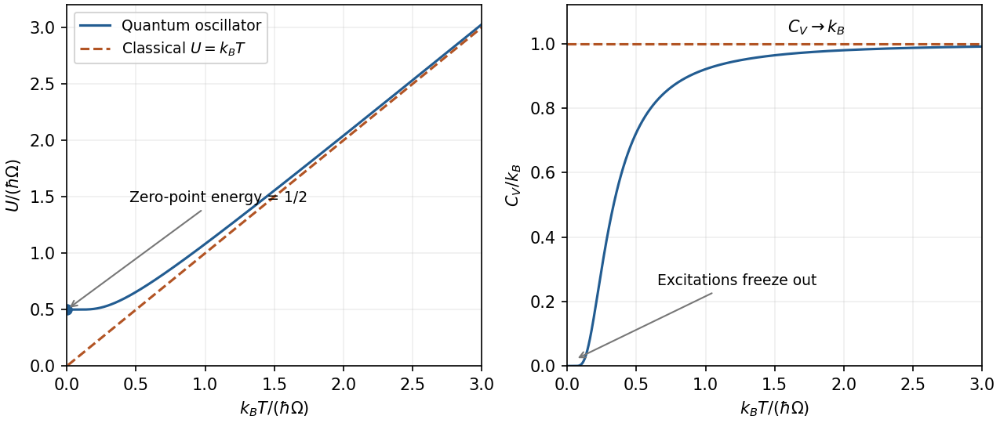

# Paper 1

↑ **Parent:** [2014](../2014.md)

Original paper: [Public original PDF, physical pages 287–290; cover on page 287 and questions on pages 288–290](https://www.whatdotheyknow.com/request/natural_science_tripos_physics_e_2/response/2340776/attach/2/FOI%202023%20399%20Zahid%20materials.pdf?cookie_passthrough=1#page=287).

**Table of contents**

- [1](#1)
  - [a](#1/a)
    - [Solution](#1/a/solution)
  - [b](#1/b)
    - [Solution](#1/b/solution)
  - [c](#1/c)
    - [Solution](#1/c/solution)
- [2](#2)
  - [a](#2/a)
    - [Solution](#2/a/solution)
  - [b](#2/b)
    - [Solution](#2/b/solution)
  - [c](#2/c)
    - [Solution](#2/c/solution)
- [3](#3)
  - [Solution](#3/solution)
- [4](#4)
  - [Solution](#4/solution)

## 1

↑ **Parent:** [Paper 1](paper-1.md)

<h3 id="1/a">a</h3>

↑ **Parent:** [1](#1)

<h4 id="1/a/solution">Solution</h4>

↑ **Parent:** [A](#1/a)

For one oscillator, set $x=\hbar\Omega/(k_BT)$. Its [quantum-oscillator energy and heat capacity](../../quantum-harmonic-oscillator.md#quantum-oscillator-energy-and-heat-capacity) are

$$
\boxed{U=\hbar\Omega\left(\frac12+\frac1{e^x-1}\right),\qquad
C_V=k_B\frac{x^2e^x}{(e^x-1)^2}.}
$$

At low [temperature](../../temperature.md), $U\to\hbar\Omega/2$ and $C_V\sim k_Bx^2e^{-x}\to0$: excitations freeze out but [zero-point energy](../../quantum-harmonic-oscillator.md#zero-point-energy) remains. At high [temperature](../../temperature.md), $U\sim k_BT$ and $C_V\to k_B$, recovering [equipartition](../../canonical-ensemble.md#equipartition-theorem). The zero-point term does not contribute to [heat capacity](../../heat.md#heat-capacity).

**[Figure 1](#1/a/image-original-quantum-oscillator-energy-and-heat-capacity-curves-with-zero-point-energy-low-temperature-freeze-out-and-classical-high-temperature-limits). Original quantum-oscillator energy and heat-capacity curves, with zero-point energy, low-temperature freeze-out and classical high-temperature limits**.

<h3 id="1/b">b</h3>

↑ **Parent:** [1](#1)

<h4 id="1/b/solution">Solution</h4>

↑ **Parent:** [B](#1/b)

Using $C_V=T(\partial S/\partial T)_V$ and the stated [Maxwell relation](../../thermodynamics.md#maxwell-relations), interchange derivatives within a smooth single [phase](../../wave.md#phase-waves):

$$
\left(\frac{\partial C_V}{\partial V}\right)_T
=T\frac{\partial}{\partial T}\left(\frac{\partial S}{\partial V}\right)_T
=T\left(\frac{\partial^2p}{\partial T^2}\right)_V=0.
$$

Therefore **$C_V$ depends only on [temperature](../../temperature.md)** for the given temperature-linear [equation of state](../../pressure.md#equation-of-state). It need not be constant in [temperature](../../temperature.md).

<h3 id="1/c">c</h3>

↑ **Parent:** [1](#1)

<h4 id="1/c/solution">Solution</h4>

↑ **Parent:** [C](#1/c)

For $N$ identical classical noninteracting particles, use $Z_N=Z_1^N/N!$. At fixed $N$,

$$
\ln Z_N=N\ln V+\frac{3N}{2}\ln T+\text{constant},
$$

so the canonical partition-function identities give

$$
p=k_BT\left(\frac{\partial\ln Z_N}{\partial V}\right)_T=\frac{Nk_BT}{V},\qquad
U=k_BT^2\left(\frac{\partial\ln Z_N}{\partial T}\right)_V=\frac32Nk_BT.
$$

Thus, for one [mole](../../physics.md#mole-unit),

$$
\boxed{pV=RT,\qquad C_{V,m}=\frac32R.}
$$

The supplied $T^{3/2}$ dependence includes only three translational degrees of freedom; additional thermally active internal [modes](../../probability-and-statistics.md#mode-statistics) would change the [heat capacity](../../heat.md#heat-capacity).

## 2

↑ **Parent:** [Paper 1](paper-1.md)

<h3 id="2/a">a</h3>

↑ **Parent:** [2](#2)

<h4 id="2/a/solution">Solution</h4>

↑ **Parent:** [A](#2/a)

For one Cartesian [velocity](../../classical-mechanics.md#velocity) component of a free Brownian particle, the inertial [Langevin equation](../../stochastic-process.md#langevin-dynamics) is

$$
m\dot v=-\zeta v+\xi(t),\qquad
\langle\xi(t)\rangle=0,\qquad
\langle\xi(t)\xi(t')\rangle=2\zeta k_BT\delta(t-t').
$$

The random [force](../../force.md) and viscous drag obey the fluctuation-dissipation relation. With a [thermal equilibrium](../../thermal-equilibrium.md) [velocity](../../classical-mechanics.md#velocity) distribution, the [relaxation time](../../markov-chain.md#relaxation-time) is $\tau=m/\zeta$ and

$$
\langle v(t)v(0)\rangle=\frac{k_BT}{m}e^{-|t|/\tau}.
$$

Integrating [velocity](../../classical-mechanics.md#velocity) twice gives

$$
\boxed{\langle[x(t)-x(0)]^2\rangle
=2\frac{k_BT}{\zeta}\left[t-\tau(1-e^{-t/\tau})\right].}
$$

For $t\gg\tau$, this is Einstein's [diffusion](../../thermodynamics.md#diffusion) law, $\langle\Delta x^2\rangle=2Dt$, with **$D=k_BT/\zeta$**. In three dimensions $\langle|\Delta\mathbf r|^2\rangle=6Dt$. At $t\ll\tau$ the motion is ballistic, $\langle\Delta x^2\rangle\simeq(k_BT/m)t^2$. A sphere in the Stokes-drag regime has $\zeta=6\pi\eta a$, giving $D=k_BT/(6\pi\eta a)$.

**[Figure 2](#2/a/image-original-equilibrium-langevin-mean-square-displacement-showing-the-ballistic-to-diffusive-crossover-and-the-factor-of-two-one-coordinate-diffusion-convention). Original equilibrium Langevin mean-square displacement, showing the ballistic-to-diffusive crossover and the factor-of-two one-coordinate diffusion convention**.

<h3 id="2/b">b</h3>

↑ **Parent:** [2](#2)

<h4 id="2/b/solution">Solution</h4>

↑ **Parent:** [B](#2/b)

[Landau theory](../../critical-phenomenon.md#landau-theory) expands the [free energy](../../thermodynamic-potential.md#thermodynamic-free-energy) in an [order parameter](../../critical-phenomenon.md#order-parameter). For a scalar with sign-reversal symmetry and zero [conjugate field](../../critical-phenomenon.md#field-conjugate-to-an-order-parameter), a useful [sextic even Landau potential](../../critical-phenomenon.md#sextic-even-landau-potential) is

$$
f(m)=f_0+\frac r2m^2+\frac b4m^4+\frac c6m^6,
\qquad r=a(T-T_0),\quad a,c>0.
$$

Equilibrium selects the [global minimum](../../analysis.md#global-minimum); other local minima can be metastable.

For $b>0$, the minimum changes continuously from $m=0$ to $m\simeq\pm\sqrt{-r/b}$ as $r$ passes below zero. This is a second-order transition at $T_0$: the [order parameter](../../critical-phenomenon.md#order-parameter) is continuous, there is no [latent heat](../../thermodynamic-potential.md#latent-heat), and thermodynamic derivatives such as [heat capacity](../../heat.md#heat-capacity) can be discontinuous.

For $b<0$, the sixth-order term stabilizes the [free energy](../../thermodynamic-potential.md#thermodynamic-free-energy). Equality of the ordered and disordered minima, together with $f'(m)=0$, gives

$$
\boxed{m_t^2=-\frac{3b}{4c},\qquad r_t=\frac{3b^2}{16c}>0.}
$$

The [order parameter](../../critical-phenomenon.md#order-parameter) jumps at $T_t=T_0+r_t/a$. The [entropy](../../entropy.md) generally jumps too, giving [latent heat](../../thermodynamic-potential.md#latent-heat); metastable branches and barriers permit [hysteresis](../../critical-phenomenon.md#hysteresis), though equilibrium coexistence itself does not require [hysteresis](../../critical-phenomenon.md#hysteresis). The special case $b=0$ is tricritical. Mean-field exponents can fail where fluctuations dominate.

**[Figure 3](#2/b/image-original-even-landau-free-energy-curves-continuous-quartic-ordering-and-sextic-first-order-coexistence-with-separated-equal-depth-minima). Original even Landau free-energy curves: continuous quartic ordering and sextic first-order coexistence with separated equal-depth minima**.

<h3 id="2/c">c</h3>

↑ **Parent:** [2](#2)

<h4 id="2/c/solution">Solution</h4>

↑ **Parent:** [C](#2/c)

At $T\ll T_F$, Pauli exclusion restricts thermally changed occupations to an [energy](../../energy.md) interval of order $k_BT$ about the [Fermi energy](../../quantum-ideal-gas-statistics.md#fermi-energy). The affected fraction is of order $T/T_F$; their typical excitation [energy](../../energy.md) is of order $k_BT$, so the thermal [energy](../../energy.md) correction is proportional to $T^2$ and the [heat capacity](../../heat.md#heat-capacity) is linear in $T$.

More precisely, with $g(E_F)$ the total [density](../../fluid-mechanics.md#density) of one-particle states per unit [energy](../../energy.md), including [spin](../../angular-momentum-operator.md#spin),

$$
\boxed{C_V=\frac{\pi^2}{3}g(E_F)k_B^2T+O(T^3).}
$$

For a three-dimensional [ideal gas](../../ideal-gas.md) with quadratic dispersion, $g(E_F)=3N/(2E_F)$, hence

$$
\boxed{C_V=\frac{\pi^2}{2}Nk_B\frac{T}{T_F},\qquad T_F=E_F/k_B.}
$$

The fixed-particle-number [Sommerfeld expansion](../../quantum-ideal-gas-statistics.md#sommerfeld-expansion) gives $U=3NE_F/5+(\pi^2/4)N(k_BT)^2/E_F+\cdots$. The [temperature](../../temperature.md) dependence of the [chemical potential](../../chemical-potential.md) must be included when obtaining this expression; holding it artificially fixed changes the intermediate [energy](../../energy.md) correction.

## 3

↑ **Parent:** [Paper 1](paper-1.md)

<h3 id="3/solution">Solution</h3>

↑ **Parent:** [3](#3)

For a single quantum state, the equilibrium occupations are

$$
\boxed{\bar n_F(\epsilon)=\frac1{e^{(\epsilon-\mu)/(k_BT)}+1},\qquad
\bar n_B(\epsilon)=\frac1{e^{(\epsilon-\mu)/(k_BT)}-1}.}
$$

Both reduce to $e^{(\mu-\epsilon)/(k_BT)}$ when $\epsilon-\mu\gg k_BT$.

For one three-dimensional quadratic branch, the [density of states](../../quantum-ideal-gas-statistics.md#density-of-states) per unit [volume](../../geometry-and-topology.md#volume) is

$$
g(\epsilon)=\frac1{4\pi^2}\left(\frac{2m}{\hbar^2}\right)^{3/2}\sqrt\epsilon.
$$

With $\lambda_T=\sqrt{2\pi\hbar^2/(mk_BT)}$, changing integration variable to $x=\epsilon/(k_BT)$ gives

$$
\boxed{n_{\rm ex}(\mu=0)=\frac{\zeta(3/2)}{\lambda_T^3}\propto T^{3/2},\qquad
n_{\rm classical}=\frac{e^{\mu/(k_BT)}}{\lambda_T^3}.}
$$

A degeneracy factor multiplies both [densities](../../fluid-mechanics.md#density) if additional equivalent branches are present. The first expression is the noncondensed [density](../../fluid-mechanics.md#density): a macroscopically occupied [ground state](../../quantum-mechanics.md#ground-state) must be counted separately.

[Bose-Einstein condensation](../../quantum-ideal-gas-statistics.md#bose-einstein-condensation) occurs when the [excited states](../../energy-eigenvalue.md#excited-state) can no longer hold all particles and the ground-state occupation becomes macroscopic. At fixed total [density](../../fluid-mechanics.md#density),

$$
\boxed{T_c=\frac{2\pi\hbar^2}{mk_B}
\left[\frac{n}{\zeta(3/2)}\right]^{2/3}\propto n^{2/3}.}
$$

For [field-induced triplon condensation](../../quantum-ideal-gas-statistics.md#field-induced-triplon-condensation), write $\Delta=\nu n-\eta(H-H_g)$, so $\epsilon(k)=\hbar^2k^2/(2m)+\Delta$. At fixed reference $n$, the three requested dispersions have gaps $\nu n+\eta H_g$, $\nu n$ and zero respectively. Their curvature is unchanged. Because the actual thermodynamic [chemical potential](../../chemical-potential.md) is zero, the Bose distribution requires $\Delta\ge0$. At $H_c=H_g+\nu n/\eta$, the minimum reaches zero and the noncondensed population saturates, permitting macroscopic occupation.

For the [triplon condensation field scaling](../../quantum-ideal-gas-statistics.md#triplon-condensation-field-scaling), the critical [density](../../fluid-mechanics.md#density) at onset is $n_T=\zeta(3/2)/\lambda_T^3$. Therefore

$$
\boxed{H_c(T)-H_g=\frac{\nu}{\eta}\zeta(3/2)
\left(\frac{mk_BT}{2\pi\hbar^2}\right)^{3/2}\propto T^{3/2}.}
$$

The low-temperature [phase](../../wave.md#phase-waves) boundary rises from $(T,H)=(0,H_g)$; the condensed [phase](../../wave.md#phase-waves) lies on the higher-field side.

**[Figure 4](#3/image-original-shifted-parabola-triplon-dispersions-and-low-temperature-field-temperature-phase-diagram-model-choices-are-dimensionless-and-illustrative). Original shifted-parabola triplon dispersions and low-temperature field–temperature phase diagram; model choices are dimensionless and illustrative**.

For $H>H_c$, simply continuing the gap below zero would give unphysical Bose occupations. For the [condensate density in a shifted-parabola triplon model](../../quantum-ideal-gas-statistics.md#condensate-density-in-a-shifted-parabola-triplon-model), added [condensate density](../../quantum-ideal-gas-statistics.md#condensate-density) keeps the minimum at zero: $\nu(n_0+n_T)=\eta(H-H_g)$. At fixed [temperature](../../temperature.md) this gives

$$
\boxed{n_0=\frac{\eta}{\nu}[H-H_c(T)]\quad(H>H_c),}
$$

with $n_0=0$ below onset. At zero [temperature](../../temperature.md) it becomes $n_0=\eta(H-H_g)/\nu$ within that model.

This prefactor is conditional on continuing the stated single-density mean-field shift into the condensed [phase](../../wave.md#phase-waves). A microscopic interacting Bose condensate has collective Bogoliubov excitations $E_k=\sqrt{\epsilon_k^0(\epsilon_k^0+2g n_0)}$, with $\epsilon_k^0=\hbar^2k^2/(2m)$, which are linear at small $k$. The normal-state shift alone does not fix the condensed interaction closure or identify $g$ with $\nu$. **The gap closes and the [condensate density](../../quantum-ideal-gas-statistics.md#condensate-density) grows linearly with excess field in the simple mean-field description; the detailed collective dispersion needs that additional interaction model.** A dilute-boson treatment of field-induced magnetic ordering makes this normal/condensed distinction explicitly.[arXiv:cond-mat/9908118v1, equations (4)–(9): normal Hartree-Fock shift, T^(3/2) onset and gapless condensed spectrum](../../physics-bibliography.md#bose-einstein-condensation-of-dilute-magnons-in-tlcucl3-by-tetsuro-nikuni-and-others)

## 4

↑ **Parent:** [Paper 1](paper-1.md)

<h3 id="4/solution">Solution</h3>

↑ **Parent:** [4](#4)

Use $v$ for molar [volume](../../geometry-and-topology.md#volume) to distinguish it from the fluctuating parcel [volume](../../geometry-and-topology.md#volume) below. The equation is $p=RT/(v-b)-a/v^2$. The parameter $b>0$ models excluded [volume](../../geometry-and-topology.md#volume), while $a>0$ models the reduction in pressure from attractive interactions.

Below the [critical temperature](../../quantum-ideal-gas-statistics.md#critical-temperature), a raw isotherm has a loop. The positive-slope segment is mechanically unstable and surrounding metastable portions do not give the stable equilibrium mixture. Replace the loop by a constant coexistence pressure $p_s$ satisfying the Maxwell equal-area condition,

$$
\int_{v_l}^{v_g}[p(v,T)-p_s],dv=0.
$$

The endpoints are liquid and vapour molar [volumes](../../geometry-and-topology.md#volume); intermediate mean [volumes](../../geometry-and-topology.md#volume) correspond to [phase](../../wave.md#phase-waves) mixtures with changing proportions. Above the [critical temperature](../../quantum-ideal-gas-statistics.md#critical-temperature), liquid-like and gas-like states connect continuously without a coexistence plateau.

**[Figure 5](#4/image-original-reduced-van-der-waals-isotherms-with-computed-maxwell-coexistence-plateaus-and-the-pressure-temperature-coexistence-curve-ending-at-the-critical-point). Original reduced van der Waals isotherms with computed Maxwell coexistence plateaus and the pressure–temperature coexistence curve ending at the critical point**.

In the pressure-temperature diagram, the liquid-vapour coexistence line ends at the [critical point](../../analysis.md#critical-point). Below it, the low-pressure side is vapour and the high-pressure side liquid. “Gas” conventionally denotes the region above the [critical temperature](../../quantum-ideal-gas-statistics.md#critical-temperature), where compression alone cannot cross a liquid-vapour transition. The model has no solid [phase](../../wave.md#phase-waves).

The critical isotherm has an inflection: $p_v=p_{vv}=0$. Thus

$$
-\frac{RT_c}{(v_c-b)^2}+\frac{2a}{v_c^3}=0,\qquad
\frac{2RT_c}{(v_c-b)^3}-\frac{6a}{v_c^4}=0,
$$

which give

$$
\boxed{v_c=3b,\qquad T_c=\frac{8a}{27Rb},\qquad p_c=\frac{a}{27b^2}.}
$$

For fluctuations about a stable equilibrium value $x_0$, the system plus reservoir has probability proportional to $e^{-A(x)/(k_BT)}$. Expanding [availability](../../thermodynamic-potential.md#exergy),

$$
A(x)=A(x_0)+\frac12 A''(x_0)(x-x_0)^2+\cdots,
$$

gives a [Gaussian distribution](../../probability-distribution.md#normal-distribution) and, to this order, $\langle x\rangle=x_0$ with

$$
\boxed{\langle(x-\langle x\rangle)^2\rangle\simeq\frac{k_BT}{A''(x_0)}.}
$$

This requires positive curvature and sufficiently small fluctuations; it is not exact when higher-order terms matter.

The whole cylinder's [volume](../../geometry-and-topology.md#volume) is fixed. For the [volume fluctuations of a small fluid parcel](../../thermodynamic-potential.md#volume-fluctuations-of-a-small-fluid-parcel), interpret the small quantity as a material parcel containing $s$ [moles](../../physics.md#mole-unit), whose [volume](../../geometry-and-topology.md#volume) can fluctuate against the much larger remainder. Its mean [volume](../../geometry-and-topology.md#volume) at the critical [density](../../fluid-mechanics.md#density) is $\bar V=s v_c=3sb$. At fixed [temperature](../../temperature.md) its [availability](../../thermodynamic-potential.md#exergy) is $A(V)=F_s(V,T)+p_{\rm bath}V$, so

$$
A_{VV}=-\left(\frac{\partial p}{\partial V}\right)_{T,s}
=-\frac1s\left(\frac{\partial p}{\partial v}\right)_T.
$$

On the critical isochore, approached from $T>T_c$,

$$
\left(\frac{\partial p}{\partial v}\right)_{v_c,T}
=-\frac{R(T-T_c)}{4b^2}.
$$

Consequently

$$
\boxed{\langle\delta V^2\rangle
\simeq\frac{4k_Bs b^2T}{R(T-T_c)}
=\frac{4k_B b\bar V T}{3R(T-T_c)}.}
$$

Equivalently, $\langle\delta V^2\rangle=k_BT\kappa_T\bar V$, with $\kappa_T=4b/[3R(T-T_c)]$. **The mean-field [variance](../../variance.md) diverges as $(T-T_c)^{-1}$, so its [critical exponent](../../critical-phenomenon.md#critical-exponent) is $1$**; the root-mean-square fluctuation has exponent $1/2$. A fixed spatial observation box instead has number fluctuations, not fluctuating geometric [volume](../../geometry-and-topology.md#volume). Finite size and non-Gaussian terms cut off the literal divergence; the approximation fails exactly at the [critical point](../../analysis.md#critical-point).

## ↑ Ancestors (11)

1. [2014](../2014.md)
2. [Past exam of the thermal and statistical physics course of the University of Cambridge](../../past-exam-of-the-thermal-and-statistical-physics-course-of-the-university-of-cambridge.md)
3. [Thermal and Statistical Physics course of the University of Cambridge](../../university-of-cambridge.md#thermal-and-statistical-physics-course-of-the-university-of-cambridge)
4. [Physics course of the year 3 of the natural sciences course of the University of Cambridge](../../university-of-cambridge.md#physics-course-of-the-year-3-of-the-natural-sciences-course-of-the-university-of-cambridge)
5. [Year 3 of the natural sciences course of the University of Cambridge](../../university-of-cambridge.md#year-3-of-the-natural-sciences-course-of-the-university-of-cambridge)
6. [Year of the natural sciences course of the University of Cambridge](../../university-of-cambridge.md#year-of-the-natural-sciences-course-of-the-university-of-cambridge)
7. [Natural sciences course of the University of Cambridge](../../university-of-cambridge.md#natural-sciences-course-of-the-university-of-cambridge)
8. [Course of the University of Cambridge](../../university-of-cambridge.md#course-of-the-university-of-cambridge)
9. [University of Cambridge](../../university-of-cambridge.md)
10. [List of universities](../../README.md#list-of-universities)
11. [Codex Wiki](../../README.md)
