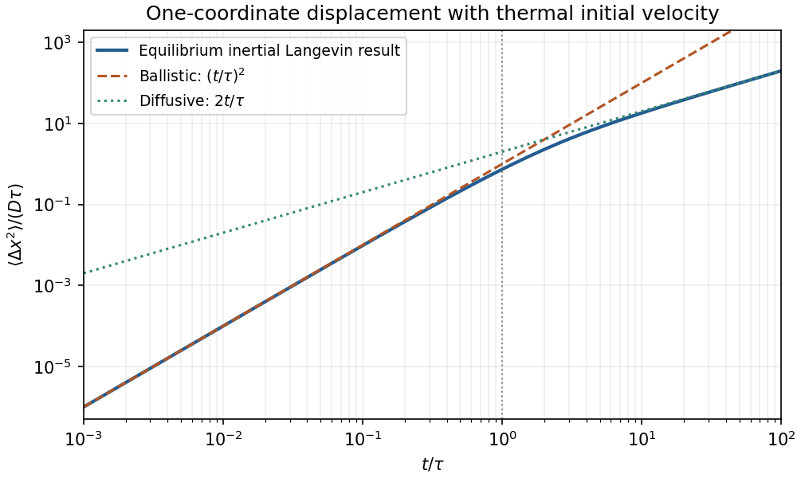

<h1 id="2/a/solution">Solution</h1>

↑ **Parent:** [A](../a.md)

For one Cartesian [velocity](../../../../../velocity.md) component of a free Brownian particle, the inertial [Langevin equation](../../../../../langevin-dynamics.md) is

$$
m\dot v=-\zeta v+\xi(t),\qquad
\langle\xi(t)\rangle=0,\qquad
\langle\xi(t)\xi(t')\rangle=2\zeta k_BT\delta(t-t').
$$

The random [force](../../../../../force-split.md) and viscous drag obey the fluctuation-dissipation relation. With a [thermal equilibrium](../../../../../thermal-equilibrium-split.md) [velocity](../../../../../velocity.md) distribution, the [relaxation time](../../../../../relaxation-time.md) is $\tau=m/\zeta$ and

$$
\langle v(t)v(0)\rangle=\frac{k_BT}{m}e^{-|t|/\tau}.
$$

Integrating [velocity](../../../../../velocity.md) twice gives

$$
\boxed{\langle[x(t)-x(0)]^2\rangle
=2\frac{k_BT}{\zeta}\left[t-\tau(1-e^{-t/\tau})\right].}
$$

For $t\gg\tau$, this is Einstein's [diffusion](../../../../../diffusion.md) law, $\langle\Delta x^2\rangle=2Dt$, with **$D=k_BT/\zeta$**. In three dimensions $\langle|\Delta\mathbf r|^2\rangle=6Dt$. At $t\ll\tau$ the motion is ballistic, $\langle\Delta x^2\rangle\simeq(k_BT/m)t^2$. A sphere in the Stokes-drag regime has $\zeta=6\pi\eta a$, giving $D=k_BT/(6\pi\eta a)$.

**[Figure 2](#2/a/image-original-equilibrium-langevin-mean-square-displacement-showing-the-ballistic-to-diffusive-crossover-and-the-factor-of-two-one-coordinate-diffusion-convention). Original equilibrium Langevin mean-square displacement, showing the ballistic-to-diffusive crossover and the factor-of-two one-coordinate diffusion convention**.

## ↑ Ancestors (14)

1. [A](../a.md)
2. [2](../../2.md)
3. [Paper 1](../../../paper-1-split.md)
4. [2014](../../../split.md)
5. [Past exam of the thermal and statistical physics course of the University of Cambridge](../../../../split.md)
6. [Thermal and Statistical Physics course of the University of Cambridge](../../../../../thermal-and-statistical-physics-course-of-the-university-of-cambridge.md)
7. [Physics course of the year 3 of the natural sciences course of the University of Cambridge](../../../../../physics-course-of-the-year-3-of-the-natural-sciences-course-of-the-university-of-cambridge.md)
8. [Year 3 of the natural sciences course of the University of Cambridge](../../../../../year-3-of-the-natural-sciences-course-of-the-university-of-cambridge.md)
9. [Year of the natural sciences course of the University of Cambridge](../../../../../year-of-the-natural-sciences-course-of-the-university-of-cambridge.md)
10. [Natural sciences course of the University of Cambridge](../../../../../natural-sciences-course-of-the-university-of-cambridge.md)
11. [Course of the University of Cambridge](../../../../../course-of-the-university-of-cambridge.md)
12. [University of Cambridge](../../../../../university-of-cambridge-split.md)
13. [List of universities](../../../../../list-of-universities.md)
14. [Codex Wiki](../../../../../split.md)
