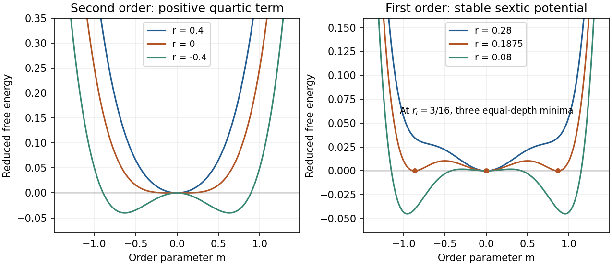

<h1 id="2/b/solution">Solution</h1>

↑ **Parent:** [B](../b.md)

[Landau theory](../../../../../landau-theory.md) expands the [free energy](../../../../../thermodynamic-free-energy.md) in an [order parameter](../../../../../order-parameter.md). For a scalar with sign-reversal symmetry and zero [conjugate field](../../../../../field-conjugate-to-an-order-parameter.md), a useful [sextic even Landau potential](../../../../../sextic-even-landau-potential.md) is

$$
f(m)=f_0+\frac r2m^2+\frac b4m^4+\frac c6m^6,
\qquad r=a(T-T_0),\quad a,c>0.
$$

Equilibrium selects the [global minimum](../../../../../global-minimum.md); other local minima can be metastable.

For $b>0$, the minimum changes continuously from $m=0$ to $m\simeq\pm\sqrt{-r/b}$ as $r$ passes below zero. This is a second-order transition at $T_0$: the [order parameter](../../../../../order-parameter.md) is continuous, there is no [latent heat](../../../../../latent-heat.md), and thermodynamic derivatives such as [heat capacity](../../../../../heat-capacity.md) can be discontinuous.

For $b<0$, the sixth-order term stabilizes the [free energy](../../../../../thermodynamic-free-energy.md). Equality of the ordered and disordered minima, together with $f'(m)=0$, gives

$$
\boxed{m_t^2=-\frac{3b}{4c},\qquad r_t=\frac{3b^2}{16c}>0.}
$$

The [order parameter](../../../../../order-parameter.md) jumps at $T_t=T_0+r_t/a$. The [entropy](../../../../../entropy-split.md) generally jumps too, giving [latent heat](../../../../../latent-heat.md); metastable branches and barriers permit [hysteresis](../../../../../hysteresis.md), though equilibrium coexistence itself does not require [hysteresis](../../../../../hysteresis.md). The special case $b=0$ is tricritical. Mean-field exponents can fail where fluctuations dominate.

**[Figure 3](#2/b/image-original-even-landau-free-energy-curves-continuous-quartic-ordering-and-sextic-first-order-coexistence-with-separated-equal-depth-minima). Original even Landau free-energy curves: continuous quartic ordering and sextic first-order coexistence with separated equal-depth minima**.

## ↑ Ancestors (14)

1. [B](../b.md)
2. [2](../../2.md)
3. [Paper 1](../../../paper-1-split.md)
4. [2014](../../../split.md)
5. [Past exam of the thermal and statistical physics course of the University of Cambridge](../../../../split.md)
6. [Thermal and Statistical Physics course of the University of Cambridge](../../../../../thermal-and-statistical-physics-course-of-the-university-of-cambridge.md)
7. [Physics course of the year 3 of the natural sciences course of the University of Cambridge](../../../../../physics-course-of-the-year-3-of-the-natural-sciences-course-of-the-university-of-cambridge.md)
8. [Year 3 of the natural sciences course of the University of Cambridge](../../../../../year-3-of-the-natural-sciences-course-of-the-university-of-cambridge.md)
9. [Year of the natural sciences course of the University of Cambridge](../../../../../year-of-the-natural-sciences-course-of-the-university-of-cambridge.md)
10. [Natural sciences course of the University of Cambridge](../../../../../natural-sciences-course-of-the-university-of-cambridge.md)
11. [Course of the University of Cambridge](../../../../../course-of-the-university-of-cambridge.md)
12. [University of Cambridge](../../../../../university-of-cambridge-split.md)
13. [List of universities](../../../../../list-of-universities.md)
14. [Codex Wiki](../../../../../split.md)
