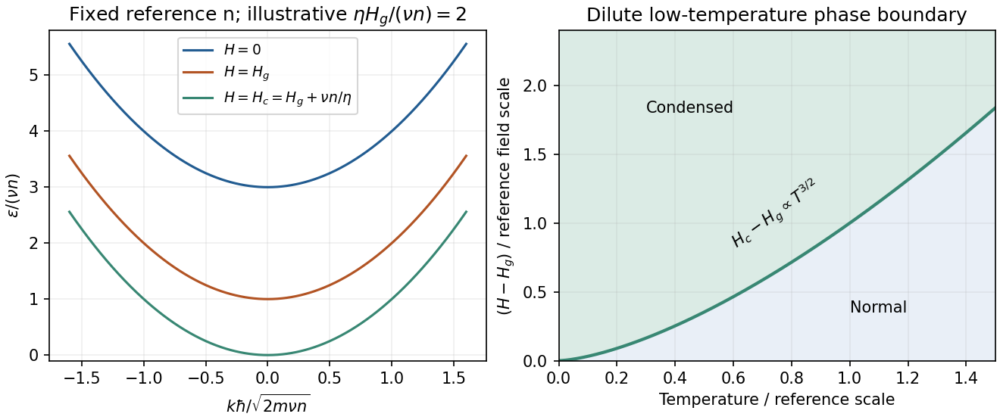

<h1 id="3/solution">Solution</h1>

↑ **Parent:** [3](../3.md)

For a single quantum state, the equilibrium occupations are

$$
\boxed{\bar n_F(\epsilon)=\frac1{e^{(\epsilon-\mu)/(k_BT)}+1},\qquad
\bar n_B(\epsilon)=\frac1{e^{(\epsilon-\mu)/(k_BT)}-1}.}
$$

Both reduce to $e^{(\mu-\epsilon)/(k_BT)}$ when $\epsilon-\mu\gg k_BT$.

For one three-dimensional quadratic branch, the [density of states](../../../../density-of-states.md) per unit [volume](../../../../volume.md) is

$$
g(\epsilon)=\frac1{4\pi^2}\left(\frac{2m}{\hbar^2}\right)^{3/2}\sqrt\epsilon.
$$

With $\lambda_T=\sqrt{2\pi\hbar^2/(mk_BT)}$, changing integration variable to $x=\epsilon/(k_BT)$ gives

$$
\boxed{n_{\rm ex}(\mu=0)=\frac{\zeta(3/2)}{\lambda_T^3}\propto T^{3/2},\qquad
n_{\rm classical}=\frac{e^{\mu/(k_BT)}}{\lambda_T^3}.}
$$

A degeneracy factor multiplies both [densities](../../../../density.md) if additional equivalent branches are present. The first expression is the noncondensed [density](../../../../density.md): a macroscopically occupied [ground state](../../../../ground-state.md) must be counted separately.

[Bose-Einstein condensation](../../../../bose-einstein-condensation.md) occurs when the [excited states](../../../../excited-state.md) can no longer hold all particles and the ground-state occupation becomes macroscopic. At fixed total [density](../../../../density.md),

$$
\boxed{T_c=\frac{2\pi\hbar^2}{mk_B}
\left[\frac{n}{\zeta(3/2)}\right]^{2/3}\propto n^{2/3}.}
$$

For [field-induced triplon condensation](../../../../field-induced-triplon-condensation.md), write $\Delta=\nu n-\eta(H-H_g)$, so $\epsilon(k)=\hbar^2k^2/(2m)+\Delta$. At fixed reference $n$, the three requested dispersions have gaps $\nu n+\eta H_g$, $\nu n$ and zero respectively. Their curvature is unchanged. Because the actual thermodynamic [chemical potential](../../../../chemical-potential-split.md) is zero, the Bose distribution requires $\Delta\ge0$. At $H_c=H_g+\nu n/\eta$, the minimum reaches zero and the noncondensed population saturates, permitting macroscopic occupation.

For the [triplon condensation field scaling](../../../../triplon-condensation-field-scaling.md), the critical [density](../../../../density.md) at onset is $n_T=\zeta(3/2)/\lambda_T^3$. Therefore

$$
\boxed{H_c(T)-H_g=\frac{\nu}{\eta}\zeta(3/2)
\left(\frac{mk_BT}{2\pi\hbar^2}\right)^{3/2}\propto T^{3/2}.}
$$

The low-temperature [phase](../../../../phase-waves.md) boundary rises from $(T,H)=(0,H_g)$; the condensed [phase](../../../../phase-waves.md) lies on the higher-field side.

**[Figure 4](#3/image-original-shifted-parabola-triplon-dispersions-and-low-temperature-field-temperature-phase-diagram-model-choices-are-dimensionless-and-illustrative). Original shifted-parabola triplon dispersions and low-temperature field–temperature phase diagram; model choices are dimensionless and illustrative**.

For $H>H_c$, simply continuing the gap below zero would give unphysical Bose occupations. For the [condensate density in a shifted-parabola triplon model](../../../../condensate-density-in-a-shifted-parabola-triplon-model.md), added [condensate density](../../../../condensate-density.md) keeps the minimum at zero: $\nu(n_0+n_T)=\eta(H-H_g)$. At fixed [temperature](../../../../temperature-split.md) this gives

$$
\boxed{n_0=\frac{\eta}{\nu}[H-H_c(T)]\quad(H>H_c),}
$$

with $n_0=0$ below onset. At zero [temperature](../../../../temperature-split.md) it becomes $n_0=\eta(H-H_g)/\nu$ within that model.

This prefactor is conditional on continuing the stated single-density mean-field shift into the condensed [phase](../../../../phase-waves.md). A microscopic interacting Bose condensate has collective Bogoliubov excitations $E_k=\sqrt{\epsilon_k^0(\epsilon_k^0+2g n_0)}$, with $\epsilon_k^0=\hbar^2k^2/(2m)$, which are linear at small $k$. The normal-state shift alone does not fix the condensed interaction closure or identify $g$ with $\nu$. **The gap closes and the [condensate density](../../../../condensate-density.md) grows linearly with excess field in the simple mean-field description; the detailed collective dispersion needs that additional interaction model.** A dilute-boson treatment of field-induced magnetic ordering makes this normal/condensed distinction explicitly.[arXiv:cond-mat/9908118v1, equations (4)–(9): normal Hartree-Fock shift, T^(3/2) onset and gapless condensed spectrum](../../../../bose-einstein-condensation-of-dilute-magnons-in-tlcucl3-by-tetsuro-nikuni-and-others.md)

## ↑ Ancestors (13)

1. [3](../3.md)
2. [Paper 1](../../paper-1-split.md)
3. [2014](../../split.md)
4. [Past exam of the thermal and statistical physics course of the University of Cambridge](../../../split.md)
5. [Thermal and Statistical Physics course of the University of Cambridge](../../../../thermal-and-statistical-physics-course-of-the-university-of-cambridge.md)
6. [Physics course of the year 3 of the natural sciences course of the University of Cambridge](../../../../physics-course-of-the-year-3-of-the-natural-sciences-course-of-the-university-of-cambridge.md)
7. [Year 3 of the natural sciences course of the University of Cambridge](../../../../year-3-of-the-natural-sciences-course-of-the-university-of-cambridge.md)
8. [Year of the natural sciences course of the University of Cambridge](../../../../year-of-the-natural-sciences-course-of-the-university-of-cambridge.md)
9. [Natural sciences course of the University of Cambridge](../../../../natural-sciences-course-of-the-university-of-cambridge.md)
10. [Course of the University of Cambridge](../../../../course-of-the-university-of-cambridge.md)
11. [University of Cambridge](../../../../university-of-cambridge-split.md)
12. [List of universities](../../../../list-of-universities.md)
13. [Codex Wiki](../../../../split.md)
