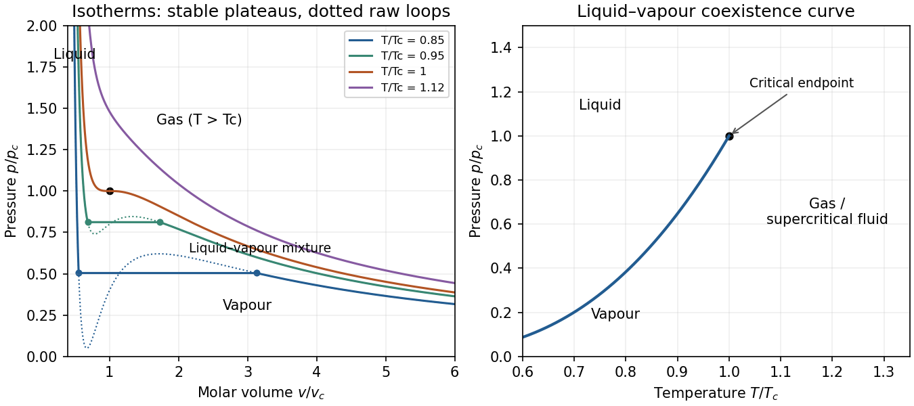

<h1 id="4/solution">Solution</h1>

↑ **Parent:** [4](../4.md)

Use $v$ for molar [volume](../../../../volume.md) to distinguish it from the fluctuating parcel [volume](../../../../volume.md) below. The equation is $p=RT/(v-b)-a/v^2$. The parameter $b>0$ models excluded [volume](../../../../volume.md), while $a>0$ models the reduction in pressure from attractive interactions.

Below the [critical temperature](../../../../critical-temperature.md), a raw isotherm has a loop. The positive-slope segment is mechanically unstable and surrounding metastable portions do not give the stable equilibrium mixture. Replace the loop by a constant coexistence pressure $p_s$ satisfying the Maxwell equal-area condition,

$$
\int_{v_l}^{v_g}[p(v,T)-p_s],dv=0.
$$

The endpoints are liquid and vapour molar [volumes](../../../../volume.md); intermediate mean [volumes](../../../../volume.md) correspond to [phase](../../../../phase-waves.md) mixtures with changing proportions. Above the [critical temperature](../../../../critical-temperature.md), liquid-like and gas-like states connect continuously without a coexistence plateau.

**[Figure 5](#4/image-original-reduced-van-der-waals-isotherms-with-computed-maxwell-coexistence-plateaus-and-the-pressure-temperature-coexistence-curve-ending-at-the-critical-point). Original reduced van der Waals isotherms with computed Maxwell coexistence plateaus and the pressure–temperature coexistence curve ending at the critical point**.

In the pressure-temperature diagram, the liquid-vapour coexistence line ends at the [critical point](../../../../critical-point.md). Below it, the low-pressure side is vapour and the high-pressure side liquid. “Gas” conventionally denotes the region above the [critical temperature](../../../../critical-temperature.md), where compression alone cannot cross a liquid-vapour transition. The model has no solid [phase](../../../../phase-waves.md).

The critical isotherm has an inflection: $p_v=p_{vv}=0$. Thus

$$
-\frac{RT_c}{(v_c-b)^2}+\frac{2a}{v_c^3}=0,\qquad
\frac{2RT_c}{(v_c-b)^3}-\frac{6a}{v_c^4}=0,
$$

which give

$$
\boxed{v_c=3b,\qquad T_c=\frac{8a}{27Rb},\qquad p_c=\frac{a}{27b^2}.}
$$

For fluctuations about a stable equilibrium value $x_0$, the system plus reservoir has probability proportional to $e^{-A(x)/(k_BT)}$. Expanding [availability](../../../../exergy.md),

$$
A(x)=A(x_0)+\frac12 A''(x_0)(x-x_0)^2+\cdots,
$$

gives a [Gaussian distribution](../../../../normal-distribution.md) and, to this order, $\langle x\rangle=x_0$ with

$$
\boxed{\langle(x-\langle x\rangle)^2\rangle\simeq\frac{k_BT}{A''(x_0)}.}
$$

This requires positive curvature and sufficiently small fluctuations; it is not exact when higher-order terms matter.

The whole cylinder's [volume](../../../../volume.md) is fixed. For the [volume fluctuations of a small fluid parcel](../../../../volume-fluctuations-of-a-small-fluid-parcel.md), interpret the small quantity as a material parcel containing $s$ [moles](../../../../mole-unit.md), whose [volume](../../../../volume.md) can fluctuate against the much larger remainder. Its mean [volume](../../../../volume.md) at the critical [density](../../../../density.md) is $\bar V=s v_c=3sb$. At fixed [temperature](../../../../temperature-split.md) its [availability](../../../../exergy.md) is $A(V)=F_s(V,T)+p_{\rm bath}V$, so

$$
A_{VV}=-\left(\frac{\partial p}{\partial V}\right)_{T,s}
=-\frac1s\left(\frac{\partial p}{\partial v}\right)_T.
$$

On the critical isochore, approached from $T>T_c$,

$$
\left(\frac{\partial p}{\partial v}\right)_{v_c,T}
=-\frac{R(T-T_c)}{4b^2}.
$$

Consequently

$$
\boxed{\langle\delta V^2\rangle
\simeq\frac{4k_Bs b^2T}{R(T-T_c)}
=\frac{4k_B b\bar V T}{3R(T-T_c)}.}
$$

Equivalently, $\langle\delta V^2\rangle=k_BT\kappa_T\bar V$, with $\kappa_T=4b/[3R(T-T_c)]$. **The mean-field [variance](../../../../variance-split.md) diverges as $(T-T_c)^{-1}$, so its [critical exponent](../../../../critical-exponent.md) is $1$**; the root-mean-square fluctuation has exponent $1/2$. A fixed spatial observation box instead has number fluctuations, not fluctuating geometric [volume](../../../../volume.md). Finite size and non-Gaussian terms cut off the literal divergence; the approximation fails exactly at the [critical point](../../../../critical-point.md).

## ↑ Ancestors (13)

1. [4](../4.md)
2. [Paper 1](../../paper-1-split.md)
3. [2014](../../split.md)
4. [Past exam of the thermal and statistical physics course of the University of Cambridge](../../../split.md)
5. [Thermal and Statistical Physics course of the University of Cambridge](../../../../thermal-and-statistical-physics-course-of-the-university-of-cambridge.md)
6. [Physics course of the year 3 of the natural sciences course of the University of Cambridge](../../../../physics-course-of-the-year-3-of-the-natural-sciences-course-of-the-university-of-cambridge.md)
7. [Year 3 of the natural sciences course of the University of Cambridge](../../../../year-3-of-the-natural-sciences-course-of-the-university-of-cambridge.md)
8. [Year of the natural sciences course of the University of Cambridge](../../../../year-of-the-natural-sciences-course-of-the-university-of-cambridge.md)
9. [Natural sciences course of the University of Cambridge](../../../../natural-sciences-course-of-the-university-of-cambridge.md)
10. [Course of the University of Cambridge](../../../../course-of-the-university-of-cambridge.md)
11. [University of Cambridge](../../../../university-of-cambridge-split.md)
12. [List of universities](../../../../list-of-universities.md)
13. [Codex Wiki](../../../../split.md)
