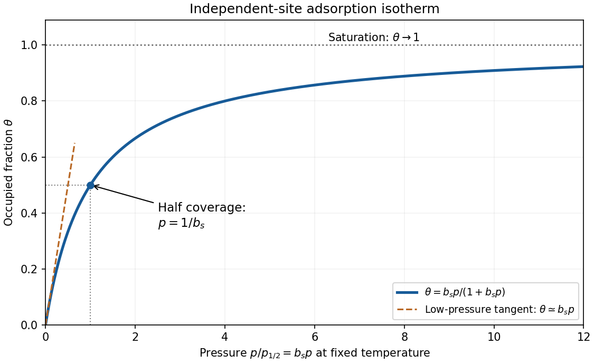
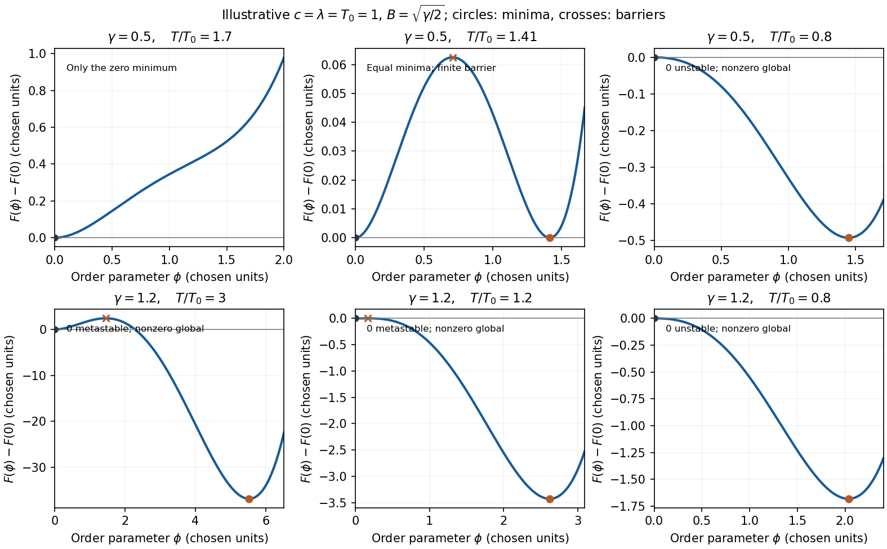

# Paper 1

↑ **Parent:** [2015](../2015.md)

Original source: [Released examination PDF, physical pages 335–338](https://www.whatdotheyknow.com/request/natural_science_tripos_physics_e_2/response/2340776/attach/2/FOI%202023%20399%20Zahid%20materials.pdf?cookie_passthrough=1#page=335). All three note alternatives and both longer questions are treated.

**Table of contents**

- [1](#1)
  - [a](#1/a)
    - [Solution](#1/a/solution)
  - [b](#1/b)
    - [Solution](#1/b/solution)
  - [c](#1/c)
    - [Solution](#1/c/solution)
- [2](#2)
  - [a](#2/a)
    - [Solution](#2/a/solution)
  - [b](#2/b)
    - [Solution](#2/b/solution)
  - [c](#2/c)
    - [Solution](#2/c/solution)
- [3](#3)
  - [Solution](#3/solution)
- [4](#4)
  - [Solution](#4/solution)

## 1

↑ **Parent:** [Paper 1](paper-1.md)

<h3 id="1/a">a</h3>

↑ **Parent:** [1](#1)

<h4 id="1/a/solution">Solution</h4>

↑ **Parent:** [A](#1/a)

For a [canonical ensemble](../../canonical-ensemble.md), $F=-k_BT\ln Z$ and $p=-(\partial F/\partial V)_{T,N}=k_BT(\partial_V\ln Z)_{T,N}$. The kinetic and [factorial](../../combinatorics.md#factorial) factors do not depend on $V$, so differentiating only the volume-dependent terms gives

$$
p=k_BT\left[\frac{N}{V-Nb}-\frac{aN^2}{k_BTV^2}\right].
$$

Thus the [equation of state](../../pressure.md#equation-of-state) is

$$
\boxed{\left(p+\frac{aN^2}{V^2}\right)(V-Nb)=Nk_BT},
\qquad V>Nb.
$$

The excluded-volume correction raises [pressure](../../pressure.md) relative to the same gas without that correction; the attractive mean-field term lowers it. No [Stirling formula](../../real-analysis.md#stirling-formula) is required for this [derivative](../../calculus.md#derivative).

<h3 id="1/b">b</h3>

↑ **Parent:** [1](#1)

<h4 id="1/b/solution">Solution</h4>

↑ **Parent:** [B](#1/b)

Differentiate the Euler relation for a single-component [simple compressible system](../../thermodynamics.md#simple-compressible-system):

$$
dU=T\,dS+S\,dT-p\,dV-V\,dp+\mu\,dN+N\,d\mu.
$$

The thermodynamic fundamental relation for the same system is $dU=T\,dS-p\,dV+\mu\,dN$. Subtraction gives

$$
S\,dT-V\,dp+N\,d\mu=0.
$$

Dividing by $N$, with $s=S/N$ and $v=V/N$, proves the [Gibbs-Duhem equation](../../thermodynamics.md#gibbs-duhem-equation)

$$
\boxed{d\mu=-s\,dT+v\,dp}.
$$

The underlying Euler relation assumes extensive bulk thermodynamics and no additional work coordinates. The result says that the intensive quantities are constrained; the [chemical potential](../../chemical-potential.md) cannot be varied independently of [temperature](../../temperature.md) and [pressure](../../pressure.md) within one homogeneous phase.

<h3 id="1/c">c</h3>

↑ **Parent:** [1](#1)

<h4 id="1/c/solution">Solution</h4>

↑ **Parent:** [C](#1/c)

Let $E$ denote the fluctuating microscopic [energy](../../energy.md) and $U=\langle E\rangle$ its mean, at fixed $N,V$. In a [canonical ensemble](../../canonical-ensemble.md) with $\beta=1/(k_BT)$,

$$
U=-\partial_\beta\ln Z,\qquad
\partial_\beta^2\ln Z=\langle E^2\rangle-\langle E\rangle^2.
$$

Since $dT/d\beta=-k_BT^2$, this gives

$$
\boxed{\langle(\Delta U)^2\rangle=-\partial_\beta U
=k_BT^2\left(\frac{\partial U}{\partial T}\right)_{V,N}
=k_BT^2C_V}.
$$

Here $\Delta U$ denotes an [energy](../../energy.md) fluctuation about the mean, as in the question. The relation is not restricted to ideal gases when the [Hamiltonian operator](../../quantum-system.md#hamiltonian-quantum-mechanics) has no explicit [temperature](../../temperature.md) dependence. Alternatively, the stated equilibrium free-energy curvature gives a Gaussian [energy](../../energy.md) weight proportional to $\exp[-(\Delta U)^2/(2k_BT^2C_V)]$, with the same [variance](../../variance.md).

For the [relative energy fluctuation of a monatomic ideal gas](../../canonical-ensemble.md#relative-energy-fluctuation-of-a-monatomic-ideal-gas), $U=3Nk_BT/2$ and $C_V=3Nk_B/2$, hence

$$
\frac{\sqrt{\langle(\Delta U)^2\rangle}}{U}
=\boxed{\sqrt{\frac{2}{3N}}}.
$$

Taking room conditions as approximately $T=300$ K and $p=10^5$ Pa, with $V=10^{-6}$ m$^3$, gives

$$
N=\frac{pV}{k_BT}\simeq2.41\times10^{19},\qquad
\boxed{\frac{\sigma_U}{U}\simeq1.66\times10^{-10}}.
$$

The mean [energy](../../energy.md) is about $0.15$ J and its [standard deviation](../../variance.md#standard-deviation) about $2.49\times10^{-11}$ J. The tiny relative fluctuation explains why macroscopic equilibrium [internal energy](../../internal-energy.md) behaves as a sharply defined thermodynamic quantity. The estimate uses a [thermal reservoir](../../thermal-equilibrium.md#heat-bath), not a particle reservoir; allowing $N$ itself to fluctuate changes the relevant fluctuation problem.

## 2

↑ **Parent:** [Paper 1](paper-1.md)

<h3 id="2/a">a</h3>

↑ **Parent:** [2](#2)

<h4 id="2/a/solution">Solution</h4>

↑ **Parent:** [A](#2/a)

A non-ideal gas departs from $p=nk_BT$ because interactions and finite particle size affect its [pressure](../../pressure.md). At sufficiently low [number density](../../statistical-physics.md#number-density) $n=N/V$, the [virial expansion](../../statistical-physics.md#virial-expansion) separates these corrections:

$$
\boxed{\frac{p}{nk_BT}=1+B_2(T)n+B_3(T)n^2+\cdots}.
$$

The [second virial coefficient](../../statistical-physics.md#second-virial-coefficient) has dimensions of [volume](../../geometry-and-topology.md#volume) per particle, while $B_3$ has dimensions of [volume](../../geometry-and-topology.md#volume) squared. These are density-series coefficients, not the coefficients of a pressure-series expansion with the same names.

For classical particles interacting through a [pair potential](../../statistical-physics.md#pair-potential) $u(r)$,

$$
B_2(T)=2\pi\int_0^\infty[1-e^{-u(r)/(k_BT)}]r^2\,dr.
$$

Repulsion contributes positively and attraction negatively. A hard core of diameter $d$ gives $B_2=2\pi d^3/3$, four times the geometric [volume](../../geometry-and-topology.md#volume) of one sphere. The factor reflects the [volume](../../geometry-and-topology.md#volume) excluded to the centre of a second particle together with pair counting; it is not simply the occupied geometric [volume](../../geometry-and-topology.md#volume).

Expanding the [Van der Waals equation](../../pressure.md#van-der-waals-equation) at $nb\ll1$ gives

$$
\frac p{nk_BT}=\frac1{1-nb}-\frac{an}{k_BT}
=1+\left(b-\frac a{k_BT}\right)n+b^2n^2+\cdots.
$$

The [virial coefficients of the van der Waals gas](../../statistical-physics.md#virial-coefficients-of-the-van-der-waals-gas) are therefore $B_2=b-a/(k_BT)$ and $B_3=b^2$. The [Boyle temperature](../../statistical-physics.md#boyle-temperature), $T_B=a/(k_Bb)$, makes the leading correction vanish, but does not remove the higher coefficients or turn the gas exactly ideal. More realistic potentials give temperature-dependent higher coefficients that need not equal the van der Waals values.

A useful measurement is a sequence of dilute isothermal [pressure](../../pressure.md)–[volume](../../geometry-and-topology.md#volume) observations. Plotting $[p/(nk_BT)-1]/n$ against $n$ exposes $B_2$ as the zero-density intercept and $B_3$ as its initial slope. Control [temperature](../../temperature.md) and density calibration, check equilibration and [adsorption](../../physical-chemistry.md#adsorption) on the container walls, and vary the fitted density interval to test truncation error. One measured virial coefficient cannot uniquely reconstruct the [pair potential](../../statistical-physics.md#pair-potential). Near coexistence or a [critical point](../../analysis.md#critical-point) a short density series may fail, and at quantum-degenerate densities exchange statistics add corrections even without interactions.

<h3 id="2/b">b</h3>

↑ **Parent:** [2](#2)

<h4 id="2/b/solution">Solution</h4>

↑ **Parent:** [B](#2/b)

[Bose-Einstein condensation](../../quantum-ideal-gas-statistics.md#bose-einstein-condensation) is macroscopic occupation of the lowest [one-particle state](../../quantum-field-theory.md#one-particle-state). It is a change in occupation statistics, not ordinary liquid formation and not a requirement that all atoms occupy one spatial point. For ideal [bosons](../../tensor-product-of-quantum-systems.md#boson),

$$
\overline n_{\mathbf k}=\frac1{\exp[(\epsilon_{\mathbf k}-\mu)/(k_BT)]-1}.
$$

Set the lowest one-particle [energy](../../energy.md) to zero. Then $\mu\leq0$, and the population of excited states in a uniform three-dimensional box is

$$
N_{\rm ex}=\frac V{\lambda^3}g_{3/2}(z),\qquad
z=e^{\mu/(k_BT)}\leq1,\qquad
\lambda=\sqrt{\frac{2\pi\hbar^2}{mk_BT}}.
$$

Here $g_s(z)=\sum_{j\geq1}z^j/j^s$. As $\mu$ approaches zero, the excited-state population saturates at $V\zeta(3/2)/\lambda^3$. Any excess particles occupy the [ground state](../../quantum-mechanics.md#ground-state). In the [thermodynamic limit](../../statistical-physics.md#thermodynamic-limit),

$$
\boxed{T_c=\frac{2\pi\hbar^2}{mk_B}
\left[\frac{n}{\zeta(3/2)}\right]^{2/3}},\qquad
\boxed{\frac{N_0}{N}=1-\left(\frac T{T_c}\right)^{3/2}\quad(T<T_c)}.
$$

Thus the onset occurs when the [thermal de Broglie wavelength](../../canonical-ensemble.md#thermal-de-broglie-wavelength) is comparable to the mean interparticle spacing. At finite $N$, the [chemical potential](../../chemical-potential.md) remains slightly below the ground-state [energy](../../energy.md); setting it equal to zero is a thermodynamic-limit statement.

The 1995 [rubidium](../../chemical-substance.md#rubidium) experiment used magnetic confinement and [evaporative cooling of atoms](../../atomic-physics.md#evaporative-cooling-atomic-physics). Absorption images after trap manipulation revealed a narrow, anisotropically expanding component superposed on the broader thermal distribution; the new component grew as cooling proceeded. The thermal component supplied an internal comparison through the same imaging optics. Trap decompression and release geometry mattered, and finite imaging resolution and interactions limited direct comparison with an ideal-gas [ground state](../../quantum-mechanics.md#ground-state).[Science 269, pp. 198–201, experimental preparation and velocity distributions](../../physics-bibliography.md#observation-of-bose-einstein-condensation-in-a-dilute-atomic-vapor-by-m-h-anderson-and-others)

A narrow cloud alone is not sufficient evidence. One should check its emergence across a controlled cooling sequence, atom-number and [temperature](../../temperature.md) calibration, the thermal background and the predicted expansion anisotropy. These are tests of an occupation transition rather than a simple focusing artifact. The box formula above is not the exact critical-temperature or condensate-fraction formula for the trapped experiment: the trap changes the [density of states](../../quantum-ideal-gas-statistics.md#density-of-states), and interactions also matter. Condensation and superfluid response are related but distinct properties; the former definition is ground-state occupation.

<h3 id="2/c">c</h3>

↑ **Parent:** [2](#2)

<h4 id="2/c/solution">Solution</h4>

↑ **Parent:** [C](#2/c)

The [Fermi-Dirac distribution](../../quantum-ideal-gas-statistics.md#fermi-dirac-distribution) gives the mean occupancy of a single [fermion](../../tensor-product-of-quantum-systems.md#fermion) state:

$$
\boxed{f(\epsilon)=\frac1{e^{(\epsilon-\mu)/(k_BT)}+1}}.
$$

Its maximum occupancy of one expresses the [Pauli exclusion principle](../../tensor-product-of-quantum-systems.md#pauli-exclusion-principle). A spatial orbital with two [spin](../../angular-momentum-operator.md#spin) states can hold two [electrons](../../physics.md#electron) because they are different single-particle states. At zero [temperature](../../temperature.md), the occupation is a step at the [Fermi energy](../../quantum-ideal-gas-statistics.md#fermi-energy) $E_F$; at low nonzero [temperature](../../temperature.md), occupation changes appreciably only in an [energy](../../energy.md) shell of width of order $k_BT$ about the [chemical potential](../../chemical-potential.md).

Consequently, most conduction [electrons](../../physics.md#electron) cannot absorb small thermal [energies](../../energy.md) into already occupied states. Only a fraction of order $T/T_F$ participates, where $T_F=E_F/k_B$. For a normal [metal](../../chemical-substance.md#metal) with a smooth [density of states](../../quantum-ideal-gas-statistics.md#density-of-states) $g(E_F)$, including both [spin](../../angular-momentum-operator.md#spin) states and using the total-system normalization, the [Sommerfeld expansion](../../quantum-ideal-gas-statistics.md#sommerfeld-expansion) at fixed [particle number](../../physics.md#particle-number) gives

$$
U(T)-U(0)=\frac{\pi^2}{6}g(E_F)(k_BT)^2+O(T^4),
$$

and therefore

$$
\boxed{C_{\rm el}=\gamma_{\rm el}T,\qquad
\gamma_{\rm el}=\frac{\pi^2}{3}k_B^2g(E_F)}.
$$

For a three-dimensional [free electron gas](../../physics.md#free-electron-model), $g(E_F)=3N/(2E_F)$, so $C_{\rm el}=(\pi^2/2)Nk_B(T/T_F)$. This is much smaller than a classical equipartition estimate at $T\ll T_F$. The [chemical potential](../../chemical-potential.md) must adjust with [temperature](../../temperature.md) to maintain $N$; treating it as fixed while differentiating an [energy](../../energy.md) [integral](../../integral.md) gives the wrong fixed-$N$ calculation in general.

The lattice adds a Debye contribution $C_{\rm ph}=\beta_D T^3$ at [temperatures](../../temperature.md) well below the [Debye temperature](../../quantum-ideal-gas-statistics.md#debye-temperature). Hence

$$
\boxed{\frac CT\simeq\gamma_{\rm el}+\beta_D T^2}.
$$

A plot of measured $C/T$ against $T^2$ can separate the electronic intercept from the [phonon](../../quantum-ideal-gas-statistics.md#phonon) slope. [calorimetry](../../calorimetry.md) must account for the [heat capacity](../../heat.md#heat-capacity) of the sample holder, heat leaks, thermal equilibration and [thermometer](../../temperature.md#thermometer) calibration. A magnetic impurity contribution or a superconducting transition can invalidate this two-term fit; the prediction is for the normal metallic state in an appropriate low-temperature interval. Differences from a free-electron coefficient can reveal [quasiparticle](../../quantum-mechanics.md#quasiparticle) effective-mass enhancement or nontrivial electronic structure rather than a failure of Fermi statistics.

**[Figure 1](#2/c/image-original-ideal-box-condensate-fraction-and-fermi-dirac-occupation-curves). Original ideal-box condensate fraction and Fermi-Dirac occupation curves**.

## 3

↑ **Parent:** [Paper 1](paper-1.md)

<h3 id="3/solution">Solution</h3>

↑ **Parent:** [3](#3)

**Ensemble and applications.** A [grand canonical ensemble](../../statistical-physics.md#grand-canonical-ensemble) describes a system exchanging both [energy](../../energy.md) and particles with a large reservoir. Its fixed control parameters are $T,V,\mu$, while microstates with different $N$ have [probabilities](../../probability-theory.md#probability)

$$
P_r=\Xi^{-1}e^{-\beta(E_r-\mu N_r)},\qquad
\Xi=\sum_r e^{-\beta(E_r-\mu N_r)}.
$$

Weak coupling allows the system's [energy](../../energy.md) levels to remain meaningful; equilibrium fixes the reservoir [temperature](../../temperature.md) and [chemical potential](../../chemical-potential.md). The [grand potential](../../statistical-physics.md#grand-potential) is $\Phi=-k_BT\ln\Xi=U-TS-\mu N$, with $N$ now the mean population. It generates [entropy](../../entropy.md), [pressure](../../pressure.md) and mean [particle number](../../physics.md#particle-number) by differentiation. This ensemble is convenient for gases in contact with particle reservoirs, independently occupied quantum levels and surface [adsorption](../../physical-chemistry.md#adsorption); its particle-number fluctuations are part of the description, not an error in counting.

**Classical single-level limit.** For the [single-level grand partition function in the dilute limit](../../statistical-physics.md#single-level-grand-partition-function-in-the-dilute-limit), put $x_k=e^{-\beta(\epsilon_k-\mu)}$. Empty and singly occupied levels contribute $1$ and $x_k$. In the dilute classical limit $x_k\ll1$, higher occupancies contribute only at order $x_k^2$ or beyond:

$$
\boxed{\Xi_k=1+x_k+O(x_k^2)
\simeq1+\exp[-(\epsilon_k-\mu)/(k_BT)]}.
$$

This truncation does not impose the Pauli principle on a classical gas. A [fermion](../../tensor-product-of-quantum-systems.md#fermion) state has exactly $1+x_k$, a [boson](../../tensor-product-of-quantum-systems.md#boson) state has $(1-x_k)^{-1}$, and Maxwell-Boltzmann occupancy weights give $e^{x_k}$; they all agree to this order. In particular, $\ln\Xi_k=x_k+O(x_k^2)$, with the classical Maxwell-Boltzmann result exactly $x_k$.

**[grand potential](../../statistical-physics.md#grand-potential) and [chemical potential](../../chemical-potential.md).** With $z=e^{\beta\mu}$, summing the single-level [logarithms](../../calculus.md#logarithm) and using the stated [density of states](../../quantum-ideal-gas-statistics.md#density-of-states) gives

$$
\ln\Xi\simeq z\int_0^\infty g(\epsilon)e^{-\beta\epsilon}\,d\epsilon.
$$

Substitute $\epsilon=k_BTx^2$, for which

$$
\int_0^\infty\epsilon^{1/2}e^{-\beta\epsilon}\,d\epsilon
=2(k_BT)^{3/2}\int_0^\infty x^2e^{-x^2}dx
=\frac{\sqrt\pi}{2}(k_BT)^{3/2}.
$$

Combining this with the density-of-states prefactor gives $\ln\Xi=zV/\lambda^3$. Thus

$$
\boxed{\Phi=-k_BT\frac V{\lambda^3}e^{\mu/(k_BT)}}.
$$

Differentiating at fixed $T,V$,

$$
N=-\left(\frac{\partial\Phi}{\partial\mu}\right)_{T,V}
=\frac V{\lambda^3}e^{\mu/(k_BT)},
\qquad
\boxed{\mu=k_BT\ln\frac{N\lambda^3}{V}}.
$$

Similarly $p=-(\partial_V\Phi)_{T,\mu}=k_BTz/\lambda^3$, so $pV=Nk_BT$. This is the [grand-canonical chemical potential of a classical ideal gas](../../chemical-potential.md#grand-canonical-chemical-potential-of-a-classical-ideal-gas). The condition $N\lambda^3/V\ll1$ states the classical regime. The supplied [density of states](../../quantum-ideal-gas-statistics.md#density-of-states) counts one internal state; extra internal degeneracies would have to be included consistently rather than inserted at only one stage.

**One [adsorption](../../physical-chemistry.md#adsorption) site.** Take the free-vapour [energy](../../energy.md) reference as zero and the [binding energy](../../energy.md#binding-energy) as $-\epsilon$. A site is either empty or singly occupied; the latter has vibrational [partition function](../../canonical-ensemble.md#canonical-partition-function) $z_s(T)$. Its [adsorption-site grand partition function](../../physical-chemistry.md#adsorption-site-grand-partition-function) and mean occupation are

$$
\Xi_{\rm site}=1+z_s e^{\beta(\mu_s+\epsilon)},\qquad
\theta=\frac{z_s e^{\beta(\mu_s+\epsilon)}}
{1+z_s e^{\beta(\mu_s+\epsilon)}}.
$$

The [chemical potential of an adsorbed species on equivalent sites](../../physical-chemistry.md#chemical-potential-of-an-adsorbed-species-on-equivalent-sites) follows by inverting the occupation ratio

$$
\boxed{\mu_s=-\epsilon+k_BT\ln\frac{\theta}{(1-\theta)z_s}}.
$$

The factor $1-\theta$ is the vacant-site probability. The binding reference and the [energies](../../energy.md) included in $z_s$ must be chosen consistently, so that vibrational [zero-point energy](../../quantum-harmonic-oscillator.md#zero-point-energy) is not counted twice.

**Isotherm.** The [vibrational factor in a Langmuir equilibrium constant](../../physical-chemistry.md#vibrational-factor-in-a-langmuir-equilibrium-constant) is fixed by [adsorption](../../physical-chemistry.md#adsorption) equilibrium, $\mu_s=\mu_{\rm vap}$. Neglecting vapour internal degrees of freedom and writing its [number density](../../statistical-physics.md#number-density) as $p/(k_BT)$ gives $e^{\beta\mu_{\rm vap}}=p\lambda^3/(k_BT)$. Therefore

$$
b_s(T)=\frac{z_s(T)\lambda^3}{k_BT}e^{\epsilon/(k_BT)},\qquad
\boxed{\theta(p,T)=\frac{b_s(T)p}{1+b_s(T)p}}.
$$

This is the [Langmuir isotherm](../../physical-chemistry.md#langmuir-adsorption-model): initially linear, increasing monotonically and concave down, approaching unit coverage. Half coverage occurs at $p_{1/2}=1/b_s(T)$. The coefficient has inverse-pressure units. It assumes equivalent independent sites, at most one [molecule](../../molecule.md) per site and no lateral interaction or multilayer [adsorption](../../physical-chemistry.md#adsorption). The molecular mass appropriate to the vapour determines $\lambda$.

**[Figure 2](#3/image-original-dimensionless-langmuir-coverage-curve-with-half-coverage-and-limiting-behavior). Original dimensionless Langmuir coverage curve with half-coverage and limiting behavior**.

A real uptake measurement must separate adsorbed [molecules](../../molecule.md) from free gas in the apparatus. Langmuir's original mica experiment compared a mica-containing bulb with a similar blank and inferred uptake from calibrated gas [volumes](../../geometry-and-topology.md#volume) and [pressures](../../pressure.md). His stated blank contribution and bath-temperature drift limited the inferred [adsorption](../../physical-chemistry.md#adsorption); a saturating curve alone does not establish ideal equivalent sites.[pp. 1376–1378: mica apparatus and blank; p. 1385: limitations](../../chemistry-bibliography.md#the-adsorption-of-gases-on-plane-surfaces-of-glass-mica-and-platinum-by-irving-langmuir)

## 4

↑ **Parent:** [Paper 1](paper-1.md)

<h3 id="4/solution">Solution</h3>

↑ **Parent:** [4](#4)

**Landau description.** Introduce a macroscopic [order parameter](../../critical-phenomenon.md#order-parameter) and expand an appropriate [free energy](../../thermodynamic-potential.md#thermodynamic-free-energy) analytically in that parameter, retaining terms permitted by the physical symmetries. Stable equilibrium minimizes this [free energy](../../thermodynamic-potential.md#thermodynamic-free-energy) globally; a [local minimum](../../analysis.md#local-minimum) with larger [free energy](../../thermodynamic-potential.md#thermodynamic-free-energy) is metastable. Coefficient changes with [temperature](../../temperature.md) can exchange the preferred minima. A continuous emergence from zero can produce a continuous transition, while competing separated minima can produce a first-order transition. Stability requires a positive highest retained even-power term. This local mean-field description neglects spatial fluctuations and [nucleation](../../critical-phenomenon.md#nucleation) dynamics unless gradient and dynamical terms are added; near a [critical point](../../analysis.md#critical-point) those omissions can matter.

For this [temperature-dependent cubic-quartic Landau free energy](../../critical-phenomenon.md#temperature-dependent-cubic-quartic-landau-free-energy), abbreviate $B=a/(12\pi)>0$ and $A(T)=c(T^2-T_0^2)$, so $F=A\phi^2/2-BT\phi^3+\lambda\phi^4/4$ and $\gamma=2B^2/(\lambda c)$.

**Local behavior at the origin.** To determine [constrained order-parameter boundary stability](../../critical-phenomenon.md#constrained-order-parameter-boundary-stability), note that $F'(0)=0$ and $F''(0)=c(T^2-T_0^2)$, the origin is a [local minimum](../../analysis.md#local-minimum) for $T>T_0$ and a [local maximum](../../analysis.md#local-maximum) for $0\leq T<T_0$. At $T=T_0$, the quadratic term vanishes, but $F=-BT_0\phi^3+O(\phi^4)<0$ for small positive $\phi$. Therefore

$$
\boxed{\phi=0\text{ is locally stable for }T>T_0,\quad
\text{a one-sided <local maximum> for }0\leq T\leq T_0.}
$$

The equality case uses the stipulated domain $\phi\geq0$. On an unrestricted real line, the nonzero cubic term would instead make it a stationary inflection point.

**Global stability in both inline cases.** For $\phi>0$, complete the square in $F/\phi^2$:

$$
\frac{F}{\phi^2}
=\frac{\lambda}{4}\left(\phi-\frac{2BT}{\lambda}\right)^2
+\frac c2\left[(1-\gamma)T^2-T_0^2\right].
$$

The quartic coefficient guarantees a bounded [global minimum](../../analysis.md#global-minimum). A negative value exists precisely when the minimum of this quadratic factor is negative. Hence case a, $\gamma>1$, has a nonzero globally stable phase with $F<0$ for every physical [temperature](../../temperature.md). Case b, $0<\gamma<1$, has such a phase exactly for

$$
\boxed{T<T^*=\frac{T_0}{\sqrt{1-\gamma}}}.
$$

At $T=0$, the square's centre is at the boundary, but its negative constant still gives $F<0$ for small positive $\phi$, so this endpoint is included.

At $T=T^*$,

$$
F(\phi,T^*)=\frac{\lambda}{4}\phi^2(\phi-\phi^*)^2,\qquad
\boxed{\phi^*=\frac{2BT^*}{\lambda}=\frac{aT^*}{6\pi\lambda}}.
$$

The two global minima $\phi=0,\phi^*$ have equal [free energy](../../thermodynamic-potential.md#thermodynamic-free-energy), and $F''(\phi^*)=\lambda(\phi^*)^2/2>0$. The [coexistence barrier of a cubic-quartic Landau transition](../../critical-phenomenon.md#coexistence-barrier-of-a-cubic-quartic-landau-transition) has its maximum at $\phi^*/2$, with barrier height $\lambda(\phi^*)^4/64$.

For locating the extrema away from coexistence,

$$
\phi_\pm(T)=\frac{3BT\pm\sqrt{9B^2T^2-4\lambda c(T^2-T_0^2)}}{2\lambda}.
$$

Retain only real positive roots; when both are positive, $\phi_-$ is a [local maximum](../../analysis.md#local-maximum) and $\phi_+$ a [local minimum](../../analysis.md#local-minimum). For $T<T_0$, only $\phi_+$ is positive. If $\gamma<8/9$, the pair first appears on cooling at $T_{\rm sp}=T_0/\sqrt{1-9\gamma/8}>T^*$; if $8/9\leq\gamma<1$, a higher-free-energy nonzero minimum already exists at arbitrarily high [temperature](../../temperature.md). These local-stability limits must not be mistaken for the global coexistence condition. The boundary $\gamma=1$ also favors a nonzero minimum at every finite [temperature](../../temperature.md), but has no finite $T^*$.

**[Figure 3](#4/image-original-cubic-quartic-free-energy-curves-above-at-and-below-the-relevant-stability-regimes). Original cubic-quartic free-energy curves above, at and below the relevant stability regimes**.

**Cooling and transition [temperature](../../temperature.md).** For $\gamma<1$, equilibrium starts at the zero minimum at high [temperature](../../temperature.md) and switches to the nonzero minimum at $T^*$. The jump is finite, $0\to\phi^*>0$, and there is a barrier between the coexisting states. This is a first-order transition. The [latent heat of a temperature-dependent cubic-quartic Landau transition](../../critical-phenomenon.md#latent-heat-of-a-temperature-dependent-cubic-quartic-landau-transition) follows from differentiating the minimized [free energy](../../thermodynamic-potential.md#thermodynamic-free-energy): the heat released on cooling is

$$
L=T^*(S_0-S_+)
=c(1-\gamma)(T^*)^2(\phi^*)^2
=cT_0^2(\phi^*)^2>0.
$$

If $F$ is an [energy](../../energy.md) density rather than total [energy](../../energy.md), $L$ is likewise a density. An actual system can supercool below $T^*$ before [nucleation](../../critical-phenomenon.md#nucleation), so $T^*$ is the equilibrium transition [temperature](../../temperature.md).

For [thermal symmetry nonrestoration in a cubic-quartic model](../../critical-phenomenon.md#thermal-symmetry-nonrestoration-in-a-cubic-quartic-model), with $\gamma>1$, the equilibrium [global minimum](../../analysis.md#global-minimum) is nonzero already at arbitrarily high [temperature](../../temperature.md). Following it does not force a transition. A system initially prepared in the [metastable](../../critical-phenomenon.md#metastability) zero minimum can still leave it by [nucleation](../../critical-phenomenon.md#nucleation) while $T>T_0$; that minimum loses local stability at $T_0$. This is the sense in which a change is possible rather than inevitable. **There is no equilibrium coexistence temperature for $\gamma>1$ in this model.** A kinetic transition can depend on preparation and [nucleation](../../critical-phenomenon.md#nucleation) dynamics; $T_0$ is the limiting loss of local stability of the zero state, not a second coexistence temperature. Continuing $T^*$ to an imaginary value does not define a physical transition [temperature](../../temperature.md).

**Mass window in the specified [electroweak phase transition](../../standard-model.md#electroweak-phase-transition) model.** For the [mass window in a cubic electroweak transition model](../../standard-model.md#mass-window-in-a-cubic-electroweak-transition-model), put $x=m_H^2/m_0^2>0$. The supplied ratios imply

$$
\gamma=\frac1{72\pi^2x(A+x)},\qquad
\frac{\phi^*}{T^*}=\frac1{6\pi x}.
$$

The two strict conditions therefore require

$$
x(A+x)>\frac1{72\pi^2},
\qquad
x<\frac1{6\pi}.
$$

Since $x(A+x)$ is increasing for $x>0$, the finite window is

$$
\boxed{\frac{-A+\sqrt{A^2+1/(18\pi^2)}}2
<x<\frac1{6\pi}}.
$$

Using the specified $A$ and $m_0$ gives

$$
0.00147900<x<0.05305165,\qquad
\boxed{8.61\ \mathrm u<m_H<51.57\ \mathrm u}.
$$

At $m_H=134$ u, $x=0.3581801$, $\gamma\simeq0.0030033<1$ but $\phi^*/T^*\simeq0.1481<1$. Thus **134 u lies outside the required window**, failing the order-parameter-strength condition. This does not remove the [polynomial](../../polynomial.md) model's finite first-order jump; it fails the additional requirement $\phi^*>T^*$. The result is a bound within the specified simplified model, not a model-independent Higgs-mass bound.

## ↑ Ancestors (11)

1. [2015](../2015.md)
2. [Past exam of the thermal and statistical physics course of the University of Cambridge](../../past-exam-of-the-thermal-and-statistical-physics-course-of-the-university-of-cambridge.md)
3. [Thermal and Statistical Physics course of the University of Cambridge](../../university-of-cambridge.md#thermal-and-statistical-physics-course-of-the-university-of-cambridge)
4. [Physics course of the year 3 of the natural sciences course of the University of Cambridge](../../university-of-cambridge.md#physics-course-of-the-year-3-of-the-natural-sciences-course-of-the-university-of-cambridge)
5. [Year 3 of the natural sciences course of the University of Cambridge](../../university-of-cambridge.md#year-3-of-the-natural-sciences-course-of-the-university-of-cambridge)
6. [Year of the natural sciences course of the University of Cambridge](../../university-of-cambridge.md#year-of-the-natural-sciences-course-of-the-university-of-cambridge)
7. [Natural sciences course of the University of Cambridge](../../university-of-cambridge.md#natural-sciences-course-of-the-university-of-cambridge)
8. [Course of the University of Cambridge](../../university-of-cambridge.md#course-of-the-university-of-cambridge)
9. [University of Cambridge](../../university-of-cambridge.md)
10. [List of universities](../../README.md#list-of-universities)
11. [Codex Wiki](../../README.md)
