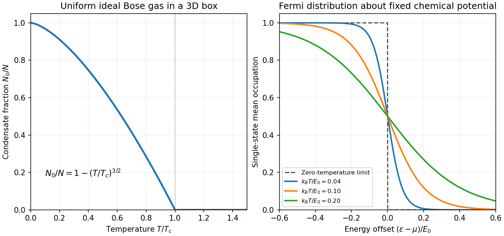

<h1 id="2/c/solution">Solution</h1>

↑ **Parent:** [C](../c.md)

The [Fermi-Dirac distribution](../../../../../fermi-dirac-distribution.md) gives the mean occupancy of a single [fermion](../../../../../fermion.md) state:

$$
\boxed{f(\epsilon)=\frac1{e^{(\epsilon-\mu)/(k_BT)}+1}}.
$$

Its maximum occupancy of one expresses the [Pauli exclusion principle](../../../../../pauli-exclusion-principle.md). A spatial orbital with two [spin](../../../../../spin.md) states can hold two [electrons](../../../../../electron.md) because they are different single-particle states. At zero [temperature](../../../../../temperature-split.md), the occupation is a step at the [Fermi energy](../../../../../fermi-energy.md) $E_F$; at low nonzero [temperature](../../../../../temperature-split.md), occupation changes appreciably only in an [energy](../../../../../energy-split.md) shell of width of order $k_BT$ about the [chemical potential](../../../../../chemical-potential-split.md).

Consequently, most conduction [electrons](../../../../../electron.md) cannot absorb small thermal [energies](../../../../../energy-split.md) into already occupied states. Only a fraction of order $T/T_F$ participates, where $T_F=E_F/k_B$. For a normal [metal](../../../../../metal.md) with a smooth [density of states](../../../../../density-of-states.md) $g(E_F)$, including both [spin](../../../../../spin.md) states and using the total-system normalization, the [Sommerfeld expansion](../../../../../sommerfeld-expansion.md) at fixed [particle number](../../../../../particle-number.md) gives

$$
U(T)-U(0)=\frac{\pi^2}{6}g(E_F)(k_BT)^2+O(T^4),
$$

and therefore

$$
\boxed{C_{\rm el}=\gamma_{\rm el}T,\qquad
\gamma_{\rm el}=\frac{\pi^2}{3}k_B^2g(E_F)}.
$$

For a three-dimensional [free electron gas](../../../../../free-electron-model.md), $g(E_F)=3N/(2E_F)$, so $C_{\rm el}=(\pi^2/2)Nk_B(T/T_F)$. This is much smaller than a classical equipartition estimate at $T\ll T_F$. The [chemical potential](../../../../../chemical-potential-split.md) must adjust with [temperature](../../../../../temperature-split.md) to maintain $N$; treating it as fixed while differentiating an [energy](../../../../../energy-split.md) [integral](../../../../../integral-split.md) gives the wrong fixed-$N$ calculation in general.

The lattice adds a Debye contribution $C_{\rm ph}=\beta_D T^3$ at [temperatures](../../../../../temperature-split.md) well below the [Debye temperature](../../../../../debye-temperature.md). Hence

$$
\boxed{\frac CT\simeq\gamma_{\rm el}+\beta_D T^2}.
$$

A plot of measured $C/T$ against $T^2$ can separate the electronic intercept from the [phonon](../../../../../phonon.md) slope. [calorimetry](../../../../../calorimetry-split.md) must account for the [heat capacity](../../../../../heat-capacity.md) of the sample holder, heat leaks, thermal equilibration and [thermometer](../../../../../thermometer.md) calibration. A magnetic impurity contribution or a superconducting transition can invalidate this two-term fit; the prediction is for the normal metallic state in an appropriate low-temperature interval. Differences from a free-electron coefficient can reveal [quasiparticle](../../../../../quasiparticle.md) effective-mass enhancement or nontrivial electronic structure rather than a failure of Fermi statistics.

**[Figure 1](#2/c/image-original-ideal-box-condensate-fraction-and-fermi-dirac-occupation-curves). Original ideal-box condensate fraction and Fermi-Dirac occupation curves**.

## ↑ Ancestors (14)

1. [C](../c.md)
2. [2](../../2.md)
3. [Paper 1](../../../paper-1-split.md)
4. [2015](../../../split.md)
5. [Past exam of the thermal and statistical physics course of the University of Cambridge](../../../../split.md)
6. [Thermal and Statistical Physics course of the University of Cambridge](../../../../../thermal-and-statistical-physics-course-of-the-university-of-cambridge.md)
7. [Physics course of the year 3 of the natural sciences course of the University of Cambridge](../../../../../physics-course-of-the-year-3-of-the-natural-sciences-course-of-the-university-of-cambridge.md)
8. [Year 3 of the natural sciences course of the University of Cambridge](../../../../../year-3-of-the-natural-sciences-course-of-the-university-of-cambridge.md)
9. [Year of the natural sciences course of the University of Cambridge](../../../../../year-of-the-natural-sciences-course-of-the-university-of-cambridge.md)
10. [Natural sciences course of the University of Cambridge](../../../../../natural-sciences-course-of-the-university-of-cambridge.md)
11. [Course of the University of Cambridge](../../../../../course-of-the-university-of-cambridge.md)
12. [University of Cambridge](../../../../../university-of-cambridge-split.md)
13. [List of universities](../../../../../list-of-universities.md)
14. [Codex Wiki](../../../../../split.md)
