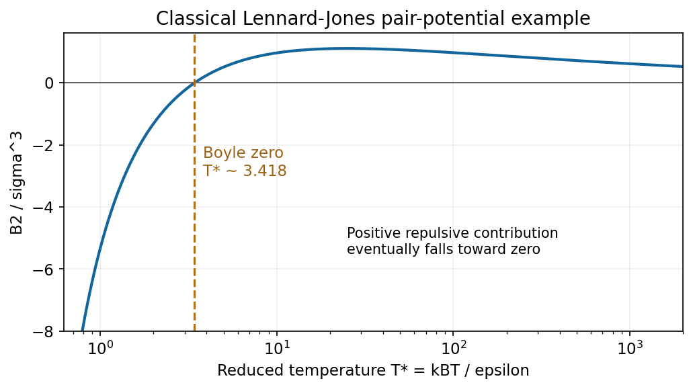
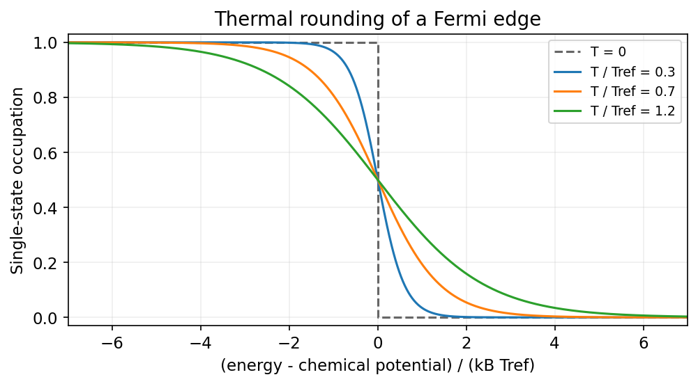
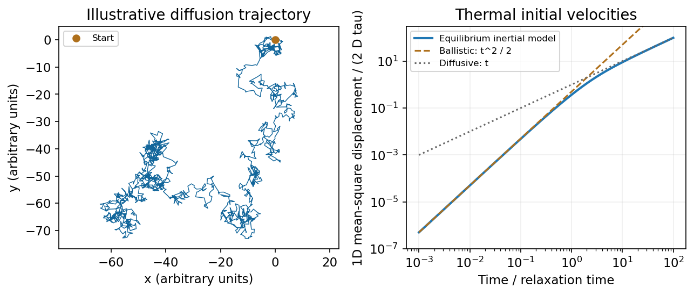
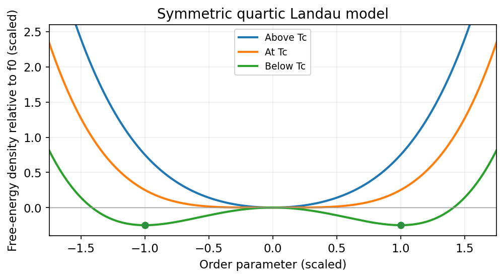
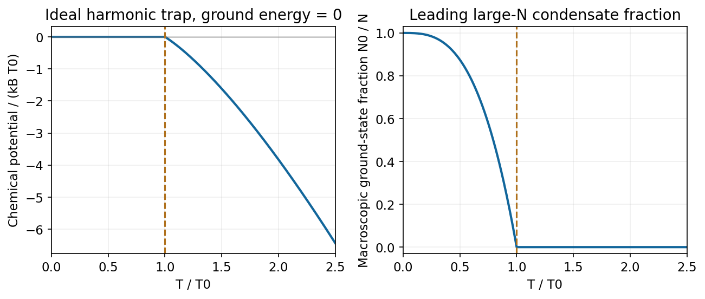

# Paper 1

↑ **Parent:** [2016](../2016.md)

[Original examination PDF, physical pages 382–385](https://www.whatdotheyknow.com/request/natural_science_tripos_physics_e_2/response/2340776/attach/2/FOI%202023%20399%20Zahid%20materials.pdf?cookie_passthrough=1#page=382)

**Table of contents**

- [1](#1)
  - [a](#1/a)
    - [Solution](#1/a/solution)
  - [b](#1/b)
    - [Solution](#1/b/solution)
  - [c](#1/c)
    - [Solution](#1/c/solution)
- [2](#2)
  - [a](#2/a)
    - [Solution](#2/a/solution)
  - [b](#2/b)
    - [Solution](#2/b/solution)
  - [c](#2/c)
    - [Solution](#2/c/solution)
- [3](#3)
  - [Solution](#3/solution)
- [4](#4)
  - [Solution](#4/solution)

## 1

↑ **Parent:** [Paper 1](paper-1.md)

<h3 id="1/a">a</h3>

↑ **Parent:** [1](#1)

<h4 id="1/a/solution">Solution</h4>

↑ **Parent:** [A](#1/a)

Use the **number-density [virial expansion](../../statistical-physics.md#virial-expansion)**, following the [density versus molar second virial convention](../../statistical-physics.md#density-versus-molar-second-virial-convention), with $n=N/V$:

$$
\frac{p}{nk_BT}=1+B_2(T)n+O(n^2).
$$

Thus $B_2$ is the coefficient of the first [density](../../fluid-mechanics.md#density) correction and has units of [volume](../../geometry-and-topology.md#volume). With molar [density](../../fluid-mechanics.md#density) instead, the molar coefficient is $N_AB_2$. For a classical pair potential $u(r)$,

$$
\boxed{B_2(T)=-\frac12\int\left(e^{-u(r)/(k_BT)}-1\right)d^3r=2\pi\int_0^\infty\left[1-e^{-u(r)/(k_BT)}\right]r^2dr.}
$$

Attractive separations contribute negatively and short-range repulsion contributes positively. For inert-gas interactions the attractive contribution dominates at sufficiently low [temperature](../../temperature.md), $B_2$ crosses zero at the [Boyle temperature](../../statistical-physics.md#boyle-temperature), and repulsion dominates above it.

**[Figure 1](#1/a/image-an-illustrative-lennard-jones-second-virial-coefficient-is-negative-at-low-temperature-crosses-zero-and-has-a-broad-positive-maximum). An illustrative Lennard-Jones second virial coefficient is negative at low temperature, crosses zero and has a broad positive maximum**. [Source](paper-1-second-virial.py).

The [soft-core high-temperature second virial coefficient](../../statistical-physics.md#soft-core-high-temperature-second-virial-coefficient) illustrates why the far-high-temperature tail depends on the model. A hard-core estimate $B_2\simeq b-a/(k_BT)$ tends to positive excluded [volume](../../geometry-and-topology.md#volume) $b$. A soft repulsive potential, such as the [Lennard-Jones potential](../../energy.md#lennard-jones-potential) in the original diagram, allows a positive maximum followed by decay toward zero. The sign change is the main attraction-versus-repulsion feature; neither sketch should be interpreted as measured data for a specified gas. This classical, dilute-gas sketch omits low-temperature quantum-exchange corrections.[Section 2.5: interacting gas, virial expansion and Mayer pair function](../../physics-bibliography.md#classical-gases-by-david-tong)

<h3 id="1/b">b</h3>

↑ **Parent:** [1](#1)

<h4 id="1/b/solution">Solution</h4>

↑ **Parent:** [B](#1/b)

Take $\mu>0$ to be the magnitude of either [spin](../../angular-momentum-operator.md#spin) projection's [magnetic moment](../../electromagnetism.md#magnetic-dipole-moment), so the independent magnetic levels are $E_\pm=\mp\mu B$. Their [partition function](../../canonical-ensemble.md#canonical-partition-function) and magnetic [energy](../../energy.md) are

$$
Z_1=2\cosh x,\qquad Z=(2\cosh x)^N,\qquad U_{\rm mag}=-\partial_\beta\ln Z=-N\mu B\tanh x,
$$

where $\beta=1/(k_BT)$ and $x=\beta\mu B$. The [canonical entropy](../../canonical-ensemble.md#canonical-entropy-formula) is consequently

$$
\boxed{S=k_B\ln Z+\frac{U_{\rm mag}}T=Nk_B[\ln(2\cosh x)-x\tanh x].}
$$

This [independent-spin magnetic entropy](../../electromagnetism.md#independent-spin-magnetic-entropy) counts the two orientation states of each independent moment; translational [entropy](../../entropy.md) and interactions are excluded.

Along the [magnetic-entropy demagnetization adiabat](../../temperature.md#magnetic-entropy-demagnetization-adiabat), constant magnetic [entropy](../../entropy.md) fixes $x$, hence **$B/T$ is constant**. Lowering the field therefore gives the ideal [adiabatic demagnetization](../../temperature.md#adiabatic-demagnetization) relation

$$
\boxed{T_f=T_i\frac{B_f}{B_i}.}
$$

A useful cycle first magnetizes isothermally while releasing heat to a reservoir, then thermally isolates the sample and lowers the field. Cooling the entire sample requires its other [heat capacities](../../heat.md#heat-capacity) and spin-lattice equilibration to be accounted for. Magnetic interactions, residual fields and heat leaks prevent extrapolating the independent-moment formula to an attainable zero [temperature](../../temperature.md).[Canonical ensemble: two-state partition function, entropy and thermodynamic derivatives](../../physics-bibliography.md#the-fundamentals-of-statistical-mechanics-by-david-tong)

**[Figure 2](#1/b/image-magnetic-entropy-decreases-with-b-over-t-while-an-ideal-demagnetization-adiabat-has-constant-b-over-t). Magnetic entropy decreases with B over T, while an ideal demagnetization adiabat has constant B over T**. [Source](paper-1-paramagnetic-cooling.py).

<h3 id="1/c">c</h3>

↑ **Parent:** [1](#1)

<h4 id="1/c/solution">Solution</h4>

↑ **Parent:** [C](#1/c)

For a complete single-particle state, the [Fermi-Dirac distribution](../../quantum-ideal-gas-statistics.md#fermi-dirac-distribution) is

$$
\boxed{\langle n(\epsilon)\rangle=\frac1{\exp[(\epsilon-\mu_{\rm ch})/(k_BT)]+1}.}
$$

Here $\mu_{\rm ch}$ denotes the [chemical potential](../../chemical-potential.md), distinct from the magnetic-moment symbol in (b). At zero [temperature](../../temperature.md) it approaches the [Fermi energy](../../quantum-ideal-gas-statistics.md#fermi-energy) $E_F$ and the occupation has a sharp edge. At $T\ll T_F=E_F/k_B$, thermal changes occur within an [energy](../../energy.md) interval of order $k_BT$ about that edge.

The [Fermi-edge heat-capacity counting](../../heat.md#fermi-edge-heat-capacity-counting) argument uses the fact that only order $g(E_F)k_BT$ [electrons](../../physics.md#electron) can be rearranged because states well below the edge are blocked by the [Pauli exclusion principle](../../tensor-product-of-quantum-systems.md#pauli-exclusion-principle). Each active excitation carries [energy](../../energy.md) of order $k_BT$, so $U(T)-U(0)\sim g(E_F)(k_BT)^2$ and **$C_{V,e}\propto T$**. For a smooth [density of states](../../quantum-ideal-gas-statistics.md#density-of-states), the [Sommerfeld expansion](../../quantum-ideal-gas-statistics.md#sommerfeld-expansion) gives

$$
\boxed{C_{V,e}=\frac{\pi^2}{3}g(E_F)k_B^2T.}
$$

Here $g$ is the total single-particle [density of states](../../quantum-ideal-gas-statistics.md#density-of-states), including [spin](../../angular-momentum-operator.md#spin). In a three-dimensional free-electron gas, $g(E_F)=3N/(2E_F)$, giving $C_{V,e}=(\pi^2/2)Nk_B(T/T_F)$. This is the low-temperature normal-state electronic contribution, not the lattice [heat capacity](../../heat.md#heat-capacity) or a description across a superconducting transition.[Sections 3.6.2–3.6.4: Fermi edge, low-temperature heat capacity and Sommerfeld expansion](../../physics-bibliography.md#quantum-gases-by-david-tong)

**[Figure 3](#1/c/image-finite-temperature-rounds-the-fermi-edge-over-an-energy-scale-of-order-kbt). Finite temperature rounds the Fermi edge over an energy scale of order kBT**. [Source](paper-1-fermi-edge.py).

## 2

↑ **Parent:** [Paper 1](paper-1.md)

<h3 id="2/a">a</h3>

↑ **Parent:** [2](#2)

<h4 id="2/a/solution">Solution</h4>

↑ **Parent:** [A](#2/a)

An **[statistical ensemble](../../thermodynamics.md#statistical-ensemble) specifies probabilities of microstates under particular macroscopic constraints**. It represents statistical information about a system; the [reservoir constraints of equilibrium ensembles](../../thermodynamics.md#reservoir-constraints-of-equilibrium-ensembles) specify what it can exchange with its surroundings.

- The [microcanonical ensemble](../../statistical-physics.md#microcanonical-ensemble) has fixed $E,V,N$. Accessible states in a narrow [energy](../../energy.md) shell are equally probable, with $S=k_B\ln\Omega$, where $\Omega$ counts the states in that shell. It describes an isolated system.
- The [canonical ensemble](../../canonical-ensemble.md) has fixed $T,V,N$ and can exchange [energy](../../energy.md) with a heat reservoir. A microstate has probability $p_i=e^{-\beta E_i}/Z$, with $Z=\sum_i e^{-\beta E_i}$ and $F=-k_BT\ln Z$. The [energy](../../energy.md) fluctuates; its mean is not imposed independently.
- The [grand canonical ensemble](../../statistical-physics.md#grand-canonical-ensemble) has fixed $T,V,\mu_{\rm ch}$ and exchanges both particles and [energy](../../energy.md). Its probabilities are proportional to $e^{-\beta(E_i-\mu_{\rm ch}N_i)}$, with $\Xi=\sum_N e^{\beta\mu_{\rm ch}N}Z_N$ and [grand potential](../../statistical-physics.md#grand-potential) $\Omega_G=-k_BT\ln\Xi$. For a homogeneous extensive equilibrium system, $\Omega_G=-pV$.

The [thermodynamic potentials](../../thermodynamic-potential.md) generate mean quantities and response functions. For example, canonical [energy](../../energy.md) variance is $\langle(\Delta E)^2\rangle=k_BT^2C_V$. With short-range interactions and stable bulk phases, relative fluctuations usually vanish for large systems and these ensembles give equivalent bulk predictions after matching their mean variables. Finite systems, constraints and long-range interactions require greater care; the ensembles retain different fluctuating variables.[Sections 1.2–1.4: microcanonical, canonical and grand canonical ensembles](../../physics-bibliography.md#the-fundamentals-of-statistical-mechanics-by-david-tong)

<h3 id="2/b">b</h3>

↑ **Parent:** [2](#2)

<h4 id="2/b/solution">Solution</h4>

↑ **Parent:** [B](#2/b)

**[Brownian motion](../../brownian-motion.md) is the irregular motion of a mesoscopic particle caused by thermal molecular impacts.** A colloidal sphere in a fluid provides a physical example. The random force competes with dissipative drag; averaging many trajectories produces [diffusion](../../thermodynamics.md#diffusion) even though each trajectory fluctuates.

A free-particle [Langevin equation](../../stochastic-process.md#langevin-dynamics) with [thermal Langevin force normalization](../../stochastic-process.md#thermal-langevin-force-normalization) is

$$
m\dot{\mathbf v}=-\zeta\mathbf v+\boldsymbol\xi(t),\qquad\langle\xi_i(t)\xi_j(t')\rangle=2\zeta k_BT\,\delta_{ij}\delta(t-t').
$$

The noise has zero mean, and its strength is linked to drag by the [fluctuation-dissipation theorem](../../quantum-field-theory.md#fluctuation-dissipation-theorem). The velocity relaxes on the time scale $\tau=m/\zeta$. At long times $t\gg\tau$, the [Einstein diffusion relation](../../thermodynamics.md#einstein-diffusion-relation) is

$$
\boxed{D=\frac{k_BT}{\zeta},\qquad\langle|\mathbf r(t)-\mathbf r(0)|^2\rangle=6Dt\quad\hbox{in three dimensions}.}
$$

For a slowly moving no-slip sphere of radius $a$ in a continuum fluid of [dynamic viscosity](../../dynamic-viscosity.md) $\eta$, [Stokes drag law](../../stokes-flow.md#stokes-s-law) gives $\zeta=6\pi\eta a$. The particle probability [density](../../fluid-mechanics.md#density) obeys $\partial_tP=D\nabla^2P$; a localized initial position develops a Gaussian profile. The [ballistic-to-diffusive Brownian displacement](../../brownian-motion.md#ballistic-to-diffusive-brownian-displacement) changes character: at $t\ll\tau$, equilibrium velocities instead give ballistic mean-square displacement $3(k_BT/m)t^2$.

**[Figure 4](#2/b/image-an-illustrative-random-trajectory-and-the-inertial-crossover-from-ballistic-to-diffusive-mean-square-displacement). An illustrative random trajectory and the inertial crossover from ballistic to diffusive mean-square displacement**. [Source](paper-1-brownian-motion.py).

The drag-noise model assumes a classical bath with a sufficiently short correlation time; a mathematical white-noise trajectory does not resolve individual molecular collisions. Tracking nonliving colloidal particles measures [diffusion](../../thermodynamics.md#diffusion) and tests the connection between thermal fluctuations and dissipation.[Sections 3.1–3.2: Brownian motion, Langevin equation, diffusion and the Einstein relation](../../physics-bibliography.md#stochastic-processes-by-david-tong)

<h3 id="2/c">c</h3>

↑ **Parent:** [2](#2)

<h4 id="2/c/solution">Solution</h4>

↑ **Parent:** [C](#2/c)

**[Landau theory](../../critical-phenomenon.md#landau-theory) expands the [free energy](../../thermodynamic-potential.md#thermodynamic-free-energy) in a small [order parameter](../../critical-phenomenon.md#order-parameter) and keeps terms allowed by the system's symmetries.** For a scalar [order parameter](../../critical-phenomenon.md#order-parameter) $q$ with [sign-reversal symmetry in Landau theory](../../critical-phenomenon.md#sign-reversal-symmetry-in-landau-theory) $q\mapsto-q$, a useful free-energy [density](../../fluid-mechanics.md#density) is

$$
f(q,T,h)=f_0(T)+\frac a2(T-T_c)q^2+\frac b4q^4-hq,\qquad a,b>0.
$$

At zero conjugate field $h$, the [quartic Landau equilibrium branches](../../critical-phenomenon.md#quartic-landau-equilibrium-branches) obtained by minimizing are

$$
\boxed{q_{\rm eq}=0\quad(T>T_c),\qquad q_{\rm eq}=\pm\sqrt{\frac{a(T_c-T)}b}\quad(T<T_c).}
$$

The single minimum becomes two symmetry-related minima: the [order parameter](../../critical-phenomenon.md#order-parameter) turns on continuously and a chosen equilibrium phase spontaneously breaks the symmetry. At the [critical temperature](../../quantum-ideal-gas-statistics.md#critical-temperature) the quadratic restoring term vanishes. The mean-field exponent is $q\propto(T_c-T)^{1/2}$; the susceptibility above $T_c$ is $\partial q/\partial h=1/[a(T-T_c)]$.

**[Figure 5](#2/c/image-a-symmetric-quartic-landau-free-energy-changes-from-one-minimum-to-two-as-its-quadratic-coefficient-changes-sign). A symmetric quartic Landau free energy changes from one minimum to two as its quadratic coefficient changes sign**. [Source](paper-1-landau-free-energy.py).

More general allowed terms describe other transitions. A negative quartic term, stabilized by a positive sixth-order term, can give a first-order transition with a discontinuous [order parameter](../../critical-phenomenon.md#order-parameter) and metastable minima. Without the sign-reversal symmetry, a cubic term may also be allowed. The expansion is phenomenological: its coefficients depend on microscopic physics. Minimizing a uniform polynomial neglects important spatial fluctuations, particularly near a [critical point](../../analysis.md#critical-point), so its [critical exponents](../../critical-phenomenon.md#critical-exponent) need not be exact.[Section 5.4: Landau free energy, symmetry and mean-field transitions](../../physics-bibliography.md#phase-transitions-by-david-tong)

## 3

↑ **Parent:** [Paper 1](paper-1.md)

<h3 id="3/solution">Solution</h3>

↑ **Parent:** [3](#3)

Measure energies from the single-particle [ground state](../../quantum-mechanics.md#ground-state), and assume the **three-dimensional ideal Bose gas in the large-particle-number limit**. The [harmonic-trap chemical-potential pinning](../../quantum-ideal-gas-statistics.md#harmonic-trap-chemical-potential-pinning) discussed here uses a [chemical potential](../../chemical-potential.md) satisfying $\mu_{\rm ch}\leq0$. On cooling, it approaches zero; below the condensation [temperature](../../temperature.md) it remains at zero to leading thermodynamic order. Above that [temperature](../../temperature.md) it is negative. The detailed negative-chemical-potential branch shape is determined by the [density of states](../../quantum-ideal-gas-statistics.md#density-of-states); the figure uses the harmonic trap analysed below. The [finite-size condensate chemical potential](../../quantum-ideal-gas-statistics.md#finite-size-condensate-chemical-potential) stays slightly below zero rather than being exactly pinned there.

A **[Bose-Einstein condensate](../../quantum-ideal-gas-statistics.md#bose-einstein-condensate) has macroscopic occupation of a single quantum state**. A dilute atomic gas needs low [temperature](../../temperature.md) and high phase-space [density](../../fluid-mechanics.md#density) while remaining metastable against ordinary liquid or solid formation. [Laser cooling](../../atomic-physics.md#laser-cooling) followed by [evaporative cooling of atoms](../../atomic-physics.md#evaporative-cooling-atomic-physics) in a weak trap can achieve the required regime. For the trapped ideal gas the quantitative threshold is derived below; a uniform ideal gas has $n\lambda_T^3=\zeta(3/2)$ at onset. An experimental signature is a narrow low-momentum component appearing within the broader thermal distribution after time-of-flight expansion, as observed in magnetically trapped rubidium-87.[1995 rubidium experiment: low-velocity condensate component and nonthermal anisotropic expansion](../../physics-bibliography.md#observation-of-bose-einstein-condensation-in-a-dilute-atomic-vapor-by-m-h-anderson-and-others)

**[Spinless cubic-box wave-vector counting](../../quantum-ideal-gas-statistics.md#spinless-cubic-box-wave-vector-counting).** Impose [periodic boundary conditions](../../differential-equation.md#periodic-boundary-conditions) on a cube of side $L$. The allowed vectors are $\mathbf k=(2\pi/L)(n_x,n_y,n_z)$ with integer components. Each state occupies $ (2\pi/L)^3$ in wave-vector space. For a spinless particle, counting the spherical shell gives

$$
d\mathcal N=\frac{V}{(2\pi)^3}4\pi k^2dk,\qquad\boxed{g_V(k)=\frac1V\frac{d\mathcal N}{dk}=\frac{k^2}{2\pi^2}.}
$$

There is no [spin](../../angular-momentum-operator.md#spin) multiplicity. This is continuum shell counting; a finite box has discrete levels. Using $\epsilon=\hbar^2k^2/(2m)$ gives the free-particle [density of states](../../quantum-ideal-gas-statistics.md#density-of-states) per unit [energy](../../energy.md) and [volume](../../geometry-and-topology.md#volume)

$$
g_V(\epsilon)=\frac{(2m)^{3/2}}{4\pi^2\hbar^3}\sqrt\epsilon.
$$

**[Semiclassical density of states in a central potential](../../quantum-ideal-gas-statistics.md#semiclassical-density-of-states-in-a-central-potential).** At position $\mathbf r$, the available [kinetic energy](../../energy.md#kinetic-energy) is $\epsilon-U(r)$. The local-density approximation integrates the preceding free-particle result over the classically allowed region:

$$
g(\epsilon)=\int_{U<\epsilon}\frac{(2m)^{3/2}}{4\pi^2\hbar^3}\sqrt{\epsilon-U(r)}\,d^3r=\boxed{\frac{(2m)^{3/2}}{\pi\hbar^3}\int_0^{r_\epsilon}r^2\sqrt{\epsilon-U(r)}\,dr.}
$$

This form assumes the allowed radial region is the connected interval $0\leq r\leq r_\epsilon$. A nonmonotonic potential would require integrating all allowed shells.

For the isotropic harmonic trap, $r_\epsilon=\sqrt{2\epsilon/(m\omega^2)}$. Substituting $r=r_\epsilon\sin\vartheta$ gives

$$
\int_0^{r_\epsilon}r^2\sqrt{\epsilon-\tfrac12m\omega^2r^2}\,dr=r_\epsilon^3\sqrt\epsilon\int_0^{\pi/2}\sin^2\vartheta\cos^2\vartheta\,d\vartheta=\frac\pi{16}r_\epsilon^3\sqrt\epsilon.
$$

Consequently

$$
\boxed{g(\epsilon)=\frac{\epsilon^2}{2(\hbar\omega)^3}.}
$$

The exact oscillator ground [energy](../../energy.md) is $3\hbar\omega/2$ above the potential minimum. The [harmonic-trap energy-zero convention](../../quantum-ideal-gas-statistics.md#harmonic-trap-energy-zero-convention) subtracts that constant, while the displayed [density of states](../../quantum-ideal-gas-statistics.md#density-of-states) is the leading semiclassical continuum expression, neglecting the finite-level corrections produced by that shift. The discrete [ground state](../../quantum-mechanics.md#ground-state) must be counted separately.

**Condensate population.** Below the transition, use $\mu_{\rm ch}\simeq0$ for the excited states. The [saturation of harmonic-trap excited states](../../quantum-ideal-gas-statistics.md#saturation-of-harmonic-trap-excited-states) follows from the supplied integral:

$$
N_{\rm ex}=\int_0^\infty\frac{g(\epsilon)\,d\epsilon}{e^{\epsilon/(k_BT)}-1}=\frac12\left(\frac{k_BT}{\hbar\omega}\right)^3\int_0^\infty\frac{x^2dx}{e^x-1}=\zeta(3)\left(\frac{k_BT}{\hbar\omega}\right)^3,
$$

where $\zeta$ is the [Riemann zeta function](../../analytic-number-theory.md#riemann-zeta-function) and $\zeta(3)\simeq1.202$. Setting $N_{\rm ex}(T_0)=N$ gives the [harmonic-trap critical-temperature prefactor](../../quantum-ideal-gas-statistics.md#harmonic-trap-critical-temperature-prefactor):

$$
\boxed{T_0=\frac{\hbar\omega}{k_B}\left(\frac N{\zeta(3)}\right)^{1/3}\simeq0.9405\frac{\hbar\omega}{k_B}N^{1/3},\qquad \frac{N_0(T)}N=1-\left(\frac T{T_0}\right)^3\quad(T<T_0).}
$$

Above $T_0$ there is no macroscopic ground-state fraction in this approximation. For completeness, above the transition the [quantum gas fugacity](../../statistical-physics.md#fugacity-statistical-mechanics) $z=e^{\mu_{\rm ch}/(k_BT)}<1$ satisfies $N=(k_BT/\hbar\omega)^3\operatorname{Li}_3(z)$; the [polylogarithm](../../complex-analysis.md#polylogarithm) $\operatorname{Li}_3$ therefore defines the plotted negative branch. A finite trapped gas has rounded behaviour, weak interactions shift the threshold, and the continuum thermal population is inaccurate when $k_BT$ is comparable to or below $\hbar\omega$. The power law is intended for the large-$N$ condensed regime, not an exact discrete-spectrum formula at arbitrarily small [temperature](../../temperature.md).[Section 3.5: Bose distribution, excited-state saturation and separate condensate population; trap density-of-states calculation derived here](../../physics-bibliography.md#quantum-gases-by-david-tong)

**[Figure 6](#3/image-leading-ideal-harmonic-trap-chemical-potential-and-condensate-fraction-versus-temperature-with-energy-measured-from-the-ground-state). Leading ideal harmonic-trap chemical potential and condensate fraction versus temperature, with energy measured from the ground state**. [Source](paper-1-trapped-condensate.py).

## 4

↑ **Parent:** [Paper 1](paper-1.md)

<h3 id="4/solution">Solution</h3>

↑ **Parent:** [4](#4)

For the **ideal dilute Maxwell-Boltzmann gas** implicit in a single-particle [partition function](../../canonical-ensemble.md#canonical-partition-function), indistinguishability gives $Z_N=Z_1^N/N!$. With [Stirling's approximation](../../real-analysis.md#stirling-formula),

$$
F=-k_BT\ln Z_N\simeq-Nk_BT\ln Z_1+k_BT(N\ln N-N).
$$

Differentiate at fixed $T,V$:

$$
\boxed{\mu_{\rm ch}=\left(\frac{\partial F}{\partial N}\right)_{T,V}=k_BT\ln\frac N{Z_1}=-k_BT[\ln Z_1-\ln N].}
$$

This is a thermodynamic-limit ideal-gas result; arbitrary interacting classical gases do not have $Z_N=Z_1^N/N!$.

**Equilibrium constraints and the Gibbs minimum.** The [open-system equilibrium contacts](../../chemical-potential.md#open-system-equilibrium-contacts) allow exchange of heat, [volume](../../geometry-and-topology.md#volume) and matter. For unconstrained contacts without external-field or interface corrections, equilibrium requires equal temperatures, pressures and each exchangeable species' [chemical potentials](../../chemical-potential.md) across the contacts. These conditions follow by maximizing total [entropy](../../entropy.md) under conserved total [energy](../../energy.md), [volume](../../geometry-and-topology.md#volume) and species amounts.

The next minimization statement fixes the system's particle number. For a system in a reservoir at $T_0,p_0$, with $N$ fixed and only pressure-volume work, the reservoir [entropy](../../entropy.md) change gives

$$
\Delta S_{\rm tot}=\Delta S-\frac{\Delta U+p_0\Delta V}{T_0}=-\frac{\Delta(U+p_0V-T_0S)}{T_0}\geq0.
$$

For candidate states at the imposed $T=T_0$, $p=p_0$, the expression in parentheses is $G$. Thus **the [Fixed-particle-number Gibbs minimum](../../thermodynamic-potential.md#fixed-particle-number-gibbs-minimum) selects stable equilibrium at fixed $T,p,N$**, with stationary first variation and nonnegative allowed second variation. If particle exchange remains unconstrained, $N$ is not fixed and this minimization statement must be replaced by one incorporating the particle reservoir; it is not a justification for minimizing $G$ over arbitrary $N$.

The simple-compressible-system first law gives

$$
dG=d(U-TS+pV)=\boxed{-S\,dT+V\,dp+\mu_{\rm ch}\,dN}.
$$

For a homogeneous extensive single-component phase, the [Single-component Gibbs Euler relation](../../thermodynamic-potential.md#single-component-gibbs-euler-relation) follows from $U=TS-pV+\mu_{\rm ch}N$, yielding **$G=\mu_{\rm ch}N$**. For a mixture, the corresponding identities are $G=\sum_i\mu_iN_i$ and $dG=-S\,dT+V\,dp+\sum_i\mu_i\,dN_i$. Surface effects or other nonextensive contributions require additional terms.[Free energies, chemical potential and equilibrium with imposed reservoir variables](../../physics-bibliography.md#classical-thermodynamics-by-david-tong)

**Reaction equilibrium.** Let $d\xi$ be an allowed reaction extent for the forward process, so $dN_A=-d\xi$ and $dN_B=2d\xi$. At fixed $T,p$,

$$
dG=(2\mu_B-\mu_A)d\xi.
$$

For an interior equilibrium allowing both reaction directions, the coefficient vanishes:

$$
\boxed{\mu_A=2\mu_B.}
$$

At fixed $T,V$, minimizing $F$ gives the same condition. The [reaction formula-unit conservation](../../chemical-potential.md#reaction-formula-unit-conservation) gives $M=N_A+N_B/2$, not the total number $N_A+N_B$ of gas particles. This [conservation law](../../mathematical-physics.md#conservation-law) replaces fixed total particle number for the reacting mixture.

Using the stipulated single-particle functions,

$$
\mu_i=k_BT\ln\frac{N_i}{C_iVT^{3/2}},\qquad\frac{N_A}{C_AVT^{3/2}}=\left(\frac{N_B}{C_BVT^{3/2}}\right)^2.
$$

The [number-based dissociation equilibrium ratio](../../chemical-potential.md#number-based-dissociation-equilibrium-ratio) is therefore

$$
\boxed{K_N(V,T)=\frac{N_B^2}{N_A}=\frac{C_B^2}{C_A}VT^{3/2}.}
$$

This number-based quantity has a factor of [volume](../../geometry-and-topology.md#volume); the corresponding concentration ratio $n_B^2/n_A=K_N/V$ depends on [temperature](../../temperature.md) alone in the stated ideal model. A standard activity-based equilibrium constant would additionally specify reference states. No bond-energy factor is added to the functions given in the paper.

Define the dissociated fraction of original A formula units by $\alpha=N_B/(2M)$. Then $N_A=M(1-\alpha)$ and $N_B=2M\alpha$, so

$$
\frac{\alpha^2}{1-\alpha}=\frac{K_N}{4M}\equiv q,\qquad\boxed{\alpha=\frac{\sqrt{q^2+4q}-q}{2}.}
$$

The [dissociation fraction versus conserved density](../../chemical-potential.md#dissociation-fraction-versus-conserved-density) follows because the left side increases monotonically from zero to infinity on $0<\alpha<1$. At fixed $V,T$, increasing $M$ decreases $q$, hence **decreases dissociation**. Equivalently, at fixed $M,T$ compression raises $M/V$ and favours A. Association produces fewer independent translating particles; at high [density](../../fluid-mechanics.md#density) the translational-entropy advantage of the two-particle side is smaller, so equilibrium shifts toward the one-particle side.

**[Figure 7](#4/image-at-fixed-temperature-the-dissociated-fraction-falls-as-the-conserved-formula-unit-density-increases). At fixed temperature the dissociated fraction falls as the conserved formula-unit density increases**. [Source](paper-1-dissociation-density.py).

## ↑ Ancestors (11)

1. [2016](../2016.md)
2. [Past exam of the thermal and statistical physics course of the University of Cambridge](../../past-exam-of-the-thermal-and-statistical-physics-course-of-the-university-of-cambridge.md)
3. [Thermal and Statistical Physics course of the University of Cambridge](../../university-of-cambridge.md#thermal-and-statistical-physics-course-of-the-university-of-cambridge)
4. [Physics course of the year 3 of the natural sciences course of the University of Cambridge](../../university-of-cambridge.md#physics-course-of-the-year-3-of-the-natural-sciences-course-of-the-university-of-cambridge)
5. [Year 3 of the natural sciences course of the University of Cambridge](../../university-of-cambridge.md#year-3-of-the-natural-sciences-course-of-the-university-of-cambridge)
6. [Year of the natural sciences course of the University of Cambridge](../../university-of-cambridge.md#year-of-the-natural-sciences-course-of-the-university-of-cambridge)
7. [Natural sciences course of the University of Cambridge](../../university-of-cambridge.md#natural-sciences-course-of-the-university-of-cambridge)
8. [Course of the University of Cambridge](../../university-of-cambridge.md#course-of-the-university-of-cambridge)
9. [University of Cambridge](../../university-of-cambridge.md)
10. [List of universities](../../README.md#list-of-universities)
11. [Codex Wiki](../../README.md)
