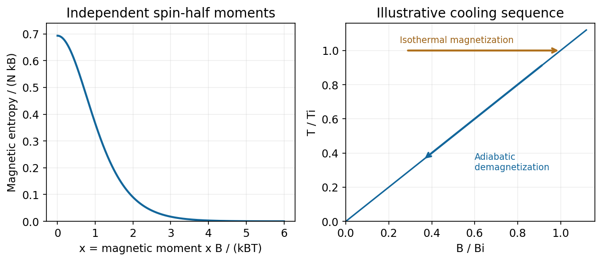

<h1 id="1/b/solution">Solution</h1>

↑ **Parent:** [B](../b.md)

Take $\mu>0$ to be the magnitude of either [spin](../../../../../spin.md) projection's [magnetic moment](../../../../../magnetic-dipole-moment.md), so the independent magnetic levels are $E_\pm=\mp\mu B$. Their [partition function](../../../../../canonical-partition-function.md) and magnetic [energy](../../../../../energy-split.md) are

$$
Z_1=2\cosh x,\qquad Z=(2\cosh x)^N,\qquad U_{\rm mag}=-\partial_\beta\ln Z=-N\mu B\tanh x,
$$

where $\beta=1/(k_BT)$ and $x=\beta\mu B$. The [canonical entropy](../../../../../canonical-entropy-formula.md) is consequently

$$
\boxed{S=k_B\ln Z+\frac{U_{\rm mag}}T=Nk_B[\ln(2\cosh x)-x\tanh x].}
$$

This [independent-spin magnetic entropy](../../../../../independent-spin-magnetic-entropy.md) counts the two orientation states of each independent moment; translational [entropy](../../../../../entropy-split.md) and interactions are excluded.

Along the [magnetic-entropy demagnetization adiabat](../../../../../magnetic-entropy-demagnetization-adiabat.md), constant magnetic [entropy](../../../../../entropy-split.md) fixes $x$, hence **$B/T$ is constant**. Lowering the field therefore gives the ideal [adiabatic demagnetization](../../../../../adiabatic-demagnetization.md) relation

$$
\boxed{T_f=T_i\frac{B_f}{B_i}.}
$$

A useful cycle first magnetizes isothermally while releasing heat to a reservoir, then thermally isolates the sample and lowers the field. Cooling the entire sample requires its other [heat capacities](../../../../../heat-capacity.md) and spin-lattice equilibration to be accounted for. Magnetic interactions, residual fields and heat leaks prevent extrapolating the independent-moment formula to an attainable zero [temperature](../../../../../temperature-split.md).[Canonical ensemble: two-state partition function, entropy and thermodynamic derivatives](../../../../../the-fundamentals-of-statistical-mechanics-by-david-tong.md)

**[Figure 2](#1/b/image-magnetic-entropy-decreases-with-b-over-t-while-an-ideal-demagnetization-adiabat-has-constant-b-over-t). Magnetic entropy decreases with B over T, while an ideal demagnetization adiabat has constant B over T**. [Source](paper-1-paramagnetic-cooling.py).

## ↑ Ancestors (14)

1. [B](../b.md)
2. [1](../../1.md)
3. [Paper 1](../../../paper-1-split.md)
4. [2016](../../../split.md)
5. [Past exam of the thermal and statistical physics course of the University of Cambridge](../../../../split.md)
6. [Thermal and Statistical Physics course of the University of Cambridge](../../../../../thermal-and-statistical-physics-course-of-the-university-of-cambridge.md)
7. [Physics course of the year 3 of the natural sciences course of the University of Cambridge](../../../../../physics-course-of-the-year-3-of-the-natural-sciences-course-of-the-university-of-cambridge.md)
8. [Year 3 of the natural sciences course of the University of Cambridge](../../../../../year-3-of-the-natural-sciences-course-of-the-university-of-cambridge.md)
9. [Year of the natural sciences course of the University of Cambridge](../../../../../year-of-the-natural-sciences-course-of-the-university-of-cambridge.md)
10. [Natural sciences course of the University of Cambridge](../../../../../natural-sciences-course-of-the-university-of-cambridge.md)
11. [Course of the University of Cambridge](../../../../../course-of-the-university-of-cambridge.md)
12. [University of Cambridge](../../../../../university-of-cambridge-split.md)
13. [List of universities](../../../../../list-of-universities.md)
14. [Codex Wiki](../../../../../split.md)
