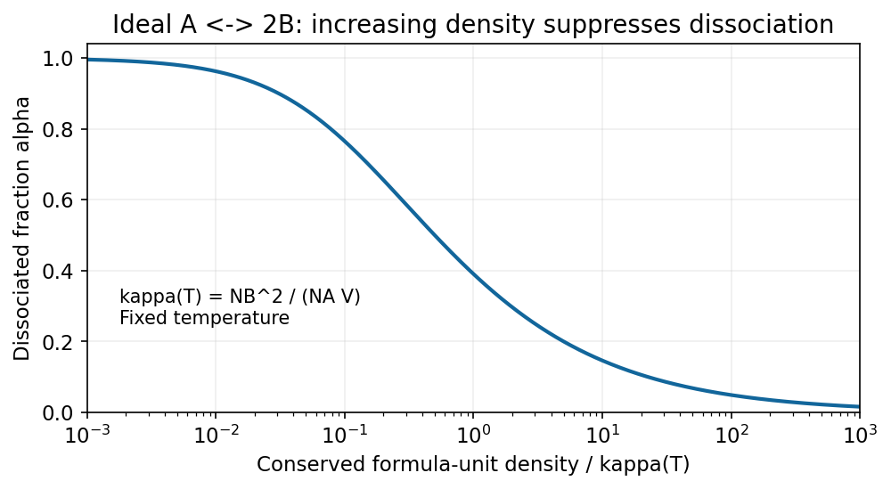

<h1 id="4/solution">Solution</h1>

↑ **Parent:** [4](../4.md)

For the **ideal dilute Maxwell-Boltzmann gas** implicit in a single-particle [partition function](../../../../canonical-partition-function.md), indistinguishability gives $Z_N=Z_1^N/N!$. With [Stirling's approximation](../../../../stirling-formula.md),

$$
F=-k_BT\ln Z_N\simeq-Nk_BT\ln Z_1+k_BT(N\ln N-N).
$$

Differentiate at fixed $T,V$:

$$
\boxed{\mu_{\rm ch}=\left(\frac{\partial F}{\partial N}\right)_{T,V}=k_BT\ln\frac N{Z_1}=-k_BT[\ln Z_1-\ln N].}
$$

This is a thermodynamic-limit ideal-gas result; arbitrary interacting classical gases do not have $Z_N=Z_1^N/N!$.

**Equilibrium constraints and the Gibbs minimum.** The [open-system equilibrium contacts](../../../../open-system-equilibrium-contacts.md) allow exchange of heat, [volume](../../../../volume.md) and matter. For unconstrained contacts without external-field or interface corrections, equilibrium requires equal temperatures, pressures and each exchangeable species' [chemical potentials](../../../../chemical-potential-split.md) across the contacts. These conditions follow by maximizing total [entropy](../../../../entropy-split.md) under conserved total [energy](../../../../energy-split.md), [volume](../../../../volume.md) and species amounts.

The next minimization statement fixes the system's particle number. For a system in a reservoir at $T_0,p_0$, with $N$ fixed and only pressure-volume work, the reservoir [entropy](../../../../entropy-split.md) change gives

$$
\Delta S_{\rm tot}=\Delta S-\frac{\Delta U+p_0\Delta V}{T_0}=-\frac{\Delta(U+p_0V-T_0S)}{T_0}\geq0.
$$

For candidate states at the imposed $T=T_0$, $p=p_0$, the expression in parentheses is $G$. Thus **the [Fixed-particle-number Gibbs minimum](../../../../fixed-particle-number-gibbs-minimum.md) selects stable equilibrium at fixed $T,p,N$**, with stationary first variation and nonnegative allowed second variation. If particle exchange remains unconstrained, $N$ is not fixed and this minimization statement must be replaced by one incorporating the particle reservoir; it is not a justification for minimizing $G$ over arbitrary $N$.

The simple-compressible-system first law gives

$$
dG=d(U-TS+pV)=\boxed{-S\,dT+V\,dp+\mu_{\rm ch}\,dN}.
$$

For a homogeneous extensive single-component phase, the [Single-component Gibbs Euler relation](../../../../single-component-gibbs-euler-relation.md) follows from $U=TS-pV+\mu_{\rm ch}N$, yielding **$G=\mu_{\rm ch}N$**. For a mixture, the corresponding identities are $G=\sum_i\mu_iN_i$ and $dG=-S\,dT+V\,dp+\sum_i\mu_i\,dN_i$. Surface effects or other nonextensive contributions require additional terms.[Free energies, chemical potential and equilibrium with imposed reservoir variables](../../../../classical-thermodynamics-by-david-tong.md)

**Reaction equilibrium.** Let $d\xi$ be an allowed reaction extent for the forward process, so $dN_A=-d\xi$ and $dN_B=2d\xi$. At fixed $T,p$,

$$
dG=(2\mu_B-\mu_A)d\xi.
$$

For an interior equilibrium allowing both reaction directions, the coefficient vanishes:

$$
\boxed{\mu_A=2\mu_B.}
$$

At fixed $T,V$, minimizing $F$ gives the same condition. The [reaction formula-unit conservation](../../../../reaction-formula-unit-conservation.md) gives $M=N_A+N_B/2$, not the total number $N_A+N_B$ of gas particles. This [conservation law](../../../../conservation-law.md) replaces fixed total particle number for the reacting mixture.

Using the stipulated single-particle functions,

$$
\mu_i=k_BT\ln\frac{N_i}{C_iVT^{3/2}},\qquad\frac{N_A}{C_AVT^{3/2}}=\left(\frac{N_B}{C_BVT^{3/2}}\right)^2.
$$

The [number-based dissociation equilibrium ratio](../../../../number-based-dissociation-equilibrium-ratio.md) is therefore

$$
\boxed{K_N(V,T)=\frac{N_B^2}{N_A}=\frac{C_B^2}{C_A}VT^{3/2}.}
$$

This number-based quantity has a factor of [volume](../../../../volume.md); the corresponding concentration ratio $n_B^2/n_A=K_N/V$ depends on [temperature](../../../../temperature-split.md) alone in the stated ideal model. A standard activity-based equilibrium constant would additionally specify reference states. No bond-energy factor is added to the functions given in the paper.

Define the dissociated fraction of original A formula units by $\alpha=N_B/(2M)$. Then $N_A=M(1-\alpha)$ and $N_B=2M\alpha$, so

$$
\frac{\alpha^2}{1-\alpha}=\frac{K_N}{4M}\equiv q,\qquad\boxed{\alpha=\frac{\sqrt{q^2+4q}-q}{2}.}
$$

The [dissociation fraction versus conserved density](../../../../dissociation-fraction-versus-conserved-density.md) follows because the left side increases monotonically from zero to infinity on $0<\alpha<1$. At fixed $V,T$, increasing $M$ decreases $q$, hence **decreases dissociation**. Equivalently, at fixed $M,T$ compression raises $M/V$ and favours A. Association produces fewer independent translating particles; at high [density](../../../../density.md) the translational-entropy advantage of the two-particle side is smaller, so equilibrium shifts toward the one-particle side.

**[Figure 7](#4/image-at-fixed-temperature-the-dissociated-fraction-falls-as-the-conserved-formula-unit-density-increases). At fixed temperature the dissociated fraction falls as the conserved formula-unit density increases**. [Source](paper-1-dissociation-density.py).

## ↑ Ancestors (13)

1. [4](../4.md)
2. [Paper 1](../../paper-1-split.md)
3. [2016](../../split.md)
4. [Past exam of the thermal and statistical physics course of the University of Cambridge](../../../split.md)
5. [Thermal and Statistical Physics course of the University of Cambridge](../../../../thermal-and-statistical-physics-course-of-the-university-of-cambridge.md)
6. [Physics course of the year 3 of the natural sciences course of the University of Cambridge](../../../../physics-course-of-the-year-3-of-the-natural-sciences-course-of-the-university-of-cambridge.md)
7. [Year 3 of the natural sciences course of the University of Cambridge](../../../../year-3-of-the-natural-sciences-course-of-the-university-of-cambridge.md)
8. [Year of the natural sciences course of the University of Cambridge](../../../../year-of-the-natural-sciences-course-of-the-university-of-cambridge.md)
9. [Natural sciences course of the University of Cambridge](../../../../natural-sciences-course-of-the-university-of-cambridge.md)
10. [Course of the University of Cambridge](../../../../course-of-the-university-of-cambridge.md)
11. [University of Cambridge](../../../../university-of-cambridge-split.md)
12. [List of universities](../../../../list-of-universities.md)
13. [Codex Wiki](../../../../split.md)
