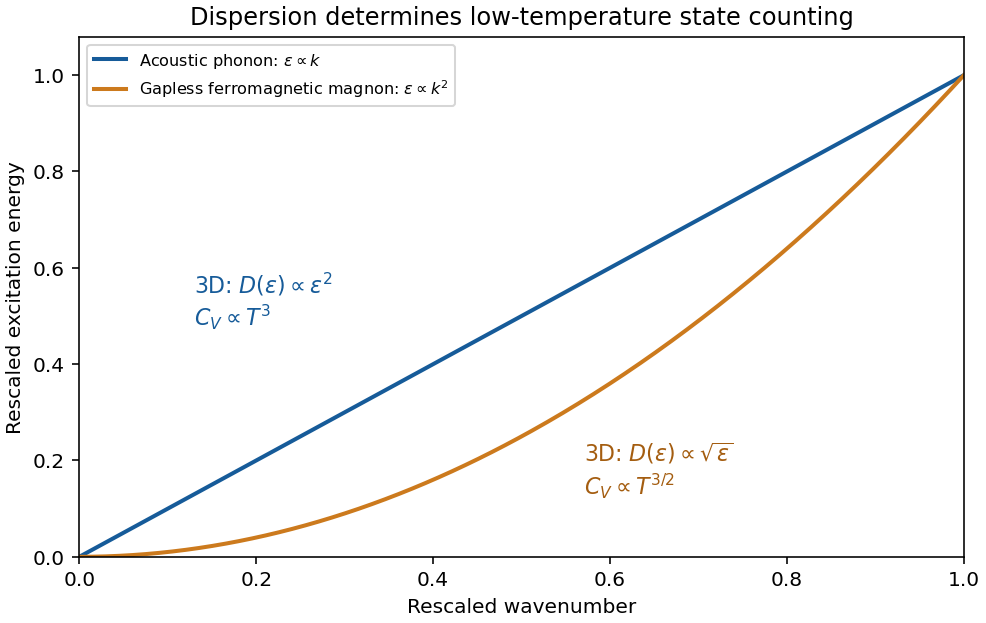

# 2017

↑ **Parent:** [Past exam of the thermal and statistical physics course of the University of Cambridge](../past-exam-of-the-thermal-and-statistical-physics-course-of-the-university-of-cambridge.md)

[Original paper, released PDF pages 253–256](https://www.whatdotheyknow.com/request/natural_science_tripos_physics_e/response/2127325/attach/3/FOI%202022%20639%20Sullivan%20materials.pdf?cookie_passthrough=1#page=253)

**Table of contents**

- [1](#1)
  - [a](#1/a)
    - [Solution](#1/a/solution)
  - [b](#1/b)
    - [Solution](#1/b/solution)
  - [c](#1/c)
    - [Solution](#1/c/solution)
- [2](#2)
  - [a](#2/a)
    - [Solution](#2/a/solution)
  - [b](#2/b)
    - [Solution](#2/b/solution)
  - [c](#2/c)
    - [Solution](#2/c/solution)
- [3](#3)
  - [a](#3/a)
    - [Solution](#3/a/solution)
  - [b](#3/b)
    - [Solution](#3/b/solution)
- [4](#4)
  - [Solution](#4/solution)

## 1

↑ **Parent:** [2017](2017.md)

<h3 id="1/a">a</h3>

↑ **Parent:** [1](#1)

<h4 id="1/a/solution">Solution</h4>

↑ **Parent:** [A](#1/a)

Put $\xi=\epsilon-\epsilon_F$ and $\Delta=|\Delta|>0$. The [BCS quasiparticle spectrum](../fermi-liquid.md#bcs-quasiparticle-spectrum) has $E=\sqrt{\xi^2+\Delta^2}$, so on either inverse branch

$$
\xi_\pm=\pm\sqrt{E^2-\Delta^2},\qquad
\left|\frac{d\xi_\pm}{dE}\right|=\frac E{\sqrt{E^2-\Delta^2}}.
$$

Conservation of states on one branch gives $D_{\rm branch}(E)dE=g(\epsilon_F)|d\xi|$. Consequently the single-branch expression requested in the source is

$$
\boxed{D_{\rm branch}(E)=\frac{g(\epsilon_F)E}{\sqrt{E^2-\Delta^2}},\qquad E>\Delta.}
$$

There are no such states for $0<E<\Delta$ in this ideal fully gapped model. Near the edge the [density of states](../quantum-ideal-gas-statistics.md#density-of-states) diverges as $(E-\Delta)^{-1/2}$, an integrable singularity; at large $E/\Delta$ it approaches its normal-state value.

**Counting qualification.** The [energy](../energy.md) map in the source is two-to-one. If $g(\epsilon)$ literally counts all normal-state levels both above and below $\epsilon_F$, the unweighted [positive-energy quasiparticle density from a folded spectrum](../quantum-ideal-gas-statistics.md#positive-energy-quasiparticle-density-from-a-folded-spectrum) must sum both preimages, and is instead

$$
\boxed{D_{\rm qp}(E)=\sum_{\pm}g(\epsilon_F+\xi_\pm)
\left|\frac{d\xi_\pm}{dE}\right|
=\frac{2g(\epsilon_F)E}{\sqrt{E^2-\Delta^2}}.}
$$

Already at $\Delta=0$, folding $\xi$ into $|\xi|$ doubles the positive-axis density. Thus the printed formula is not the unweighted count of all states under the literal mapping without an additional normalization convention.

There is also a standard physical quantity with exactly the printed normalization: the [BCS electronic density of states](../fermi-liquid.md#bcs-electronic-density-of-states), measured for example by [single-electron superconducting tunneling](../superconductivity.md#single-electron-superconducting-tunneling). At positive $E$, the electron spectral weights of the two roots are the [BCS coherence factors](../fermi-liquid.md#bcs-coherence-factors) $u_\pm^2=(1+\xi_\pm/E)/2$. They sum to one, so the weighted sum is $g(\epsilon_F)E/\sqrt{E^2-\Delta^2}$. This supplies a valid electronic-DOS interpretation, while keeping it distinct from counting every positive-[energy](../energy.md) excitation. Spin degeneracy must be included consistently in $g$ and the transformed density; it does not remove the branch-counting issue.

<h3 id="1/b">b</h3>

↑ **Parent:** [1](#1)

<h4 id="1/b/solution">Solution</h4>

↑ **Parent:** [B](#1/b)

**Repeated letters.** There are six positions, with two copies of each of two letters. Counting labeled arrangements and dividing by the [permutations](../combinatorics.md#permutation) of each repeated pair gives

$$
\boxed{\frac{6!}{2!\,2!}=180.}
$$

**Single-occupancy cells.** For $N$ indistinguishable particles, specifying which $N$ of the $M$ distinct cells are occupied completely specifies a configuration. Thus

$$
\boxed{W_{\rm indist}=\binom MN=\frac{M!}{N!(M-N)!}.}
$$

For distinguishable particles, each chosen occupied set admits $N!$ assignments of particle labels:

$$
\boxed{W_{\rm dist}=\binom MN N!=\frac{M!}{(M-N)!}.}
$$

Equivalently, successively place labeled particles in $M,M-1,\ldots,M-N+1$ available cells. The single-occupancy constraint is essential: this is not unrestricted [stars and bars](../combinatorics.md#stars-and-bars-combinatorics). Both counts give one empty configuration at $N=0$; at $N=M$ they give one unlabeled occupation pattern and $M!$ labeled assignments.

<h3 id="1/c">c</h3>

↑ **Parent:** [1](#1)

<h4 id="1/c/solution">Solution</h4>

↑ **Parent:** [C](#1/c)

In the [grand canonical ensemble](../statistical-physics.md#grand-canonical-ensemble), the system exchanges both [energy](../energy.md) and particles with a reservoir at fixed [temperature](../temperature.md) $T$ and [chemical potential](../chemical-potential.md) $\mu$. The probability of a particular many-body [microstate](../statistical-physics.md#microstate) $i$, with [energy](../energy.md) $E_i$ and [particle number](../physics.md#particle-number) $N_i$, is its [Boltzmann weight](../canonical-ensemble.md#boltzmann-factor) $e^{-\beta(E_i-\mu N_i)}$ divided by the [grand canonical partition function](../statistical-physics.md#grand-canonical-partition-function) $\Xi$, where $\beta=1/(k_BT)$. The denominator normalizes $\sum_i p_i=1$; a degeneracy is accounted for by counting distinct microstates, rather than changing an individual state's probability.

For noninteracting particles, specify a microstate by the [occupation numbers](../quantum-field-theory.md#occupation-number) $n_r$ of one-particle levels of [energy](../energy.md) $\epsilon_r$. Then $E-\mu N=\sum_r(\epsilon_r-\mu)n_r$, so the Gibbs probability factorizes between levels. Put $x_r=e^{-\beta(\epsilon_r-\mu)}$.

For [fermions](../tensor-product-of-quantum-systems.md#fermion), the [Pauli exclusion principle](../tensor-product-of-quantum-systems.md#pauli-exclusion-principle) permits $n_r=0,1$ in each complete one-particle state, giving $\Xi_r=1+x_r$. Its mean occupancy is

$$
\boxed{\langle n_r\rangle=\frac{0+x_r}{1+x_r}
=\frac1{e^{\beta(\epsilon_r-\mu)}+1},}
$$

the [Fermi-Dirac distribution](../quantum-ideal-gas-statistics.md#fermi-dirac-distribution).

For [bosons](../tensor-product-of-quantum-systems.md#boson), $n_r=0,1,2,\ldots$, so the geometric sum is $\Xi_r=1/(1-x_r)$ when $x_r<1$. Differentiating that sum gives

$$
\boxed{\langle n_r\rangle=
\frac{\sum_{n=0}^\infty n x_r^n}{\sum_{n=0}^\infty x_r^n}
=\frac{x_r}{1-x_r}
=\frac1{e^{\beta(\epsilon_r-\mu)}-1},}
$$

the [Bose-Einstein distribution](../quantum-ideal-gas-statistics.md#bose-einstein-distribution). Finite-system convergence requires $\mu<\epsilon_{\min}$; condensation is the limiting approach to the lowest [energy](../energy.md) with macroscopic ground-state occupation. Both quantum distributions reduce to $e^{-\beta(\epsilon_r-\mu)}$ when occupation is small. The quantities derived here are mean occupancies of states, rather than normalized probabilities over the set of one-particle energies.

## 2

↑ **Parent:** [2017](2017.md)

<h3 id="2/a">a</h3>

↑ **Parent:** [2](#2)

<h4 id="2/a/solution">Solution</h4>

↑ **Parent:** [A](#2/a)

**Structure through pair correlations.** For a homogeneous isotropic monatomic liquid of [number density](../statistical-physics.md#number-density) $n=N/V$, the [radial distribution function](../thermodynamics.md#radial-distribution-function) $g(r)$ is defined by

$$
\boxed{dN_{\rm neighbours}=4\pi n r^2g(r)\,dr.}
$$

It compares the conditional density around a tagged particle with the bulk density. A repulsive core makes close neighbours unlikely; a first peak identifies a preferred coordination shell, and damped peaks at larger radii describe short-range order. Far away, $g(r)\to1$ in the bulk limit. Unlike a crystal, an ordinary liquid has no indefinitely repeated positional order. An ideal uncorrelated gas has $g(r)=1$ away from the tagged particle. The shell factor $4\pi r^2$ must not be confused with $g(r)$ itself.

**[Figure 1](#2/a/image-original-schematic-radial-distribution-function-showing-a-core-exclusion-region-and-damped-liquid-like-coordination-shells-the-curve-is-illustrative-rather-than-measured-data). Original schematic radial distribution function showing a core exclusion region and damped liquid-like coordination shells; the curve is illustrative rather than measured data**.

The same pair structure enters the [static structure factor](../critical-phenomenon.md#static-structure-factor) measured through scattering. In the bulk isotropic convention,

$$
S(k)=1+4\pi n\int_0^\infty[g(r)-1]r^2\frac{\sin kr}{kr}\,dr.
$$

Thus real-space coordination and reciprocal-space scattering peaks describe the same correlations.

**Energy from the structure.** If interactions are sums of a central [pair potential](../statistical-physics.md#pair-potential) $v(r)$, the [equipartition theorem](../canonical-ensemble.md#equipartition-theorem) gives the classical [kinetic energy](../energy.md#kinetic-energy) $3Nk_BT/2$. Count the interaction of a tagged particle with its neighbours and divide by two to avoid counting each pair twice. The [pair-correlation expression for internal energy](../thermodynamics.md#pair-correlation-expression-for-internal-energy) is

$$
\boxed{U=\frac32Nk_BT+2\pi Nn\int_0^\infty r^2v(r)g(r)\,dr.}
$$

This makes structure thermodynamically useful: short-distance repulsion and the attractive region contribute with different weights. Additional internal molecular modes or many-body interactions require extra terms. The formula is a classical bulk pair-potential result, not a universal [energy](../energy.md) formula for every liquid.

**Pressure and the dilute expansion.** The mechanical [virial theorem](../classical-mechanics.md#virial-theorem) relates the pair forces to [pressure](../pressure.md). The [virial pressure from pair correlations](../thermodynamics.md#virial-pressure-from-pair-correlations) is

$$
p=nk_BT-\frac{2\pi n^2}{3}\int_0^\infty r^3v'(r)g(r)\,dr.
$$

At low density, $g(r)\simeq e^{-\beta v(r)}$, giving the [virial expansion](../statistical-physics.md#virial-expansion)

$$
\boxed{\frac p{nk_BT}=1+B_2(T)n+B_3(T)n^2+\cdots,\qquad
B_2(T)=-2\pi\int_0^\infty[e^{-\beta v(r)}-1]r^2\,dr.}
$$

The [second virial coefficient](../statistical-physics.md#second-virial-coefficient) has units of [volume](../geometry-and-topology.md#volume) per particle; higher coefficients encode additional cluster correlations. A hard-sphere exclusion diameter $d$ gives $B_2=2\pi d^3/3>0$. Attractions contribute negative terms and can make $B_2$ negative. Although the pair-correlation formulas can describe a dense liquid when its actual $g(r)$ is known, truncating the virial series after a few terms is normally a dilute-fluid approximation. It should not be silently extrapolated through condensation or into a dense liquid.

<h3 id="2/b">b</h3>

↑ **Parent:** [2](#2)

<h4 id="2/b/solution">Solution</h4>

↑ **Parent:** [B](#2/b)

**Excited-state saturation.** Consider first a uniform three-dimensional noninteracting gas of identical spinless [bosons](../tensor-product-of-quantum-systems.md#boson) in a large box. Set the one-particle ground [energy](../energy.md) to zero. The [Bose-Einstein distribution](../quantum-ideal-gas-statistics.md#bose-einstein-distribution) is $\bar n(\epsilon)=[z^{-1}e^{\beta\epsilon}-1]^{-1}$, with [quantum gas fugacity](../statistical-physics.md#fugacity-statistical-mechanics) $z=e^{\beta\mu}\leq1$. For dispersion $\epsilon=p^2/(2m)$, the excited [density of states](../quantum-ideal-gas-statistics.md#density-of-states) is

$$
g(\epsilon)=\frac V{4\pi^2}\left(\frac{2m}{\hbar^2}\right)^{3/2}\sqrt\epsilon.
$$

Using the [thermal de Broglie wavelength](../canonical-ensemble.md#thermal-de-broglie-wavelength) $\lambda_T=\sqrt{2\pi\hbar^2/(mk_BT)}$, integration gives

$$
N_{\rm ex}=\frac V{\lambda_T^3}\operatorname{Li}_{3/2}(z),\qquad
N_0=\frac z{1-z}.
$$

The [polylogarithm](../complex-analysis.md#polylogarithm) is $\operatorname{Li}_s(z)=\sum_{\ell\geq1}z^\ell/\ell^s$. Its finite value at $z=1$ implies a maximum excited population $V\zeta(3/2)/\lambda_T^3$, with $\zeta(3/2)\simeq2.612$. Once this is less than $N$, the excess particles occupy the [ground state](../quantum-mechanics.md#ground-state) macroscopically. This is [Bose-Einstein condensation](../quantum-ideal-gas-statistics.md#bose-einstein-condensation), rather than occupation of a state by merely one or a few atoms.

**Transition and condensate fraction.** Setting the saturation number equal to $N$ gives the [homogeneous ideal Bose gas condensation](../quantum-ideal-gas-statistics.md#homogeneous-ideal-bose-gas-condensation) [temperature](../temperature.md)

$$
\boxed{T_c=\frac{2\pi\hbar^2}{mk_B}
\left[\frac n{\zeta(3/2)}\right]^{2/3}.}
$$

Below this [temperature](../temperature.md), $\mu$ approaches zero from below in the [thermodynamic limit](../statistical-physics.md#thermodynamic-limit), and particle conservation gives

$$
\boxed{\frac{N_0}{N}=1-\left(\frac T{T_c}\right)^{3/2}
\quad(0\leq T\leq T_c).}
$$

Above $T_c$ there is no macroscopic condensate and $\mu<0$ adjusts to keep $N$ fixed. At finite $N$, the [chemical potential](../chemical-potential.md) remains slightly below the ground [energy](../energy.md) and the transition is rounded.

**[Figure 2](#2/b/image-original-uniform-ideal-gas-condensate-fraction-and-schematic-accumulation-in-the-lowest-state-below-the-critical-temperature-the-exponent-is-for-a-three-dimensional-box). Original uniform ideal-gas condensate fraction and schematic accumulation in the lowest state below the critical temperature; the exponent is for a three-dimensional box**.

**Energy and the role of geometry.** The excited-state [internal energy](../internal-energy.md) is

$$
U=\frac32\frac{Vk_BT}{\lambda_T^3}\operatorname{Li}_{5/2}(z).
$$

The zero-[energy](../energy.md) condensate contributes no term to this [energy](../energy.md) in the ideal model. Below $T_c$,

$$
U=\frac32Nk_BT\frac{\zeta(5/2)}{\zeta(3/2)}
\left(\frac T{T_c}\right)^{3/2},\qquad
C_V=\frac{15}{4}Nk_B\frac{\zeta(5/2)}{\zeta(3/2)}
\left(\frac T{T_c}\right)^{3/2}.
$$

Condensation depends on low-[energy](../energy.md) state counting: for a uniform quadratic-dispersion gas, a finite-[temperature](../temperature.md) bulk condensate requires spatial dimension greater than two. A trap changes the [density of states](../quantum-ideal-gas-statistics.md#density-of-states) and therefore the [temperature](../temperature.md) law; a three-dimensional harmonic trap gives a cubic, rather than $3/2$, condensate-fraction exponent. Finally, an ideal-gas condensate should not automatically be called a [superfluid](../statistical-physics.md#superfluid): its free quadratic spectrum has zero critical speed by the [Landau criterion](../statistical-physics.md#landau-criterion). Interactions matter for the robust collective-flow properties of real dilute condensates.

<h3 id="2/c">c</h3>

↑ **Parent:** [2](#2)

<h4 id="2/c/solution">Solution</h4>

↑ **Parent:** [C](#2/c)

**Quanta of collective motion.** An elementary excitation is a low-[energy](../energy.md) departure from the many-body [ground state](../quantum-mechanics.md#ground-state) that can often be treated as a [quasiparticle](../quantum-mechanics.md#quasiparticle). Near an ordered equilibrium, small collective motions form [normal modes](../wave-equation.md#normal-mode). Quantization turns a harmonic mode of frequency $\omega_{\mathbf k}$ into bosonic excitations with [energy](../energy.md) $\hbar\omega_{\mathbf k}$. Their number is not an independently conserved thermodynamic variable in equilibrium, so their [chemical potential](../chemical-potential.md) is zero and

$$
\bar n_{\mathbf k}=\frac1{e^{\hbar\omega_{\mathbf k}/(k_BT)}-1},\qquad
\boxed{U-U_0=\sum_{\mathbf k,\nu}\hbar\omega_{\mathbf k,\nu}\bar n_{\mathbf k,\nu}.}
$$

Here $\nu$ labels branches, and $U_0$ contains the ground-state contribution, including [phonon](../quantum-ideal-gas-statistics.md#phonon) zero-point [energy](../energy.md) where appropriate. The approximation is useful while interactions and damping of the excitations are weak enough that the modes remain identifiable.

**Phonons.** A [phonon](../quantum-ideal-gas-statistics.md#phonon) is a quantum of an elastic lattice-vibration mode. Long-wavelength [acoustic phonon branches](../quantum-ideal-gas-statistics.md#acoustic-phonon-branch) have $\omega\simeq c_\nu k$, with one longitudinal and two transverse polarizations in a three-dimensional monatomic solid. A multi-atom primitive cell can also support [optical phonon branches](../quantum-ideal-gas-statistics.md#optical-phonon-branch), generally with nonzero frequency at $k=0$. Linear acoustic dispersion gives $D(\epsilon)\propto\epsilon^2$, so the [energy](../energy.md) integral has $U-U_0\propto T^4$ and the [heat capacity](../heat.md#heat-capacity) obeys the Debye $T^3$ law. In the [Debye model](../quantum-ideal-gas-statistics.md#debye-model),

$$
\boxed{C_V\simeq\frac{12\pi^4}{5}Nk_B
\left(\frac T{\Theta_D}\right)^3\quad(T\ll\Theta_D).}
$$

At temperatures high compared with all [phonon](../quantum-ideal-gas-statistics.md#phonon) energies but below structural changes, the classical harmonic limit gives approximately $C_V=3Nk_B$. Optical modes are frozen out at temperatures well below their gaps.

**Spin waves.** A [spin wave](../critical-phenomenon.md#spin-wave) is a spatially varying collective precession of ordered spins; its quantum is a [magnon](../critical-phenomenon.md#magnon). In a simple isotropic [ferromagnet](../electromagnetism.md#ferromagnet), a long-wavelength gapless branch has [energy](../energy.md) $\epsilon_{\mathbf k}\simeq D_s k^2$, where the spin stiffness $D_s$ has units $\mathrm{J\,m^2}$. State counting gives $D(\epsilon)\propto\epsilon^{1/2}$. For one isotropic branch in three dimensions,

$$
\frac{U-U_0}{V}=\frac{\Gamma(5/2)\zeta(5/2)}{4\pi^2D_s^{3/2}}(k_BT)^{5/2},
\qquad\boxed{C_V^{\rm magnon}\propto T^{3/2}.}
$$

This exponent is specific to a gapless quadratic ferromagnetic branch. Long-wavelength [antiferromagnetic spin waves](../statistical-physics.md#antiferromagnetic-spin-wave) can be linear and instead give a $T^3$ heat-capacity law in three dimensions. Magnetic anisotropy or an applied field can open a gap, causing activated behaviour at still lower temperatures. Near a magnetic ordering transition, a dilute noninteracting spin-wave description is no longer adequate.

**[Figure 3](#2/c/image-original-schematic-linear-acoustic-phonon-and-quadratic-ferromagnetic-magnon-dispersions-with-their-three-dimensional-low-temperature-heat-capacity-powers). Original schematic linear acoustic-phonon and quadratic ferromagnetic-magnon dispersions with their three-dimensional low-temperature heat-capacity powers**.

These examples illustrate the [low-temperature energy of gapless bosonic excitations](../quantum-ideal-gas-statistics.md#low-temperature-energy-of-gapless-bosonic-excitations): for $\epsilon\propto k^s$ in $d$ dimensions, $D(\epsilon)\propto\epsilon^{d/s-1}$, hence $U-U_0\propto T^{1+d/s}$ and $C_V\propto T^{d/s}$. The exponent records both the spatial dimension and the dispersion, making [calorimetry](../calorimetry.md) a probe of elementary excitations.

## 3

↑ **Parent:** [2017](2017.md)

<h3 id="3/a">a</h3>

↑ **Parent:** [3](#3)

<h4 id="3/a/solution">Solution</h4>

↑ **Parent:** [A](#3/a)

**Component chemical potentials.** Define the per-spin [quantum concentration](../canonical-ensemble.md#quantum-concentration) $n_Q=\lambda_T^{-3}=(mk_BT/(2\pi\hbar^2))^{3/2}$. For a classical component with one-particle [potential energy](../energy.md#potential-energy) $U_\sigma(\mathbf r)$, the local [Helmholtz free energy](../thermodynamic-potential.md#helmholtz-free-energy) density is $k_BTn_\sigma[\ln(n_\sigma/n_Q)-1]+n_\sigma U_\sigma$. Its derivative with respect to [number density](../statistical-physics.md#number-density) gives the full local [chemical potential](../chemical-potential.md), including the magnetic [energy](../energy.md). With the up state defined as the lower level,

$$
\boxed{\mu_\uparrow=k_BT\ln\frac{n_\uparrow}{n_Q}-\mu_BB,
\qquad
\mu_\downarrow=k_BT\ln\frac{n_\downarrow}{n_Q}+\mu_BB.}
$$

The [Bohr magneton](../electromagnetism.md#bohr-magneton) $\mu_B$ is a [magnetic moment](../electromagnetism.md#magnetic-dipole-moment); $\mu_BB$ is an [energy](../energy.md). The factor two for the two spin states is not already included in $n_Q$.

**Total equilibrium chemical potential.** If spin conversion is allowed, a particle can be added in either spin state at the same equilibrium free-[energy](../energy.md) cost. Thus

$$
\boxed{\mu=\mu_\uparrow=\mu_\downarrow,}
$$

not their sum or zero. The total [particle number](../physics.md#particle-number), or a reservoir, fixes this common value; the supplied information does not specify a numerical [chemical potential](../chemical-potential.md). A useful local expression is $\mu=k_BT\ln[n/(2n_Q\cosh x)]$, with $x=\mu_BB/(k_BT)$, whose density dependence is found below.

**Why it is uniform and common.** Moving a small number $dN$ of one species from $\mathbf r_1$ to $\mathbf r_2$ changes the [free energy](../thermodynamic-potential.md#thermodynamic-free-energy) by $[\mu_\sigma(\mathbf r_2)-\mu_\sigma(\mathbf r_1)]dN$. If this difference were nonzero, a transfer could lower the [free energy](../thermodynamic-potential.md#thermodynamic-free-energy). Equilibrium under diffusion therefore requires each full [chemical potential](../chemical-potential.md) to be spatially constant. A spin flip transferring $dN$ from down to up similarly changes [free energy](../thermodynamic-potential.md#thermodynamic-free-energy) by $(\mu_\uparrow-\mu_\downarrow)dN$, proving equality when spin relaxation is permitted. This is [chemical equilibrium of a classical spin gas](../chemical-potential.md#chemical-equilibrium-of-a-classical-spin-gas). Mere thermal contact at fixed separate spin populations would not enforce the latter equality; full spin equilibrium is the necessary assumption. A spatially varying [magnetic field](../magnetic-field.md) is balanced by a spatially varying density, not by a varying full [chemical potential](../chemical-potential.md).

**Magnetization.** Invert the component equations at the common $\mu$:

$$
n_\uparrow(\mathbf r)=n_Qe^{\beta\mu}e^{x(\mathbf r)},\qquad
n_\downarrow(\mathbf r)=n_Qe^{\beta\mu}e^{-x(\mathbf r)}.
$$

The two levels have moments $+\mu_B$ and $-\mu_B$ along the field. The [magnetization](../electromagnetism.md#magnetization), [magnetic moment](../electromagnetism.md#magnetic-dipole-moment) per unit [volume](../geometry-and-topology.md#volume), is therefore

$$
\boxed{M(\mathbf r)=\mu_B(n_\uparrow-n_\downarrow)
=2\mu_Bn_Qe^{\beta\mu}\sinh x(\mathbf r).}
$$

Its SI units are $\mathrm{A\,m^{-1}}$. This expression neglects interactions and magnetic feedback of the gas on the specified external field.

**High-temperature response.** For $|x|\ll1$, $\sinh x\simeq x$ and $\cosh x\simeq1$, yielding

$$
\boxed{M(\mathbf r)\simeq
\frac{2\mu_B^2 n_Qe^{\beta\mu}}{k_BT}B(\mathbf r)
\simeq\frac{n(\mathbf r)\mu_B^2}{k_BT}B(\mathbf r).}
$$

At fixed [number density](../statistical-physics.md#number-density), this is the [Curie law](../statistical-physics.md#curie-s-law): the susceptibility with respect to $B$ is $n\mu_B^2/(k_BT)$. The conventional dimensionless susceptibility with respect to $H$ is approximately $\chi_v=\mu_0n\mu_B^2/(k_BT)$ when $B\simeq\mu_0H$. At fixed $\mu$, however, $n_Qe^{\beta\mu}$ changes with [temperature](../temperature.md), so $M$ itself need not scale simply as $1/T$. The moment per particle has the Curie behaviour; the density constraint must be stated.

**Total density.** Adding the two populations gives

$$
\boxed{n(\mathbf r)=2n_Qe^{\beta\mu}\cosh x(\mathbf r),\qquad
\frac{M(\mathbf r)}{n(\mathbf r)}=\mu_B\tanh x(\mathbf r).}
$$

For a finite container and fixed $N$, normalization gives $e^{\beta\mu}=N/[2n_Q\int\cosh x(\mathbf r)\,d^3r]$. In a weak field the leading density is uniform, with changes only of order $x^2$. Particles preferentially occupy regions where the magnitude of the field lowers one of the spin energies, even though the common [chemical potential](../chemical-potential.md) remains uniform.

<h3 id="3/b">b</h3>

↑ **Parent:** [3](#3)

<h4 id="3/b/solution">Solution</h4>

↑ **Parent:** [B](#3/b)

**Gibbs free energy and its minimum.** For fixed atom number $N$, there are $N+n$ sites and

$$
W(N,n)=\binom{N+n}{n}
$$

configurations with $n$ indistinguishable vacancies. Their [configurational entropy](../entropy.md#configurational-entropy) is $k_B\ln W$. Relative to the vacancy-free [Gibbs free energy](../thermodynamic-potential.md#gibbs-free-energy) $G_0$, creating $n$ vacancies costs [energy](../energy.md) $n\epsilon$ and pressure-[volume](../geometry-and-topology.md#volume) work $npv$. Put $A=\epsilon+pv>0$. Then

$$
G(n)=G_0+nA-k_BT\ln\frac{(N+n)!}{N!\,n!}.
$$

At leading thermodynamic order, [Stirling's approximation](../real-analysis.md#stirling-formula) gives

$$
G(n)\simeq G_0+nA-k_BT\big[(N+n)\ln(N+n)-N\ln N-n\ln n\big].
$$

The minimum obtained from the stationary point below is

$$
\boxed{G_{\min}\simeq G_0+Nk_BT\ln\left(1-e^{-A/(k_BT)}\right).}
$$

If the perfect crystal's [internal energy](../internal-energy.md) and other [entropy](../entropy.md) are chosen as zero, its [pressure](../pressure.md) term is $G_0=pNv$. More generally the information given fixes the vacancy contribution rather than the absolute bulk [free energy](../thermodynamic-potential.md#thermodynamic-free-energy). The pressure-[volume](../geometry-and-topology.md#volume) term must be retained because the number of sites, and hence the [volume](../geometry-and-topology.md#volume), changes.

**Equilibrium vacancy population.** Differentiating the extensive [free energy](../thermodynamic-potential.md#thermodynamic-free-energy) at fixed $N,T,p$ gives

$$
\frac{\partial G}{\partial n}=A+k_BT\ln\frac n{N+n},\qquad
\frac{\partial^2G}{\partial n^2}=\frac{k_BTN}{n(N+n)}>0.
$$

The stationary point is consequently the unique interior minimum. Write $q=e^{-A/(k_BT)}$; its condition is $n/(N+n)=q$, giving the requested thermodynamic result for [equilibrium vacancies with variable lattice size](../physical-chemistry.md#equilibrium-vacancies-with-variable-lattice-size),

$$
\boxed{n_*\simeq\frac{Nq}{1-q}
=\frac{N}{e^{(\epsilon+pv)/(k_BT)}-1}.}
$$

Substitution back into $G$ cancels the terms containing $n_*$ and yields the boxed minimum. In the dilute-defect limit $A\gg k_BT$, $n_*\simeq Ne^{-A/(k_BT)}$. The Bose-like denominator is a consequence of the changing number of lattice sites and combinatorial [entropy](../entropy.md); it does not assert that vacancies here are an ideal gas of bosonic particles.

There is a [finite-size correction to a variable-site vacancy model](../physical-chemistry.md#finite-size-correction-to-a-variable-site-vacancy-model) if “average” is interpreted exactly. The microscopic count written above gives the relative isothermal-isobaric sum

$$
\mathcal Y=\sum_{n=0}^\infty\binom{N+n}{n}q^n=(1-q)^{-N-1},
$$

so

$$
\boxed{\langle n\rangle_{\rm exact}=q\partial_q\ln\mathcal Y
=\frac{(N+1)q}{1-q}.}
$$

Its relative equilibrium [free energy](../thermodynamic-potential.md#thermodynamic-free-energy) is $-k_BT\ln\mathcal Y=(N+1)k_BT\ln(1-q)$. Thus the source's $N$ numerator is correct to leading extensive order, but is not the exact finite-$N$ mean for that stated configuration count. A free-[energy](../energy.md) minimum is likewise not generally identical to the mean of a finite distribution. These distinctions vanish relatively as $N\to\infty$.

**Thermal volume.** Each atom or vacancy occupies [volume](../geometry-and-topology.md#volume) $v$, so at the same thermodynamic accuracy

$$
\boxed{\langle V(T)\rangle\simeq v(N+n_*)
=\frac{Nv}{1-e^{-(\epsilon+pv)/(k_BT)}}.}
$$

For the exact counting model, replace $n_*$ by $(N+1)q/(1-q)$ in $v(N+\langle n\rangle)$. The vacancy-free limit is $Nv$ as $T\to0$. This model isolates expansion from vacancies, taking $v$ and $\epsilon$ constant; it omits ordinary [phonon](../quantum-ideal-gas-statistics.md#phonon) thermal expansion. Its growth at high [temperature](../temperature.md) should not be extrapolated to arbitrarily large vacancy fractions in a stable crystal, and $A>0$ is essential for a normalizable variable-site ensemble.

## 4

↑ **Parent:** [2017](2017.md)

<h3 id="4/solution">Solution</h3>

↑ **Parent:** [4](#4)

**One particle.** Use the classical phase-space normalization of one quantum state per [volume](../geometry-and-topology.md#volume) $h^3$, with no unspecified internal degeneracy. For $a>0$ and $\beta=1/(k_BT)$, the [canonical partition function](../canonical-ensemble.md#canonical-partition-function) factorizes into [momentum](../momentum.md) and position integrals:

$$
Z_1=\frac1{h^3}\int e^{-\beta p^2/(2m)}d^3p
\int e^{-\beta ar}d^3r.
$$

The Gaussian [momentum](../momentum.md) integral is $(2\pi mk_BT)^{3/2}$. In [spherical coordinates](../multivariable-calculus.md#spherical-coordinate-system), put $t=\beta ar$:

$$
\int e^{-\beta ar}d^3r
=4\pi\left(\frac{k_BT}{a}\right)^3
\int_0^\infty t^2e^{-t}\,dt
=8\pi\left(\frac{k_BT}{a}\right)^3.
$$

Therefore the [classical ideal gas in a spherical linear trap](../canonical-ensemble.md#classical-ideal-gas-in-a-spherical-linear-trap) has

$$
\boxed{Z_1(T,a)=\frac{8\pi}{\lambda_T^3}\left(\frac{k_BT}{a}\right)^3
=\frac{8\pi(2\pi m)^{3/2}(k_BT)^{9/2}}{h^3a^3}.}
$$

Here $a$ is a force, in $\mathrm{J\,m^{-1}}$, so $k_BT/a$ is a length and $Z_1$ is dimensionless. A nonconfining $a\leq0$ would not give this finite spatial integral. As required by the classical phase-space approximation, the [temperature](../temperature.md) must exceed the trap's discrete level scale.

**Indistinguishable dilute particles.** Independent labeled particles would give $Z_1^N$. In the classical dilute regime, division by $N!$ removes the overcounting of [permutations](../combinatorics.md#permutation) of identical particles:

$$
\boxed{Z_N=\frac{Z_1^N}{N!}.}
$$

This is the Maxwell-Boltzmann limit, not an exact quantum [canonical partition function](../canonical-ensemble.md#canonical-partition-function) at high occupation. Exchange effects cannot be captured merely by continuing this formula beyond its dilute regime.

**Free energy, energy and entropy.** The [Helmholtz free energy](../thermodynamic-potential.md#helmholtz-free-energy) is

$$
F=-k_BT\ln Z_N=-Nk_BT\ln Z_1+k_BT\ln N!.
$$

With leading [Stirling's approximation](../real-analysis.md#stirling-formula), $\ln N!\simeq N\ln N-N$, this becomes

$$
\boxed{F\simeq-Nk_BT\left[\ln\frac{Z_1}{N}+1\right].}
$$

At fixed trap strength, $\partial_T\ln Z_1=9/(2T)$. Differentiating $F$ gives the requested [entropy](../entropy.md),

$$
\boxed{S=-\left(\frac{\partial F}{\partial T}\right)_{N,a}
\simeq Nk_B\left[\ln\frac{Z_1}{N}+\frac{11}{2}\right].}
$$

The $11/2$ is $1+9/2$: the first term comes from indistinguishability through Stirling's formula, and the second from the [temperature](../temperature.md) dependence of $Z_1$. Without the large-$N$ approximation, $S=k_B[N\ln Z_1-\ln N!+(9/2)N]$. Independently,

$$
U=-\partial_\beta\ln Z_N=\frac92Nk_BT,\qquad
C_a=\frac92Nk_B.
$$

The kinetic contribution is $3Nk_BT/2$ and the linear-trap potential contribution is $3Nk_BT$, also obtained from generalized equipartition.

**Entropy curves and reversible cooling.** For a fixed $N$ and a reference pair $(T_*,a_*)$, the dependence can be written without logarithms of dimensional quantities:

$$
\frac S{Nk_B}=\frac{S_*}{Nk_B}
+\frac92\ln\frac T{T_*}-3\ln\frac a{a_*}.
$$

At each fixed $a$, the [entropy](../entropy.md) increases logarithmically and is concave downward in $T$; decreasing $a$ shifts the curve upward. Its formal classical divergence as $T\to0$ marks failure of classical statistics, not a physical negative-infinite [entropy](../entropy.md).

**[Figure 4](#4/image-original-classical-entropy-curves-for-two-linear-trap-strengths-a-horizontal-constant-entropy-arrow-shows-cooling-on-reversible-decompression-within-the-dilute-regime). Original classical entropy curves for two linear-trap strengths; a horizontal constant-entropy arrow shows cooling on reversible decompression, within the dilute regime**.

For a reversible adiabatic change, $S$ is constant at fixed $N$, so

$$
0=\frac92\,d\ln T-3\,d\ln a,
\qquad
\boxed{T_f=T_i\left(\frac{a_f}{a_i}\right)^{2/3}.}
$$

Hence reducing $a$ lowers the [temperature](../temperature.md): this is [isentropic decompression of a spherical linear trap](../canonical-ensemble.md#isentropic-decompression-of-a-spherical-linear-trap). The gas does work on the control that weakens the trap. Equivalently $dU=\langle\partial H/\partial a\rangle da=N\langle r\rangle da$, with $\langle r\rangle=3k_BT/a$; inserting $U=9Nk_BT/2$ gives the same relation. Reversibility requires an equilibrium sequence without heat input or [entropy](../entropy.md) production. Because $Z_1$ stays constant on this adiabat, $N/Z_1$ also stays constant: this mechanism cools the cloud but does not by itself increase [quantum degeneracy](../quantum-mechanics.md#degenerate-energy-levels).

**Chemical potential and quantum threshold.** From the extensive [free energy](../thermodynamic-potential.md#thermodynamic-free-energy),

$$
\boxed{\mu=\left(\frac{\partial F}{\partial N}\right)_{T,a}
\simeq k_BT\ln\frac{N}{Z_1}.}
$$

Thus the [quantum gas fugacity](../statistical-physics.md#fugacity-statistical-mechanics) is $z=e^{\mu/(k_BT)}\simeq N/Z_1$. Classical statistics requires $z\ll1$; quantum effects become important as the [chemical potential](../chemical-potential.md) comes within order $k_BT$ of the lowest one-particle [energy](../energy.md). With the semiclassical zero at the potential minimum, the [quantum degeneracy threshold in a spherical linear trap](../canonical-ensemble.md#quantum-degeneracy-threshold-in-a-spherical-linear-trap) is consequently

$$
\boxed{N_{\rm quantum}\sim Z_1(T,a)
=\frac{8\pi}{\lambda_T^3}\left(\frac{k_BT}{a}\right)^3.}
$$

There are no numerical values of $m,T,a$ in the paper, so this parameter-dependent estimate is the requested atom number. It also follows from the peak density: $n(0)=N/[8\pi(k_BT/a)^3]$, and degeneracy starts when $n(0)\lambda_T^3$ is order one. The criterion is a crossover estimate, not an assertion that the classical formula remains valid at $\mu=0$. For spinless [bosons](../tensor-product-of-quantum-systems.md#boson) the continuum excited-state saturation is more specifically $N_c=\zeta(9/2)Z_1$, while for [fermions](../tensor-product-of-quantum-systems.md#fermion) the onset is occupation constrained by exclusion. At temperatures comparable with the quantum trap spacing, the actual ground [energy](../energy.md) must be included consistently rather than identified exactly with the classical minimum.

## ↑ Ancestors (10)

1. [Past exam of the thermal and statistical physics course of the University of Cambridge](../past-exam-of-the-thermal-and-statistical-physics-course-of-the-university-of-cambridge.md)
2. [Thermal and Statistical Physics course of the University of Cambridge](../university-of-cambridge.md#thermal-and-statistical-physics-course-of-the-university-of-cambridge)
3. [Physics course of the year 3 of the natural sciences course of the University of Cambridge](../university-of-cambridge.md#physics-course-of-the-year-3-of-the-natural-sciences-course-of-the-university-of-cambridge)
4. [Year 3 of the natural sciences course of the University of Cambridge](../university-of-cambridge.md#year-3-of-the-natural-sciences-course-of-the-university-of-cambridge)
5. [Year of the natural sciences course of the University of Cambridge](../university-of-cambridge.md#year-of-the-natural-sciences-course-of-the-university-of-cambridge)
6. [Natural sciences course of the University of Cambridge](../university-of-cambridge.md#natural-sciences-course-of-the-university-of-cambridge)
7. [Course of the University of Cambridge](../university-of-cambridge.md#course-of-the-university-of-cambridge)
8. [University of Cambridge](../university-of-cambridge.md)
9. [List of universities](../README.md#list-of-universities)
10. [Codex Wiki](../README.md)
