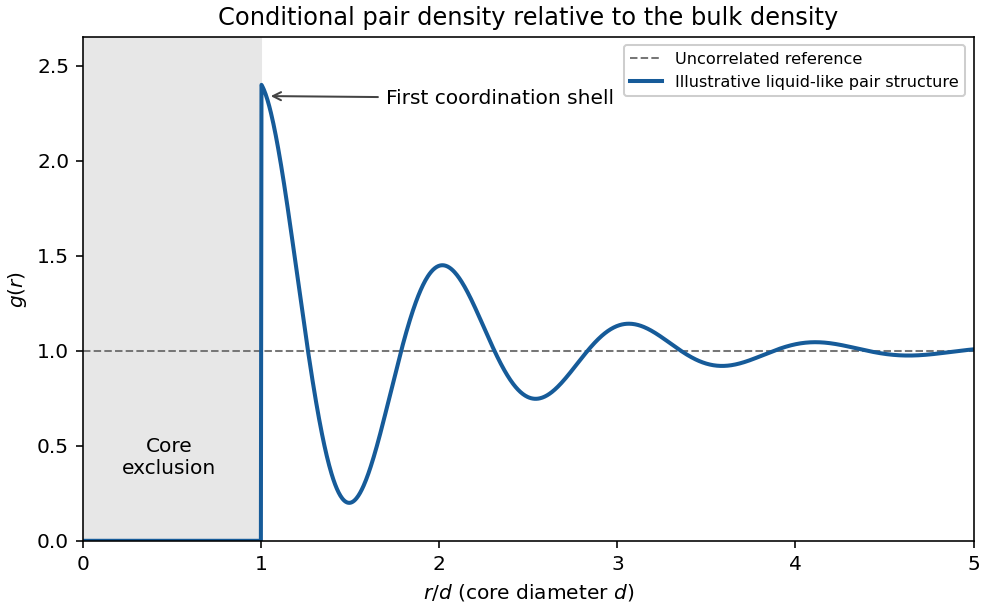

<h1 id="2/a/solution">Solution</h1>

↑ **Parent:** [A](../a.md)

**Structure through pair correlations.** For a homogeneous isotropic monatomic liquid of [number density](../../../../number-density.md) $n=N/V$, the [radial distribution function](../../../../radial-distribution-function.md) $g(r)$ is defined by

$$
\boxed{dN_{\rm neighbours}=4\pi n r^2g(r)\,dr.}
$$

It compares the conditional density around a tagged particle with the bulk density. A repulsive core makes close neighbours unlikely; a first peak identifies a preferred coordination shell, and damped peaks at larger radii describe short-range order. Far away, $g(r)\to1$ in the bulk limit. Unlike a crystal, an ordinary liquid has no indefinitely repeated positional order. An ideal uncorrelated gas has $g(r)=1$ away from the tagged particle. The shell factor $4\pi r^2$ must not be confused with $g(r)$ itself.

**[Figure 1](#2/a/image-original-schematic-radial-distribution-function-showing-a-core-exclusion-region-and-damped-liquid-like-coordination-shells-the-curve-is-illustrative-rather-than-measured-data). Original schematic radial distribution function showing a core exclusion region and damped liquid-like coordination shells; the curve is illustrative rather than measured data**.

The same pair structure enters the [static structure factor](../../../../static-structure-factor.md) measured through scattering. In the bulk isotropic convention,

$$
S(k)=1+4\pi n\int_0^\infty[g(r)-1]r^2\frac{\sin kr}{kr}\,dr.
$$

Thus real-space coordination and reciprocal-space scattering peaks describe the same correlations.

**Energy from the structure.** If interactions are sums of a central [pair potential](../../../../pair-potential.md) $v(r)$, the [equipartition theorem](../../../../equipartition-theorem.md) gives the classical [kinetic energy](../../../../kinetic-energy.md) $3Nk_BT/2$. Count the interaction of a tagged particle with its neighbours and divide by two to avoid counting each pair twice. The [pair-correlation expression for internal energy](../../../../pair-correlation-expression-for-internal-energy.md) is

$$
\boxed{U=\frac32Nk_BT+2\pi Nn\int_0^\infty r^2v(r)g(r)\,dr.}
$$

This makes structure thermodynamically useful: short-distance repulsion and the attractive region contribute with different weights. Additional internal molecular modes or many-body interactions require extra terms. The formula is a classical bulk pair-potential result, not a universal [energy](../../../../energy-split.md) formula for every liquid.

**Pressure and the dilute expansion.** The mechanical [virial theorem](../../../../virial-theorem.md) relates the pair forces to [pressure](../../../../pressure-split.md). The [virial pressure from pair correlations](../../../../virial-pressure-from-pair-correlations.md) is

$$
p=nk_BT-\frac{2\pi n^2}{3}\int_0^\infty r^3v'(r)g(r)\,dr.
$$

At low density, $g(r)\simeq e^{-\beta v(r)}$, giving the [virial expansion](../../../../virial-expansion.md)

$$
\boxed{\frac p{nk_BT}=1+B_2(T)n+B_3(T)n^2+\cdots,\qquad
B_2(T)=-2\pi\int_0^\infty[e^{-\beta v(r)}-1]r^2\,dr.}
$$

The [second virial coefficient](../../../../second-virial-coefficient.md) has units of [volume](../../../../volume.md) per particle; higher coefficients encode additional cluster correlations. A hard-sphere exclusion diameter $d$ gives $B_2=2\pi d^3/3>0$. Attractions contribute negative terms and can make $B_2$ negative. Although the pair-correlation formulas can describe a dense liquid when its actual $g(r)$ is known, truncating the virial series after a few terms is normally a dilute-fluid approximation. It should not be silently extrapolated through condensation or into a dense liquid.

## ↑ Ancestors (13)

1. [A](../a.md)
2. [2](../../2.md)
3. [2017](../../../2017-split.md)
4. [Past exam of the thermal and statistical physics course of the University of Cambridge](../../../split.md)
5. [Thermal and Statistical Physics course of the University of Cambridge](../../../../thermal-and-statistical-physics-course-of-the-university-of-cambridge.md)
6. [Physics course of the year 3 of the natural sciences course of the University of Cambridge](../../../../physics-course-of-the-year-3-of-the-natural-sciences-course-of-the-university-of-cambridge.md)
7. [Year 3 of the natural sciences course of the University of Cambridge](../../../../year-3-of-the-natural-sciences-course-of-the-university-of-cambridge.md)
8. [Year of the natural sciences course of the University of Cambridge](../../../../year-of-the-natural-sciences-course-of-the-university-of-cambridge.md)
9. [Natural sciences course of the University of Cambridge](../../../../natural-sciences-course-of-the-university-of-cambridge.md)
10. [Course of the University of Cambridge](../../../../course-of-the-university-of-cambridge.md)
11. [University of Cambridge](../../../../university-of-cambridge-split.md)
12. [List of universities](../../../../list-of-universities.md)
13. [Codex Wiki](../../../../split.md)
