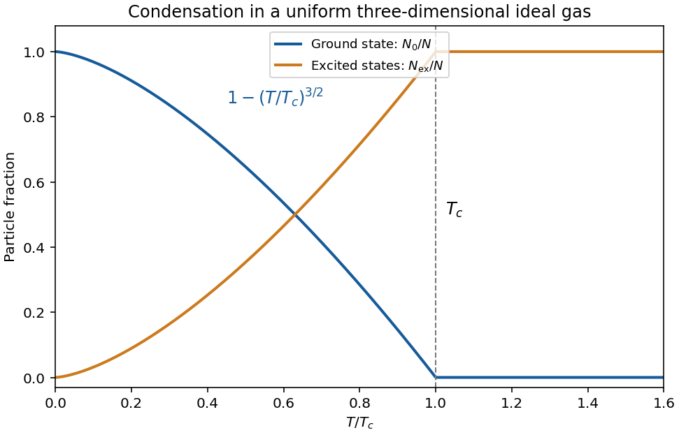

<h1 id="2/b/solution">Solution</h1>

↑ **Parent:** [B](../b.md)

**Excited-state saturation.** Consider first a uniform three-dimensional noninteracting gas of identical spinless [bosons](../../../../boson.md) in a large box. Set the one-particle ground [energy](../../../../energy-split.md) to zero. The [Bose-Einstein distribution](../../../../bose-einstein-distribution.md) is $\bar n(\epsilon)=[z^{-1}e^{\beta\epsilon}-1]^{-1}$, with [quantum gas fugacity](../../../../fugacity-statistical-mechanics.md) $z=e^{\beta\mu}\leq1$. For dispersion $\epsilon=p^2/(2m)$, the excited [density of states](../../../../density-of-states.md) is

$$
g(\epsilon)=\frac V{4\pi^2}\left(\frac{2m}{\hbar^2}\right)^{3/2}\sqrt\epsilon.
$$

Using the [thermal de Broglie wavelength](../../../../thermal-de-broglie-wavelength.md) $\lambda_T=\sqrt{2\pi\hbar^2/(mk_BT)}$, integration gives

$$
N_{\rm ex}=\frac V{\lambda_T^3}\operatorname{Li}_{3/2}(z),\qquad
N_0=\frac z{1-z}.
$$

The [polylogarithm](../../../../polylogarithm.md) is $\operatorname{Li}_s(z)=\sum_{\ell\geq1}z^\ell/\ell^s$. Its finite value at $z=1$ implies a maximum excited population $V\zeta(3/2)/\lambda_T^3$, with $\zeta(3/2)\simeq2.612$. Once this is less than $N$, the excess particles occupy the [ground state](../../../../ground-state.md) macroscopically. This is [Bose-Einstein condensation](../../../../bose-einstein-condensation.md), rather than occupation of a state by merely one or a few atoms.

**Transition and condensate fraction.** Setting the saturation number equal to $N$ gives the [homogeneous ideal Bose gas condensation](../../../../homogeneous-ideal-bose-gas-condensation.md) [temperature](../../../../temperature-split.md)

$$
\boxed{T_c=\frac{2\pi\hbar^2}{mk_B}
\left[\frac n{\zeta(3/2)}\right]^{2/3}.}
$$

Below this [temperature](../../../../temperature-split.md), $\mu$ approaches zero from below in the [thermodynamic limit](../../../../thermodynamic-limit.md), and particle conservation gives

$$
\boxed{\frac{N_0}{N}=1-\left(\frac T{T_c}\right)^{3/2}
\quad(0\leq T\leq T_c).}
$$

Above $T_c$ there is no macroscopic condensate and $\mu<0$ adjusts to keep $N$ fixed. At finite $N$, the [chemical potential](../../../../chemical-potential-split.md) remains slightly below the ground [energy](../../../../energy-split.md) and the transition is rounded.

**[Figure 2](#2/b/image-original-uniform-ideal-gas-condensate-fraction-and-schematic-accumulation-in-the-lowest-state-below-the-critical-temperature-the-exponent-is-for-a-three-dimensional-box). Original uniform ideal-gas condensate fraction and schematic accumulation in the lowest state below the critical temperature; the exponent is for a three-dimensional box**.

**Energy and the role of geometry.** The excited-state [internal energy](../../../../internal-energy-split.md) is

$$
U=\frac32\frac{Vk_BT}{\lambda_T^3}\operatorname{Li}_{5/2}(z).
$$

The zero-[energy](../../../../energy-split.md) condensate contributes no term to this [energy](../../../../energy-split.md) in the ideal model. Below $T_c$,

$$
U=\frac32Nk_BT\frac{\zeta(5/2)}{\zeta(3/2)}
\left(\frac T{T_c}\right)^{3/2},\qquad
C_V=\frac{15}{4}Nk_B\frac{\zeta(5/2)}{\zeta(3/2)}
\left(\frac T{T_c}\right)^{3/2}.
$$

Condensation depends on low-[energy](../../../../energy-split.md) state counting: for a uniform quadratic-dispersion gas, a finite-[temperature](../../../../temperature-split.md) bulk condensate requires spatial dimension greater than two. A trap changes the [density of states](../../../../density-of-states.md) and therefore the [temperature](../../../../temperature-split.md) law; a three-dimensional harmonic trap gives a cubic, rather than $3/2$, condensate-fraction exponent. Finally, an ideal-gas condensate should not automatically be called a [superfluid](../../../../superfluid.md): its free quadratic spectrum has zero critical speed by the [Landau criterion](../../../../landau-criterion.md). Interactions matter for the robust collective-flow properties of real dilute condensates.

## ↑ Ancestors (13)

1. [B](../b.md)
2. [2](../../2.md)
3. [2017](../../../2017-split.md)
4. [Past exam of the thermal and statistical physics course of the University of Cambridge](../../../split.md)
5. [Thermal and Statistical Physics course of the University of Cambridge](../../../../thermal-and-statistical-physics-course-of-the-university-of-cambridge.md)
6. [Physics course of the year 3 of the natural sciences course of the University of Cambridge](../../../../physics-course-of-the-year-3-of-the-natural-sciences-course-of-the-university-of-cambridge.md)
7. [Year 3 of the natural sciences course of the University of Cambridge](../../../../year-3-of-the-natural-sciences-course-of-the-university-of-cambridge.md)
8. [Year of the natural sciences course of the University of Cambridge](../../../../year-of-the-natural-sciences-course-of-the-university-of-cambridge.md)
9. [Natural sciences course of the University of Cambridge](../../../../natural-sciences-course-of-the-university-of-cambridge.md)
10. [Course of the University of Cambridge](../../../../course-of-the-university-of-cambridge.md)
11. [University of Cambridge](../../../../university-of-cambridge-split.md)
12. [List of universities](../../../../list-of-universities.md)
13. [Codex Wiki](../../../../split.md)
